# Cahier des charges F2i - Le Rameau

Projet : Le Rameau, application web de gestion de copropriété
Client : Conseil syndical de la résidence Le Rameau
Agence : DevSphere
Rédacteur : Matthieu Luiggi
Version : 0.1
Date de version : 01/07/2026
Période projet : du 19/01/2026 au 12/06/2026

Document préparé dans le cadre du titre RNCP Concepteur Développeur Web Full Stack.

DevSphere SAS - 18 rue de la Liberté, 21000 Dijon - SIRET 918 472 640 00024 - RCS Dijon B 918 472 640

---

## Sommaire

| Partie                                            | Contenu principal                                                                        | Page PDF |
| ------------------------------------------------- | ---------------------------------------------------------------------------------------- | -------: |
| Couverture                                        | Informations générales du dossier                                                        |        1 |
| Sommaire                                          | Plan du cahier des charges                                                               |        2 |
| A. Descriptifs                                    | Présentation du client, du projet, de l'agence, de l'équipe, de la gestion et des canaux |        3 |
| B. Plan de veille                                 | Organisation de la veille et sources suivies                                             |       11 |
| C. Benchmark                                      | Analyse concurrentielle et positionnement du projet                                      |       14 |
| D. Optimisations techniques et légales            | RGPD, sécurité, accessibilité, éco-conception et performance                             |       25 |
| E. Cahier des charges fonctionnel, méthode MERISE | Besoins, règles de gestion, modèles et dictionnaire de données                           |       38 |
| F. Cahier des clauses techniques détaillées       | Spécifications techniques en français et en anglais                                      |       57 |
| G. Identité visuelle                              | Logo, couleurs, typographies, wireframes et maquettes                                    |      141 |
| H. Gantt                                          | Planning prévisionnel et organisation des lots                                           |      158 |
| I. Devis                                          | Devis principal, options et conditions d'acceptation                                     |      168 |
| Annexes                                           | QQOQCCPP et calcul du TJM                                                                |      175 |

---

## A. Descriptifs

### A.1 Présentation du client

La résidence Le Rameau est une copropriété située au 5 rue André Malraux à Dijon, dans un secteur urbain où les habitants ont besoin d'un accès rapide aux informations de leur immeuble. Elle regroupe environ 80 à 100 lots, avec des profils assez variés : propriétaires occupants, bailleurs, résidents plus âgés, actifs qui consultent surtout les informations depuis leur téléphone.

Le projet est porté directement par le conseil syndical. L'idée de départ vient d'un constat assez simple. Les informations importantes circulent encore par plusieurs canaux différents. Certains documents sont envoyés par mail, d'autres sont affichés dans les parties communes, et certaines décisions se retrouvent perdues dans des échanges entre copropriétaires. À force, cela crée un manque de visibilité. Les résidents ne savent pas toujours où retrouver un compte rendu, une actualité sur des travaux, une information sur les badges Vigik ou une consultation en cours.

Le conseil syndical souhaite donc moderniser cette communication sans transformer la copropriété en grosse structure numérique compliquée. Le besoin est plutôt de créer un outil clair, sécurisé et réaliste pour une résidence locale. Le site Le Rameau doit permettre aux copropriétaires de retrouver les actualités, les documents de la copropriété, les informations du conseil syndical et les consultations internes depuis un seul espace. L'objectif est aussi de renforcer la participation des résidents, notamment sur les votes et sondages. Une information mieux centralisée aide les copropriétaires à suivre les décisions et à se sentir davantage concernés par la vie de l'immeuble.

#### Informations juridiques du client

Les informations ci-dessous sont utilisées comme données de cadrage pour le cahier des charges. Elles devront être remplacées par les informations officielles si le syndic professionnel fournit une fiche d'identification complète.

| Élément                | Information retenue                                      |
| ---------------------- | -------------------------------------------------------- |
| Dénomination           | Syndicat des copropriétaires de la résidence Le Rameau   |
| Siège                  | 5 rue André Malraux, 21000 Dijon                         |
| Représentation projet  | Conseil syndical de la résidence Le Rameau               |
| Statut juridique       | Syndicat de copropriétaires                              |
| Activité               | Administration et gestion courante d'une copropriété     |
| Capital social         | Non applicable                                           |
| RCS                    | Non applicable                                           |
| SIREN                  | 824 619 735                                              |
| SIRET                  | 824 619 735 00017                                        |
| Code APE / NAF         | 8110Z - Activités combinées de soutien lié aux bâtiments |
| TVA intracommunautaire | Non applicable                                           |

#### Interlocuteurs côté client

| Nom            | Rôle dans le projet                      |
| -------------- | ---------------------------------------- |
| Claire Martin  | Présidente du conseil syndical           |
| Julien Moreau  | Référent communication et documents      |
| Sophie Bernard | Référente travaux et vie de la résidence |

#### SWOT du client

| Forces                                                                                                                                                                   | Faiblesses                                                                                                                                                                            |
| ------------------------------------------------------------------------------------------------------------------------------------------------------------------------ | ------------------------------------------------------------------------------------------------------------------------------------------------------------------------------------- |
| Conseil syndical impliqué, besoin réel déjà identifié, résidence avec un volume d'environ 80 à 100 lots qui justifie un outil numérique, projet limité donc maîtrisable. | Communication actuelle dispersée, adoption numérique pas garantie chez tous les résidents, pas d'équipe technique côté client, dépendance à l'agence pour les évolutions importantes. |

| Opportunités                                                                                                                                                                                          | Menaces                                                                                                                                                                                                                 |
| ----------------------------------------------------------------------------------------------------------------------------------------------------------------------------------------------------- | ----------------------------------------------------------------------------------------------------------------------------------------------------------------------------------------------------------------------- |
| Dématérialisation progressive des échanges de copropriété, meilleure participation aux consultations internes, possibilité de réutiliser certains choix pour d'autres résidences de taille similaire. | Concurrence de plateformes déjà connues comme MyFoncia, Homeland ou Cotoit, réticence possible de certains copropriétaires, risque de données obsolètes si le conseil syndical ne met pas le site à jour régulièrement. |

### A.2 Présentation du projet

Le projet Le Rameau consiste à créer une plateforme web privée pour centraliser la vie numérique de la copropriété. Le conseil syndical ne cherchait pas une solution trop large ou trop chère, mais un outil adapté à une résidence d'environ 80 à 100 lots. Le problème de départ venait surtout de la dispersion des informations : mails, affichages, documents PDF stockés à plusieurs endroits, échanges informels entre copropriétaires. Le site doit donc servir de point d'entrée unique, avec une partie visible par les visiteurs et un espace réservé aux résidents authentifiés.

La première version du projet a déjà été développée. Elle couvre les besoins les plus importants remontés par le conseil syndical : publier des actualités, mettre à disposition les documents liés à l'assemblée générale et au conseil syndical, présenter les informations du syndic, gérer les informations de badges Vigik, organiser des consultations internes et permettre au conseil syndical d'administrer le contenu depuis un tableau de bord. Pour éviter les votes multiples, le principe retenu est un vote par appartement sur chaque consultation. Cette règle correspond mieux au fonctionnement d'une copropriété qu'un vote libre par compte utilisateur.

Le projet garde une logique réaliste. L'objectif n'est pas de concurrencer directement des plateformes nationales comme MyFoncia ou Homeland, mais de proposer une solution plus simple pour un client local. L'interface doit rester claire sur mobile, car une partie des résidents consultera surtout les actualités depuis son téléphone. Le site doit aussi rassurer les copropriétaires sur la confidentialité des données. Les pages publiques expliquent le service et les pages privées restent accessibles uniquement après connexion.

La méthode AIDA est utilisée dans le cadrage du site. La page d'accueil doit d'abord attirer l'attention avec une identité visuelle propre à la résidence, puis montrer rapidement l'intérêt de la plateforme : retrouver les informations sans chercher dans plusieurs mails. La partie privée doit ensuite créer l'envie d'utiliser l'outil régulièrement, avec des actualités visibles, des documents faciles à consulter et des consultations simples. L'action attendue reste concrète : se connecter, lire une information, voter ou retrouver un document.

#### Livrables attendus

| Livrable                         | Description                                                          | Statut                    |
| -------------------------------- | -------------------------------------------------------------------- | ------------------------- |
| Site web responsive              | Interface utilisable sur mobile, tablette et ordinateur              | Développé                 |
| Espace résident sécurisé         | Connexion, profil utilisateur, accès aux contenus privés             | Développé                 |
| Module actualités                | Publication, modification, suppression, images et fichiers PDF       | Développé                 |
| Module consultations             | Sondages internes avec limitation à un vote par appartement          | Développé                 |
| Espace documentaire              | Documents d'assemblée générale et du conseil syndical                | Développé                 |
| Pages légales                    | Mentions légales, politique de confidentialité, conditions générales | Développé                 |
| Tableau de bord conseil syndical | Gestion des contenus principaux par les membres autorisés            | Développé                 |
| Documentation projet             | Cahier des charges, schémas, explications techniques et procédures   | En cours de formalisation |

#### Contraintes principales

| Contrainte         | Réponse apportée                                                                                                                                                 |
| ------------------ | ---------------------------------------------------------------------------------------------------------------------------------------------------------------- |
| Budget limité      | Utilisation de Vercel et Supabase sur des offres adaptées au démarrage, avec un objectif de fonctionnement inférieur à 25 euros par mois pour la résidence seule |
| Délais             | Première version développée sur un cycle court d'environ 8 à 10 semaines, avec priorisation des fonctionnalités utiles au quotidien                              |
| Taille de la cible | Dimensionnement pour environ 80 à 100 lots, avec un pic estimé à 10 à 20 utilisateurs connectés en même temps lors d'une consultation                            |
| Sécurité           | Accès privé par authentification, rôles utilisateurs, Row Level Security Supabase et jetons de session stockés en cookies                                        |
| Accessibilité      | Interface responsive, contrastes travaillés, labels de formulaires et navigation pensée pour des résidents de générations différentes                            |
| Maintenance        | Choix d'une stack connue, Next.js, React, Supabase et PostgreSQL, afin de faciliter la reprise du projet et les corrections futures                              |

La réflexion QQOQCCPP sera placée en annexe du cahier. Elle servira à justifier le besoin de manière plus structurée : qui porte le projet, quoi développer, où l'outil sera utilisé, quand il doit être livré, comment il fonctionne, combien il coûte et pourquoi il est utile pour la résidence.

### A.3 Présentation de l'agence

DevSphere est une agence web fictive spécialisée dans la création d'applications sur mesure pour des structures qui ont besoin d'outils métier simples à prendre en main. L'agence existe depuis 2019 et travaille surtout sur des projets liés à l'immobilier, aux services de proximité et aux plateformes collaboratives. Pour Le Rameau, ce positionnement est cohérent, car le projet ne demande pas seulement une vitrine. Il faut concevoir un espace privé, gérer des droits d'accès, stocker des documents et permettre au conseil syndical de garder la main sur le contenu.

L'agence a été retenue pour sa capacité à cadrer un besoin assez concret sans partir sur une solution trop lourde. Pour une copropriété d'environ 80 à 100 lots, proposer une plateforme complexe avec abonnement élevé n'aurait pas beaucoup de sens. DevSphere a donc orienté le projet vers une application web progressive, accessible depuis un navigateur mobile ou desktop, avec une base technique connue et maintenable. Ce choix permet de limiter les coûts au démarrage et de garder une marge d'évolution si la résidence veut ajouter des fonctionnalités plus tard.

#### Informations juridiques de l'agence

Les informations ci-dessous sont des données fictives utilisées pour donner au cahier des charges un cadre d'agence complet.

| Élément                | Information retenue                |
| ---------------------- | ---------------------------------- |
| Dénomination sociale   | DevSphere SAS                      |
| Siège social           | 18 rue de la Liberté, 21000 Dijon  |
| Statut juridique       | SAS                                |
| Capital social         | 12 000 euros                       |
| RCS                    | Dijon B 918 472 640                |
| SIREN                  | 918 472 640                        |
| SIRET                  | 918 472 640 00024                  |
| Code APE / NAF         | 6201Z - Programmation informatique |
| TVA intracommunautaire | FR 42 918472640                    |
| Adresse mail           | contact@devsphere-agency.fr        |
| Téléphone              | 03 80 42 16 58                     |

#### Méthodologie de travail

DevSphere travaille avec une méthode agile adaptée aux petits projets clients. Pour Le Rameau, l'équipe n'a pas appliqué Scrum de manière trop rigide, car le client n'est pas une entreprise avec un product owner disponible tous les jours. Le fonctionnement retenu repose plutôt sur des cycles courts de 2 semaines, avec un point de validation à la fin de chaque sprint. Cette organisation permet au conseil syndical de vérifier régulièrement les avancées sans bloquer le développement.

Le projet est découpé en 5 grands lots : cadrage et benchmark, identité visuelle, développement de l'espace public, développement de l'espace privé, puis tests et mise en ligne. Chaque lot donne lieu à des livrables concrets. Par exemple, le sprint dédié aux consultations devait aboutir à un parcours complet : création d'une consultation par le conseil syndical, vote par un résident, blocage du doublon par appartement et affichage des résultats. C'est plus simple à valider pour le client qu'une liste technique abstraite.

Les échanges avec le conseil syndical sont prévus selon un rythme léger : un atelier de lancement de 1 h 30, un point de suivi toutes les 2 semaines et une recette finale d'environ 2 h. Les retours sont centralisés dans un tableau de suivi, avec trois statuts principaux : à faire, en cours, validé. Pour les demandes plus techniques ou les bugs, l'agence utilise des tickets GitHub afin de garder une trace précise du problème, de sa priorité et de sa correction.

La cartographie ci-dessous reprend le schéma déjà présent dans le livret candidat. Je la garde ici parce qu'elle explique mieux que du texte seul le passage entre la demande client, le cadrage, le développement, les tests et la mise en production.

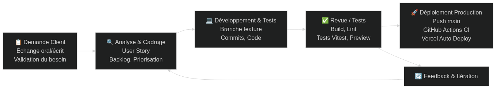

Figure A.1 : cartographie des processus issue du livret candidat. Elle sert de repère pour comprendre comment DevSphere transforme le besoin du conseil syndical en livrables vérifiés.

#### Equipe projet DevSphere

| Profil                 | Rôle sur le projet                                              | Charge estimée |
| ---------------------- | --------------------------------------------------------------- | -------------- |
| Chef de projet web     | Cadrage, suivi client, priorisation, validation des livrables   | 5 jours        |
| UX/UI designer         | Identité visuelle, zoning, wireframes, maquettes responsive     | 6 jours        |
| Développeur full stack | Développement Next.js, Supabase, intégration, sécurité et tests | 18 jours       |
| Testeur web            | Recette fonctionnelle, accessibilité, tests multi-device        | 3 jours        |

Cette organisation reste volontairement réduite. Elle correspond mieux au budget d'une copropriété locale qu'une équipe projet trop large, tout en couvrant les compétences nécessaires : cadrage, design, développement, tests et accompagnement à la mise en ligne.

### A.4 Comité de pilotage

Le comité de pilotage sert à éviter les validations floues. Pour Le Rameau, le projet reste de petite taille, mais il touche quand même à des données de copropriété et à des usages quotidiens pour les résidents. Il faut donc identifier clairement qui décide, qui donne les retours et qui valide les livrables. Le conseil syndical représente la maîtrise d'ouvrage, tandis que DevSphere assure la maîtrise d'oeuvre.

Les décisions importantes sont validées par la présidente du conseil syndical après échange avec les deux référents client. Les validations intermédiaires se font à la fin de chaque sprint de 2 semaines. En cas de blocage, le chef de projet DevSphere propose une solution ou une alternative chiffrée sous 48 h ouvrées.

#### Maîtrise d'ouvrage, côté client

| Nom     | Prénom | Poste                                    | Adresse postale                  | Mail                        | Téléphone      | Jours et horaires                        | Congés prévus      | Remplaçant     |
| ------- | ------ | ---------------------------------------- | -------------------------------- | --------------------------- | -------------- | ---------------------------------------- | ------------------ | -------------- |
| Martin  | Claire | Présidente du conseil syndical           | 5 rue André Malraux, 21000 Dijon | claire.martin@le-rameau.fr  | 06 14 28 73 41 | Lundi, mercredi et vendredi, 18 h à 20 h | 12 au 18 août 2026 | Julien Moreau  |
| Moreau  | Julien | Référent communication et documents      | 5 rue André Malraux, 21000 Dijon | julien.moreau@le-rameau.fr  | 06 22 49 81 36 | Mardi et jeudi, 18 h 30 à 20 h           | 5 au 11 août 2026  | Sophie Bernard |
| Bernard | Sophie | Référente travaux et vie de la résidence | 5 rue André Malraux, 21000 Dijon | sophie.bernard@le-rameau.fr | 06 37 60 24 19 | Lundi et jeudi, 19 h à 20 h 30           | 19 au 25 août 2026 | Claire Martin  |

#### Maîtrise d'oeuvre, côté agence

| Nom     | Prénom   | Poste                  | Adresse postale                   | Mail                                | Téléphone      | Jours et horaires                | Congés prévus                         | Remplaçant      |
| ------- | -------- | ---------------------- | --------------------------------- | ----------------------------------- | -------------- | -------------------------------- | ------------------------------------- | --------------- |
| Garnier | Antoine  | Chef de projet web     | 18 rue de la Liberté, 21000 Dijon | antoine.garnier@devsphere-agency.fr | 03 80 42 16 58 | Lundi au vendredi, 9 h à 17 h 30 | Aucun congé prévu sur la phase projet | Nina Caron      |
| Caron   | Nina     | UX/UI designer         | 18 rue de la Liberté, 21000 Dijon | nina.caron@devsphere-agency.fr      | 03 80 42 16 59 | Lundi au jeudi, 9 h 30 à 17 h    | 8 au 12 juillet 2026                  | Antoine Garnier |
| Luiggi  | Matthieu | Développeur full stack | 18 rue de la Liberté, 21000 Dijon | matthieu.luiggi@devsphere-agency.fr | 03 80 42 16 60 | Lundi au vendredi, 9 h à 18 h    | Aucun congé prévu sur la phase projet | Antoine Garnier |
| Petit   | Lucas    | Testeur web            | 18 rue de la Liberté, 21000 Dijon | lucas.petit@devsphere-agency.fr     | 03 80 42 16 61 | Mardi au vendredi, 10 h à 17 h   | 22 au 26 juillet 2026                 | Matthieu Luiggi |

#### Règles de validation

| Sujet validé                             | Responsable principal            | Délai de retour attendu                                |
| ---------------------------------------- | -------------------------------- | ------------------------------------------------------ |
| Besoin fonctionnel et priorités          | Claire Martin                    | 3 jours ouvrés                                         |
| Contenus et documents transmis           | Julien Moreau                    | 3 jours ouvrés                                         |
| Informations travaux et vie de résidence | Sophie Bernard                   | 3 jours ouvrés                                         |
| Maquettes et ergonomie                   | Antoine Garnier avec Nina Caron  | 2 jours ouvrés après retour client                     |
| Développement et corrections             | Matthieu Luiggi                  | Selon priorité du ticket, entre 24 h et 5 jours ouvrés |
| Recette finale                           | Claire Martin et Antoine Garnier | 5 jours ouvrés                                         |

Ce fonctionnement évite qu'une demande soit validée oralement puis modifiée trop tard. Toutes les décisions qui changent le périmètre, le budget ou le planning sont notées dans le tableau de suivi projet, avec une date et le nom de la personne ayant validé.

### A.5 Descriptif rédactionnel fonctionnel

Le site Le Rameau est pensé comme un espace numérique de copropriété, avec une séparation claire entre les visiteurs, les résidents connectés et les membres du conseil syndical. La partie publique sert surtout à présenter la plateforme, rassurer sur son utilité et permettre aux résidents d'accéder aux pages légales. Elle joue un rôle d'entrée dans le parcours : un copropriétaire qui arrive sur le site doit comprendre rapidement que l'outil sert à centraliser les informations de la résidence, puis être guidé vers la connexion ou l'inscription.

Lors de l'inscription, l'utilisateur renseigne ses informations de base, notamment son prénom, son nom, son adresse mail, son bâtiment et son numéro d'appartement. Ces données ne sont pas demandées pour faire joli. Elles servent à rattacher chaque compte à la résidence et à contrôler certaines actions, comme le vote dans les consultations. Le formulaire impose aussi un mot de passe suffisamment solide et un consentement RGPD. Une fois connecté, le résident accède à un tableau d'accueil qui regroupe les principaux raccourcis : actualités, syndic, badges Vigik, assemblées générales, conseil syndical et consultations. Ce tableau de bord évite de multiplier les menus compliqués et correspond mieux à une utilisation ponctuelle par des copropriétaires.

La partie actualités permet aux résidents de suivre les informations courantes de la copropriété. Le conseil syndical peut publier une annonce sur des travaux, un rappel de réunion, une information pratique ou une nouveauté concernant la résidence. Chaque actualité peut être accompagnée d'une image ou d'un fichier PDF, ce qui permet de remplacer une partie des affichages papier dans les parties communes. Côté résident, la consultation reste simple : il lit les annonces publiées, ouvre le détail si besoin et retrouve les documents associés sans devoir rechercher un ancien mail.

L'espace documentaire répond à un autre besoin important du client. Les documents liés aux assemblées générales et au conseil syndical sont regroupés dans des pages dédiées. L'objectif est de rendre les comptes rendus, procès-verbaux, ordres du jour ou documents utiles plus faciles à retrouver. Le règlement de copropriété et le livret d'accueil peuvent aussi être accessibles directement depuis l'espace résident. Pour une résidence d'environ 80 à 100 lots, ce regroupement limite les pertes d'information et évite que le conseil syndical doive renvoyer plusieurs fois les mêmes fichiers.

Le module de consultations permet au conseil syndical de recueillir l'avis des résidents sur des sujets internes. Une consultation peut porter sur un choix d'organisation, une préférence d'aménagement ou une question pratique liée à la vie de l'immeuble. Le fonctionnement retenu limite le vote à une seule réponse par appartement. Cette règle est importante, car elle évite qu'un même foyer pèse plusieurs fois dans un sondage simplement parce que plusieurs comptes ont été créés. Si un résident tente de voter alors que son appartement a déjà participé, le site bloque l'action et affiche un message explicite.

Le site intègre aussi des pages d'information plus pratiques. La page syndic regroupe les coordonnées utiles, afin que les résidents sachent rapidement qui contacter. La page badges Vigik explique le tarif et la procédure de remplacement ou de demande de badge. Ces pages ne sont pas forcément les plus complexes techniquement, mais elles répondent à des questions récurrentes. Dans le fonctionnement actuel de la copropriété, ce sont typiquement des informations qui peuvent se perdre entre un affichage, un message et une discussion informelle.

Le back-office est réservé aux membres autorisés du conseil syndical. Depuis le tableau de bord d'administration, ils peuvent gérer les actualités, les documents d'assemblée générale, les documents du conseil syndical, les informations du syndic, les données liées aux badges Vigik et les consultations. Ce choix évite de dépendre de l'agence pour chaque modification simple. Le conseil syndical peut mettre à jour un contenu courant en quelques minutes, sans demander une intervention technique facturée. Les accès restent limités par rôle, car tous les utilisateurs connectés ne doivent pas pouvoir modifier les informations de la résidence.

Certaines contraintes techniques ont été prises en compte dès le départ. Le site doit être responsive, car une partie des résidents le consultera depuis un téléphone. Les données personnelles doivent rester protégées, avec une authentification obligatoire pour les espaces privés et une gestion des droits côté application et base de données. La plateforme doit aussi rester légère pour maîtriser les coûts. L'objectif fixé est de conserver un coût d'exploitation inférieur à 25 euros par mois tant que le projet reste limité à la résidence Le Rameau. Les choix techniques comme Next.js, Supabase et Vercel sont donc liés à cette contrainte : livrer un outil utilisable, sécurisé et maintenable sans créer une charge financière disproportionnée pour une copropriété locale.

## B. Plan de veille

Le plan de veille sert à cadrer les recherches avant et pendant le développement du projet Le Rameau. Même si le document F2i demande normalement un format tableur, cette version est intégrée directement dans le livret Markdown pour garder un seul document de travail. Les colonnes restent les mêmes qu'un tableau de veille classique, afin de pouvoir l'exporter plus tard si besoin.

La veille a été organisée autour de 7 axes : technologique, juridique, sécurité, accessibilité, éco-conception, concurrence et performance. Ce découpage évite de limiter la recherche à la stack technique. Pour une copropriété, les sujets les plus sensibles sont aussi la protection des données personnelles, la clarté des documents mis en ligne et la capacité des résidents à utiliser le site sans difficulté. La veille ne sert donc pas juste à choisir Next.js ou Supabase. Elle aide aussi à vérifier que la solution reste cohérente avec le budget, les usages réels des copropriétaires et les obligations de confidentialité.

Le processus appliqué est simple. Les informations sont d'abord collectées depuis des sources fiables, puis triées selon leur lien direct avec Le Rameau. Les articles trop généralistes ou non datés ne sont pas conservés comme source principale. Ensuite, chaque information utile est résumée dans le tableau de suivi projet avec une décision possible : à appliquer maintenant, à surveiller, ou à garder pour une évolution future. Les points vraiment importants sont repris en réunion de sprint, toutes les 2 semaines, pour décider si le périmètre doit être modifié.

| Type de veille                    | Objectifs de la veille                                                           | Axes de recherche                                                                                       | Sources et outils utilisés                                                                       | Retranscription à l'équipe projet                                                                                               | Destinataires                                    | Date de l'action | Mise à jour                                     |
| --------------------------------- | -------------------------------------------------------------------------------- | ------------------------------------------------------------------------------------------------------- | ------------------------------------------------------------------------------------------------ | ------------------------------------------------------------------------------------------------------------------------------- | ------------------------------------------------ | ---------------- | ----------------------------------------------- |
| Technologique                     | Suivre les évolutions de la stack retenue et limiter le risque d'obsolescence    | Versions de Next.js, React, Supabase, compatibilité Node.js, changements sur l'App Router               | Documentation officielle Next.js, changelog Supabase, MDN Web Docs, State of JS, GitHub releases | Note courte dans le tableau de suivi technique, avec lien vers la source et impact sur le projet                                | Chef de projet, développeur full stack           | 03/07/2026       | Hebdomadaire pendant le développement           |
| Juridique et RGPD                 | Vérifier que la collecte des données reste limitée et conforme aux attentes CNIL | Consentement, droit à l'effacement, conservation des logs, confidentialité des documents de copropriété | CNIL, Légifrance, loi du 10 juillet 1965 sur la copropriété, pages RGPD de Supabase              | Synthèse dans le cahier, puis création ou modification des pages légales du site                                                | Chef de projet, conseil syndical, développeur    | 06/07/2026       | Mensuelle                                       |
| Sécurité applicative              | Identifier les risques principaux avant la mise en ligne                         | Authentification, cookies, XSS, CSRF, injections SQL, accès aux fichiers, rôles utilisateurs            | OWASP Top 10, Mozilla Observatory, documentation Supabase RLS, issues GitHub                     | Tickets GitHub pour chaque point sensible, priorisés en haute, moyenne ou basse priorité                                        | Développeur full stack, chef de projet           | 08/07/2026       | Mensuelle et avant chaque mise en production    |
| Accessibilité                     | Rendre le site utilisable par des résidents de profils différents                | Contrastes, navigation clavier, labels de formulaire, structure HTML, messages d'erreur                 | RGAA, WCAG, Lighthouse, axe DevTools, composants Radix UI                                        | Liste de corrections dans le backlog, puis vérification sur les pages clés                                                      | UX/UI designer, développeur, testeur             | 09/07/2026       | À chaque recette importante                     |
| Éco-conception                    | Limiter le poids du site et justifier les choix d'hébergement                    | Poids des pages, nombre de requêtes, stockage des images, usage du CDN, impact de l'hébergeur           | GreenIT.fr, EcoIndex, RGESN, CIGREF, documentation Vercel et Supabase                            | Résultats dans le cahier, avec objectifs chiffrés et score EcoIndex                                                             | Chef de projet, développeur, conseil syndical    | 10/07/2026       | Trimestrielle                                   |
| Concurrentielle                   | Comparer Le Rameau aux outils existants et repérer les bonnes pratiques          | MyFoncia, Cotoit, Homeland, Chouette Copro, fonctionnalités résidents, modèle économique                | Sites concurrents, Wappalyzer, Lighthouse, consultation mobile, avis utilisateurs publics        | Synthèse rédigée dans le benchmark, sans tableau comparatif dans la partie C                                                    | Chef de projet, UX/UI designer, conseil syndical | 13/07/2026       | Au démarrage puis avant les évolutions majeures |
| Performance                       | Garder une application rapide malgré les images et documents                     | Temps de chargement, Core Web Vitals, poids des assets, comportement mobile                             | Lighthouse, Vercel Analytics, Chrome DevTools, Speedlify                                         | Capture des scores et suivi des régressions dans le backlog                                                                     | Développeur, testeur, chef de projet             | 14/07/2026       | À chaque livraison                              |
| IA et assistance au développement | Utiliser les outils IA sans exposer de données personnelles                      | Aide au code, rédaction documentaire, revue de sécurité, limites éthiques, données partagées            | GitHub Copilot, ChatGPT, Claude ou Gemini, documentation officielle des outils                   | Mention dans le cahier et règles internes : pas de données réelles de résidents, pas de clés API, pas de fichier `.env` partagé | Développeur, chef de projet                      | 15/07/2026       | À chaque changement d'outil                     |

La veille CIGREF est intégrée dans l'axe éco-conception et obsolescence. Pour Le Rameau, elle a surtout servi à éviter une technologie trop marginale ou difficile à maintenir. Le choix de Next.js, React, Supabase et PostgreSQL reste cohérent avec cette logique, car ces outils ont une communauté active, une documentation abondante et des possibilités d'export des données. C'est aussi pour cette raison que les fichiers ne sont pas stockés en base64 directement en base de données, mais dans Supabase Storage avec cache et CDN. Le site reste plus léger et la maintenance est plus propre.

Les outils IA ont été utilisés comme assistance, pas comme décisionnaire. Ils peuvent aider à reformuler une documentation, expliquer une erreur TypeScript ou proposer une structure de test, mais les choix finaux restent validés par le développeur et le chef de projet. Les données personnelles des copropriétaires ne sont pas copiées dans ces outils. Les variables d'environnement, clés Supabase et informations de connexion restent exclues des prompts. Cette règle est importante pour respecter la confidentialité du projet, surtout avec une plateforme qui contient des noms, appartements, mails et documents internes.

Les décisions issues de la veille ont déjà eu des effets concrets sur le projet. Le RGPD a conduit à ajouter un consentement obligatoire à l'inscription et une page de confidentialité. La veille accessibilité a poussé à utiliser des labels de formulaires et une structure de navigation plus lisible. La veille performance et éco-conception a justifié la compression des images, le stockage des fichiers dans Supabase Storage et l'objectif d'un coût d'exploitation inférieur à 25 euros par mois pour la résidence seule. La veille n'est donc pas séparée du projet : elle sert directement à décider quoi développer, quoi éviter et quoi surveiller après la mise en ligne.

## C. Benchmark

### C.1 Étude de marché et chiffres clés

Le projet Le Rameau s'inscrit dans un marché assez précis : la gestion numérique d'une copropriété locale. Il ne s'agit pas de créer un nouveau syndic en ligne ni une plateforme nationale, mais de répondre à un besoin d'organisation interne pour une résidence dijonnaise d'environ 80 à 100 lots. Le marché visé est donc plus étroit que celui de MyFoncia ou Homeland, mais il est bien réel. Les copropriétés ont de plus en plus de documents à centraliser, de décisions à expliquer et de résidents à informer rapidement.

Le contexte local confirme l'intérêt du projet. D'après le dossier Insee de Dijon paru le 25 juin 2026, la commune compte 159 941 habitants en 2022. La ville compte aussi 100 667 logements, dont 89 312 résidences principales. Surtout, 85,2 % des logements dijonnais sont des appartements. Ce chiffre est important pour Le Rameau, parce qu'il montre que Dijon est un territoire très concerné par l'habitat collectif. Une solution numérique de copropriété n'est donc pas un gadget isolé : elle répond à un mode d'habitat très présent dans la ville.

L'évolution du parc de logements va dans le même sens. Entre 2016 et 2022, Dijon passe de 92 551 à 100 667 logements, soit environ 8 100 logements supplémentaires en 6 ans. Cette progression d'environ 8,8 % montre que la ville continue de se densifier. Dans une ville où les appartements représentent plus de 8 logements sur 10, la gestion collective des immeubles devient un sujet concret : les habitants doivent pouvoir retrouver les documents, les contacts utiles et les décisions sans dépendre uniquement d'un affichage dans le hall ou d'une chaîne de mails.

La structure de population invite aussi à ne pas penser le site uniquement pour des utilisateurs très à l'aise avec le numérique. Toujours selon l'Insee, les 15-29 ans représentent 30,8 % de la population dijonnaise, mais les 60 ans et plus représentent aussi 22,9 %. Le Rameau doit donc viser une interface assez simple pour des profils différents. Un étudiant ou un actif consultera facilement une actualité sur mobile, tandis qu'un résident plus âgé aura besoin d'une navigation lisible, de boutons explicites et de documents faciles à ouvrir. Cette diversité justifie les choix d'accessibilité et de sobriété dans l'interface.

Au niveau national, le registre national d'immatriculation des copropriétés montre aussi que la copropriété est un objet suivi par les pouvoirs publics. Le jeu de données publié sur data.gouv.fr explique que ce registre sert à recenser les copropriétés à usage d'habitat et à publier des informations comme le nom, l'adresse, la date de création du syndicat, le nombre et la nature des lots. Depuis avril 2026, les données du registre sont mises à jour automatiquement chaque jour. Pour le projet Le Rameau, cela confirme que la copropriété n'est pas seulement une organisation privée entre voisins. C'est un cadre réglementé, avec des informations qui doivent être tenues à jour.

Le cadre légal pousse également vers la dématérialisation. L'article 18 de la loi du 10 juillet 1965 impose au syndic professionnel de proposer un accès en ligne sécurisé aux documents dématérialisés relatifs à la gestion de l'immeuble, sauf décision contraire de l'assemblée générale. Même si Le Rameau est piloté ici directement par le conseil syndical avec l'agence DevSphere, cette obligation crée une attente chez les copropriétaires : pouvoir accéder aux documents de gestion depuis un espace sécurisé devient progressivement une norme. Le site développé va dans ce sens, avec un accès privé, des documents regroupés et des droits différenciés.

Pour une résidence de 80 à 100 lots, l'enjeu économique reste toutefois limité. Le client n'a pas besoin d'un outil à plusieurs centaines d'euros par mois. Il a besoin d'une plateforme assez fiable pour centraliser les informations, mais pas d'un logiciel métier complet de syndic professionnel. C'est pour cela que l'objectif d'exploitation inférieur à 25 euros par mois reste cohérent. Il permet au conseil syndical de moderniser la communication sans créer une nouvelle charge trop visible pour les copropriétaires.

#### Chiffres clés retenus

| Indicateur                        | Valeur                            | Lecture pour Le Rameau                                                                                   |
| --------------------------------- | --------------------------------- | -------------------------------------------------------------------------------------------------------- |
| Population de Dijon               | 159 941 habitants en 2022         | La résidence s'inscrit dans une ville dense, avec un vrai besoin d'organisation des informations locales |
| Logements à Dijon                 | 100 667 logements en 2022         | Le parc de logements est important et continue de progresser                                             |
| Résidences principales            | 89 312 en 2022                    | La majorité du parc correspond à un usage quotidien, donc à des besoins réguliers d'information          |
| Part des appartements             | 85,2 % des logements en 2022      | Le projet vise un type d'habitat très présent localement                                                 |
| Croissance du nombre de logements | Environ +8,8 % entre 2016 et 2022 | La densification renforce les besoins de gestion collective                                              |
| Taille du projet Le Rameau        | Environ 80 à 100 lots             | Le site doit rester proportionné : utile, privé, mais pas trop coûteux                                   |
| Coût d'exploitation cible         | Moins de 25 euros par mois        | Le modèle technique doit rester compatible avec le budget d'une copropriété locale                       |

#### PESTEL

| Facteur         | Analyse pour Le Rameau                                                                                                                                                                                                                                   | Impact sur le projet                                                                                                                                                                                                  |
| --------------- | -------------------------------------------------------------------------------------------------------------------------------------------------------------------------------------------------------------------------------------------------------- | --------------------------------------------------------------------------------------------------------------------------------------------------------------------------------------------------------------------- |
| Politique       | Les pouvoirs publics suivent de près les copropriétés, notamment avec le registre national d'immatriculation. Les données des copropriétés sont structurées, mises à jour et utilisées pour les politiques publiques liées au logement.                  | Le projet doit rester sérieux dans sa manière de présenter les informations de copropriété. Les contenus doivent être vérifiables et régulièrement mis à jour par le conseil syndical.                                |
| Economique      | Le client est une copropriété locale, pas une entreprise avec un budget logiciel important. Un outil trop cher serait difficile à défendre devant les copropriétaires.                                                                                   | Le choix d'une stack avec coûts limités est prioritaire. L'objectif est de rester sous 25 euros par mois en phase normale d'exploitation pour la résidence seule.                                                     |
| Socioculturel   | Dijon a une population mélangée, avec une part importante de jeunes adultes mais aussi plus d'un habitant sur 5 âgé de 60 ans ou plus. Les usages numériques ne sont donc pas les mêmes selon les résidents.                                             | L'interface doit être lisible, responsive et simple. Les actions importantes, comme lire une actualité ou voter, doivent rester compréhensibles sans formation.                                                       |
| Technologique   | Les solutions web modernes permettent de créer des espaces privés avec authentification, stockage de fichiers et gestion de rôles sans développer toute une infrastructure serveur.                                                                      | Next.js, Supabase et Vercel sont adaptés au périmètre. Ils permettent une mise en ligne rapide, une maintenance raisonnable et une évolution possible si la résidence ajoute de nouveaux besoins.                     |
| Environnemental | La multiplication des documents PDF, images et échanges numériques peut alourdir inutilement le site si rien n'est optimisé. Le projet doit éviter de déplacer le problème papier vers une plateforme trop lourde.                                       | Les fichiers sont stockés dans Supabase Storage, les images sont compressées et les pages doivent rester légères. L'objectif EcoIndex A déjà obtenu dans le projet sert de repère.                                    |
| Légal           | La loi du 10 juillet 1965 prévoit un accès en ligne sécurisé aux documents dématérialisés pour les copropriétés gérées par un syndic professionnel, sauf décision contraire de l'assemblée générale. Le RGPD s'applique aussi aux données des résidents. | Le site doit proposer un espace privé, une authentification, des droits d'accès et des pages légales. Les données collectées doivent rester limitées au besoin réel : identité, email, bâtiment, appartement et rôle. |

#### Sources utilisées pour cette partie

| Source                                                                                       | Donnée utilisée                                                                | Lien                                                                                      |
| -------------------------------------------------------------------------------------------- | ------------------------------------------------------------------------------ | ----------------------------------------------------------------------------------------- |
| Insee, dossier complet Commune de Dijon 21231, paru le 25/06/2026                            | Population, nombre de logements, résidences principales, part des appartements | https://www.insee.fr/fr/statistiques/2011101?geo=COM-21231                                |
| data.gouv.fr, Registre national d'Immatriculation des Copropriétés, mis à jour le 17/06/2026 | Rôle du registre et publication des données de copropriété                     | https://www.data.gouv.fr/fr/datasets/registre-national-dimmatriculation-des-coproprietes/ |
| Légifrance, loi n°65-557 du 10 juillet 1965, article 18                                      | Accès en ligne sécurisé aux documents dématérialisés de copropriété            | https://www.legifrance.gouv.fr/loda/id/JORFTEXT000000880200/                              |

### C.2 Analyses concurrentielles

Les analyses suivantes ont été faites à partir des pages publiques consultées le 01/07/2026, du code source visible dans le navigateur et des pages techniques accessibles sans compte client. Le but n'est pas de copier ces acteurs, parce que Le Rameau n'a pas la même taille ni le même budget. L'objectif est plutôt d'identifier ce qui fonctionne bien sur le marché, ce qui serait trop lourd pour une résidence de 80 à 100 lots et ce qui peut être repris de manière plus simple dans le projet.

#### MyFoncia

MyFoncia est le concurrent le plus institutionnel de cette sélection, parce qu'il est lié à Foncia, un grand acteur de l'administration de biens. Pour Le Rameau, il représente surtout le modèle de l'espace client privé. Ce n'est pas une solution pensée uniquement pour une résidence locale, mais plutôt un portail rattaché à une organisation beaucoup plus large. C'est intéressant à analyser, car les copropriétaires connaissent souvent ce type d'espace client chez les grands syndics et s'attendent donc à retrouver au moins les fonctions de base : documents, suivi des demandes, informations personnelles et accès sécurisé.

Sur l'audit technique, la page de connexion redirige vers `my-foncia.fonciamillenium.net` et charge une application React construite avec Vite. Le code public montre un point d'entrée `root`, des fichiers JavaScript en module, des polices Google Montserrat et Roboto, ainsi que les icônes Material Icons. Le portail semble donc fonctionner comme une single page application, avec une interface rendue côté navigateur. C'est cohérent pour un espace privé, mais ça veut aussi dire que l'utilisateur dépend fortement du chargement JavaScript. Pour Le Rameau, on peut garder l'idée d'une application privée moderne, mais avec une interface moins lourde et surtout un message clair si la page ne charge pas. Sur un public de 80 à 100 lots, perdre 5 utilisateurs parce qu'ils arrivent sur une page blanche serait déjà visible.

Sur le référencement, MyFoncia n'a pas le même objectif qu'un site vitrine. La page consultée ne cherche pas à se positionner sur Google : `robots.txt` et `sitemap.xml` renvoient vers l'application, sans vrai contenu SEO. Il n'y a pas de title marketing visible dans le HTML de la page de connexion. Ce choix est logique pour un portail privé, mais il ne convient pas à tout le projet Le Rameau. Pour Le Rameau, la partie connectée pourra rester discrète, alors que la page d'accueil publique doit quand même avoir un title clair, une meta description propre et un sitemap. La méthode AIDA est presque absente côté MyFoncia sur la page de connexion. On est surtout dans l'action directe : se connecter. Pour notre projet, il faut ajouter un peu plus d'intérêt et de réassurance avant l'inscription.

Sur l'audit de design, MyFoncia semble privilégier une interface fonctionnelle. Les polices Montserrat et Roboto donnent un rendu assez standard, proche des outils de gestion. L'usage de Material Icons va dans le sens d'une application utilitaire. Le point positif est la lisibilité attendue d'un portail de grande entreprise. Le point négatif, pour Le Rameau, est le manque de proximité. Une résidence locale a besoin d'un ton plus humain, avec le nom de la copropriété bien visible, des intitulés simples et des écrans qui ne ressemblent pas à un extranet national impersonnel.

Sur l'accessibilité, la page observée contient un problème visible dans le code : la balise `html` est en `lang="en"` alors que le portail s'adresse à des utilisateurs français. Ce détail peut gêner les lecteurs d'écran et il ne coûte presque rien à corriger. Le rendu principal dépend aussi d'un `div id="root"`, donc si JavaScript ne fonctionne pas, le contenu utile n'est pas accessible. Pour Le Rameau, il faudra donc prévoir `lang="fr"`, des labels explicites sur les formulaires, des messages d'erreur compréhensibles et une navigation clavier testée sur les écrans de connexion et de vote. MyFoncia donne une bonne référence technique de portail privé, mais il montre aussi ce qu'il faut éviter : une page trop vide sans JavaScript et peu d'explication pour l'utilisateur.

Le bilan de MyFoncia est donc mitigé mais utile. Le point positif est la logique d'espace client sécurisé, qui valide le besoin d'un tableau de bord privé pour les copropriétaires. Le point négatif est le côté très institutionnel et peu pédagogique. Pour Le Rameau, la bonne décision est de garder le principe de portail privé, tout en réduisant le périmètre à environ 6 grandes rubriques et en gardant un ton beaucoup plus local.

#### Cotoit

Cotoit est un concurrent direct, car son site vend un service de syndic en ligne et une plateforme collaborative dédiée aux copropriétés. La page d'accueil annonce une solution adaptée aux copropriétés de 15 à 300 appartements, ce qui place Le Rameau dans sa cible. Cotoit est donc plus proche du projet que MyFoncia sur la taille des résidences, même si son service reste un syndic professionnel complet alors que Le Rameau veut surtout un outil interne piloté par le conseil syndical.

Sur l'audit technique, le site public Cotoit est construit avec WordPress. Le code source indique aussi l'utilisation de Yoast SEO, Google Tag Manager, une police Raleway chargée depuis Google Fonts et un outil Dexem pour le suivi téléphonique. L'espace client, lui, est séparé sur `coach.cotoit.fr`, ce qui montre une séparation nette entre site vitrine et plateforme privée. C'est une bonne pratique à retenir. Pour Le Rameau, on peut garder la même idée fonctionnelle avec une page publique légère et un espace connecté séparé par authentification, mais sans multiplier les outils marketing. Cotoit peut se permettre du tracking et un tunnel de devis. Le Rameau n'a pas besoin de ça, puisque le site ne vend pas à des prospects.

Sur le référencement, Cotoit est beaucoup plus travaillé. Le title est précis : « Syndic en ligne et à la carte : bienvenue chez Cotoit ». La meta description promet des services à la carte et des outils pour vivre la copropriété plus simplement. Le fichier `robots.txt` autorise l'indexation et pointe vers un sitemap Yoast. Le sitemap contient plusieurs entrées récentes en 2026, ce qui montre une stratégie de contenu active. Le maillage interne est dense, avec des pages de tarifs, des guides, des villes, des ressources et des questions fréquentes. La méthode AIDA apparaît clairement : l'attention vient de la promesse de syndic en ligne, l'intérêt vient des offres Colib et Cocoon, le désir est renforcé par les avis et les 4 500 copropriétaires annoncés, puis l'action passe par « obtenir votre devis » ou « demander une démo ».

Sur l'audit de design, Cotoit mise sur une identité accessible et assez chaleureuse. Le vocabulaire est volontairement moins froid que celui d'un syndic traditionnel. Les illustrations, les avis clients et les appels à l'action rendent le site rassurant. La typographie Raleway donne une image plus moderne qu'un site institutionnel classique. Pour Le Rameau, ce n'est pas le style exact à reprendre, car la copropriété ne cherche pas à vendre une offre. Par contre, il faut garder cette idée : les informations importantes doivent être écrites avec des mots simples. Par exemple, « documents de l'assemblée générale » sera plus clair que « espace documentaire réglementaire ».

Sur l'accessibilité, le site Cotoit a une base correcte avec une langue française déclarée, des titres visibles et beaucoup de texte explicatif. Il faut quand même rester prudent. La page contient beaucoup de blocs, de liens répétés et d'images décoratives, ce qui peut fatiguer un utilisateur qui cherche juste un document ou un prix. Pour Le Rameau, la préconisation est de ne pas dépasser 7 entrées principales dans la navigation et de garder des boutons d'action vraiment utiles. Le vote, la lecture d'un document et le contact du syndic doivent être accessibles en 2 ou 3 clics maximum depuis le tableau de bord.

Le bilan de Cotoit est très positif sur la pédagogie et le SEO. Son défaut, pour Le Rameau, est d'être pensé comme un outil commercial national. Le projet Le Rameau doit reprendre la clarté des offres, les textes simples et les preuves de confiance, mais sans transformer le site en page de vente. Le bon compromis est une interface privée courte, avec une page publique qui explique seulement le rôle du site et la procédure d'inscription.

#### Homeland

Homeland est aussi un concurrent direct, mais avec un positionnement plus premium. Sa promesse insiste sur la réactivité, la disponibilité et la transparence. Le site annonce 900 copropriétés gérées, une plage de 20 à 750 logements, 97 % de clients qui reconduisent et 23 % d'économie de charges courantes en moyenne. Ces chiffres donnent tout de suite une impression de sérieux. Pour Le Rameau, Homeland sert surtout de référence sur la manière de rassurer un conseil syndical.

Sur l'audit technique, la page publique Homeland est réalisée avec Webflow. Le code source indique un domaine Webflow, des feuilles CSS servies depuis `cdn.prod.website-files.com`, des polices Lora et Poppins, et un extranet séparé sur `extranet.homeland.immo`. Le site a un `robots.txt` accessible et un sitemap XML classique. Techniquement, c'est un choix logique pour un site marketing rapide à maintenir. En revanche, ce n'est pas forcément le meilleur modèle pour Le Rameau, car le projet a déjà besoin de fonctionnalités connectées, de rôles utilisateurs et de stockage de documents. Une application Next.js avec Supabase reste plus adaptée qu'un site Webflow complété par un extranet séparé.

Sur le référencement, Homeland travaille très bien sa promesse dans le title et la meta description. La meta annonce un syndic disponible 7j/7 et 24h/24, avec un forfait à 12,99 euros par lot et par mois. Le sitemap contient des pages utiles comme les tarifs, les questions fréquentes, le changement de syndic et l'extranet. Le maillage interne est clair. Les liens vers la presse et les avis Google jouent aussi un rôle de réassurance, même si ce ne sont pas tous des backlinks vérifiés depuis le code de la page. La méthode AIDA est très visible : le titre attire avec « propriétaires exigeants », les chiffres créent l'intérêt, les économies et l'assistance 24h/24 créent le désir, puis les boutons de devis poussent à l'action.

Sur l'audit de design, Homeland a une identité plus haut de gamme que Cotoit. Les polices Lora et Poppins donnent un côté éditorial et sérieux. Les grands chiffres sont utilisés comme preuves, ce qui fonctionne bien pour convaincre vite. La limite, pour Le Rameau, est que ce style peut paraître trop commercial ou trop parisien pour une résidence locale dijonnaise. Le Rameau doit plutôt garder une esthétique sobre, avec une navigation qui va droit au but. On peut tout de même reprendre l'idée des chiffres visibles, par exemple « 92 lots », « 3 membres du conseil syndical », « documents centralisés » ou « coût cible inférieur à 25 euros par mois ».

Sur l'accessibilité, Homeland a plusieurs bons points : les textes sont lisibles, les informations de contact sont présentes et la promesse est répétée de façon compréhensible. Le site reste quand même très orienté marketing, avec des images, des sections longues et des animations possibles liées à Webflow. Pour Le Rameau, ce serait trop chargé. Les quatre principes WAI doivent être appliqués de façon plus pratique : contenu perceptible avec de bons contrastes, interface utilisable au clavier, textes compréhensibles pour tous les résidents et code assez robuste pour fonctionner sur mobile. La disponibilité 24h/24 d'Homeland n'est pas réaliste pour Le Rameau, donc il vaut mieux annoncer des délais de réponse honnêtes, par exemple 72 heures ouvrées pour une demande non urgente.

Le bilan de Homeland est bon sur la confiance et la preuve par les chiffres. Le point négatif est le coût et le niveau de service, qui dépassent le cadre du projet. Une copropriété comme Le Rameau n'a pas besoin d'une hotline 24h/24 ni d'un syndic complet à plusieurs milliers d'euros par an. En revanche, elle a besoin du même sentiment de transparence. Le site devra donc afficher clairement les documents disponibles, les dates des votes et les interlocuteurs, sans promettre plus que ce que le conseil syndical peut tenir.

#### ChouetteCopro

ChouetteCopro est le concurrent indirect du benchmark. Le site précise que ChouetteCopro n'est pas un syndic ni un gestionnaire locatif, mais une solution qui connecte les occupants, le gestionnaire et les prestataires techniques pour déclarer les incidents dans les parties communes. Cette différence est intéressante pour Le Rameau, car le projet ne remplace pas le syndic non plus. Il améliore surtout la circulation de l'information entre les résidents et le conseil syndical.

Sur l'audit technique, ChouetteCopro utilise WordPress sur sa partie publique, avec Yoast SEO et CleanTalk pour la protection anti-spam. Le site propose une connexion et une inscription sur `app.chouettecopro.com`, ce qui montre là aussi une séparation entre site vitrine et application. Le menu cible deux profils : les gestionnaires et les occupants. C'est une bonne approche, parce que les besoins ne sont pas les mêmes selon le rôle. Pour Le Rameau, cette logique peut être reprise avec des rôles simples : résident, membre du conseil syndical et administrateur. Il ne faut pas créer trop de profils au départ, sinon l'administration deviendra lourde pour seulement 80 à 100 lots.

Sur le référencement, ChouetteCopro a un title clair : « ChouetteCopro Gestion Immobilière - Syndic & GL ». La meta description cible les syndics et administrateurs de biens avec un angle de gain de temps et de mandats plus rentables. Le `robots.txt` autorise l'indexation et le sitemap Yoast contient peu d'entrées, principalement les pages et les témoignages. Le maillage interne est moins riche que celui de Cotoit, mais il va directement vers les enjeux, le syndic de copropriété, la gestion locative, les occupants et les témoignages. La méthode AIDA est présente de manière plus simple : l'attention vient du gain de temps, l'intérêt vient des témoignages, le désir vient de la promesse d'un canal unique, puis l'action passe par l'inscription ou le contact.

Sur l'audit de design, ChouetteCopro est plus orienté outil métier que marque grand public. Le site met vite en avant les témoignages, les partenaires et les intégrations avec des acteurs comme Krier, Gercop, Crypto ou h2i. C'est rassurant pour un gestionnaire immobilier, mais moins parlant pour un résident classique. Pour Le Rameau, il faudra éviter de parler comme un logiciel B2B. Les habitants doivent comprendre en quelques secondes où cliquer pour consulter une actualité, retrouver un document ou participer à une consultation. Le logo et le nom ChouetteCopro sont mémorisables, mais le projet Le Rameau doit plutôt jouer sur l'identité de la résidence et une ambiance sobre.

Sur l'accessibilité, ChouetteCopro présente plusieurs éléments utiles : la langue française est déclarée, le formulaire de contact contient des champs visibles et une case de consentement RGPD. Le site affiche aussi un message demandant d'utiliser un navigateur récent, ce qui peut être utile mais doit rester discret. Il y a quand même des points à surveiller. La page contient beaucoup d'images de logos partenaires et de témoignages, donc les textes alternatifs doivent être corrects. Le titre principal contient aussi une formulation maladroite, « soyez plus visible et gagner du temps », qui donne une impression moins professionnelle. Pour Le Rameau, la correction des libellés sera importante, parce qu'un site de copropriété doit inspirer confiance.

Le bilan de ChouetteCopro est intéressant parce qu'il ne cherche pas à être syndic. C'est le concurrent qui se rapproche le plus de l'idée d'un outil complémentaire. Son point positif est la gestion des incidents et du lien entre occupants, gestionnaire et prestataires. Son point négatif est un discours plus orienté professionnels que résidents. Pour Le Rameau, la déclaration d'incident peut devenir une évolution future, mais pas une priorité de première version. La version actuelle doit d'abord réussir les actualités, les documents, les consultations et les accès par rôle.

Au final, le benchmark montre que Le Rameau doit rester volontairement plus petit que ses concurrents. MyFoncia confirme le besoin d'un espace privé. Cotoit montre l'importance de la pédagogie. Homeland montre la force des preuves chiffrées et de la transparence. ChouetteCopro montre qu'un outil complémentaire au syndic peut avoir de la valeur. La recommandation retenue pour le projet est donc de développer une plateforme locale, connectée et sobre, avec 6 rubriques principales maximum au lancement, un budget d'exploitation inférieur à 25 euros par mois et une interface pensée pour des résidents qui ne sont pas tous à l'aise avec les outils numériques.

Sources consultées pour cette partie : https://myfoncia.fr/, https://www.cotoit.fr/, https://www.cotoit.fr/robots.txt, https://www.cotoit.fr/sitemap_index.xml, https://www.homeland.immo/, https://www.homeland.immo/robots.txt, https://www.homeland.immo/sitemap.xml, https://www.chouettecopro.com/, https://www.chouettecopro.com/robots.txt et https://www.chouettecopro.com/sitemap_index.xml.

### C.3 Analyse de stratégie

Pour Le Rameau, l'analyse de stratégie ne se lit pas exactement comme celle d'un site commercial. Le site ne cherche pas à vendre un produit à des inconnus. Il doit surtout convaincre les résidents d'utiliser un nouvel outil, rassurer les copropriétaires sur la confidentialité des informations et simplifier le travail du conseil syndical. La logique AIDA reste quand même utile : attirer l'attention avec un site clairement identifié comme celui de la résidence, créer de l'intérêt avec des informations vraiment utiles, donner envie de revenir grâce à des documents faciles à retrouver, puis pousser à l'action avec l'inscription, la consultation d'une actualité ou la participation à un vote.

#### Cibles et coeur de cible

La cible principale du projet correspond aux habitants et copropriétaires de la résidence Le Rameau. La résidence étant estimée entre 80 et 100 lots, on peut partir sur environ 90 foyers concernés, avec 1 à 2 utilisateurs potentiels par logement. Le volume réaliste d'utilisateurs se situe donc autour de 110 à 140 comptes, en comptant les copropriétaires occupants, les locataires et quelques membres du syndic ou du conseil syndical. Cette cible est assez large en âge : des jeunes actifs peuvent utiliser le site presque uniquement sur mobile, tandis que des retraités préféreront un ordinateur ou une tablette.

Le coeur de cible est constitué des copropriétaires occupants âgés d'environ 35 à 75 ans, déjà impliqués dans la vie de la résidence ou au moins attentifs aux assemblées générales. Ce sont eux qui ont le plus d'intérêt à consulter les procès-verbaux, les documents liés aux travaux, les informations du syndic et les consultations internes. Ils ne vont pas utiliser le site pour le plaisir. Ils l'utiliseront si le gain est évident : retrouver un document en moins de 2 minutes, comprendre une décision ou voter sans chercher un vieux mail.

La cible secondaire regroupe les locataires, les propriétaires bailleurs et les nouveaux arrivants. Leur besoin est souvent plus ponctuel. Un locataire cherchera surtout une information pratique, par exemple le fonctionnement du Vigik, un contact ou une actualité sur un problème dans les parties communes. Un propriétaire bailleur, lui, pourra consulter les documents importants sans être physiquement présent à Dijon. Les nouveaux arrivants ont aussi besoin d'un point d'entrée simple pour comprendre les règles de la résidence. Pour cette cible, le site doit rester très lisible et ne pas supposer que l'utilisateur connaît déjà le fonctionnement du conseil syndical.

La cible décisionnaire est plus petite : les 3 membres du conseil syndical qui pilotent le projet avec DevSphere. Ce sont eux qui valident le contenu, priorisent les fonctionnalités et acceptent le budget. Leur motivation est différente de celle des résidents. Ils veulent réduire les demandes répétitives, centraliser les documents et éviter les pertes d'information. Pour eux, le site doit faire gagner du temps. Si le conseil syndical passe 3 heures par semaine à répondre aux mêmes questions par mail ou téléphone, même une réduction de 30 % représente déjà environ 4 heures gagnées par mois.

| Cible                     | Profil                                                      | Besoin principal                                  | Frein probable                               | Réponse prévue dans le site                                          |
| ------------------------- | ----------------------------------------------------------- | ------------------------------------------------- | -------------------------------------------- | -------------------------------------------------------------------- |
| Copropriétaires occupants | 35 à 75 ans, propriétaires de leur logement, suivent les AG | Accéder aux documents et comprendre les décisions | Peur d'un outil compliqué ou peu sécurisé    | Tableau de bord simple, espace privé, documents rangés par catégorie |
| Locataires                | 20 à 60 ans, usage surtout pratique                         | Obtenir les infos du quotidien                    | Peu d'intérêt pour les sujets de copropriété | Actualités courtes, page Vigik, contacts utiles                      |
| Propriétaires bailleurs   | 35 à 70 ans, pas toujours sur place                         | Suivre la résidence à distance                    | Manque de temps, informations dispersées     | Accès aux documents AG, actualités et consultations                  |
| Conseil syndical          | 3 membres pilotes, rôle de validation                       | Publier, organiser, consulter les avis            | Charge d'administration du site              | Back-office limité, rôles clairs, workflow de publication simple     |

La stratégie retenue est donc volontairement sobre. Le site ne doit pas multiplier les rubriques pour impressionner. Au lancement, 6 entrées principales suffisent : accueil, actualités, documents, consultations, syndic et Vigik. Cette limite est cohérente avec la taille du projet. Elle évite aussi de perdre les utilisateurs moins à l'aise avec le numérique.

#### Personas

| Persona 1             | Claire Martin, copropriétaire occupante                                                                         |
| --------------------- | --------------------------------------------------------------------------------------------------------------- |
| Age et situation      | 52 ans, cadre administrative, habite la résidence depuis 9 ans                                                  |
| Appareil principal    | Ordinateur portable le soir, smartphone pour lire rapidement une information                                    |
| Réseaux et usages web | Email, WhatsApp familial, peu de réseaux sociaux publics                                                        |
| Motivation            | Retrouver les PV d'AG, suivre les décisions et éviter de demander les mêmes documents au conseil syndical       |
| Frein                 | Elle n'aime pas créer un compte sur un site si elle ne voit pas tout de suite à quoi il sert                    |
| Budget perçu          | Elle accepte un coût faible dans les charges si le service reste sous 25 euros par mois pour toute la résidence |
| Fonction attendue     | Documents AG avec filtre par année et bouton de téléchargement visible                                          |

Claire représente le coeur de cible. Elle n'a pas besoin d'une interface spectaculaire. Elle veut surtout gagner du temps. Pour elle, la page d'accueil connectée doit afficher les derniers documents ajoutés, les actualités récentes et une entrée directe vers les consultations. Si elle doit chercher plus de 2 ou 3 minutes, elle retournera demander l'information par mail.

| Persona 2             | Karim Benali, locataire                                                                            |
| --------------------- | -------------------------------------------------------------------------------------------------- |
| Age et situation      | 29 ans, technicien informatique, locataire depuis 1 an                                             |
| Appareil principal    | Smartphone Android                                                                                 |
| Réseaux et usages web | Instagram, YouTube, applications bancaires et administratives                                      |
| Motivation            | Être prévenu vite quand il y a une coupure, un problème d'accès ou une information pratique        |
| Frein                 | Il ne se sent pas vraiment concerné par les sujets de copropriété                                  |
| Budget perçu          | Aucun budget direct, il veut juste que le site soit utile sans l'obliger à lire de longs documents |
| Fonction attendue     | Actualités courtes, informations Vigik et contacts utiles                                          |

Karim montre que tous les utilisateurs ne viendront pas pour les assemblées générales. Sa priorité est le quotidien. Pour lui, le site doit fonctionner très correctement sur mobile, avec des titres courts et une lecture rapide. Une actualité importante doit être comprise en moins de 30 secondes. C'est aussi pour ce profil que les contrastes, les gros boutons et la navigation mobile sont importants.

| Persona 3             | Jean-Pierre Lefèvre, propriétaire bailleur                                                  |
| --------------------- | ------------------------------------------------------------------------------------------- |
| Age et situation      | 67 ans, retraité, possède un appartement loué dans la résidence                             |
| Appareil principal    | Tablette et ordinateur fixe                                                                 |
| Réseaux et usages web | Email, sites bancaires, démarches administratives en ligne                                  |
| Motivation            | Suivre les documents et les votes sans se déplacer systématiquement                         |
| Frein                 | Méfiance sur les mots de passe et difficulté avec les interfaces trop modernes              |
| Budget perçu          | Il accepte une petite dépense si elle évite des courriers papier ou des pertes de documents |
| Fonction attendue     | Connexion simple, documents bien nommés, messages d'erreur compréhensibles                  |

Jean-Pierre oblige le projet à rester accessible. Il peut utiliser le site, mais il faut éviter les écrans trop chargés ou les icônes sans texte. Les labels de formulaires, la taille des textes et la clarté des messages d'erreur ne sont pas des détails. Pour ce profil, le site doit accepter un usage calme : télécharger un document, lire une information, se déconnecter. Pas besoin d'effets visuels.

| Persona 4             | Sophie Bernard, membre du conseil syndical                                                                                             |
| --------------------- | -------------------------------------------------------------------------------------------------------------------------------------- |
| Age et situation      | 44 ans, infirmière libérale, membre du conseil syndical                                                                                |
| Appareil principal    | Smartphone en journée, ordinateur le week-end                                                                                          |
| Réseaux et usages web | Email, agenda partagé, applications professionnelles                                                                                   |
| Motivation            | Publier rapidement une information et lancer une consultation sans devoir gérer 40 réponses par mail                                   |
| Frein                 | Elle n'a pas le temps de se former à un outil compliqué                                                                                |
| Budget perçu          | Elle défendra le projet si le coût reste inférieur à 25 euros par mois et si l'administration ne prend pas plus de 1 heure par semaine |
| Fonction attendue     | Back-office court, ajout d'actualité, dépôt de document et création de consultation                                                    |

Sophie représente l'utilisateur administrateur côté client. C'est un profil critique, parce qu'un site de copropriété peut être très bien développé mais mourir s'il n'est jamais alimenté. L'administration doit donc rester limitée à quelques actions. Une publication d'actualité doit pouvoir être faite en moins de 5 minutes, avec un titre, un contenu, une catégorie et éventuellement une pièce jointe. Pour les consultations, la règle d'un vote par appartement doit être visible dans l'interface, afin d'éviter les contestations.

#### Zone de chalandise

La zone de chalandise du projet est volontairement réduite, car Le Rameau n'est pas une entreprise qui cherche des clients dans toute la France. La zone actuelle correspond à la résidence située 5 rue André Malraux à Dijon. Le site est donc d'abord destiné aux personnes liées à cette adresse : résidents, copropriétaires, membres du conseil syndical et syndic. Cela représente environ 80 à 100 lots et environ 110 à 140 comptes utilisateurs potentiels.

La zone d'influence directe correspond au quartier autour de la résidence. Elle n'est pas ciblée pour vendre le site, mais elle peut concerner les prestataires locaux, les artisans intervenant dans l'immeuble ou les personnes qui visitent un logement avant location ou achat. Cette zone reste dans un rayon d'environ 1 à 2 kilomètres autour de la résidence. Dans le cahier final mis en page, elle pourra être représentée par une carte de Dijon avec un cercle centré sur la rue André Malraux.

Une zone d'extension peut être envisagée si le conseil syndical souhaite réutiliser le modèle sur une autre copropriété proche. Elle resterait locale, à l'échelle de Dijon Métropole, car le projet est fait pour une gestion de proximité et non pour devenir un outil national. Cette extension n'est pas prévue dans la première version. Elle pourra devenir une option si le projet fonctionne pendant au moins 6 mois et si le coût de maintenance reste stable.

#### Carte simplifiée de la zone

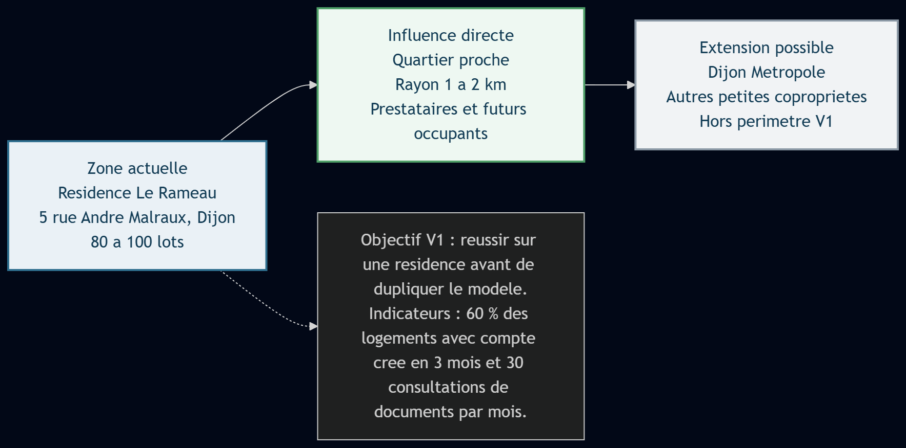

Figure C.1 : zone de chalandise simplifiée du projet Le Rameau. La V1 reste centrée sur la résidence, avec une extension seulement envisagée après validation de l'usage réel.

| Couleur prévue sur la carte finale | Zone                | Rôle                                                         |
| ---------------------------------- | ------------------- | ------------------------------------------------------------ |
| Bleu                               | Résidence Le Rameau | Zone actuelle et utilisateurs réellement concernés par la V1 |
| Vert                               | Quartier proche     | Prestataires, visiteurs, futurs occupants et contexte local  |
| Gris                               | Dijon Métropole     | Extension possible, non incluse dans la première livraison   |

La stratégie géographique retenue évite de surdimensionner le projet. Le site doit réussir sur une résidence avant d'imaginer une duplication. Pour la première version, la réussite sera mesurée avec des indicateurs simples : au moins 60 % des logements ayant un compte créé dans les 3 premiers mois, au moins 30 consultations de documents par mois et une publication d'actualité au minimum toutes les 2 semaines. Ces chiffres sont réalistes pour une copropriété de cette taille et permettent au conseil syndical de vérifier si le site est vraiment utilisé.

## D. Optimisations techniques et légales

### D.1 Optimisations SEO

Le SEO correspond au travail fait pour aider un site à être compris par les moteurs de recherche. Dans le cas du Rameau, l'objectif n'est pas de concurrencer Cotoit ou Homeland sur des requêtes nationales comme « syndic en ligne ». Ce serait irréaliste et inutile pour une résidence privée. Le vrai besoin est plus simple : quand un résident cherche « Le Rameau Dijon », « résidence Le Rameau » ou « copropriété Le Rameau », il doit tomber sur une page claire, rassurante et à jour.

Google reste la référence principale, parce que c'est le moteur utilisé par la majorité des internautes en France et parce que ses critères influencent aussi les bonnes pratiques générales du web. Les algorithmes de Google regardent plusieurs éléments : la pertinence du contenu, la structure HTML, la vitesse de chargement, l'adaptation mobile, la sécurité HTTPS et l'expérience utilisateur. Pour Le Rameau, ces critères ont été traduits en actions concrètes plutôt qu'en optimisation de masse.

Le premier objectif de communication est l'identification. Un visiteur doit comprendre en moins de 5 secondes qu'il est sur le site de la résidence Le Rameau à Dijon. Le deuxième objectif est la confiance, car le site va proposer un accès privé avec des documents internes. Le troisième objectif est l'action : créer un compte, se connecter ou consulter une information publique. La méthode AIDA est utilisée dans ce sens. L'attention vient du nom de la résidence et de l'adresse. L'intérêt vient des fonctions annoncées. Le désir vient du gain de temps pour retrouver les documents. L'action vient des boutons « S'inscrire » et « Se connecter ».

#### Mots-clés retenus

Les mots-clés ont été choisis en fonction du vrai usage attendu, pas pour chercher du trafic inutile. Pour une copropriété locale, attirer des visiteurs hors résidence n'a pas beaucoup d'intérêt. Les requêtes prioritaires sont donc liées au nom, à la ville et aux besoins pratiques des habitants.

| Niveau      | Mots-clés                                                                                | Intérêt pour le projet                                                              |
| ----------- | ---------------------------------------------------------------------------------------- | ----------------------------------------------------------------------------------- |
| Prioritaire | Le Rameau Dijon, Résidence Le Rameau, copropriété Le Rameau                              | Permettre aux résidents ou futurs occupants d'identifier rapidement le bon site     |
| Secondaire  | copropriété Dijon, résidence rue André Malraux Dijon, conseil syndical Dijon             | Donner un contexte local sans viser un trafic national                              |
| Fonctionnel | documents copropriété, assemblée générale copropriété, badge Vigik, actualités résidence | Faire comprendre les fonctions principales du site                                  |
| A éviter    | syndic en ligne, logiciel syndic, plateforme copropriété nationale                       | Requêtes trop larges, trop concurrentielles et peu utiles pour une résidence privée |

La recommandation retenue est de travailler seulement 8 à 12 mots-clés dans la V1. Au-delà, le contenu deviendrait artificiel et moins crédible. Le site doit rester lisible pour les résidents avant de chercher à plaire aux moteurs de recherche.

#### Optimisation de la page d'accueil

La page d'accueil publique est la page la plus importante pour le SEO. Dans le projet Next.js, le titre global déjà prévu est « Le Rameau - Votre copropriété en ligne » et la description est « Plateforme de gestion et communication pour les résidents de la copropriété Le Rameau ». Cette base est correcte, car elle contient le nom de la résidence, le sujet principal et le public concerné. Pour la version de livraison, je recommande de la préciser légèrement avec la localisation.

| Élément          | Version recommandée                                                                                                                        | Justification                                                                     |
| ---------------- | ------------------------------------------------------------------------------------------------------------------------------------------ | --------------------------------------------------------------------------------- |
| Title            | Le Rameau Dijon - Copropriété et espace résident                                                                                           | Environ 55 caractères, avec le nom, la ville et le thème principal                |
| Meta description | Site de la résidence Le Rameau à Dijon : actualités, documents de copropriété, consultations et informations pratiques pour les résidents. | Environ 155 caractères, lisible dans Google et orienté vers les fonctions réelles |
| H1               | Bienvenue à la Résidence Le Rameau                                                                                                         | Déjà cohérent avec le projet, clair pour l'utilisateur et pour le moteur          |
| URL              | `/`                                                                                                                                        | Simple et adaptée, pas besoin d'une URL longue pour la page principale            |
| Appel à l'action | S'inscrire / Se connecter                                                                                                                  | Action directe pour les résidents, sans discours commercial inutile               |

Le contenu visible de la page d'accueil doit rester court. L'objectif est d'avoir environ 300 à 500 mots utiles sur la page publique, pas plus. Ce volume suffit pour présenter la résidence, les fonctionnalités principales et le contact, tout en gardant une page rapide à lire. Le texte actuel présente déjà la résidence, l'adresse et le quartier. Il faudra simplement vérifier que les fonctionnalités principales restent visibles sans connexion : actualités, documents, conseil syndical, badges Vigik, assemblées générales et consultations.

#### Structure HTML et balises

La structure de la page doit rester simple. Une seule balise `h1` est prévue sur la page d'accueil, puis les sections utilisent des titres de niveau inférieur. C'est important parce qu'un empilement de plusieurs `h1` rend la page moins claire pour les moteurs et pour certains outils d'accessibilité. Le projet utilise déjà `html lang="fr"`, ce qui corrige un défaut vu chez MyFoncia pendant le benchmark.

Les images doivent aussi être nommées et décrites correctement. L'image de fond de la résidence peut être nommée `residence-le-rameau-dijon.jpg` au lieu d'un nom générique. Si elle est décorative, elle peut rester en fond CSS. Si elle devient une vraie image de contenu, il faut prévoir un texte alternatif du type « Résidence Le Rameau à Dijon ». Pour les images d'actualités, l'attribut `alt` doit reprendre le titre de l'actualité, comme c'est déjà prévu dans plusieurs pages du projet.

Les icônes ne doivent pas remplacer les textes. Sur la page d'accueil, les boutons principaux gardent un texte lisible. C'est un bon point, parce qu'un bouton seulement composé d'une icône serait moins compréhensible pour un résident plus âgé ou pour un lecteur d'écran.

#### Sitemap, robots.txt et indexation

Le site doit prévoir un sitemap simple pour la mise en ligne. Dans une V1, il n'a pas besoin de lister toutes les pages privées. Les pages à indexer sont uniquement les pages publiques : accueil, mentions légales, politique de confidentialité et conditions générales d'utilisation. Les pages de connexion et d'inscription peuvent être accessibles depuis l'accueil, mais elles ne sont pas prioritaires pour le référencement.

Les pages connectées doivent rester en dehors de l'indexation. Elles contiennent des informations internes à la résidence et n'ont aucune valeur SEO publique. La préconisation est donc d'ajouter une règle `noindex` ou une configuration `robots.txt` pour les routes privées comme `/dashboard`, `/actualites` connectées, `/ag`, `/conseil-syndical`, `/consultations`, `/profil` et toutes les pages d'administration. Cette mesure protège la cohérence du référencement et évite qu'un résultat Google affiche une page inaccessible aux visiteurs.

| Type de page             | Indexation recommandée | Raison                                                            |
| ------------------------ | ---------------------- | ----------------------------------------------------------------- |
| Accueil publique         | Oui                    | Présenter officiellement la résidence et donner un point d'entrée |
| Mentions légales         | Oui                    | Page publique utile et attendue                                   |
| Confidentialité          | Oui                    | Rassurer sur le traitement des données                            |
| CGU                      | Oui                    | Donner le cadre d'utilisation du service                          |
| Connexion et inscription | Non prioritaire        | Pages utiles, mais peu intéressantes dans les résultats Google    |
| Espace connecté          | Non                    | Contenu privé réservé aux résidents                               |
| Administration           | Non                    | Zone sensible et sans intérêt pour le référencement               |

#### Performance et SEO technique

Le SEO dépend aussi du temps de chargement. Le projet utilise Next.js 14, ce qui permet d'avoir une bonne base technique, mais la page d'accueil contient aussi une scène Spline. Cet élément donne une identité visuelle au site, mais il peut alourdir le chargement. La préconisation est de charger la scène seulement côté client, comme c'est déjà le cas, et de garder le texte principal visible même si la scène met plus de temps à apparaître. Le contenu important ne doit jamais dépendre uniquement d'un élément 3D.

Pour la version de livraison, les objectifs techniques retenus sont les suivants : un score Lighthouse SEO d'au moins 90/100 sur la page d'accueil, un temps de chargement initial inférieur à 3 secondes sur une connexion 4G correcte et une image de fond compressée sous 300 Ko. Ces seuils sont réalistes pour un site de copropriété. Ils sont plus utiles qu'une promesse vague de performance.

La capture Lighthouse déjà présente dans le livret candidat sert de point de comparaison. Elle ne remplace pas la recette finale, mais elle montre que le projet part sur une base saine, avec des scores élevés sur la performance, les bonnes pratiques et le SEO. Les scores devront être relancés avant livraison, car ils peuvent varier selon l'URL auditée, les données chargées et la date du test.

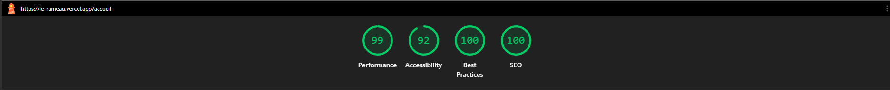

Figure D.1 : capture Lighthouse utilisée comme point de contrôle technique pour la page auditée. L'objectif F2i reste de justifier les choix et de prévoir une vérification finale, pas seulement d'afficher un score.

#### Maillage interne

Le maillage interne doit rester limité mais logique. Depuis la page d'accueil, les liens publics principaux mènent vers la présentation, les fonctionnalités, le contact, l'inscription et la connexion. Une fois connecté, l'utilisateur doit pouvoir rejoindre les rubriques importantes en 2 clics maximum : actualités, AG, conseil syndical, syndic, Vigik et consultations. Ce choix vient directement du benchmark. Cotoit et Homeland ont des menus très riches, mais Le Rameau doit garder une navigation plus courte.

La page d'accueil doit aussi créer un lien clair vers les pages légales en bas de page. Ces liens ne servent pas seulement au SEO. Ils renforcent la confiance, surtout parce que le site collecte des données personnelles comme le nom, le prénom, l'email, le bâtiment, l'appartement et le rôle.

#### Exemple d'application concrète sur la page d'accueil

Pour la page d'accueil, la structure recommandée est la suivante :

```html
<title>Le Rameau Dijon - Copropriété et espace résident</title>
<meta
  name="description"
  content="Site de la résidence Le Rameau à Dijon : actualités, documents de copropriété, consultations et informations pratiques pour les résidents."
/>
<h1>Bienvenue à la Résidence Le Rameau</h1>
<h2>Un espace privé pour suivre la vie de la copropriété</h2>
<h2>Documents, actualités et consultations au même endroit</h2>
```

Cette structure reste volontairement simple. Elle reprend les mots-clés essentiels sans les répéter de façon forcée. Elle donne aussi une promesse claire aux résidents : le site sert à centraliser la vie de la copropriété, pas à faire de la publicité pour un service externe.

#### Suivi SEO après mise en ligne

Le suivi SEO sera léger, car le projet n'a pas besoin d'une stratégie éditoriale lourde. Une vérification mensuelle suffit pendant les 3 premiers mois. Elle portera sur 5 points : présence de la page dans Google, absence d'indexation des pages privées, title et meta description corrects, score Lighthouse SEO supérieur ou égal à 90/100, liens légaux toujours accessibles depuis le footer. Cette routine prend environ 30 minutes par mois et peut être intégrée à la maintenance.

Le livret candidat contenait aussi un contrôle EcoIndex A à 89/100. Je le reprends dans le cahier des charges parce qu'il relie directement la partie SEO technique, l'éco-conception et le choix de ne pas charger trop d'assets inutiles.

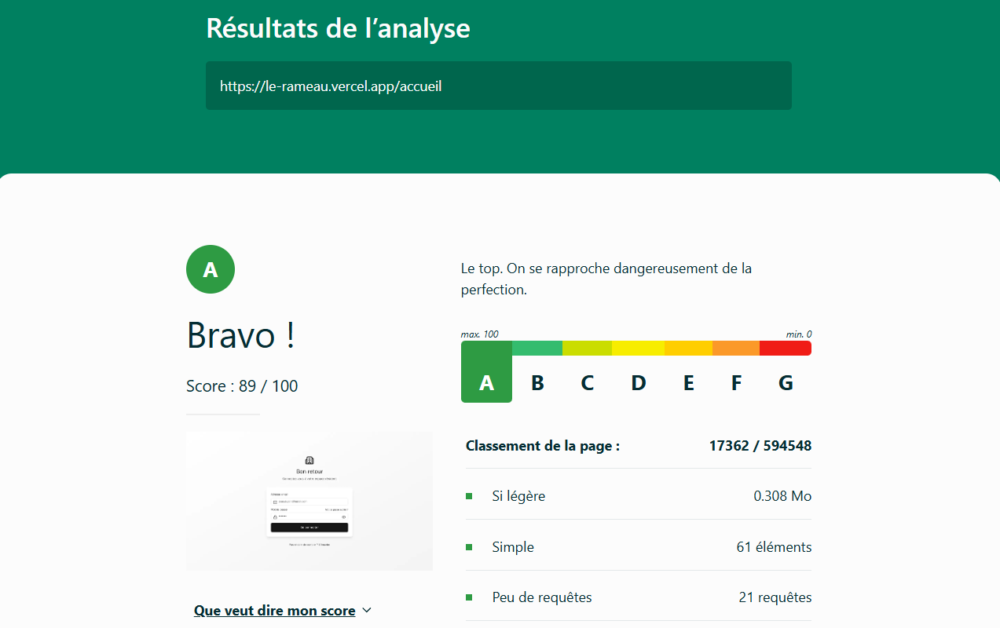

Figure D.2 : score EcoIndex du projet, avec une page à 0,308 Mo, 61 éléments DOM et 21 requêtes. Ce résultat sert de repère pour garder une page d'accueil légère pendant les évolutions.

La conclusion SEO est donc assez claire. Le Rameau doit être trouvable, mais pas surexposé. Le référencement sert surtout à identifier la résidence, rassurer les utilisateurs et proposer un accès propre au service. La priorité reste la confidentialité et l'usage réel par les résidents, même si cela limite volontairement le nombre de pages indexées.

### D.2 Optimisations accessibilité web

L'accessibilité web consiste à rendre un site utilisable par le plus grand nombre, y compris par les personnes en situation de handicap, les personnes âgées, les utilisateurs sur mobile ou les personnes qui utilisent un lecteur d'écran. Pour Le Rameau, le sujet est concret. La résidence rassemble des profils différents, avec des jeunes actifs, des copropriétaires plus âgés, des locataires et des propriétaires bailleurs. Si l'interface est trop petite, trop rapide ou mal expliquée, une partie des résidents n'utilisera pas le site.

La référence internationale actuelle est WCAG 2.2, publiée par le W3C comme recommandation le 12 décembre 2024. Elle repose sur 4 grands principes : un contenu perceptible, utilisable, compréhensible et robuste. En France, la référence opérationnelle est le RGAA 4.1.2. Le site officiel du RGAA indique que cette version contient 106 critères de contrôle et que le RGAA 5 est en cours de rédaction pour une publication prévue fin 2026. Pour le projet Le Rameau, la base retenue est donc le RGAA 4.1.2, avec une attention aux critères récents de WCAG 2.2 quand ils sont faciles à intégrer, notamment la taille des zones cliquables et l'authentification accessible.

Le Rameau n'est pas un service public, donc le projet n'a pas exactement les mêmes obligations qu'une plateforme administrative. Par contre, l'accessibilité reste une vraie exigence de qualité. Elle répond aussi au référentiel RNCP, car le jury attend une prise en compte des situations de handicap, pas seulement une interface jolie. L'objectif retenu est d'atteindre un niveau proche WCAG/RGAA AA sur les parcours principaux : consulter une actualité, créer un compte, se connecter, ouvrir un document et voter à une consultation.

#### Principes retenus pour Le Rameau

| Principe WCAG  | Application dans Le Rameau                                                      | Préconisation chiffrée                                                                               |
| -------------- | ------------------------------------------------------------------------------- | ---------------------------------------------------------------------------------------------------- |
| Perceptible    | Les textes, images, icônes et messages doivent être visibles et compréhensibles | Contraste minimum 4,5:1 pour le texte normal, 3:1 pour les gros titres et éléments graphiques utiles |
| Utilisable     | Le site doit fonctionner au clavier et sur mobile                               | Parcours inscription, connexion et vote testés au clavier en moins de 15 tabulations chacun          |
| Compréhensible | Les libellés, erreurs et confirmations doivent être simples                     | Messages d'erreur en français, affichés près du champ concerné et sans jargon technique              |
| Robuste        | Le code doit rester lisible par les navigateurs et technologies d'assistance    | HTML sémantique, labels de formulaires, attributs ARIA seulement quand ils sont utiles               |

Ces seuils sont adaptés au projet. Un objectif plus strict comme le niveau AAA serait trop lourd pour une première version et pas forcément justifié par le budget. En revanche, le niveau AA sur les parcours critiques est réaliste, surtout avec les composants déjà utilisés dans l'application.

#### Points positifs déjà présents dans le projet

Le projet a déjà plusieurs bases correctes. La balise `html` est en français avec `lang="fr"`, ce qui aide les lecteurs d'écran à utiliser la bonne langue. Les pages principales possèdent des titres `h1`, par exemple la page d'accueil, les actualités, les consultations ou l'espace profil. Les formulaires d'inscription et de connexion utilisent des composants de formulaire avec des labels visibles, ce qui est préférable à des champs qui reposent seulement sur un placeholder.

Les images d'actualités reprennent le titre de l'actualité dans l'attribut `alt`, ce qui est une bonne base. Les icônes décoratives de Lucide sont souvent accompagnées d'un texte, par exemple dans les boutons et les titres de section. C'est important, car une icône seule peut être jolie mais pas forcément compréhensible. Les boutons du composant principal ont aussi un état `focus-visible`, ce qui aide l'utilisateur qui navigue au clavier.

Les pages légales existent déjà : mentions légales, politique de confidentialité et conditions générales. Même si ce n'est pas uniquement de l'accessibilité, cela contribue à rendre le service plus compréhensible pour les résidents. Un utilisateur qui hésite à créer un compte peut vérifier ce qui est fait de ses données.

#### Corrections à prévoir

Le premier point à corriger concerne les boutons d'affichage du mot de passe sur les pages de connexion et d'inscription. Dans le code, ces boutons utilisent seulement une icône oeil ou oeil barré. Visuellement, c'est clair pour beaucoup d'utilisateurs, mais un lecteur d'écran risque de ne pas comprendre l'action. La correction recommandée est d'ajouter un `aria-label` explicite, par exemple « Afficher le mot de passe » ou « Masquer le mot de passe ». Il faut aussi conserver un focus visible, car certains boutons utilisent `focus:outline-none`.

Le deuxième point concerne les messages dynamiques, notamment les toasts de succès ou d'erreur. Quand un vote est enregistré, le site affiche un message. Pour être accessible, ce type de message doit être annoncé aux technologies d'assistance avec une zone de statut, par exemple `role="status"` pour une confirmation ou `role="alert"` pour une erreur bloquante. Sans ça, une personne utilisant un lecteur d'écran peut cliquer, attendre, et ne pas comprendre si l'action a fonctionné.

Le troisième point concerne la scène Spline de la page d'accueil. Elle donne une identité visuelle au site, mais elle ne doit pas être indispensable pour comprendre la page. La préconisation est de la traiter comme un élément décoratif ou secondaire, avec un texte principal toujours présent dans le HTML. Si la scène ne charge pas, l'utilisateur doit quand même comprendre qu'il est sur le site de la Résidence Le Rameau et accéder aux boutons d'inscription et de connexion.

Le quatrième point concerne les PDF. Le site propose des documents comme le règlement de copropriété ou le livret d'accueil. Ces fichiers doivent être nommés proprement, datés et, si possible, ne pas être de simples scans illisibles. Pour la V1, la règle retenue est de limiter les PDF à 10 Mo maximum, de leur donner un titre compréhensible et de toujours afficher une courte description dans la page avant le téléchargement.

#### Préconisations par parcours

| Parcours             | Risque d'accessibilité                                         | Préconisation                                                                                                                                     |
| -------------------- | -------------------------------------------------------------- | ------------------------------------------------------------------------------------------------------------------------------------------------- |
| Inscription          | Formulaire long avec plusieurs champs et mot de passe complexe | Garder les labels visibles, afficher l'erreur sous le champ, permettre la navigation clavier complète et ajouter un `aria-label` aux boutons oeil |
| Connexion            | Erreur de connexion trop vague ou non annoncée                 | Conserver un message simple, ajouter une annonce accessible et éviter de supprimer le contenu saisi après erreur                                  |
| Consultation et vote | Choix perçu seulement par la couleur ou vote pas annoncé       | Garder le texte « Voté », annoncer la confirmation et rendre les boutons utilisables avec Entrée et Espace                                        |
| Documents AG         | Fichiers PDF difficiles à identifier                           | Afficher titre, date, catégorie et taille du fichier avant téléchargement                                                                         |
| Actualités           | Image mal décrite ou contenu trop long                         | Alt basé sur le titre si l'image informe, texte court, titres bien hiérarchisés                                                                   |
| Mobile               | Boutons trop petits ou navigation trop serrée                  | Taille minimale de cible à 44 x 44 px sur les actions principales                                                                                 |

La consultation est le parcours le plus sensible, parce qu'elle engage un choix du résident. L'utilisateur doit comprendre qu'il ne peut voter qu'une seule fois par appartement. Après le vote, le retour doit être clair, visible et annoncé. Une confirmation seulement colorée ne suffit pas. Le texte « Votre vote a été enregistré » est donc une bonne base, mais il doit être relié à une zone de statut accessible.

#### Couleurs, contrastes et typographie

Le thème actuel utilise des contrastes assez forts en mode clair, avec un texte presque noir sur fond blanc. C'est un bon point. Le fichier CSS montre aussi que `muted-foreground` a été foncé pour une meilleure visibilité. Il faudra quand même vérifier les couleurs de statut, surtout le rouge des erreurs, le vert de validation et les alertes orange. Un texte coloré ne doit jamais être le seul indicateur. Par exemple, pour un mot de passe correct, le site peut utiliser la couleur verte, mais il doit aussi afficher un texte comme « Les mots de passe correspondent ».

La taille de texte minimum recommandée est de 16 px pour le contenu courant. Les paragraphes importants, comme les explications de vote ou les messages d'erreur, ne doivent pas descendre sous 14 px. Sur mobile, les boutons principaux doivent garder une hauteur d'environ 44 px pour éviter les erreurs de toucher. C'est particulièrement important pour les résidents plus âgés.

#### Navigation clavier et focus

Chaque action importante doit être possible sans souris. Le test prévu est simple : utiliser Tab, Shift + Tab, Entrée, Espace et Échap sur les pages de connexion, inscription, actualités, consultations et profil. L'utilisateur doit voir où se trouve le focus à chaque étape. Le site utilise déjà un style `focus-visible` sur les boutons principaux, mais il faut vérifier les boutons personnalisés, les menus, les boîtes de dialogue et les contrôles d'affichage du mot de passe.

Le parcours cible est le suivant : sur la page de connexion, un utilisateur clavier doit pouvoir atteindre l'email, le mot de passe, le bouton d'affichage du mot de passe, le lien mot de passe oublié, le bouton de connexion et le lien d'inscription sans être bloqué. Sur la page de consultation, il doit pouvoir lire la question, parcourir les options, choisir une réponse et recevoir la confirmation sans utiliser la souris.

#### Tests prévus

Les tests d'accessibilité doivent mélanger outils automatiques et vérification humaine. Un outil automatique détecte bien certains problèmes, mais il ne comprend pas toujours si un texte alternatif est pertinent ou si un parcours est réellement clair.

| Outil ou méthode                  | Usage prévu                                   | Fréquence                                       |
| --------------------------------- | --------------------------------------------- | ----------------------------------------------- |
| Lighthouse Accessibility          | Score global sur les pages principales        | À chaque fin de sprint                          |
| WAVE by WebAIM                    | Vérification visuelle des erreurs courantes   | Avant livraison                                 |
| axe DevTools                      | Contrôle des labels, rôles ARIA et contrastes | Avant livraison                                 |
| Test clavier manuel               | Vérifier navigation sans souris               | À chaque évolution d'un formulaire ou d'un vote |
| Lecteur d'écran NVDA ou VoiceOver | Tester connexion, inscription et vote         | Au moins 1 fois avant recette client            |

L'objectif de recette est d'obtenir au moins 90/100 au score Lighthouse Accessibility sur les pages publiques et privées principales. Les anomalies bloquantes doivent être corrigées avant livraison, par exemple un champ sans label, un bouton sans nom accessible ou un contraste insuffisant sur une erreur. Les anomalies mineures, comme une amélioration de texte alternatif non critique, peuvent être planifiées en maintenance si elles ne bloquent pas l'utilisation.

#### Sources utilisées pour cette partie

| Source                  | Information utilisée                                                        | Lien                                                               |
| ----------------------- | --------------------------------------------------------------------------- | ------------------------------------------------------------------ |
| W3C, WCAG 2.2           | Version actuelle, principes et niveaux de conformité                        | https://www.w3.org/TR/WCAG22/                                      |
| RGAA 4.1.2              | Méthode française, 106 critères de contrôle, version RGAA 5 prévue fin 2026 | https://accessibilite.numerique.gouv.fr/                           |
| RGAA, critères et tests | Thématiques Images, Couleurs, Formulaires, Navigation et Consultation       | https://accessibilite.numerique.gouv.fr/methode/criteres-et-tests/ |

### D.3 Optimisations RGPD

Le projet Le Rameau traite des données personnelles, même s'il ne s'agit pas d'un site commercial. La CNIL rappelle qu'une donnée personnelle correspond à toute information se rapportant à une personne physique identifiée ou identifiable. Dans le cas du site, un nom, un prénom, un email, un numéro d'appartement ou même une photo de profil entrent dans cette définition. Le projet doit donc être cadré avec le RGPD, c'est-à-dire le Règlement général sur la protection des données, applicable aux organismes qui traitent des données de résidents européens.

L'objectif n'est pas de collecter le maximum d'informations sur les habitants. Pour une copropriété de 80 à 100 lots, le bon réflexe est plutôt de collecter peu, d'expliquer pourquoi, et de donner au résident un moyen simple de modifier ou supprimer ses informations. Le site doit inspirer confiance dès l'inscription. Si l'utilisateur a l'impression que la résidence récupère trop de données ou que les documents sont trop visibles, il risque de ne pas créer son compte.

#### Données collectées

Les données collectées sont directement liées aux fonctionnalités du site. Le formulaire d'inscription demande le prénom, le nom, l'email, le bâtiment, l'appartement, le mot de passe et l'acceptation des conditions. Le profil peut aussi contenir une photo, un téléphone et un rôle. Les consultations enregistrent le vote par appartement afin d'empêcher plusieurs votes pour le même logement. Les journaux d'activité stockent certaines actions administratives, par exemple la suppression d'une actualité ou la modification d'un élément important.

| Donnée                  | Exemple                                 | Finalité                                                                      | Caractère obligatoire           |
| ----------------------- | --------------------------------------- | ----------------------------------------------------------------------------- | ------------------------------- |
| Nom et prénom           | Claire Martin                           | Identifier le résident et personnaliser le compte                             | Obligatoire                     |
| Email                   | claire.martin@email.fr                  | Connexion, confirmation de compte, contact lié au service                     | Obligatoire                     |
| Mot de passe            | Stocké par Supabase Auth                | Sécuriser l'accès au compte                                                   | Obligatoire                     |
| Bâtiment et appartement | Bâtiment B, appartement 24              | Vérifier l'appartenance à la résidence et limiter le vote à 1 par appartement | Obligatoire                     |
| Rôle utilisateur        | membre, conseil, ag                     | Donner les bons droits d'accès                                                | Obligatoire côté administration |
| Téléphone               | 06 XX XX XX XX                          | Contact volontaire ou gestion de profil                                       | Facultatif                      |
| Photo ou avatar         | Image de profil                         | Personnalisation du compte ou identification visuelle                         | Facultatif                      |
| Votes de consultation   | consultation_id, option_id, appartement | Comptabiliser une seule réponse par appartement                               | Obligatoire pour voter          |
| Logs d'administration   | action, email, date, détails            | Suivre les actions sensibles et sécuriser l'administration                    | Automatique                     |
| Documents et fichiers   | PDF AG, fichiers conseil syndical       | Mettre à disposition les informations de copropriété                          | Selon document                  |

La minimisation est importante ici. Le site ne collecte pas de date de naissance, pas de revenu, pas de pièce d'identité, pas de données de santé et pas de données bancaires. Ces informations ne sont pas nécessaires pour consulter des actualités, lire des documents ou voter à une consultation interne. Cette limite doit être conservée dans les futures versions.

#### Bases légales et finalités

La base légale principale retenue est l'intérêt légitime du syndicat des copropriétaires pour organiser la communication interne de la résidence. Le consentement est aussi demandé à l'inscription pour l'acceptation des CGU et de la politique de confidentialité, mais il ne faut pas tout faire reposer dessus. Un résident peut accepter les règles d'utilisation du site, mais le vrai fondement du traitement est surtout la gestion normale d'une copropriété et la sécurisation de l'accès aux informations.

| Finalité                       | Données utilisées                                         | Base légale retenue                                  | Justification                                                                    |
| ------------------------------ | --------------------------------------------------------- | ---------------------------------------------------- | -------------------------------------------------------------------------------- |
| Création et gestion du compte  | nom, prénom, email, mot de passe                          | Contrat d'utilisation du service et intérêt légitime | Le compte est nécessaire pour réserver l'accès aux résidents                     |
| Vérification de l'appartenance | bâtiment, appartement, rôle                               | Intérêt légitime                                     | Le site ne doit pas être ouvert à des personnes extérieures                      |
| Consultation des documents     | identité, rôle, logs de consultation si ajoutés plus tard | Intérêt légitime                                     | Les documents de copropriété doivent rester accessibles aux personnes concernées |
| Vote interne                   | appartement, consultation_id, option_id                   | Intérêt légitime                                     | La règle d'un vote par appartement évite les doublons                            |
| Administration du site         | logs, email administrateur, action réalisée               | Intérêt légitime et sécurité                         | Les actions sensibles doivent être traçables                                     |
| Photo de profil                | avatar_url                                                | Consentement                                         | La photo n'est pas nécessaire au fonctionnement du service                       |

Le site ne prévoit pas de vente de données, de publicité ciblée ou de profilage commercial. C'est un point fort à garder dans la politique de confidentialité. Les données servent à faire fonctionner la copropriété, pas à monétiser les résidents.

#### Durées de conservation

Les durées doivent être annoncées dès la politique de confidentialité. Une formulation trop vague comme « pendant toute la durée nécessaire » n'est pas suffisante pour le cahier. Pour Le Rameau, les durées suivantes sont proposées.

| Catégorie                | Durée proposée                                                   | Raison                                                                               |
| ------------------------ | ---------------------------------------------------------------- | ------------------------------------------------------------------------------------ |
| Compte utilisateur actif | Durée de présence dans la résidence                              | Le compte reste utile tant que la personne est résidente, copropriétaire ou bailleur |
| Compte après départ      | Suppression sous 30 jours après demande ou signalement de départ | Délai raisonnable pour vérifier qu'il ne s'agit pas d'une erreur                     |
| Logs d'administration    | 12 mois                                                          | Suffisant pour retrouver une action sensible sans garder un historique trop long     |
| Votes de consultation    | Durée de la consultation puis archivage 24 mois                  | Permet de justifier un résultat interne en cas de contestation                       |
| Documents AG             | Selon règles de conservation du syndic et de la copropriété      | Ces documents peuvent avoir une valeur administrative plus longue                    |
| Avatar et téléphone      | Jusqu'à suppression par l'utilisateur ou suppression du compte   | Données facultatives, donc suppression simple                                        |
| Sauvegardes techniques   | 30 jours maximum                                                 | Délai court et réaliste pour restauration en cas d'incident                          |

La suppression du compte existe déjà dans le profil utilisateur via une route dédiée. Pour le cahier des charges, il faut préciser que cette suppression doit effacer le compte Auth, le profil et les données personnelles associées quand elles ne sont plus nécessaires. Certains éléments peuvent rester sous forme anonymisée, par exemple le résultat global d'une consultation, mais sans lien direct avec le nom ou l'email d'un résident.

#### Droits des utilisateurs

La CNIL liste plusieurs droits que les personnes peuvent exercer : information, opposition, accès, rectification, effacement, portabilité et limitation. Dans Le Rameau, ces droits doivent être expliqués avec des mots simples dans la politique de confidentialité et dans le profil utilisateur.

Le droit d'accès permet à un résident de demander quelles données sont stockées sur lui. Le droit de rectification est déjà en partie prévu dans la page profil, où l'utilisateur peut modifier certaines informations. Le droit d'effacement est prévu avec le bouton de suppression de compte. La portabilité peut être traitée dans une première version de façon simple, avec une exportation JSON ou CSV sur demande, car le volume de données reste faible. L'objectif est de répondre sous 30 jours maximum à une demande RGPD, ce qui correspond au délai habituel attendu pour ce type de demande.

Pour éviter une surcharge au conseil syndical, la demande RGPD doit passer par un contact unique. La proposition retenue est `contact@devsphere-agency.fr` pendant la phase projet, puis une adresse de résidence à créer avant mise en ligne, par exemple `contact@le-rameau-dijon.fr`. Cette adresse devra apparaître dans les mentions légales et la politique de confidentialité.

#### Cookies et traceurs

Le site n'a pas besoin de cookies marketing. Pour une plateforme privée de copropriété, ajouter Meta Pixel ou un outil de remarketing serait disproportionné. Les seuls éléments strictement nécessaires sont liés à l'authentification, à la session utilisateur, à la sécurité et à la mémorisation du choix de consentement. Ces traceurs restent indispensables au fonctionnement du service.

Même si aucun outil publicitaire n'est prévu, la V1 intègre un bandeau de gestion des cookies pour clarifier le choix utilisateur et préparer une éventuelle mesure d'audience plus tard. Le bandeau propose trois actions dès le premier niveau : tout refuser, paramétrer ou tout accepter. Le refus et l'acceptation sont affichés au même niveau pour respecter la recommandation CNIL selon laquelle refuser doit être aussi simple qu'accepter.

Le paramétrage distingue trois finalités. Les cookies strictement nécessaires restent toujours actifs. Les cookies de mesure d'audience et de confort sont facultatifs et désactivés tant que l'utilisateur ne les accepte pas. Le choix est conservé 6 mois dans le navigateur, puis redemandé. Un lien `Gérer les cookies` est aussi ajouté dans le pied de page pour permettre au résident de modifier son choix à tout moment.

#### Pages légales prévues

Le projet contient déjà trois pages : mentions légales, politique de confidentialité et CGU. Elles doivent être gardées, mais certaines formulations doivent être corrigées avant livraison. Par exemple, il vaut mieux écrire « RGPD, règlement UE 2016/679 » plutôt que « RGPD 2026 », car le RGPD n'est pas un nouveau texte de 2026. La politique doit aussi éviter d'affirmer trop vite qu'aucune donnée ne sort de l'Union européenne si l'hébergement frontal utilise Vercel, une société américaine. Le bon cadrage consiste à distinguer l'hébergement de l'application, la base de données, les fichiers et les garanties contractuelles du prestataire.

| Page                         | Rôle                                                               | État actuel             | Correction recommandée                                                                                |
| ---------------------------- | ------------------------------------------------------------------ | ----------------------- | ----------------------------------------------------------------------------------------------------- |
| Mentions légales             | Identifier l'éditeur, le directeur de publication et l'hébergeur   | Présente dans le projet | Ajouter SIREN/SIRET fictifs du syndicat, contact RGPD et distinguer Vercel/Supabase                   |
| Politique de confidentialité | Expliquer données, finalités, droits, durées                       | Présente dans le projet | Remplacer « RGPD 2026 », préciser les durées et les bases légales                                     |
| CGU                          | Fixer les règles d'utilisation du service                          | Présente dans le projet | Simplifier certaines phrases trop juridiques et retirer les fonctionnalités non développées si besoin |
| Bandeau cookies              | Informer et recueillir le consentement si traceurs non nécessaires | Présent dans le projet  | Boutons accepter, refuser et paramétrer, choix conservé 6 mois                                        |

Il n'y a pas de CGV à rédiger, car Le Rameau ne vend aucun produit ni service en ligne. Les badges Vigik sont indiqués comme information de copropriété, mais le paiement se fait via les charges ou le syndic, pas par un module e-commerce du site.

#### Sécurité et confidentialité

La confidentialité dépend aussi des choix techniques. Le site utilise Supabase pour l'authentification et la base de données. Les mots de passe ne doivent jamais être stockés en clair dans les tables applicatives. Pour les comptes utilisateurs, le stockage doit rester géré par Supabase Auth. Les variables d'environnement et clés d'accès ne doivent jamais être publiées dans le dépôt GitHub ou copiées dans des outils IA.

Un point à corriger ressort des fichiers de configuration Supabase : plusieurs buckets de stockage sont déclarés en lecture publique, notamment les fichiers AG et conseil syndical. Pour un site de copropriété, ce choix est risqué si les documents contiennent des informations internes. La recommandation est de passer les buckets sensibles en privé et d'utiliser des URL signées avec une durée courte, par exemple 15 minutes. Les images publiques d'actualités peuvent rester publiques si elles ne contiennent pas de données personnelles, mais les PDF de copropriété doivent être réservés aux utilisateurs connectés.

| Mesure                | Application attendue                                            | Priorité |
| --------------------- | --------------------------------------------------------------- | -------- |
| Authentification      | Email + mot de passe fort, confirmation email, rôle utilisateur | Haute    |
| Contrôle d'accès      | Résident, conseil syndical, administrateur                      | Haute    |
| Buckets privés        | AG, conseil syndical, fichiers internes                         | Haute    |
| Logs                  | Actions administratives conservées 12 mois                      | Moyenne  |
| Suppression de compte | Profil + compte Auth + données personnelles associées           | Haute    |
| Sauvegardes           | Conservation 30 jours maximum                                   | Moyenne  |
| IA                    | Aucune donnée réelle de résident copiée dans les prompts        | Haute    |

#### Registre de traitement simplifié

Le conseil syndical n'a pas besoin d'un énorme document pour la V1, mais il doit garder un registre simple des traitements. Une page ou un tableau suffit. Ce registre devra indiquer le responsable de traitement, les catégories de données, les finalités, les destinataires, les durées de conservation et les mesures de sécurité. Pour Le Rameau, le responsable proposé est le Syndicat des copropriétaires de la résidence Le Rameau, représenté par le conseil syndical pour le projet. DevSphere agit comme prestataire technique et doit être considéré comme sous-traitant au sens RGPD.

| Traitement               | Responsable                            | Sous-traitant               | Données                            | Durée                        |
| ------------------------ | -------------------------------------- | --------------------------- | ---------------------------------- | ---------------------------- |
| Gestion des comptes      | Syndicat des copropriétaires Le Rameau | DevSphere, Supabase         | identité, email, rôle, appartement | durée de présence + 30 jours |
| Consultations internes   | Syndicat des copropriétaires Le Rameau | DevSphere, Supabase         | appartement, choix de vote, date   | consultation + 24 mois       |
| Publication de documents | Syndicat des copropriétaires Le Rameau | DevSphere, Supabase Storage | documents, titres, dates           | selon document               |
| Logs d'administration    | Syndicat des copropriétaires Le Rameau | DevSphere, Supabase         | action, email, date, détails       | 12 mois                      |

#### Conclusion RGPD

La stratégie RGPD du projet repose sur une idée assez simple : collecter seulement ce qui sert à faire fonctionner la résidence. Le site doit éviter les données inutiles, les outils marketing et les documents trop exposés. Les pages légales sont déjà présentes dans le projet, mais elles doivent être relues avant la livraison pour enlever les formulations trop floues et aligner le texte avec la réalité technique. La priorité avant mise en ligne est donc de corriger la politique de confidentialité, de rendre privés les fichiers internes et d'ajouter un contact RGPD clairement identifié.

#### Sources utilisées pour cette partie

| Source                            | Information utilisée                                                                          | Lien                                                                                    |
| --------------------------------- | --------------------------------------------------------------------------------------------- | --------------------------------------------------------------------------------------- |
| CNIL, RGPD : de quoi parle-t-on ? | Définition de donnée personnelle, traitement et application du RGPD                           | https://www.cnil.fr/fr/rgpd-de-quoi-parle-t-on                                          |
| CNIL, droits des personnes        | Droits d'information, opposition, accès, rectification, effacement, portabilité et limitation | https://www.cnil.fr/fr/mes-demarches/les-droits-pour-maitriser-vos-donnees-personnelles |
| CNIL, cookies et autres traceurs  | Encadrement des cookies et traceurs                                                           | https://www.cnil.fr/fr/cookies-et-autres-traceurs                                       |

## E. Cahier des charges fonctionnel, méthode MERISE

### E.1 Use case

Le diagramme de cas d'utilisation sert à clarifier qui fait quoi dans l'application. Pour Le Rameau, les acteurs sont assez simples, mais leurs droits ne sont pas les mêmes. Un visiteur peut seulement consulter la page publique et accéder aux pages légales. Un résident connecté peut consulter les contenus privés et participer aux consultations. Le conseil syndical gère les contenus courants. L'administrateur technique garde un accès plus large pour la gestion des comptes et des logs. Le syndic apparaît comme acteur secondaire, car il fournit ou valide certaines informations, sans être forcément l'utilisateur principal du back-office.

#### Acteurs identifiés

| Acteur                     | Description                                                                  | Droits principaux                                                                                    |
| -------------------------- | ---------------------------------------------------------------------------- | ---------------------------------------------------------------------------------------------------- |
| Visiteur                   | Personne non connectée, souvent résident avant inscription ou futur occupant | Lire la page d'accueil, consulter les pages légales, accéder à l'inscription ou à la connexion       |
| Résident                   | Utilisateur inscrit et authentifié, locataire ou copropriétaire              | Lire les actualités, consulter les documents, voter, gérer son profil                                |
| Membre du conseil syndical | Résident avec droits renforcés sur la gestion de contenu                     | Publier les actualités, gérer les documents, créer les consultations, mettre à jour les infos utiles |
| Administrateur technique   | Référent DevSphere ou personne mandatée pour la maintenance                  | Gérer les comptes, consulter les logs, intervenir sur les erreurs techniques                         |
| Syndic                     | Interlocuteur externe ou interne selon l'organisation réelle                 | Fournir des documents, valider certaines coordonnées, être affiché comme contact utile               |

Le rôle le plus sensible est celui du membre du conseil syndical. Il peut modifier des informations visibles par l'ensemble de la résidence, donc ses actions doivent être limitées, tracées et faciles à relire. Le rôle résident est plus large en volume, car il concerne environ 110 à 140 comptes potentiels, mais ses actions restent moins risquées.

#### Diagramme global des cas d'utilisation

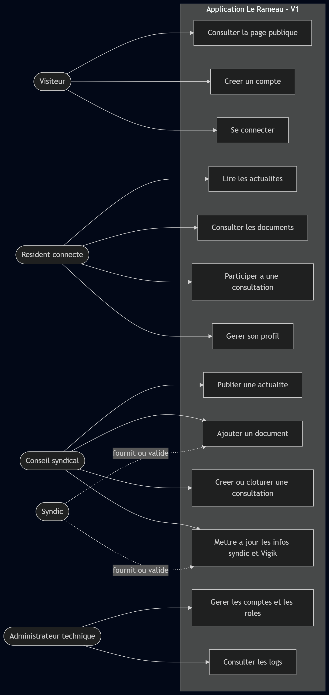

Figure E.1 : diagramme global des cas d'utilisation. Il montre les usages principaux par acteur, depuis l'accès public jusqu'à l'administration des contenus.

Ce diagramme montre volontairement la V1 du projet. Il ne contient pas de paiement en ligne, pas de messagerie complète entre résidents et pas de module de ticketing travaux. Ces idées peuvent exister plus tard, mais les ajouter tout de suite rendrait le périmètre moins réaliste pour une résidence locale. Le périmètre actuel couvre déjà les actions qui reviennent le plus souvent : lire, retrouver, voter et publier.

#### Cas d'utilisation UC-01 : créer un compte résident

| Élément                | Description                                                                                                 |
| ---------------------- | ----------------------------------------------------------------------------------------------------------- |
| Acteur principal       | Visiteur                                                                                                    |
| Acteur secondaire      | Supabase Auth                                                                                               |
| Objectif               | Permettre à un résident de créer un compte pour accéder à l'espace privé                                    |
| Préconditions          | L'utilisateur n'est pas connecté et il dispose d'une adresse email valide                                   |
| Déclencheur            | L'utilisateur clique sur « S'inscrire » depuis la page d'accueil                                            |
| Données saisies        | prénom, nom, email, mot de passe, confirmation du mot de passe, bâtiment, appartement, acceptation RGPD     |
| Postcondition nominale | Le compte est créé et l'utilisateur est redirigé vers la connexion ou l'espace résident selon le mode actif |
| Fréquence estimée      | Environ 110 à 140 créations de comptes au lancement, puis quelques comptes par mois                         |

Scénario nominal :

1. Le visiteur arrive sur la page d'accueil publique.
2. Il clique sur le bouton « S'inscrire ».
3. Le formulaire d'inscription s'affiche.
4. Il renseigne son prénom, son nom, son email, son bâtiment et son appartement.
5. Il crée un mot de passe respectant les règles de sécurité.
6. Il confirme son mot de passe.
7. Il accepte les conditions d'utilisation et la politique de confidentialité.
8. Il valide le formulaire.
9. Le système vérifie les champs avec le schéma de validation.
10. Le compte est transmis à Supabase Auth.
11. Le système crée le profil associé avec les informations de résidence.
12. L'utilisateur est informé de la réussite de l'inscription.

Scénarios alternatifs :

| Cas                       | Comportement prévu                                                                                            |
| ------------------------- | ------------------------------------------------------------------------------------------------------------- |
| Email invalide            | Le formulaire affiche « Email invalide » et bloque l'envoi                                                    |
| Mot de passe trop faible  | Le formulaire indique les règles attendues : 8 caractères, majuscule, minuscule, chiffre et caractère spécial |
| Mot de passe non confirmé | Le champ confirmation affiche « Les mots de passe ne correspondent pas »                                      |
| Appartement non renseigné | L'inscription est bloquée, car l'appartement sert ensuite à limiter le vote                                   |
| Compte déjà existant      | L'utilisateur est redirigé vers la connexion avec un message explicite                                        |
| RGPD non accepté          | L'inscription est refusée tant que la case n'est pas cochée                                                   |

Ce cas d'utilisation est important pour l'adoption. Si l'inscription est trop longue ou peu claire, une partie des résidents abandonnera. L'objectif de recette est donc de permettre une inscription complète en moins de 3 minutes pour un utilisateur qui a déjà son bâtiment et son numéro d'appartement.

#### Cas d'utilisation UC-02 : participer à une consultation

| Élément                 | Description                                                                                          |
| ----------------------- | ---------------------------------------------------------------------------------------------------- |
| Acteur principal        | Résident connecté                                                                                    |
| Acteurs secondaires     | Base Supabase, conseil syndical                                                                      |
| Objectif                | Permettre à un résident de donner son avis sur une consultation active                               |
| Préconditions           | L'utilisateur est connecté, son profil contient un numéro d'appartement, une consultation est active |
| Déclencheur             | L'utilisateur ouvre la page « Consultations »                                                        |
| Données utilisées       | identifiant utilisateur, numéro d'appartement, consultation_id, option_id                            |
| Postcondition nominale  | Le vote est enregistré et l'utilisateur voit une confirmation                                        |
| Règle métier principale | Un seul vote est accepté par appartement et par consultation                                         |

Scénario nominal :

1. Le résident se connecte à son espace.
2. Il ouvre la page « Consultations » depuis le menu ou le tableau d'accueil.
3. Le système charge les consultations actives.
4. Le système vérifie si l'appartement de l'utilisateur a déjà voté.
5. Si aucun vote n'existe, les options sont affichées.
6. Le résident choisit une réponse.
7. Le système enregistre le vote avec l'identifiant de la consultation, l'utilisateur et l'appartement.
8. Le système affiche le message « Votre vote a été enregistré ».
9. Le résident ne peut plus voter une deuxième fois sur la même consultation.

Scénarios alternatifs :

| Cas                                              | Comportement prévu                                                                 |
| ------------------------------------------------ | ---------------------------------------------------------------------------------- |
| Appartement absent du profil                     | Le système affiche un message demandant de renseigner l'appartement avant de voter |
| Appartement déjà utilisé pour cette consultation | Le vote est refusé et un message explique qu'un membre du foyer a déjà voté        |
| Consultation clôturée                            | La consultation n'apparaît plus dans la liste des votes actifs                     |
| Erreur technique Supabase                        | Un message d'erreur s'affiche et le vote n'est pas considéré comme enregistré      |
| Utilisateur non connecté                         | L'accès à la page privée est bloqué par le système d'authentification              |

Ce cas d'utilisation justifie plusieurs choix du projet. Le vote n'est pas basé uniquement sur le compte utilisateur, car plusieurs personnes d'un même foyer peuvent avoir un compte. La règle par appartement correspond mieux au fonctionnement de la résidence. Pour une copropriété d'environ 90 lots, cela évite qu'un seul foyer pèse plusieurs fois dans une consultation interne.

#### Cas d'utilisation UC-03 : publier une actualité

| Élément                | Description                                                                                    |
| ---------------------- | ---------------------------------------------------------------------------------------------- |
| Acteur principal       | Membre du conseil syndical                                                                     |
| Acteurs secondaires    | Résident connecté, système de notification, Supabase Storage                                   |
| Objectif               | Publier une information visible par les résidents                                              |
| Préconditions          | L'utilisateur est connecté avec un rôle autorisé, par exemple `ag`                             |
| Déclencheur            | Le membre du conseil syndical ouvre le tableau de bord actualités                              |
| Données saisies        | titre, extrait, contenu, image optionnelle, fichier PDF optionnel, priorité, date d'expiration |
| Postcondition nominale | L'actualité est enregistrée, visible côté résident et une notification peut être créée         |
| Fréquence estimée      | 1 actualité toutes les 2 semaines en fonctionnement normal                                     |

Scénario nominal :

1. Le membre du conseil syndical se connecte.
2. Il accède au tableau de bord.
3. Il ouvre la section « Actualités ».
4. Il clique sur « Créer une actualité ».
5. Il renseigne un titre, un extrait et le contenu.
6. Il ajoute une image ou un PDF si nécessaire.
7. Le système envoie le fichier vers Supabase Storage.
8. Le membre choisit une priorité et éventuellement une date d'expiration.
9. Il enregistre l'actualité.
10. Le système crée ou met à jour la ligne en base de données.
11. L'actualité apparaît dans la page dédiée côté résident.
12. Une notification peut être créée pour informer les utilisateurs.

Scénarios alternatifs :

| Cas                            | Comportement prévu                                                                           |
| ------------------------------ | -------------------------------------------------------------------------------------------- |
| Utilisateur sans rôle autorisé | Redirection vers l'accueil ou blocage de la page d'administration                            |
| Titre ou contenu manquant      | Le formulaire bloque l'enregistrement et affiche une erreur                                  |
| Fichier trop lourd             | L'upload est refusé selon la limite du bucket                                                |
| Format non autorisé            | Le système refuse le fichier pour éviter les contenus dangereux                              |
| Actualité expirée              | L'actualité reste gérable par le conseil syndical mais peut être moins visible côté résident |

Ce cas d'utilisation répond à l'un des besoins majeurs du conseil syndical : publier sans dépendre de l'agence à chaque petite modification. L'objectif de recette est qu'une actualité simple puisse être créée en moins de 5 minutes, fichier compris, par un membre formé rapidement.

#### Synthèse des règles métier

| Règle                                                                                 | Justification                                                             |
| ------------------------------------------------------------------------------------- | ------------------------------------------------------------------------- |
| Un compte doit être lié à un bâtiment et un appartement                               | Nécessaire pour vérifier l'appartenance à la résidence et gérer les votes |
| Un vote est limité à un appartement par consultation                                  | Evite qu'un foyer vote plusieurs fois                                     |
| Les contenus d'administration sont réservés aux rôles autorisés                       | Protège les informations publiées au nom du conseil syndical              |
| Les documents sensibles doivent être accessibles seulement aux utilisateurs connectés | Cohérent avec la partie RGPD et la confidentialité de la copropriété      |
| Les actions sensibles sont journalisées                                               | Permet de retrouver qui a créé, modifié ou supprimé un contenu            |
| Les informations publiques restent limitées                                           | Evite d'exposer des données internes de copropriété                       |

Ces règles métier seront reprises dans le MCD et le MLD. Elles permettent de passer du besoin fonctionnel à une structure de base de données cohérente, avec les entités principales comme utilisateur, profil, actualité, document, consultation, vote et log.

### E.2 MCD

Le MCD présente les données importantes du projet sans entrer encore dans les types SQL exacts. Pour Le Rameau, j'ai choisi de modéliser les entités métier principales, pas toutes les tables techniques générées par Supabase. Par exemple, l'authentification Supabase existe bien dans le projet, mais dans le MCD elle est rattachée à l'entité utilisateur et au profil résident. Cette simplification rend le modèle plus lisible pour le jury et reste cohérente avec la base réelle.

Le modèle repose sur une idée simple : un utilisateur appartient à la résidence, possède un profil, peut consulter des contenus et peut voter à des consultations. Les membres autorisés du conseil syndical peuvent publier des actualités, ajouter des documents et gérer les informations utiles. Les actions sensibles sont journalisées pour pouvoir retrouver qui a fait quoi.

#### Entités et propriétés

| Entité       | Propriétés principales                                                                                                                                     | Rôle dans le projet                                                                           |
| ------------ | ---------------------------------------------------------------------------------------------------------------------------------------------------------- | --------------------------------------------------------------------------------------------- |
| UTILISATEUR  | id_utilisateur, email, mot_de_passe_hash, date_creation                                                                                                    | Représente le compte d'authentification utilisé pour se connecter                             |
| PROFIL       | id_profil, nom, prenom, role, batiment, appartement, telephone, avatar_url, est_verifie                                                                    | Contient les informations de résidence et les droits applicatifs                              |
| ACTUALITE    | id_actualite, titre, extrait, contenu, image_url, fichier_url, priorite, date_expiration, date_creation, date_modification                                 | Permet au conseil syndical de publier une information aux résidents                           |
| DOCUMENT     | id_document, titre, date_document, type_document, url, categorie, position, date_creation, date_modification                                               | Regroupe les fichiers ou liens liés aux AG, au conseil syndical ou aux informations pratiques |
| CONSULTATION | id_consultation, question, options, statut, date_creation, date_modification                                                                               | Représente un sondage interne proposé aux résidents                                           |
| VOTE         | id_vote, appartement, option_id, date_vote                                                                                                                 | Enregistre le choix d'un appartement pour une consultation                                    |
| NOTIFICATION | id_notification, titre, message, lien, type_notification, date_creation, lu_par                                                                            | Informe les résidents d'un nouveau contenu ou d'une modification importante                   |
| SYNDIC       | id_syndic, nom, fonction, gestionnaire, assistante, telephone_gestionnaire, email_gestionnaire, telephone_assistante, email_assistante, adresse, photo_url | Stocke les informations affichées dans la page syndic                                         |
| VIGIK_INFO   | id_vigik, prix, description, date_modification                                                                                                             | Stocke les informations pratiques sur les badges Vigik                                        |
| LOG_ACTION   | id_log, type_action, details, date_action, anciennes_donnees, nouvelles_donnees                                                                            | Trace les actions sensibles réalisées depuis l'administration                                 |

Le mot de passe n'est pas stocké en clair. Dans le projet réel, Supabase Auth gère ce point. Dans le MCD, `mot_de_passe_hash` sert seulement à rappeler qu'un compte possède une donnée d'authentification sécurisée. Le profil est séparé du compte pour garder une distinction entre l'accès technique et les informations métier de la résidence.

#### Diagramme MCD du projet

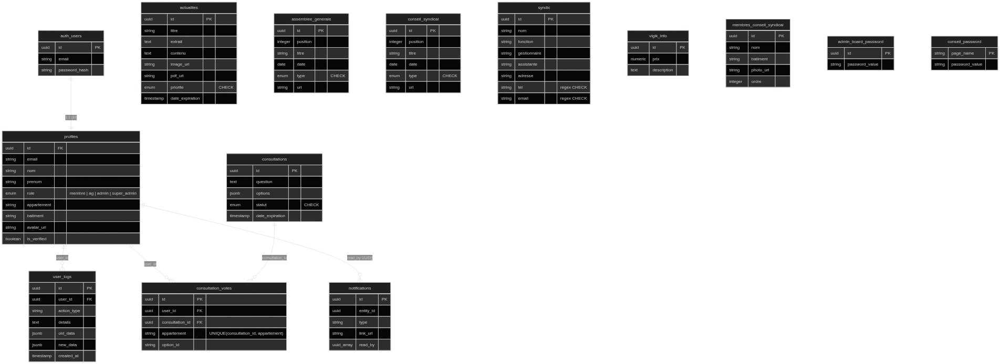

Figure E.2 : MCD issu du livret candidat. La capture montre la base complète du projet, avec les profils, les contenus, les consultations, les votes, les logs et les informations pratiques de la résidence.

Le diagramme est plus complet que la version de synthèse. Les blocs `SYNDIC` et `VIGIK_INFO` fonctionnent surtout comme des contenus de paramétrage. Ils sont modifiés par un utilisateur autorisé, mais ils ne sont pas au coeur des relations de données. Les afficher dans la liste des entités suffit pour comprendre leur rôle sans alourdir le modèle.

#### Cardinalités principales

| Relation                         | Cardinalité                                    | Explication                                                                                                                    |
| -------------------------------- | ---------------------------------------------- | ------------------------------------------------------------------------------------------------------------------------------ |
| UTILISATEUR possède PROFIL       | 1,1 côté utilisateur et 1,1 côté profil        | Chaque compte doit avoir un seul profil de résidence, et chaque profil correspond à un seul compte                             |
| UTILISATEUR publie ACTUALITE     | 0,n côté utilisateur et 1,1 côté actualité     | Un membre autorisé peut publier plusieurs actualités, une actualité a un auteur principal                                      |
| UTILISATEUR ajoute DOCUMENT      | 0,n côté utilisateur et 1,1 côté document      | Un membre du conseil syndical peut ajouter plusieurs documents                                                                 |
| UTILISATEUR crée CONSULTATION    | 0,n côté utilisateur et 1,1 côté consultation  | Une consultation est créée par un membre autorisé                                                                              |
| CONSULTATION reçoit VOTE         | 0,n côté consultation et 1,1 côté vote         | Une consultation peut recevoir plusieurs votes, un vote concerne une seule consultation                                        |
| UTILISATEUR effectue VOTE        | 0,n côté utilisateur et 1,1 côté vote          | Un utilisateur peut voter à plusieurs consultations, un vote appartient à un utilisateur                                       |
| ACTUALITE génère NOTIFICATION    | 0,n côté actualité et 0,1 côté notification    | Une actualité peut créer une notification, mais ce n'est pas obligatoire                                                       |
| CONSULTATION génère NOTIFICATION | 0,n côté consultation et 0,1 côté notification | Une nouvelle consultation peut prévenir les résidents                                                                          |
| UTILISATEUR déclenche LOG_ACTION | 0,n côté utilisateur et 0,1 côté log           | Une action sensible peut être rattachée à un utilisateur, mais certains logs techniques peuvent ne pas avoir de compte complet |

La règle la plus importante concerne le vote. Dans le schéma réel, le vote stocke `consultation_id`, `user_id`, `appartement` et `option_id`. La contrainte métier attendue est l'unicité du couple `consultation_id` et `appartement`. Cela permet de respecter la règle d'un seul vote par appartement. Elle sera traduite plus précisément dans le MLD avec une contrainte unique.

#### Choix de modélisation

Le modèle sépare volontairement les actualités et les documents. Une actualité peut contenir un fichier PDF, mais elle sert surtout à communiquer une information courte et datée. Un document AG ou conseil syndical a une logique différente : il doit être rangé, retrouvé et parfois conservé plus longtemps. Les mélanger rendrait la base moins claire.

Les documents d'assemblée générale et du conseil syndical sont regroupés dans une seule entité `DOCUMENT` avec une propriété `categorie`. Dans la base actuelle, ils existent dans deux tables différentes, `assemblee_generale` et `conseil_syndical`. Pour le MCD, les regrouper est plus propre, car leur structure est presque identique : titre, date, type, URL, position. La distinction AG/CS peut donc devenir une catégorie plutôt qu'une entité séparée.

Les notifications sont rattachées aux contenus qui peuvent déclencher une alerte. Dans le projet, elles servent surtout à prévenir les résidents d'une nouvelle actualité ou d'une consultation. Elles ne doivent pas remplacer les contenus eux-mêmes. Ce sont des messages courts, avec un lien vers la page concernée.

Les logs sont séparés du reste, parce qu'ils ont un rôle de sécurité et de traçabilité. Ils ne servent pas directement à l'expérience résident, mais ils protègent le conseil syndical en cas de suppression ou modification contestée. Une conservation de 12 mois a déjà été proposée dans la partie RGPD.

#### Contraintes métier à retenir pour le MLD

| Contrainte                                                             | Traduction prévue au MLD                                                    |
| ---------------------------------------------------------------------- | --------------------------------------------------------------------------- |
| Un email ne peut être utilisé que par un seul compte                   | Contrainte `UNIQUE` sur `email`                                             |
| Un profil dépend d'un compte existant                                  | Clé étrangère `profiles.id` vers `auth.users.id`                            |
| Un vote dépend d'une consultation existante                            | Clé étrangère `consultation_votes.consultation_id` vers `consultations.id`  |
| Un utilisateur ne peut pas voter sans appartement                      | Champ `appartement` obligatoire dans le vote                                |
| Un appartement ne peut voter qu'une fois par consultation              | Contrainte `UNIQUE (consultation_id, appartement)` à prévoir                |
| Une actualité doit avoir au minimum un titre, un extrait et un contenu | Champs `NOT NULL`                                                           |
| Une consultation doit avoir une question et au moins 2 options         | Validation applicative côté formulaire, puis stockage JSON                  |
| Les rôles doivent rester limités                                       | Type ou contrainte sur `role`, par exemple membre, conseil, ag, super_admin |

Ce MCD prépare le MLD sans rentrer encore dans la syntaxe SQL. Il montre les objets principaux du projet et les règles qui évitent les incohérences. Le point le plus important à défendre à l'oral est le lien entre profil, appartement et vote. C'est ce choix qui adapte vraiment l'application au fonctionnement d'une copropriété, au lieu de reprendre un modèle générique de sondage en ligne.

### E.3 MLD

Le modèle logique de données traduit le MCD en tables relationnelles exploitables dans une base PostgreSQL. Pour le projet Le Rameau, le MLD reste volontairement simple, car l'application doit pouvoir être maintenue par une petite agence et rester compréhensible pour une copropriété qui n'a pas d'équipe informatique interne.

Dans l'implémentation réelle, Supabase Auth gère déjà la table technique des comptes utilisateurs. Dans le cahier des charges, je présente quand même une table `utilisateurs` pour rendre le modèle complet et lisible. En production, cette table correspond à `auth.users`, tandis que les informations métiers sont stockées dans `profiles`.

| Table           | Identifiant       | Clés étrangères                     | Champs principaux                                                              | Rôle dans l'application                                  |
| --------------- | ----------------- | ----------------------------------- | ------------------------------------------------------------------------------ | -------------------------------------------------------- |
| `utilisateurs`  | `id_utilisateur`  | Aucune                              | `email`, `mot_de_passe_hash`, `date_creation`                                  | Stocker l'identité technique du compte                   |
| `profils`       | `id_profil`       | `id_utilisateur`                    | `nom`, `prenom`, `role`, `batiment`, `appartement`, `telephone`, `est_verifie` | Stocker les informations du résident                     |
| `actualites`    | `id_actualite`    | `id_auteur`                         | `titre`, `extrait`, `contenu`, `image_url`, `pdf_url`, `priorite`              | Publier les informations de la résidence                 |
| `documents`     | `id_document`     | `id_auteur`                         | `titre`, `date_document`, `type_document`, `categorie`, `url`, `position`      | Centraliser les documents de l'AG et du conseil syndical |
| `consultations` | `id_consultation` | `id_auteur`                         | `question`, `options`, `statut`                                                | Créer les consultations internes                         |
| `votes`         | `id_vote`         | `id_consultation`, `id_utilisateur` | `appartement`, `option_id`, `date_vote`                                        | Enregistrer les votes, avec une limite par logement      |
| `notifications` | `id_notification` | Aucune                              | `titre`, `message`, `lien`, `type`, `lu_par`                                   | Informer les résidents des nouveautés                    |
| `syndic`        | `id_syndic`       | Aucune                              | `titre`, `contact`, `telephone`, `email`, `description`                        | Afficher les informations du syndic                      |
| `vigik_info`    | `id_vigik`        | Aucune                              | `titre`, `contenu`, `document_url`                                             | Informer les résidents sur l'accès Vigik                 |
| `logs_action`   | `id_log`          | `id_utilisateur`                    | `action`, `details`, `date_action`                                             | Garder une trace des actions sensibles                   |

Les relations principales du MLD sont les suivantes :

| Relation                            | Type | Explication                                           |
| ----------------------------------- | ---- | ----------------------------------------------------- |
| `utilisateurs` vers `profils`       | 1,1  | Un compte possède un seul profil résident             |
| `utilisateurs` vers `actualites`    | 0,n  | Un membre autorisé peut publier plusieurs actualités  |
| `utilisateurs` vers `documents`     | 0,n  | Un membre autorisé peut déposer plusieurs documents   |
| `utilisateurs` vers `consultations` | 0,n  | Un membre autorisé peut créer plusieurs consultations |
| `consultations` vers `votes`        | 1,n  | Une consultation peut recevoir plusieurs votes        |
| `utilisateurs` vers `votes`         | 0,n  | Un utilisateur peut voter à plusieurs consultations   |
| `utilisateurs` vers `logs_action`   | 0,n  | Un utilisateur peut générer plusieurs traces d'action |

La contrainte la plus importante concerne les votes. Le couple `id_consultation` et `appartement` doit être unique. Cela évite qu'un même logement vote plusieurs fois à la même consultation, même si plusieurs comptes ont été créés pour ce logement.

```sql
create extension if not exists "uuid-ossp";

create table utilisateurs (
  id_utilisateur uuid primary key default uuid_generate_v4(),
  email text not null unique,
  mot_de_passe_hash text not null,
  date_creation timestamptz not null default now()
);

create table profils (
  id_profil uuid primary key default uuid_generate_v4(),
  id_utilisateur uuid not null unique
    references utilisateurs(id_utilisateur) on delete cascade,
  nom text not null,
  prenom text not null,
  role text not null default 'membre'
    check (role in ('membre', 'conseil', 'ag', 'super_admin')),
  batiment text not null,
  appartement text not null,
  telephone text,
  avatar_url text,
  est_verifie boolean not null default false,
  date_creation timestamptz not null default now(),
  date_modification timestamptz not null default now()
);

create table actualites (
  id_actualite uuid primary key default uuid_generate_v4(),
  id_auteur uuid references utilisateurs(id_utilisateur) on delete set null,
  titre text not null,
  extrait text not null,
  contenu text not null,
  image_url text,
  pdf_url text,
  priorite text not null default 'normale'
    check (priorite in ('basse', 'normale', 'haute', 'urgente')),
  date_expiration date,
  date_creation timestamptz not null default now(),
  date_modification timestamptz not null default now()
);

create table documents (
  id_document uuid primary key default uuid_generate_v4(),
  id_auteur uuid references utilisateurs(id_utilisateur) on delete set null,
  titre text not null,
  date_document date,
  type_document text not null default 'document'
    check (type_document in ('document', 'pdf', 'image', 'lien', 'vide')),
  categorie text not null
    check (categorie in ('ag', 'conseil_syndical', 'reglement', 'livret_accueil', 'autre')),
  url text,
  position integer not null default 0,
  date_creation timestamptz not null default now(),
  date_modification timestamptz not null default now()
);

create table consultations (
  id_consultation uuid primary key default uuid_generate_v4(),
  id_auteur uuid references utilisateurs(id_utilisateur) on delete set null,
  question text not null,
  options jsonb not null,
  statut text not null default 'actif'
    check (statut in ('brouillon', 'actif', 'cloture')),
  date_creation timestamptz not null default now(),
  date_modification timestamptz not null default now()
);

create table votes (
  id_vote uuid primary key default uuid_generate_v4(),
  id_consultation uuid not null
    references consultations(id_consultation) on delete cascade,
  id_utilisateur uuid references utilisateurs(id_utilisateur) on delete set null,
  appartement text not null,
  option_id text not null,
  date_vote timestamptz not null default now(),
  constraint unique_vote_par_logement unique (id_consultation, appartement)
);

create table notifications (
  id_notification uuid primary key default uuid_generate_v4(),
  titre text not null,
  message text not null,
  lien text,
  type text not null default 'information'
    check (type in ('information', 'actualite', 'document', 'consultation', 'alerte')),
  entite_id uuid,
  lu_par uuid[] not null default '{}',
  date_creation timestamptz not null default now()
);

create table syndic (
  id_syndic uuid primary key default uuid_generate_v4(),
  titre text not null,
  contact text,
  telephone text,
  email text,
  description text,
  date_creation timestamptz not null default now(),
  date_modification timestamptz not null default now()
);

create table vigik_info (
  id_vigik uuid primary key default uuid_generate_v4(),
  titre text not null,
  contenu text not null,
  document_url text,
  date_creation timestamptz not null default now(),
  date_modification timestamptz not null default now()
);

create table logs_action (
  id_log uuid primary key default uuid_generate_v4(),
  id_utilisateur uuid references utilisateurs(id_utilisateur) on delete set null,
  action text not null,
  details jsonb,
  date_action timestamptz not null default now()
);

create index idx_profils_appartement on profils(appartement);
create index idx_actualites_date_creation on actualites(date_creation desc);
create index idx_documents_categorie_position on documents(categorie, position);
create index idx_votes_consultation on votes(id_consultation);
create index idx_logs_date_action on logs_action(date_action desc);
```

Par rapport au schéma actuellement présent dans Supabase, la logique est très proche. La différence principale est que les documents sont regroupés ici dans une seule table `documents`, alors que la version développée utilise deux tables séparées pour l'assemblée générale et le conseil syndical. Pour une V1, les deux solutions sont acceptables. À moyen terme, une table unique serait plus simple à maintenir, car elle éviterait de dupliquer la même logique pour deux catégories de documents.

### E.4 Diagramme de classe

Le projet Le Rameau est développé avec Next.js, React et Supabase. Ce n'est donc pas une application orientée objet classique comme un projet Java avec des classes partout. Malgré ça, le diagramme de classe reste utile pour représenter les objets métier, leurs attributs et les méthodes attendues côté application. Je l'utilise ici comme une vue de conception, pas comme une copie exacte du code fichier par fichier.

Les classes principales reprennent les entités du MCD et du MLD. Les classes de service représentent les traitements qui ne sont pas directement stockés en base de données, par exemple l'inscription, la publication d'une actualité ou l'enregistrement d'un vote.

| Classe                | Attributs d'instance                                                              | Variables de classe          | Méthodes principales                                                    |
| --------------------- | --------------------------------------------------------------------------------- | ---------------------------- | ----------------------------------------------------------------------- |
| `Utilisateur`         | `id`, `email`, `dateCreation`                                                     | `ROLES_AUTORISES`            | `seConnecter()`, `seDeconnecter()`, `demanderVerification()`            |
| `Profil`              | `nom`, `prenom`, `role`, `batiment`, `appartement`, `telephone`, `estVerifie`     | `ROLE_PAR_DEFAUT`            | `mettreAJourProfil()`, `estMembreConseil()`, `estCompteValide()`        |
| `Actualite`           | `titre`, `extrait`, `contenu`, `imageUrl`, `pdfUrl`, `priorite`, `dateExpiration` | `PRIORITES`                  | `publier()`, `modifier()`, `archiver()`                                 |
| `DocumentResidence`   | `titre`, `dateDocument`, `typeDocument`, `categorie`, `url`, `position`           | `CATEGORIES_DOCUMENTS`       | `ajouter()`, `modifierPosition()`, `supprimer()`                        |
| `Consultation`        | `question`, `options`, `statut`, `dateCreation`                                   | `STATUTS`                    | `ouvrir()`, `cloturer()`, `calculerResultats()`                         |
| `Vote`                | `appartement`, `optionId`, `dateVote`                                             | `REGLE_UN_VOTE_PAR_LOGEMENT` | `enregistrer()`, `verifierDoublon()`                                    |
| `Notification`        | `titre`, `message`, `lien`, `type`, `luPar`                                       | `TYPES_NOTIFICATION`         | `creer()`, `marquerCommeLue()`                                          |
| `Syndic`              | `titre`, `contact`, `telephone`, `email`, `description`                           | Aucune                       | `mettreAJourInformations()`                                             |
| `VigikInfo`           | `titre`, `contenu`, `documentUrl`                                                 | Aucune                       | `mettreAJourContenu()`                                                  |
| `LogAction`           | `action`, `details`, `dateAction`                                                 | `DUREE_CONSERVATION_MOIS`    | `enregistrerAction()`                                                   |
| `AuthService`         | Aucune                                                                            | `MIN_PASSWORD_LENGTH`        | `inscrireUtilisateur()`, `connecterUtilisateur()`, `controlerSession()` |
| `ConsultationService` | Aucune                                                                            | Aucune                       | `creerConsultation()`, `voter()`, `chargerResultats()`                  |
| `ContentService`      | Aucune                                                                            | Aucune                       | `publierActualite()`, `ajouterDocument()`, `envoyerNotification()`      |

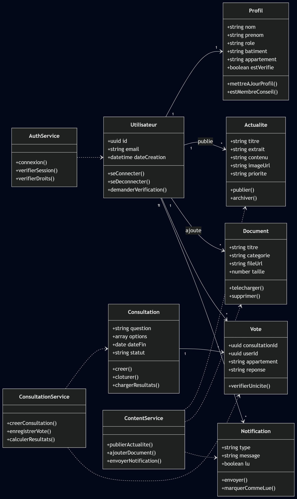

Figure E.3 : diagramme de classes simplifié. Il reprend les classes métier et les services applicatifs utilisés pour structurer le code.

La méthode la plus sensible dans ce diagramme est `verifierDoublon()` dans la classe `Vote`. Elle correspond à la règle métier d'un seul vote par appartement et par consultation. Côté base de données, cette règle est renforcée par une contrainte unique. Côté interface, elle doit aussi être contrôlée avant l'envoi du formulaire pour éviter une mauvaise expérience utilisateur.

Les classes de service servent à séparer la logique métier des composants d'interface. Par exemple, un composant React peut afficher un bouton de vote, mais la vérification du doublon, l'enregistrement du vote et la mise à jour des résultats doivent rester dans une logique de service. Ce choix rend le projet plus facile à tester, surtout pour les scénarios critiques comme l'inscription, le vote ou la publication d'un document.

### E.5 Diagramme d'infrastructure

Le diagramme d'infrastructure présente la manière dont les différentes briques techniques communiquent entre elles. Pour Le Rameau, l'objectif n'est pas de mettre en place une infrastructure lourde. La résidence compte environ 80 à 100 lots, donc le besoin réel est une plateforme fiable, peu coûteuse et simple à maintenir.

L'architecture retenue repose sur une application Next.js hébergée sur Vercel et une base Supabase pour l'authentification, les données et le stockage des fichiers. Ce choix correspond bien au contexte du projet, car il évite au conseil syndical de payer un serveur dédié ou une administration système complexe. Pour une V1, un budget technique d'environ 20 à 25 euros par mois reste réaliste si l'on garde les offres adaptées au volume de la copropriété.

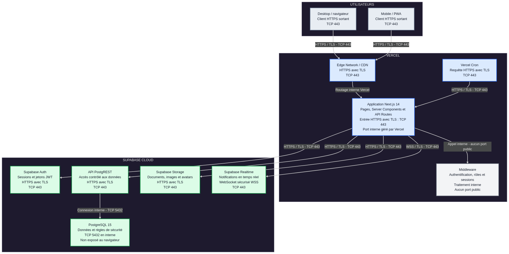

Figure E.4 : schéma d'architecture 3 tiers issu du livret candidat. Il montre les flux entre les utilisateurs, Vercel, Next.js, le middleware, Supabase Auth, PostgreSQL, Storage et Realtime.

| Brique             | Rôle                                                                | Préconisation pour Le Rameau                                                                |
| ------------------ | ------------------------------------------------------------------- | ------------------------------------------------------------------------------------------- |
| Navigateur web     | Accès des résidents depuis mobile, tablette ou ordinateur           | Cibler les navigateurs récents, surtout Chrome, Safari, Firefox et Edge                     |
| Vercel             | Hébergement de l'application Next.js                                | Utiliser un déploiement cloud avec HTTPS automatique et rollback en cas d'erreur            |
| Next.js            | Front-end React et routes serveur                                   | Garder les pages publiques séparées des pages connectées pour faciliter le contrôle d'accès |
| Middleware Next.js | Vérification de session et redirection                              | Bloquer les pages privées si l'utilisateur n'est pas connecté                               |
| Supabase Auth      | Gestion des comptes, sessions et mots de passe                      | Ne jamais stocker le mot de passe dans une table métier                                     |
| Supabase Database  | Stockage des profils, actualités, documents, consultations et votes | Ajouter une contrainte unique sur le vote par appartement et par consultation               |
| Supabase Storage   | Stockage des images et PDF                                          | Limiter les fichiers à 20 Mo maximum et éviter les documents trop lourds                    |
| Supabase Realtime  | Actualisation des notifications                                     | Réserver le temps réel aux notifications utiles, pas à toutes les pages                     |
| Vercel Cron        | Traitements automatiques                                            | Exécuter le contrôle des actualités expirées une fois par jour à 3h                         |
| GitHub             | Versionning du code                                                 | Déployer depuis une branche stable après validation des changements                         |

Le parcours d'un résident commence dans son navigateur. Il arrive sur l'application, puis le middleware vérifie si une session Supabase existe. Si le résident n'est pas connecté, il est renvoyé vers la page de connexion. S'il est connecté, l'application charge son profil, son rôle et les données utiles à l'écran demandé. Par exemple, la page des consultations récupère les consultations actives et vérifie les votes déjà enregistrés pour l'appartement du résident.

Pour le conseil syndical, le fonctionnement est presque le même, mais avec des droits plus élevés. Un membre autorisé peut accéder au dashboard et publier une actualité, ajouter un document ou créer une consultation. Les actions sensibles doivent être enregistrées dans les logs, surtout les suppressions et les modifications de documents. Cette traçabilité est utile si un résident conteste une publication ou si une erreur est faite pendant la gestion du contenu.

Le projet contient aussi une route API appelée par Vercel Cron. Elle sert à vérifier les actualités expirées tous les jours à 3h. Ce traitement supprime les notifications liées aux actualités dépassées et ajoute une trace dans les logs. Pour éviter qu'une personne extérieure appelle cette route, elle doit être protégée par un secret `CRON_SECRET`. C'est un détail technique simple, mais important, parce qu'une route automatique mal protégée peut créer des suppressions ou des traitements non voulus.

#### Flux principaux

| Flux                        | Départ              | Arrivée                 | Données échangées                                     | Sécurité attendue                                              |
| --------------------------- | ------------------- | ----------------------- | ----------------------------------------------------- | -------------------------------------------------------------- |
| Connexion                   | Navigateur          | Supabase Auth           | Email, mot de passe, session                          | HTTPS, cookie de session, mot de passe non visible             |
| Consultation des actualités | Application Next.js | Supabase Database       | Titre, extrait, contenu, image, PDF                   | Lecture réservée aux utilisateurs connectés si contenu interne |
| Upload de document          | Dashboard           | Supabase Storage        | PDF ou image                                          | Taille limitée à 20 Mo et accès réservé aux membres autorisés  |
| Vote                        | Page consultation   | Supabase Database       | Identifiant consultation, appartement, option choisie | Contrainte unique par appartement et consultation              |
| Notification                | Service applicatif  | Table notifications     | Titre, message, lien, type                            | Notification liée à un contenu existant                        |
| Expiration automatique      | Vercel Cron         | Route API puis Supabase | Actualités expirées et logs                           | Appel protégé par `CRON_SECRET`                                |

#### Sécurité et disponibilité

L'application doit utiliser HTTPS sur toutes les pages. Vercel le fournit automatiquement avec le domaine configuré, ce qui évite de gérer manuellement les certificats SSL. Pour le client, c'est un point rassurant : les identifiants ne transitent pas en clair entre le navigateur et le serveur.

Les clés sensibles ne doivent pas être présentes dans le code. La clé publique Supabase peut être utilisée côté front, mais la clé `SUPABASE_SERVICE_ROLE_KEY` doit rester uniquement côté serveur. Elle donne trop de droits pour être exposée dans le navigateur. Dans le projet, elle est utilisée pour des routes API précises, comme la suppression d'un utilisateur ou le traitement des expirations.

Pour les fichiers, la recommandation est de séparer les contenus publics et les documents internes. Les images d'actualités peuvent être publiques si elles ne contiennent pas d'information personnelle. En revanche, les documents d'assemblée générale et du conseil syndical devraient idéalement passer par des URL signées ou des buckets privés. Même pour une résidence de 100 lots, un PDF d'AG peut contenir des noms, des montants ou des informations qui ne doivent pas être indexées.

La volumétrie prévue reste faible. On peut estimer entre 100 et 150 comptes utilisateurs au maximum si certains logements ont plusieurs occupants inscrits. Le nombre de consultations devrait rester autour de 5 à 10 par an, et le nombre de documents ajoutés autour de 5 à 15 par mois en période active. Cette volumétrie justifie le choix d'une infrastructure légère, mais elle n'empêche pas de prévoir des sauvegardes et une politique de restauration.

#### Préconisations d'exploitation

| Sujet          | Préconisation                                                                         | Justification                                                                   |
| -------------- | ------------------------------------------------------------------------------------- | ------------------------------------------------------------------------------- |
| Sauvegarde     | Activer les sauvegardes automatiques Supabase et garder au moins 7 jours d'historique | Permettre une restauration rapide en cas de suppression accidentelle            |
| Domaine        | Utiliser un domaine dédié du type `le-rameau-copro.fr`                                | Donner un accès plus clair aux résidents qu'une URL technique Vercel            |
| Environnements | Garder un environnement de production et un environnement de test                     | Tester les changements sans risquer de casser le site utilisé par les résidents |
| Logs           | Conserver les logs sensibles pendant 12 mois                                          | Garder une preuve en cas de contestation, sans conserver indéfiniment           |
| Monitoring     | Contrôler les erreurs de déploiement et les routes API après chaque mise en ligne     | Détecter vite un problème sur la connexion, le vote ou le dashboard             |

Cette infrastructure est cohérente avec le niveau de besoin du client. Elle reste assez simple pour être maintenue par DevSphere, tout en couvrant les points importants : authentification, base de données relationnelle, stockage documentaire, sécurité des routes sensibles et déploiement automatisé. La partie F détaillera ensuite les choix techniques, les versions des outils, les tests et les procédures de mise en ligne.

## F. Cahier des clauses techniques détaillées

### F.1 Architecture globale de projet

#### Version française

L'architecture globale du projet doit être choisie en fonction du besoin réel du client, pas seulement en fonction des technologies à la mode. Pour Le Rameau, la plateforme doit surtout être fiable, accessible depuis un navigateur, simple à maintenir et raisonnable en coût. La résidence compte environ 80 à 100 lots. On peut donc viser une infrastructure capable de supporter 100 à 150 comptes utilisateurs, quelques consultations par an et une dizaine de documents ajoutés par mois.

Dans le cadre du comparatif demandé, certains sigles comme MERN et MEAN sont très connus, tandis que d'autres sont plutôt utilisés comme familles d'architectures. Pour éviter une définition floue, DevSphere retient les définitions suivantes dans ce cahier des charges.

| Architecture | Composants                                   | Fonctionnement                                                                               | Avis pour Le Rameau                                                                                               |
| ------------ | -------------------------------------------- | -------------------------------------------------------------------------------------------- | ----------------------------------------------------------------------------------------------------------------- |
| MERN         | MongoDB, Express, React, Node.js             | Une API Node/Express dialogue avec MongoDB, le front React consomme cette API                | Stack solide, mais MongoDB est moins adapté aux relations de copropriété comme profils, votes, documents et rôles |
| MEAN         | MongoDB, Express, Angular, Node.js           | Même logique que MERN, avec Angular côté front                                               | Architecture complète, mais trop lourde pour une petite copropriété et moins proche du projet développé           |
| SEAN         | Supabase, Express, Angular, Node.js          | Supabase gère la donnée, Express expose une API et Angular affiche l'interface               | Intéressant pour une application structurée, mais Express et Angular ajoutent deux couches non nécessaires ici    |
| MSSR         | Monolithic Server-Side Rendering             | Une seule application gère les pages, une partie serveur et les routes API                   | Très adapté avec Next.js, car le projet garde une base de code unique et des contrôles côté serveur               |
| MSAA         | Microservices Serverless API Architecture    | Plusieurs services indépendants exposent chacun une API ou une fonction                      | Trop découpé pour une V1. Le coût de maintenance serait élevé pour DevSphere et le client                         |
| PSAA         | Platform Serverless Application Architecture | L'application s'appuie sur des plateformes managées pour auth, base, stockage et déploiement | Adapté au projet, surtout avec Vercel et Supabase, car l'exploitation technique est réduite                       |

Le choix retenu pour Le Rameau est une architecture hybride MSSR + PSAA. Concrètement, l'application est développée avec Next.js 14 et React 18. Next.js apporte la partie application, le routing, le middleware, les routes API et le rendu côté serveur quand c'est utile. Supabase prend en charge l'authentification, PostgreSQL, le stockage de fichiers et une partie du temps réel. Vercel sert à héberger l'application, gérer les déploiements et exécuter un cron quotidien.


Figure F.1 : architecture réelle du projet, reprise du livret candidat. Le choix MSSR + PSAA limite les couches techniques et garde un coût d'exploitation adapté à une copropriété locale.

Cette architecture évite de créer un back-end Express séparé. Pour une grosse application nationale, ce choix pourrait être discuté. Pour Le Rameau, il est plus raisonnable de garder moins de couches techniques. L'équipe DevSphere peut corriger ou faire évoluer le projet plus vite, et le client ne paie pas une infrastructure trop dimensionnée.

| Critère                               |  MERN |  MEAN |  SEAN |  MSSR |  MSAA |  PSAA | Choix retenu MSSR + PSAA |
| ------------------------------------- | ----: | ----: | ----: | ----: | ----: | ----: | -----------------------: |
| Performance perçue                    |   4/5 |   3/5 |   3/5 |   4/5 |   4/5 |   4/5 |                      4/5 |
| Coût mensuel prévisible               |   3/5 |   3/5 |   3/5 |   4/5 |   2/5 |   4/5 |                      4/5 |
| Simplicité de maintenance             |   3/5 |   2/5 |   3/5 |   4/5 |   2/5 |   4/5 |                      5/5 |
| Adaptation aux données relationnelles |   2/5 |   2/5 |   4/5 |   4/5 |   4/5 |   5/5 |                      5/5 |
| Évolutivité pour 100 à 150 comptes    |   4/5 |   4/5 |   4/5 |   4/5 |   5/5 |   4/5 |                      4/5 |
| Total                                 | 16/25 | 14/25 | 17/25 | 20/25 | 17/25 | 21/25 |                    22/25 |

Le score le plus intéressant est celui de l'architecture MSSR + PSAA, avec 22/25. Ce n'est pas le choix le plus puissant sur le papier, mais c'est celui qui colle le mieux au projet. Une architecture microservices aurait du sens avec plusieurs équipes et beaucoup de trafic. Ici, elle ferait surtout perdre du temps. À l'inverse, Next.js avec Supabase permet de livrer une application complète, sécurisée et maintenable avec un budget technique autour de 20 à 25 euros par mois au démarrage.

Pour le client, l'avantage est concret. Le conseil syndical n'a pas à gérer un serveur, une base installée manuellement ou des sauvegardes artisanales. DevSphere reste responsable de la configuration, des mises à jour et de la surveillance, mais l'infrastructure repose sur des services déjà managés. En cas d'évolution, par exemple ajout d'un espace de signalement des incidents ou d'un module de réservation, l'architecture peut l'accepter sans repartir de zéro.

#### English version

The global architecture must be chosen according to the real client need, not only because a stack is popular. For Le Rameau, the platform must be reliable, available from a web browser, easy to maintain and not too expensive. The residence has around 80 to 100 units. A realistic target is 100 to 150 user accounts, a few consultations per year and around 10 documents uploaded per month.

In this technical comparison, some names like MERN and MEAN are common standards. Other names are used more like architecture families. DevSphere uses the following definitions for this project.

| Architecture | Components                                   | How it works                                                                     | Opinion for Le Rameau                                                                                        |
| ------------ | -------------------------------------------- | -------------------------------------------------------------------------------- | ------------------------------------------------------------------------------------------------------------ |
| MERN         | MongoDB, Express, React, Node.js             | A Node/Express API communicates with MongoDB, and React consumes the API         | Good stack, but MongoDB is not the best fit for relational data such as profiles, votes, documents and roles |
| MEAN         | MongoDB, Express, Angular, Node.js           | Same logic as MERN, with Angular for the front-end                               | Complete architecture, but too heavy for a small residence and not close to the existing project             |
| SEAN         | Supabase, Express, Angular, Node.js          | Supabase manages data, Express exposes an API and Angular displays the interface | Interesting for a structured app, but Express and Angular add two layers that are not needed here            |
| MSSR         | Monolithic Server-Side Rendering             | One application handles pages, server logic and API routes                       | Very suitable with Next.js, because the project keeps one codebase and server-side checks                    |
| MSAA         | Microservices Serverless API Architecture    | Several independent services expose APIs or serverless functions                 | Too split for a first version. Maintenance cost would be too high for DevSphere and the client               |
| PSAA         | Platform Serverless Application Architecture | The app uses managed platforms for auth, database, storage and deployment        | Well adapted to the project, especially with Vercel and Supabase                                             |

The selected architecture for Le Rameau is a hybrid MSSR + PSAA architecture. In practice, the application is built with Next.js 14 and React 18. Next.js manages the application layer, routing, middleware, API routes and server-side rendering when useful. Supabase manages authentication, PostgreSQL, file storage and some realtime features. Vercel hosts the app, manages deployments and runs a daily cron job.

The diagram in the French part also applies to this English version. A resident uses the browser, reaches the Next.js application, then the middleware checks the Supabase session. React pages call front-end services, and these services communicate with Supabase Database, Storage and Realtime. For server-only actions, Next.js API routes use protected environment variables.

| Criterion                           |  MERN |  MEAN |  SEAN |  MSSR |  MSAA |  PSAA | Selected MSSR + PSAA |
| ----------------------------------- | ----: | ----: | ----: | ----: | ----: | ----: | -------------------: |
| Perceived performance               |   4/5 |   3/5 |   3/5 |   4/5 |   4/5 |   4/5 |                  4/5 |
| Predictable monthly cost            |   3/5 |   3/5 |   3/5 |   4/5 |   2/5 |   4/5 |                  4/5 |
| Maintenance simplicity              |   3/5 |   2/5 |   3/5 |   4/5 |   2/5 |   4/5 |                  5/5 |
| Fit for relational data             |   2/5 |   2/5 |   4/5 |   4/5 |   4/5 |   5/5 |                  5/5 |
| Scalability for 100 to 150 accounts |   4/5 |   4/5 |   4/5 |   4/5 |   5/5 |   4/5 |                  4/5 |
| Total                               | 16/25 | 14/25 | 17/25 | 20/25 | 17/25 | 21/25 |                22/25 |

The selected MSSR + PSAA architecture reaches 22/25. It is not the most powerful architecture on paper, but it is the most coherent choice for this client. A microservices architecture would make sense with several teams and a lot of traffic. For Le Rameau, it would mostly create more work. With Next.js and Supabase, DevSphere can deliver a complete and maintainable application with an initial technical budget around 20 to 25 euros per month.

For the client, the benefit is clear. The council does not have to manage a server, a manually installed database or homemade backups. DevSphere remains responsible for configuration, updates and monitoring, but the technical base relies on managed services. If the project grows later, for example with an incident reporting space or a booking module, this architecture can evolve without starting again from scratch.

### F.2 Technologies de développement

#### Version française

Cette partie détaille les technologies retenues pour développer Le Rameau. Le choix principal est de rester sur une stack JavaScript/TypeScript cohérente, avec Next.js pour l'application, React pour l'interface et Supabase pour la partie back-end managée. L'objectif n'est pas d'empiler beaucoup d'outils. Pour une copropriété d'environ 80 à 100 lots, une stack trop complexe rendrait la maintenance plus chère sans apporter de vrai bénéfice au client.

| Couche                 | Technologie             |                  Version installée | Rôle dans le projet                                                 | Justification                                                             |
| ---------------------- | ----------------------- | ---------------------------------: | ------------------------------------------------------------------- | ------------------------------------------------------------------------- |
| Langage principal      | TypeScript              |                              5.9.3 | Typage du code front-end et des services                            | Réduire les erreurs sur les objets comme profils, votes et consultations  |
| Framework application  | Next.js                 |                            14.2.15 | Routing, pages, middleware et routes API                            | Garder une seule base de code pour l'interface et les traitements serveur |
| Bibliothèque UI        | React                   |                             18.3.1 | Création des composants interactifs                                 | Adapter les écrans aux usages résident et conseil syndical                |
| Rendu navigateur       | React DOM               |                             18.3.1 | Affichage des composants React dans le navigateur                   | Version alignée avec React 18.3.1                                         |
| Base de données        | PostgreSQL via Supabase |           Version managée Supabase | Stockage des profils, documents, actualités, consultations et votes | Modèle relationnel adapté aux contraintes du MCD et du MLD                |
| Authentification       | Supabase Auth           | via `@supabase/supabase-js` 2.97.0 | Gestion des comptes et sessions                                     | Éviter de gérer soi-même les mots de passe                                |
| Connexion SSR          | `@supabase/ssr`         |                              0.8.0 | Gestion des sessions dans Next.js                                   | Permettre au middleware de contrôler les pages privées                    |
| Stockage fichiers      | Supabase Storage        |           Version managée Supabase | Stockage des images et PDF                                          | Centraliser les documents sans serveur de fichiers séparé                 |
| Style                  | Tailwind CSS            |                             3.4.19 | Mise en page et design responsive                                   | Produire une interface cohérente rapidement                               |
| Validation             | Zod                     |                              4.3.6 | Validation des formulaires et données                               | Contrôler les entrées avant l'envoi en base                               |
| Formulaires            | React Hook Form         |                             7.71.2 | Gestion des formulaires                                             | Limiter le code répétitif sur inscription, profil et dashboard            |
| Résolution formulaires | `@hookform/resolvers`   |                              5.2.2 | Connexion entre React Hook Form et Zod                              | Garder une validation homogène                                            |
| Requêtes client        | SWR                     |                              2.4.0 | Récupération et rafraîchissement de données                         | Améliorer la fluidité sur les contenus dynamiques                         |
| Animations             | Framer Motion           |                            12.34.3 | Transitions et micro-interactions                                   | Garder une interface plus agréable sans animation lourde                  |
| Icônes                 | Lucide React            |                            0.575.0 | Icônes de navigation et boutons                                     | Avoir des pictogrammes lisibles et cohérents                              |
| Scène 3D               | Spline React            |                              4.1.0 | Scène visuelle de la page d'accueil                                 | Donner une identité plus marquée au projet                                |
| Tests                  | Vitest                  |                              4.1.8 | Tests unitaires et couverture                                       | Tester les règles critiques, surtout validation et services               |

Pour le front-end, le projet repose sur Next.js, React, TypeScript et Tailwind CSS. Next.js gère la structure de l'application, les routes publiques, les routes privées et les routes API. React est utilisé pour les composants d'interface, par exemple les formulaires d'inscription, le dashboard, les consultations et les pages documentaires. TypeScript est utile dans ce projet, car plusieurs objets ont des structures sensibles : un vote doit contenir un appartement, une consultation doit contenir des options, un profil doit avoir un rôle. Une erreur de champ peut vite créer un bug visible par les résidents.

Côté back-end, le projet ne crée pas un serveur Express séparé. Les traitements serveur passent par Next.js et par Supabase. Supabase fournit PostgreSQL, l'authentification, le stockage de fichiers et les abonnements temps réel. Ce choix est plus raisonnable pour Le Rameau, car DevSphere garde moins de code serveur à maintenir. Le coût de maintenance est donc plus faible, avec une estimation de 2 à 4 heures de maintenance technique par mois après livraison, hors évolution fonctionnelle.

Le schéma back-end ci-dessous vient aussi du livret candidat. Il détaille la manière dont les pages, les routes API, le middleware, les services applicatifs et les clients Supabase communiquent. C'est plus parlant qu'une longue explication, surtout pour montrer que l'application n'est pas seulement une interface graphique.

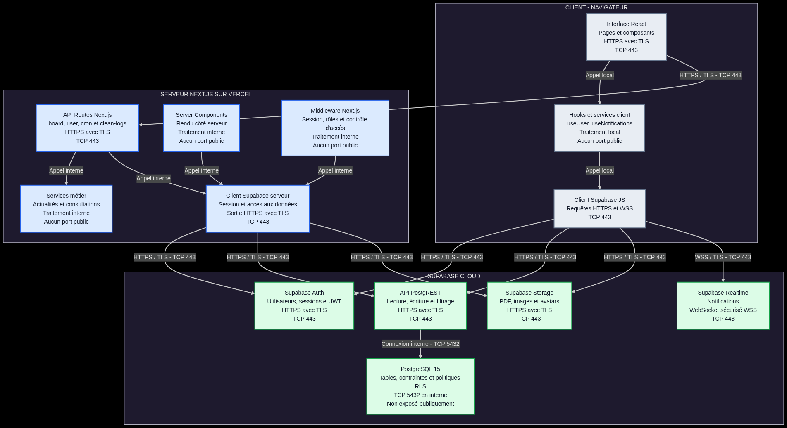

Figure F.2 : architecture logicielle back-end du projet. Elle montre le rôle de Next.js côté serveur, des routes API sensibles, des services applicatifs et de Supabase comme base managée.

Il n'y a pas d'ORM classique comme Prisma ou TypeORM dans le projet. La communication avec la base se fait avec le client officiel Supabase JS. Ce choix est cohérent avec Supabase, car le client fournit déjà les méthodes de lecture, insertion, mise à jour et suppression. Pour un projet de cette taille, ajouter un ORM complet créerait surtout une couche de plus à apprendre et maintenir. En revanche, le MCD et le MLD restent importants, car ils documentent la structure relationnelle même si le code passe par le SDK Supabase.

Les documentations officielles utilisées ou à conserver dans le dossier technique sont les suivantes :

| Technologie                | Documentation officielle                       |
| -------------------------- | ---------------------------------------------- |
| Next.js                    | https://nextjs.org/docs                        |
| React                      | https://react.dev                              |
| TypeScript                 | https://www.typescriptlang.org/docs            |
| Supabase                   | https://supabase.com/docs                      |
| Supabase JavaScript Client | https://supabase.com/docs/reference/javascript |
| Tailwind CSS               | https://tailwindcss.com/docs                   |
| Zod                        | https://zod.dev                                |
| React Hook Form            | https://react-hook-form.com                    |
| Vitest                     | https://vitest.dev                             |
| Vercel                     | https://vercel.com/docs                        |
| Spline                     | https://docs.spline.design                     |

La préconisation DevSphere est de figer les versions majeures pendant toute la V1. Cela veut dire que l'on peut accepter des correctifs de sécurité, mais pas une migration majeure juste avant la soutenance ou la mise en production. Par exemple, passer de React 18 à React 19 ou de Next.js 14 à Next.js 15 doit être traité comme une évolution séparée, avec au moins une demi-journée de tests de régression.

#### English version

This section lists the technologies used to build Le Rameau. The main choice is to keep a coherent JavaScript and TypeScript stack, with Next.js for the application, React for the user interface and Supabase for the managed back-end. The goal is not to add too many tools. For a residence of around 80 to 100 units, a heavier stack would make maintenance more expensive without a real benefit for the client.

| Layer                 | Technology                  |                      Installed version | Role in the project                                      | Reason                                                               |
| --------------------- | --------------------------- | -------------------------------------: | -------------------------------------------------------- | -------------------------------------------------------------------- |
| Main language         | TypeScript                  |                                  5.9.3 | Type safety for front-end code and services              | Reduce errors on profiles, votes and consultations                   |
| Application framework | Next.js                     |                                14.2.15 | Routing, pages, middleware and API routes                | Keep one codebase for UI and server actions                          |
| UI library            | React                       |                                 18.3.1 | Interactive components                                   | Build resident and council interfaces                                |
| Browser rendering     | React DOM                   |                                 18.3.1 | Rendering React components in the browser                | Same version line as React 18.3.1                                    |
| Database              | PostgreSQL through Supabase |               Supabase managed version | Store profiles, documents, news, consultations and votes | Relational model adapted to the MCD and MLD                          |
| Authentication        | Supabase Auth               | through `@supabase/supabase-js` 2.97.0 | Accounts and sessions                                    | Avoid managing passwords manually                                    |
| SSR connection        | `@supabase/ssr`             |                                  0.8.0 | Session handling in Next.js                              | Let the middleware protect private pages                             |
| File storage          | Supabase Storage            |               Supabase managed version | Images and PDF files                                     | Store documents without a separate file server                       |
| Styling               | Tailwind CSS                |                                 3.4.19 | Responsive layout and design                             | Build a consistent interface faster                                  |
| Validation            | Zod                         |                                  4.3.6 | Form and data validation                                 | Check inputs before sending data to the database                     |
| Forms                 | React Hook Form             |                                 7.71.2 | Form management                                          | Reduce repetitive code for registration, profile and dashboard forms |
| Form resolver         | `@hookform/resolvers`       |                                  5.2.2 | Link React Hook Form with Zod                            | Keep validation consistent                                           |
| Client data fetching  | SWR                         |                                  2.4.0 | Data fetching and refreshing                             | Improve dynamic content updates                                      |
| Animations            | Framer Motion               |                                12.34.3 | Transitions and small interactions                       | Make the interface feel smoother without heavy animations            |
| Icons                 | Lucide React                |                                0.575.0 | Navigation and button icons                              | Use readable and consistent pictograms                               |
| 3D scene              | Spline React                |                                  4.1.0 | Homepage visual scene                                    | Give the project a stronger identity                                 |
| Tests                 | Vitest                      |                                  4.1.8 | Unit tests and coverage                                  | Test critical rules, especially validation and services              |

For the front-end, the project uses Next.js, React, TypeScript and Tailwind CSS. Next.js manages the application structure, public routes, private routes and API routes. React is used for UI components such as registration forms, the dashboard, consultations and document pages. TypeScript is useful here because several objects have sensitive structures. A vote must contain an apartment, a consultation must contain options and a profile must have a role.

For the back-end, the project does not use a separate Express server. Server actions are handled by Next.js and Supabase. Supabase provides PostgreSQL, authentication, file storage and realtime subscriptions. This is a better fit for Le Rameau because DevSphere has less server code to maintain. After delivery, the expected technical maintenance is around 2 to 4 hours per month, without counting functional upgrades.

The back-end architecture screenshot shown in the French version also applies here. It shows how Next.js API routes, middleware, application services and Supabase clients are connected. This is useful for the jury because the project is not only a static front-end.

There is no classic ORM such as Prisma or TypeORM in this project. Database access is done with the official Supabase JS client. This choice is coherent with Supabase because the client already provides methods for select, insert, update and delete operations. For a project of this size, adding a full ORM would mainly add another layer to learn and maintain. The MCD and MLD still remain useful because they document the relational structure even if the code uses the Supabase SDK.

The official documentations to keep in the technical file are:

| Technology                 | Official documentation                         |
| -------------------------- | ---------------------------------------------- |
| Next.js                    | https://nextjs.org/docs                        |
| React                      | https://react.dev                              |
| TypeScript                 | https://www.typescriptlang.org/docs            |
| Supabase                   | https://supabase.com/docs                      |
| Supabase JavaScript Client | https://supabase.com/docs/reference/javascript |
| Tailwind CSS               | https://tailwindcss.com/docs                   |
| Zod                        | https://zod.dev                                |
| React Hook Form            | https://react-hook-form.com                    |
| Vitest                     | https://vitest.dev                             |
| Vercel                     | https://vercel.com/docs                        |
| Spline                     | https://docs.spline.design                     |

DevSphere recommends freezing major versions during the whole V1. Security patches can be accepted, but a major migration should not happen just before the presentation or production release. For example, migrating from React 18 to React 19 or from Next.js 14 to Next.js 15 should be planned as a separate task, with at least half a day of regression testing.

### F.3 Documentation chaîne de développement front-end

#### Version française

La chaîne de développement front-end du projet Le Rameau repose sur l'App Router de Next.js. L'organisation n'est donc pas un MVC classique comme dans certains frameworks back-end. Le projet est plutôt structuré par routes, composants réutilisables et services. Cette approche est cohérente avec React, car elle sépare les écrans, l'interface et la logique d'accès aux données sans multiplier les couches inutiles.

```text
le-rameau/
  app/                  Routes Next.js, pages publiques, pages connectées et routes API
  components/           Composants React réutilisables
  components/ui/        Composants d'interface génériques
  components/landing/   Composants de la page d'accueil
  components/dashboard/ Composants liés à l'administration
  lib/                  Fonctions partagées, validations, services et clients Supabase
  lib/services/         Services métier pour actualités et consultations
  lib/supabase/         Clients Supabase navigateur, serveur et middleware
  public/               Images et ressources statiques
  supabase/             Scripts SQL et configuration de la base
  __tests__/            Tests unitaires Vitest
```

| Dossier ou fichier   | Rôle                                | Exemple dans le projet                                 |
| -------------------- | ----------------------------------- | ------------------------------------------------------ |
| `app/(auth)`         | Pages d'inscription et de connexion | Formulaire de création de compte résident              |
| `app/(app)`          | Espace connecté des résidents       | Actualités, consultations, syndic, badges Vigik        |
| `app/admin`          | Espace d'administration             | Gestion des membres et des logs                        |
| `app/api`            | Routes serveur Next.js              | Suppression utilisateur, cron des expirations          |
| `components/ui`      | Composants génériques               | Boutons, formulaires, boîtes de dialogue               |
| `components/landing` | Composants de la page d'accueil     | Hero et éléments de présentation                       |
| `lib/services`       | Logique métier côté front           | `actualitesService`, `consultationsService`            |
| `lib/validations.ts` | Schémas de validation               | Login, inscription, mot de passe, RGPD                 |
| `lib/supabase`       | Connexion à Supabase                | Client navigateur, client serveur, middleware          |
| `vitest.config.ts`   | Configuration des tests             | Tests sur `lib/utils`, `lib/logger`, `lib/validations` |

Le modèle de conception retenu peut être décrit comme une séparation Page, Component, Service. Une page Next.js sert de point d'entrée pour un écran. Les composants React affichent l'interface. Les services dans `lib/services` regroupent les échanges avec Supabase. Par exemple, une page de dashboard ne doit pas contenir toute la logique SQL ou tout le traitement des résultats de vote. Elle appelle un service, puis se concentre sur l'affichage et les interactions utilisateur.

Ce modèle reprend une partie de l'esprit MVVM. La page et les hooks React jouent le rôle de ViewModel, car ils préparent l'état affiché par la vue. Les composants jouent le rôle de View. Les services et les types représentent la logique métier et les échanges avec la base. Je ne présente pas le projet comme un MVC pur, car ce serait moins honnête techniquement avec Next.js et React.

#### Normes de codage

| Sujet              | Règle retenue                                      | Justification                                                |
| ------------------ | -------------------------------------------------- | ------------------------------------------------------------ |
| Langage            | Utiliser TypeScript pour les fichiers applicatifs  | Réduire les erreurs sur les données de copropriété           |
| Nommage composants | PascalCase pour les composants React               | Exemple : `ActualiteForm`, `Hero`, `DashboardSidebar`        |
| Nommage fonctions  | camelCase pour fonctions et variables              | Garder une lecture cohérente dans les services               |
| Imports            | Utiliser l'alias `@/` quand le chemin devient long | Éviter les imports trop fragiles avec beaucoup de `../`      |
| Styles             | Utiliser Tailwind CSS en priorité                  | Garder un style homogène et responsive                       |
| Validation         | Centraliser les règles dans `lib/validations.ts`   | Éviter d'avoir des règles différentes entre deux formulaires |
| Accès Supabase     | Passer par les clients dans `lib/supabase`         | Éviter de recréer la connexion dans chaque fichier           |
| Tests              | Tester en priorité les fonctions sensibles         | Viser les validations, logs et règles métier                 |

Les scripts utilisés par l'équipe DevSphere sont les suivants :

| Commande                | Utilisation                                | Moment conseillé                      |
| ----------------------- | ------------------------------------------ | ------------------------------------- |
| `npm run dev`           | Lancer le projet en local                  | Pendant le développement              |
| `npm run build`         | Vérifier que l'application compile         | Avant une mise en ligne               |
| `npm run lint`          | Contrôler les règles Next.js et TypeScript | Avant une pull request                |
| `npm run typecheck`     | Vérifier les types TypeScript              | Avant une livraison                   |
| `npm run test`          | Lancer les tests Vitest                    | Après modification d'une règle métier |
| `npm run test:coverage` | Générer la couverture de tests             | Avant recette et soutenance           |

#### Méthode SOLID appliquée

Le projet n'est pas orienté objet au sens strict, mais les principes SOLID peuvent quand même guider le code React et TypeScript. Pour la V1, DevSphere retient surtout les principes les plus utiles au projet.

| Principe                   | Application dans Le Rameau                                                                                                                             |
| -------------------------- | ------------------------------------------------------------------------------------------------------------------------------------------------------ |
| Responsabilité unique      | Un composant d'interface ne doit pas gérer en même temps l'affichage, la validation complète et la persistance en base                                 |
| Ouvert fermé               | Les services peuvent évoluer avec de nouvelles méthodes sans casser les pages existantes                                                               |
| Substitution de Liskov     | Les types doivent rester compatibles, par exemple une actualité listée ne doit pas être utilisée comme une actualité complète sans vérifier les champs |
| Ségrégation des interfaces | Les types `ActualiteListItem`, `ActualiteFull`, `ConsultationInsert` évitent de manipuler trop de champs inutiles                                      |
| Inversion des dépendances  | Les composants appellent des services, au lieu d'appeler directement Supabase partout                                                                  |

Un exemple concret est le service `actualitesService`. Il sépare la récupération de la liste, la récupération d'une actualité complète, la création, la mise à jour et la suppression. Cette séparation rend le code plus facile à tester. Elle évite aussi qu'une page React contienne 80 lignes de logique Supabase mélangées à de l'affichage.

#### Gestion des commentaires

Les commentaires doivent rester utiles. Le projet contient déjà des commentaires courts dans les services, par exemple pour expliquer qu'une méthode récupère toutes les actualités visibles ou qu'une méthode change le statut d'une consultation. Cette pratique est suffisante pour la V1. Il ne faut pas commenter chaque ligne, car cela rend le code plus lourd à lire.

La préconisation DevSphere est d'ajouter du JSDoc seulement sur les fonctions partagées ou sensibles. Les fonctions concernées sont par exemple les règles de vote, les suppressions utilisateur, les traitements automatiques d'expiration et les helpers utilisés par plusieurs pages. Un objectif réaliste est de documenter 100 % des services dans `lib/services` et des routes API sensibles avant la livraison finale.

Un point d'amélioration existe dans la configuration ESLint actuelle. Certaines règles sont désactivées, notamment `@typescript-eslint/no-unused-vars` et `@typescript-eslint/no-explicit-any`. Pour le développement initial, c'est acceptable afin d'avancer plus vite. Avant la mise en production, DevSphere recommande de réactiver au minimum la règle sur les variables inutilisées et de limiter les `any` aux cas vraiment justifiés. Une demi-journée de nettoyage technique est prévue pour ce contrôle.

#### English version

The front-end development chain of Le Rameau is based on the Next.js App Router. The organization is not a classic MVC pattern like in some back-end frameworks. The project is structured around routes, reusable components and services. This fits React well because it separates screens, UI and data access logic without adding too many layers.

```text
le-rameau/
  app/                  Next.js routes, public pages, private pages and API routes
  components/           Reusable React components
  components/ui/        Generic UI components
  components/landing/   Homepage components
  components/dashboard/ Dashboard components
  lib/                  Shared functions, validations, services and Supabase clients
  lib/services/         Business services for news and consultations
  lib/supabase/         Browser, server and middleware Supabase clients
  public/               Images and static assets
  supabase/             SQL scripts and database configuration
  __tests__/            Vitest unit tests
```

| Folder or file       | Role                         | Project example                                       |
| -------------------- | ---------------------------- | ----------------------------------------------------- |
| `app/(auth)`         | Registration and login pages | Resident account creation form                        |
| `app/(app)`          | Private resident area        | News, consultations, syndic, Vigik badges             |
| `app/admin`          | Administration area          | Members and logs management                           |
| `app/api`            | Next.js server routes        | User deletion, expiration cron                        |
| `components/ui`      | Generic components           | Buttons, forms, dialogs                               |
| `components/landing` | Homepage components          | Hero and presentation blocks                          |
| `lib/services`       | Front-end business logic     | `actualitesService`, `consultationsService`           |
| `lib/validations.ts` | Validation schemas           | Login, registration, password, GDPR                   |
| `lib/supabase`       | Supabase connection          | Browser client, server client, middleware             |
| `vitest.config.ts`   | Test configuration           | Tests on `lib/utils`, `lib/logger`, `lib/validations` |

The design model can be described as a Page, Component, Service separation. A Next.js page is the entry point for a screen. React components display the UI. Services in `lib/services` group Supabase calls. For example, a dashboard page should not contain all SQL-like logic or all vote result processing. It calls a service, then focuses on display and user interactions.

This model is close to the MVVM idea. The page and React hooks act like a ViewModel because they prepare the state displayed by the view. Components act as the View. Services and types handle business logic and database exchanges. I do not describe the project as pure MVC because that would not match Next.js and React correctly.

#### Coding standards

| Subject          | Rule                                     | Reason                                               |
| ---------------- | ---------------------------------------- | ---------------------------------------------------- |
| Language         | Use TypeScript for application files     | Reduce errors on residence data                      |
| Component naming | PascalCase for React components          | Example: `ActualiteForm`, `Hero`, `DashboardSidebar` |
| Function naming  | camelCase for functions and variables    | Keep services easy to read                           |
| Imports          | Use the `@/` alias when paths are long   | Avoid fragile imports with many `../`                |
| Styles           | Use Tailwind CSS first                   | Keep the interface consistent and responsive         |
| Validation       | Centralize rules in `lib/validations.ts` | Avoid different rules between forms                  |
| Supabase access  | Use clients from `lib/supabase`          | Avoid recreating the connection in every file        |
| Tests            | Test sensitive functions first           | Focus on validation, logs and business rules         |

The scripts used by DevSphere are:

| Command                 | Usage                              | Recommended moment                         |
| ----------------------- | ---------------------------------- | ------------------------------------------ |
| `npm run dev`           | Start the project locally          | During development                         |
| `npm run build`         | Check that the app compiles        | Before deployment                          |
| `npm run lint`          | Run Next.js and TypeScript linting | Before a pull request                      |
| `npm run typecheck`     | Check TypeScript types             | Before delivery                            |
| `npm run test`          | Run Vitest tests                   | After changing a business rule             |
| `npm run test:coverage` | Generate test coverage             | Before acceptance testing and presentation |

#### SOLID method applied

The project is not object-oriented in the strict sense, but SOLID principles can still guide React and TypeScript code. For the V1, DevSphere mainly keeps the most useful principles for this project.

| Principle             | Application in Le Rameau                                                                                              |
| --------------------- | --------------------------------------------------------------------------------------------------------------------- |
| Single responsibility | A UI component should not handle display, full validation and database persistence at the same time                   |
| Open closed           | Services can receive new methods without breaking existing pages                                                      |
| Liskov substitution   | Types must stay compatible, for example a list news item must not be used as a full news item without checking fields |
| Interface segregation | Types like `ActualiteListItem`, `ActualiteFull`, `ConsultationInsert` avoid carrying too many useless fields          |
| Dependency inversion  | Components call services instead of calling Supabase everywhere                                                       |

One concrete example is `actualitesService`. It separates list retrieval, full news retrieval, creation, update and deletion. This makes the code easier to test. It also prevents a React page from containing too much Supabase logic mixed with display code.

#### Comments management

Comments must stay useful. The project already contains short comments in services, for example to explain that a method gets visible news or changes a consultation status. This is enough for the V1. Commenting every line would make the code harder to read.

DevSphere recommends adding JSDoc only on shared or sensitive functions. The main targets are voting rules, user deletion, automatic expiration jobs and helpers used by several pages. A realistic goal is to document 100% of services in `lib/services` and sensitive API routes before the final delivery.

One improvement point exists in the current ESLint configuration. Some rules are disabled, especially `@typescript-eslint/no-unused-vars` and `@typescript-eslint/no-explicit-any`. During early development, this is acceptable to move faster. Before production, DevSphere recommends re-enabling at least the unused variables rule and limiting `any` to justified cases. Half a day of technical cleanup is planned for this check.

### F.4 Compatibilité navigateur

#### Version française

Le site Le Rameau doit être utilisable sans installation d'application mobile. Le navigateur devient donc le point d'accès principal pour les résidents, qu'ils soient sur ordinateur, tablette ou smartphone. La compatibilité navigateur doit surtout couvrir les usages courants : consulter une actualité, télécharger un document, voter à une consultation et accéder à son profil.

Next.js indique dans sa documentation officielle qu'il prend en charge les navigateurs modernes sans configuration particulière, avec une base Chrome 111+, Edge 111+, Firefox 111+ et Safari 16.4+. Pour le projet, DevSphere retient une cible un peu plus récente, car le site est livré en 2026 et que cela réduit les risques liés aux anciennes versions mobiles.

| Navigateur            | Version minimale retenue | Support               | Justification                                                        |
| --------------------- | -----------------------: | --------------------- | -------------------------------------------------------------------- |
| Google Chrome desktop |                     120+ | Prioritaire           | Très utilisé sur Windows et Android                                  |
| Google Chrome Android |                     120+ | Prioritaire           | Cible importante pour les résidents qui consultent sur téléphone     |
| Microsoft Edge        |                     120+ | Prioritaire           | Navigateur courant sur Windows 10 et Windows 11                      |
| Mozilla Firefox       |                     121+ | Prioritaire           | Alternative desktop à prendre en compte                              |
| Safari macOS          |                      17+ | Prioritaire           | Important pour les utilisateurs Mac                                  |
| Safari iOS            |                      17+ | Prioritaire           | Important pour les utilisateurs iPhone                               |
| Samsung Internet      |                      23+ | Compatible à vérifier | Navigateur fréquent sur certains téléphones Android                  |
| Internet Explorer     |             Non supporté | Exclu                 | Navigateur obsolète, incompatible avec les choix modernes du projet  |
| Opera Mini            |             Non supporté | Exclu                 | Trop limité pour une interface connectée avec formulaires et scripts |

Le choix de versions minimales récentes est volontaire. Le projet utilise React, Next.js, Supabase Auth, des formulaires dynamiques, du stockage de fichiers et une scène Spline sur la page d'accueil. Garder une compatibilité avec des navigateurs trop anciens augmenterait le temps de recette, sans vrai bénéfice pour une copropriété de 80 à 100 lots. En revanche, le contenu important doit rester accessible même si la scène 3D ne se charge pas. Le site ne doit pas dépendre de Spline pour afficher une information essentielle.

#### Résolutions et appareils ciblés

| Format              | Résolution de test | Objectif                                          |
| ------------------- | -----------------: | ------------------------------------------------- |
| Mobile compact      |          360 x 800 | Vérifier les petits téléphones Android            |
| Mobile standard     |          390 x 844 | Vérifier un format proche iPhone récent           |
| Mobile large        |          414 x 896 | Vérifier les écrans plus confortables             |
| Tablette portrait   |         768 x 1024 | Vérifier la lecture des documents et du dashboard |
| Ordinateur portable |         1366 x 768 | Vérifier l'usage courant sur PC portable          |
| Desktop             |        1920 x 1080 | Vérifier les grands écrans et l'espacement        |

Les parcours à tester sur chaque famille de navigateur sont les suivants :

| Parcours                         | Pages concernées     | Critère d'acceptation                                                                                |
| -------------------------------- | -------------------- | ---------------------------------------------------------------------------------------------------- |
| Création de compte               | Inscription          | Le formulaire s'affiche, les erreurs de validation sont lisibles et l'acceptation RGPD fonctionne    |
| Connexion                        | Login                | Un utilisateur valide arrive sur l'espace connecté en moins de 3 secondes sur une connexion correcte |
| Consultation d'actualité         | Actualités           | Les images, textes et PDF restent lisibles sur mobile                                                |
| Vote                             | Consultations        | Un appartement ne peut voter qu'une seule fois à une consultation                                    |
| Documents AG et conseil syndical | AG, conseil syndical | Les liens de documents sont visibles et utilisables                                                  |
| Dashboard                        | Administration       | Les formulaires de publication restent utilisables au clavier et à la souris                         |
| Déconnexion                      | Profil ou navigation | La session est bien supprimée et l'utilisateur revient vers la connexion                             |

La compatibilité ne se limite pas au rendu visuel. Il faut aussi tester les interactions au clavier, les messages d'erreur, les menus, les modales et les champs de mot de passe. Les boutons d'affichage du mot de passe doivent avoir un libellé accessible, car sinon un lecteur d'écran ne comprend pas leur rôle. Ce point rejoint les préconisations déjà données dans la partie accessibilité.

#### Stratégie de recette navigateur

DevSphere prévoit une recette manuelle sur 6 couples navigateur/appareil avant la livraison : Chrome desktop, Edge desktop, Firefox desktop, Safari macOS, Chrome Android et Safari iOS. Pour chaque couple, les 7 parcours ci-dessus sont testés. Cela représente 42 vérifications fonctionnelles. En comptant environ 5 minutes par vérification, il faut prévoir autour de 3h30 de recette navigateur. Une marge d'une demi-journée est plus réaliste, car il faut aussi corriger les petits écarts d'affichage.

Les anomalies seront classées en trois niveaux. Un bug bloquant empêche la connexion, le vote ou l'accès aux documents. Il doit être corrigé avant mise en production. Un bug majeur gêne l'utilisation mais possède un contournement, par exemple un bouton mal aligné mais encore utilisable. Un bug mineur correspond plutôt à un détail visuel qui ne bloque pas l'usage.

Sources utilisées pour cette partie :

| Source                                                               | Information utilisée                                                          |
| -------------------------------------------------------------------- | ----------------------------------------------------------------------------- |
| Documentation Next.js, Supported Browsers, mise à jour le 01/10/2025 | Base officielle Chrome 111+, Edge 111+, Firefox 111+ et Safari 16.4+          |
| Documentation Next.js, polyfills                                     | Next.js charge certains polyfills seulement lorsque le navigateur en a besoin |

#### English version

The Le Rameau website must work without installing a mobile application. The browser is therefore the main access point for residents, on desktop, tablet and smartphone. Browser compatibility mainly has to cover common actions: reading news, downloading a document, voting in a consultation and accessing the profile page.

The official Next.js documentation says that modern browsers are supported without special configuration, with a base of Chrome 111+, Edge 111+, Firefox 111+ and Safari 16.4+. For this project, DevSphere keeps a slightly newer target because the website is delivered in 2026 and because it reduces risks on older mobile versions.

| Browser               | Minimum version | Support       | Reason                                                                  |
| --------------------- | --------------: | ------------- | ----------------------------------------------------------------------- |
| Google Chrome desktop |            120+ | Priority      | Common on Windows and Android environments                              |
| Google Chrome Android |            120+ | Priority      | Important target for residents using phones                             |
| Microsoft Edge        |            120+ | Priority      | Common browser on Windows 10 and Windows 11                             |
| Mozilla Firefox       |            121+ | Priority      | Desktop alternative to include                                          |
| Safari macOS          |             17+ | Priority      | Important for Mac users                                                 |
| Safari iOS            |             17+ | Priority      | Important for iPhone users                                              |
| Samsung Internet      |             23+ | To be checked | Frequent on some Android phones                                         |
| Internet Explorer     |   Not supported | Excluded      | Obsolete browser, not compatible with the modern choices of the project |
| Opera Mini            |   Not supported | Excluded      | Too limited for a private interface with forms and scripts              |

The choice of recent minimum versions is intentional. The project uses React, Next.js, Supabase Auth, dynamic forms, file storage and a Spline scene on the homepage. Supporting very old browsers would increase acceptance testing time without a real benefit for a residence of 80 to 100 units. However, important content must remain accessible even if the 3D scene does not load. The website must not depend on Spline to display essential information.

#### Target resolutions and devices

| Format          | Test resolution | Goal                                        |
| --------------- | --------------: | ------------------------------------------- |
| Small mobile    |       360 x 800 | Check small Android phones                  |
| Standard mobile |       390 x 844 | Check a recent iPhone-like format           |
| Large mobile    |       414 x 896 | Check larger mobile screens                 |
| Tablet portrait |      768 x 1024 | Check document reading and dashboard layout |
| Laptop          |      1366 x 768 | Check common laptop usage                   |
| Desktop         |     1920 x 1080 | Check large screens and spacing             |

The journeys to test on each browser family are:

| Journey                  | Pages                 | Acceptance criterion                                                                  |
| ------------------------ | --------------------- | ------------------------------------------------------------------------------------- |
| Account creation         | Register              | The form displays correctly, validation errors are readable and GDPR acceptance works |
| Login                    | Login                 | A valid user reaches the private area in less than 3 seconds on a normal connection   |
| News reading             | News pages            | Images, text and PDF links stay readable on mobile                                    |
| Vote                     | Consultations         | One apartment cannot vote twice on the same consultation                              |
| AG and council documents | AG, council pages     | Document links are visible and usable                                                 |
| Dashboard                | Administration        | Publishing forms remain usable with mouse and keyboard                                |
| Logout                   | Profile or navigation | The session is cleared and the user goes back to login                                |

Compatibility is not only about visual rendering. The team also has to test keyboard interactions, error messages, menus, modals and password fields. Password visibility buttons need an accessible label, otherwise a screen reader cannot understand their role. This point is linked to the accessibility recommendations already written earlier.

#### Browser acceptance strategy

DevSphere plans a manual acceptance test on 6 browser/device pairs before delivery: Chrome desktop, Edge desktop, Firefox desktop, Safari macOS, Chrome Android and Safari iOS. For each pair, the 7 journeys above are tested. This represents 42 functional checks. With around 5 minutes per check, browser acceptance testing takes around 3.5 hours. Half a day is more realistic because small display fixes also need time.

Issues are classified into three levels. A blocking bug prevents login, voting or document access. It must be fixed before production. A major bug makes usage harder but has a workaround, for example a misaligned button that is still usable. A minor bug is mostly a visual detail that does not block the resident.

Sources used for this section:

| Source                                                        | Information used                                                    |
| ------------------------------------------------------------- | ------------------------------------------------------------------- |
| Next.js documentation, Supported Browsers, updated 01/10/2025 | Official base Chrome 111+, Edge 111+, Firefox 111+ and Safari 16.4+ |
| Next.js documentation, polyfills                              | Next.js loads some polyfills only when the browser needs them       |

### F.5 Compte GIT

#### Version française

Git est retenu comme système de versionning pour le projet Le Rameau. Même si le projet reste assez petit, il contient plusieurs zones sensibles : authentification, rôles, votes, documents privés et administration. Sans suivi de versions, une correction sur le vote ou sur Supabase pourrait casser une autre partie du site sans qu'on puisse revenir rapidement en arrière.

Le dépôt est hébergé sur GitHub, ce qui complète Git avec une interface de revue de code, un historique lisible, des pull requests et une intégration continue. Pour DevSphere, GitHub est suffisant sur ce projet, car l'équipe reste réduite et le budget client doit rester raisonnable. Un compte organisation `DevSphere Agency` est prévu, avec un dépôt privé nommé `le-rameau`. Les accès sont limités aux personnes du projet : le chef de projet, le développeur principal, le développeur back-end et le référent client en lecture seule si le conseil syndical souhaite suivre l'avancement.

Le dépôt actuel utilise déjà une branche principale `main` reliée à `origin/main`. Pour une organisation d'agence plus propre, DevSphere prévoit la stratégie suivante :

| Branche                      | Rôle                                       | Règle de fusion                                         |
| ---------------------------- | ------------------------------------------ | ------------------------------------------------------- |
| `main`                       | Version stable livrable au client          | Fusion uniquement après validation technique et recette |
| `develop`                    | Intégration des développements en cours    | Fusion après pull request validée                       |
| `feature/nom-fonctionnalite` | Nouvelle fonctionnalité                    | Fusion vers `develop`                                   |
| `fix/nom-correction`         | Correction d'anomalie non urgente          | Fusion vers `develop`, puis `main` si besoin            |
| `hotfix/nom-incident`        | Correction urgente en production           | Fusion vers `main` puis report vers `develop`           |
| `docs/nom-documentation`     | Documentation projet ou cahier des charges | Fusion simple après relecture                           |

Dans la pratique, une fonctionnalité comme le module de consultations serait développée dans une branche `feature/consultations`. Une correction sur l'unicité du vote pourrait être faite dans `fix/vote-unique-appartement`. Ce nommage évite les branches floues du type `test` ou `new`, qui deviennent difficiles à comprendre après quelques semaines.

La capture suivante reprend la stratégie de branches déjà documentée dans le livret candidat. Elle permet au jury de lire rapidement la logique de travail sans devoir parcourir tout l'historique Git.

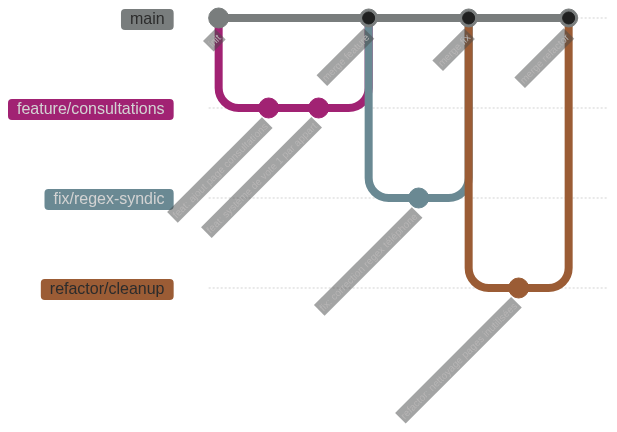

Figure F.3 : stratégie de branches Git du projet. Les branches de fonctionnalité et de correction restent courtes, puis reviennent vers une branche stable avant livraison.

Le rythme retenu est volontairement simple. Une branche de fonctionnalité ne doit pas rester ouverte plus de 5 jours ouvrés. Au-delà, le risque est d'avoir trop d'écart avec `develop` et de créer des conflits inutiles. Pour une correction courte, l'objectif est une branche ouverte moins d'une journée. C'est réaliste pour une équipe de 3 à 4 personnes.

#### Pull requests et contrôles qualité

Chaque modification qui touche au code applicatif doit passer par une pull request. La pull request sert à vérifier trois points : le besoin fonctionnel, la qualité du code et l'absence de régression visible. Pour le projet Le Rameau, une pull request doit contenir au minimum :

| Élément attendu               | Exemple concret                                     |
| ----------------------------- | --------------------------------------------------- |
| Résumé de la modification     | Ajout de la création de consultation côté admin     |
| Pages ou fichiers touchés     | `app/admin`, `lib/services/consultationsService.ts` |
| Tests réalisés                | `npm run lint`, `npm run typecheck`, `npm run test` |
| Risque identifié              | Vérifier qu'un appartement ne vote pas deux fois    |
| Capture si interface modifiée | Formulaire admin ou écran résident                  |

La règle de validation proposée est d'avoir au moins 1 relecture humaine avant fusion sur `develop`, et 2 validations pour une fusion vers `main` quand la modification touche l'authentification, les rôles ou les votes. Ce niveau est adapté au budget du projet : il sécurise les zones sensibles sans transformer chaque petite correction de texte en procédure trop lourde.

Le dépôt contient déjà un fichier `.gitignore`, ce qui évite de versionner `node_modules`, `.next`, `coverage`, les fichiers `.env*.local` et les fichiers de build. C'est un point important, car les variables Supabase ne doivent jamais être envoyées sur GitHub. Seul le fichier `.env.local.example` peut être versionné pour indiquer les noms de variables attendus.

La chaîne d'intégration continue est configurée avec GitHub Actions dans `.github/workflows/ci.yml`. Elle s'exécute sur les push vers `main` et `develop`, ainsi que sur les pull requests vers `main`. Elle installe les dépendances, lance ESLint, vérifie les types TypeScript, exécute les tests Vitest et fait un build Next.js. Le budget temps prévu pour corriger une erreur CI est d'environ 30 minutes pour une erreur simple de lint ou de typage, et 2 à 4 heures si le build révèle un problème lié à Supabase ou à une variable d'environnement.

La capture GitHub Actions issue du livret candidat montre le pipeline en réussite. Elle complète la description avec un élément de preuve : les contrôles automatisés ne sont pas seulement prévus dans le cahier, ils existent déjà dans le projet.

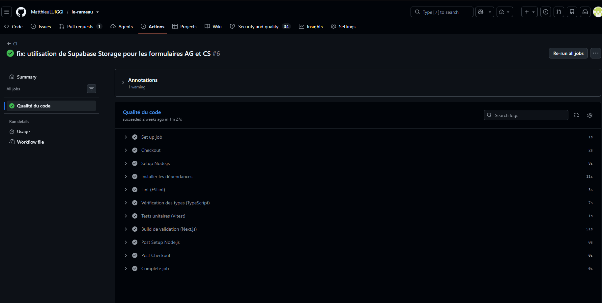

Figure F.4 : pipeline CI/CD GitHub Actions. Les étapes automatisées valident la qualité du code avant intégration et limitent les régressions avant mise en ligne.

#### Gestion des commits

DevSphere retient une convention proche de Conventional Commits, mais sans la rendre trop scolaire. L'objectif est de comprendre vite l'historique du projet.

| Type de commit | Usage                        | Exemple                                       |
| -------------- | ---------------------------- | --------------------------------------------- |
| `feat`         | Nouvelle fonctionnalité      | `feat: ajout des consultations residents`     |
| `fix`          | Correction de bug            | `fix: blocage du double vote par appartement` |
| `docs`         | Documentation                | `docs: mise a jour du livret candidat`        |
| `chore`        | Tâche technique              | `chore: mise a jour dependances`              |
| `test`         | Ajout ou correction de tests | `test: couverture schema inscription`         |
| `ci`           | Intégration continue         | `ci: ajout verification build`                |

L'historique existant du projet suit déjà en partie cette logique, avec des commits `feat`, `fix`, `docs` et `ci`. La préconisation est de garder cette convention jusqu'à la livraison. Un commit doit rester lisible et porter sur un sujet principal. Pour une journée de développement normale, 3 à 6 commits suffisent largement. Faire un commit toutes les 5 minutes rend l'historique pénible, mais faire un seul commit de fin de journée rend la relecture compliquée.

#### Sécurité du dépôt

Le dépôt doit rester privé tant que le site contient des informations sur l'architecture réelle, les routes d'administration ou les règles Supabase. Les secrets sont stockés dans GitHub Secrets et Vercel, jamais dans le code. Les droits proposés sont les suivants :

| Profil                            | Droit GitHub           | Justification                               |
| --------------------------------- | ---------------------- | ------------------------------------------- |
| Chef de projet DevSphere          | Admin                  | Gestion des accès et des releases           |
| Développeur principal             | Write                  | Développement et fusion après revue         |
| Développeur back-end              | Write                  | Tables, services, sécurité Supabase         |
| Graphiste ou intégrateur ponctuel | Triage ou Write limité | Travail sur maquettes ou interface          |
| Conseil syndical                  | Read si demandé        | Suivi du projet sans risque de modification |

Une vérification de sécurité du dépôt est prévue avant livraison. Elle comprend le contrôle des fichiers `.env`, la vérification des secrets GitHub, la suppression des branches inutiles et une revue rapide des dépendances via Dependabot. La présence d'une branche distante Dependabot montre que le projet peut déjà recevoir des alertes de mise à jour. Pour la V1, DevSphere prévoit une revue des alertes toutes les 2 semaines, puis une fois par mois pendant la maintenance.

#### English version

Git is used as the version control system for the Le Rameau project. Even if the project is not huge, it contains sensitive parts: authentication, roles, votes, private documents and administration. Without version control, a fix on voting rules or Supabase could break another part of the website without an easy rollback.

The repository is hosted on GitHub. GitHub completes Git with code reviews, readable history, pull requests and continuous integration. For DevSphere, GitHub is enough for this project because the team is small and the client's budget must stay reasonable. A `DevSphere Agency` organization account is planned, with a private repository named `le-rameau`. Access is limited to the project team: project manager, main developer, back-end developer and the client representative in read-only mode if the council wants to follow progress.

The current repository already uses a `main` branch linked to `origin/main`. For a cleaner agency workflow, DevSphere plans this branch strategy:

| Branch                    | Role                                    | Merge rule                                                   |
| ------------------------- | --------------------------------------- | ------------------------------------------------------------ |
| `main`                    | Stable client delivery version          | Merge only after technical validation and acceptance testing |
| `develop`                 | Integration branch for current work     | Merge after approved pull request                            |
| `feature/feature-name`    | New feature                             | Merge into `develop`                                         |
| `fix/fix-name`            | Non-urgent bug fix                      | Merge into `develop`, then `main` if needed                  |
| `hotfix/incident-name`    | Urgent production fix                   | Merge into `main`, then back into `develop`                  |
| `docs/documentation-name` | Project documentation or specifications | Simple merge after review                                    |

In practice, a feature like the consultations module would be developed in a `feature/consultations` branch. A fix on the unique vote rule could be done in `fix/unique-vote-apartment`. This naming avoids unclear branches such as `test` or `new`, which become hard to understand after a few weeks.

The workflow is intentionally simple. A feature branch should not stay open for more than 5 working days. After that, the difference with `develop` becomes too large and conflicts are more likely. For a small fix, the target is to keep the branch open for less than one day. This is realistic for a team of 3 to 4 people.

#### Pull requests and quality checks

Every change touching application code must go through a pull request. The pull request checks three points: the functional need, code quality and visible regression risk. For Le Rameau, a pull request must include at least:

| Expected item            | Project example                                     |
| ------------------------ | --------------------------------------------------- |
| Change summary           | Add consultation creation in admin area             |
| Pages or files changed   | `app/admin`, `lib/services/consultationsService.ts` |
| Tests performed          | `npm run lint`, `npm run typecheck`, `npm run test` |
| Identified risk          | Check that one apartment cannot vote twice          |
| Screenshot if UI changed | Admin form or resident screen                       |

The proposed validation rule is at least 1 human review before merging into `develop`, and 2 approvals before merging into `main` when the change touches authentication, roles or votes. This level fits the project budget: it secures sensitive parts without making every small text fix too heavy.

The repository already contains a `.gitignore` file. It prevents `node_modules`, `.next`, `coverage`, `.env*.local` and build files from being committed. This matters because Supabase variables must never be pushed to GitHub. Only `.env.local.example` can be versioned to show the expected variable names.

Continuous integration is configured with GitHub Actions in `.github/workflows/ci.yml`. It runs on pushes to `main` and `develop`, and on pull requests to `main`. It installs dependencies, runs ESLint, checks TypeScript types, runs Vitest tests and builds the Next.js application. The estimated correction time for a CI failure is around 30 minutes for a simple lint or typing error, and 2 to 4 hours if the build reveals a Supabase or environment variable issue.

The branch strategy and GitHub Actions screenshots shown in the French version also apply to this English section. They prove that the workflow is already documented in the project and not only described for the specification.

#### Commit management

DevSphere keeps a convention close to Conventional Commits, without making it too academic. The goal is to understand the project history quickly.

| Commit type | Usage                  | Example                               |
| ----------- | ---------------------- | ------------------------------------- |
| `feat`      | New feature            | `feat: add resident consultations`    |
| `fix`       | Bug fix                | `fix: block double vote by apartment` |
| `docs`      | Documentation          | `docs: update candidate booklet`      |
| `chore`     | Technical task         | `chore: update dependencies`          |
| `test`      | Add or fix tests       | `test: cover register schema`         |
| `ci`        | Continuous integration | `ci: add build check`                 |

The existing project history already partly follows this logic, with `feat`, `fix`, `docs` and `ci` commits. The recommendation is to keep this convention until delivery. A commit should stay readable and focus on one main subject. For a normal development day, 3 to 6 commits are enough. Committing every 5 minutes makes the history noisy, but one huge end-of-day commit makes review difficult.

#### Repository security

The repository must stay private as long as it contains real architecture information, administration routes or Supabase rules. Secrets are stored in GitHub Secrets and Vercel, never in the code. The proposed rights are:

| Profile                           | GitHub right            | Reason                                 |
| --------------------------------- | ----------------------- | -------------------------------------- |
| DevSphere project manager         | Admin                   | Access and release management          |
| Main developer                    | Write                   | Development and merge after review     |
| Back-end developer                | Write                   | Tables, services and Supabase security |
| Occasional designer or integrator | Triage or limited Write | Work on mockups or interface           |
| Council representative            | Read if requested       | Project follow-up without edit risk    |

A repository security check is planned before delivery. It includes checking `.env` files, checking GitHub Secrets, deleting useless branches and reviewing dependencies with Dependabot. The remote Dependabot branch shows that the project can already receive update alerts. For V1, DevSphere plans to review alerts every 2 weeks, then once a month during maintenance.

### F.6 Gestion des tickets

#### Version française

Pour le projet Le Rameau, DevSphere ne retient pas Jira. L'outil est très complet, mais il serait trop lourd pour une équipe réduite et pour un client composé de membres du conseil syndical qui n'ont pas forcément l'habitude des outils de pilotage agile. Le choix retenu est donc double : Notion pour le suivi projet lisible par le client, et GitHub Issues pour les tickets techniques liés au code.

Notion sert de tableau principal pour le comité de pilotage. Le conseil syndical peut y consulter les grandes étapes, les comptes rendus, les décisions prises et les points restant à valider. L'objectif est d'avoir un support compréhensible sans devoir entrer dans le détail du code. Pour une copropriété de 80 à 100 lots, le nombre d'interlocuteurs reste limité. Un tableau Notion partagé avec 3 membres côté client et 4 membres côté agence suffit.

GitHub Issues sert au suivi développement. Il est directement relié au dépôt GitHub, ce qui permet d'associer une anomalie ou une fonctionnalité à une branche, une pull request et un commit. C'est plus pratique pour les développeurs, surtout sur les sujets sensibles comme l'authentification, le vote unique par appartement ou la gestion des droits d'administration.

La capture de backlog du livret candidat est conservée ici. Elle montre le découpage en epics, features et user stories, ce qui aide à comprendre comment les besoins du client sont transformés en tickets traitables.

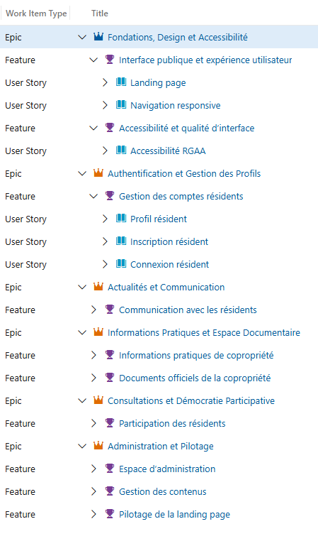

Figure F.5 : backlog produit du projet. Le découpage évite les tickets trop gros et aide à prioriser les fonctionnalités sensibles, comme l'authentification, les documents et les consultations.

#### Organisation du tableau Notion

Le tableau Notion est organisé avec des colonnes simples. Le but n'est pas d'impressionner le client, mais de suivre le projet sans perdre d'information entre deux réunions.

| Colonne    | Utilisation                              | Exemple Le Rameau                               |
| ---------- | ---------------------------------------- | ----------------------------------------------- |
| Backlog    | Idées ou besoins non planifiés           | Ajouter un historique des consultations fermées |
| A cadrer   | Besoin à préciser avec le client         | Type de documents visibles par les résidents    |
| A faire    | Tâche validée mais non commencée         | Rédiger les CGU et mentions légales             |
| En cours   | Tâche traitée dans le sprint actuel      | Module actualités côté administration           |
| En recette | Fonctionnalité prête à tester            | Vote résident sur une consultation              |
| Terminé    | Tâche validée par DevSphere ou le client | Création de compte résident                     |
| Bloqué     | Tâche en attente d'information           | Liste finale des lots et appartements           |

Chaque ticket Notion contient au minimum un titre, une description courte, un responsable, une priorité, une date cible et un statut. Pour éviter un suivi trop lourd, DevSphere limite le nombre de champs obligatoires à 6. Les champs facultatifs sont utilisés seulement si nécessaire : capture d'écran, lien vers maquette, décision du comité, lien vers ticket GitHub.

Le rythme de suivi prévu est le suivant :

| Action                        | Fréquence                 | Participants            | Durée estimée |
| ----------------------------- | ------------------------- | ----------------------- | ------------: |
| Point interne DevSphere       | 2 fois par semaine        | Equipe projet           |    20 minutes |
| Mise à jour du tableau Notion | 2 fois par semaine        | Chef de projet          |    15 minutes |
| Revue client                  | Toutes les 2 semaines     | Comité de pilotage      |    45 minutes |
| Recette fonctionnelle         | A la fin de chaque sprint | Client + chef de projet |       1 heure |
| Bilan de sprint               | Toutes les 2 semaines     | Equipe projet           |    30 minutes |

Ce rythme est volontairement léger. Le conseil syndical pilote le projet en plus de ses activités habituelles, donc il ne faut pas leur demander une disponibilité quotidienne. Une réunion toutes les 2 semaines permet de garder un vrai suivi sans saturer les bénévoles.

#### Tableau spécifique développement

Pour le développement, GitHub Issues est structuré autour de trois types de tickets : fonctionnalités, bugs et améliorations. Chaque ticket doit être assez précis pour être traité sans réinterpréter le besoin.

| Type           | Description                               | Exemple                                                | Priorité par défaut |
| -------------- | ----------------------------------------- | ------------------------------------------------------ | ------------------- |
| Fonctionnalité | Nouvelle capacité attendue par le client  | Créer une consultation avec date de fin                | Moyenne             |
| Bug            | Comportement incorrect ou régression      | Un résident peut voter deux fois après rechargement    | Haute               |
| Amélioration   | Optimisation d'un écran ou d'un processus | Rendre la liste des actualités plus lisible sur mobile | Basse ou moyenne    |
| Sécurité       | Risque sur les données ou les accès       | Vérifier le rôle admin avant suppression utilisateur   | Critique            |
| Documentation  | Notice, commentaire technique ou cahier   | Mettre à jour la procédure de déploiement              | Basse               |

Les labels GitHub prévus sont les suivants :

| Label           | Usage                                             |
| --------------- | ------------------------------------------------- |
| `feature`       | Nouvelle fonctionnalité                           |
| `bug`           | Anomalie à corriger                               |
| `security`      | Sujet sécurité ou contrôle d'accès                |
| `accessibility` | Sujet RGAA, clavier, contraste ou lecteur d'écran |
| `rgpd`          | Données personnelles, consentement, conservation  |
| `documentation` | Documentation projet ou technique                 |
| `priority-high` | A traiter dans le sprint en cours                 |
| `blocked`       | Ticket bloqué par une information manquante       |

Une règle simple est mise en place : aucun ticket `security`, `rgpd` ou `priority-high` ne doit rester sans réponse plus de 24 heures ouvrées. Pour les autres tickets, la réponse peut attendre la revue suivante, donc au maximum 5 jours ouvrés. Cette règle protège les fonctionnalités sensibles du projet sans imposer un support permanent.

#### Exemple de tickets de développement

| ID     | Type           | Titre                                             | Critère d'acceptation                                                              | Charge estimée |
| ------ | -------------- | ------------------------------------------------- | ---------------------------------------------------------------------------------- | -------------: |
| LR-001 | Fonctionnalité | Créer une actualité depuis l'administration       | Un admin peut créer, modifier et publier une actualité visible par les résidents   |         1 jour |
| LR-002 | Fonctionnalité | Ajouter une consultation résident                 | Un admin crée une question et les résidents connectés peuvent voter une seule fois |        2 jours |
| LR-003 | Bug            | Corriger l'affichage mobile du dashboard          | Les cartes ne débordent plus sur 390 x 844                                         |       0,5 jour |
| LR-004 | Sécurité       | Vérifier les droits avant suppression utilisateur | Un résident sans rôle admin ne peut jamais accéder à la suppression                |         1 jour |
| LR-005 | Amélioration   | Ajouter un message vide sur les documents AG      | Si aucun document n'est disponible, un message clair est affiché                   |       0,5 jour |
| LR-006 | Documentation  | Rédiger la procédure de déploiement Vercel        | Un développeur peut redéployer le projet en suivant la notice                      |       0,5 jour |

Ces tickets sont volontairement courts. Une tâche supérieure à 3 jours doit être découpée, par exemple en écran, service, sécurité et tests. Ce découpage rend le planning plus lisible et limite les tickets qui restent bloqués trop longtemps.

#### Priorisation

La priorisation se fait avec une logique proche de MoSCoW, qui sera reprise plus loin dans la partie Gantt. Pour la V1, DevSphere classe les tickets en quatre niveaux :

| Priorité      | Signification                | Exemple                              |
| ------------- | ---------------------------- | ------------------------------------ |
| Must have     | Indispensable à la livraison | Connexion, rôles, documents, votes   |
| Should have   | Très utile mais contournable | Filtrer les actualités par catégorie |
| Could have    | Confort utilisateur          | Animation ou micro interaction       |
| Won't have V1 | Reporté après livraison      | Application mobile native            |

Pour le projet Le Rameau, les tickets `Must have` représentent environ 70 % du sprint initial. C'est logique, car la V1 doit surtout sécuriser l'accès, centraliser les documents et permettre la consultation des résidents. Les fonctionnalités de confort sont gardées pour la fin, uniquement si le planning et le budget le permettent.

#### English version

For the Le Rameau project, DevSphere does not choose Jira. The tool is very complete, but it would be too heavy for a small team and for a client made of council members who are not necessarily used to agile project tools. The selected setup is therefore simple: Notion for client project tracking, and GitHub Issues for technical development tickets.

Notion is used as the main board for the steering committee. The council can check main steps, meeting notes, decisions and points still waiting for validation. The goal is to provide a readable project view without going into code details. For a residence of 80 to 100 units, the number of people involved stays limited. A shared Notion board with 3 client members and 4 agency members is enough.

GitHub Issues is used for development tracking. It is directly connected to the GitHub repository, so an issue can be linked to a branch, a pull request and a commit. This is more useful for developers, especially for sensitive subjects like authentication, unique vote per apartment and administration rights.

The backlog screenshot shown in the French version is kept as a visual proof of the ticket structure. It links epics, features and user stories to concrete development work.

#### Notion board organization

The Notion board uses simple columns. The goal is not to impress the client, but to track the project without losing information between meetings.

| Column      | Usage                                     | Le Rameau example                    |
| ----------- | ----------------------------------------- | ------------------------------------ |
| Backlog     | Ideas or needs not planned yet            | Add history for closed consultations |
| To clarify  | Need to check with the client             | Document types visible to residents  |
| To do       | Validated task, not started               | Write terms of use and legal notices |
| In progress | Task handled in the current sprint        | News module in administration        |
| Acceptance  | Feature ready to test                     | Resident vote on a consultation      |
| Done        | Task validated by DevSphere or the client | Resident account creation            |
| Blocked     | Task waiting for information              | Final list of units and apartments   |

Each Notion ticket contains at least a title, a short description, an owner, a priority, a target date and a status. To keep tracking light, DevSphere limits required fields to 6. Optional fields are used only when needed: screenshot, mockup link, committee decision, GitHub issue link.

The planned tracking rhythm is:

| Action                   | Frequency                 | Participants             | Estimated duration |
| ------------------------ | ------------------------- | ------------------------ | -----------------: |
| Internal DevSphere check | Twice a week              | Project team             |         20 minutes |
| Notion board update      | Twice a week              | Project manager          |         15 minutes |
| Client review            | Every 2 weeks             | Steering committee       |         45 minutes |
| Functional acceptance    | At the end of each sprint | Client + project manager |             1 hour |
| Sprint review            | Every 2 weeks             | Project team             |         30 minutes |

This rhythm is intentionally light. The council manages the project in addition to normal personal or professional activities, so daily availability would not be realistic. A meeting every 2 weeks keeps real follow-up without overloading volunteers.

#### Development ticket board

For development, GitHub Issues is organized around three main ticket types: features, bugs and improvements. Each ticket must be precise enough to be handled without reinterpreting the need.

| Type          | Description                               | Example                                    | Default priority |
| ------------- | ----------------------------------------- | ------------------------------------------ | ---------------- |
| Feature       | New client expected capability            | Create a consultation with an end date     | Medium           |
| Bug           | Incorrect behavior or regression          | A resident can vote twice after refresh    | High             |
| Improvement   | Screen or process optimization            | Make the news list more readable on mobile | Low or medium    |
| Security      | Data or access risk                       | Check admin role before user deletion      | Critical         |
| Documentation | Guide, technical comment or specification | Update deployment procedure                | Low              |

The planned GitHub labels are:

| Label           | Usage                                           |
| --------------- | ----------------------------------------------- |
| `feature`       | New feature                                     |
| `bug`           | Issue to fix                                    |
| `security`      | Security or access control topic                |
| `accessibility` | RGAA, keyboard, contrast or screen reader topic |
| `rgpd`          | Personal data, consent, retention               |
| `documentation` | Project or technical documentation              |
| `priority-high` | To handle during the current sprint             |
| `blocked`       | Ticket blocked by missing information           |

One simple rule is applied: no `security`, `rgpd` or `priority-high` ticket should stay without answer for more than 24 working hours. Other tickets can wait until the next review, so up to 5 working days. This rule protects sensitive project features without requiring permanent support.

#### Development ticket examples

| ID     | Type          | Title                             | Acceptance criterion                                                   | Estimated workload |
| ------ | ------------- | --------------------------------- | ---------------------------------------------------------------------- | -----------------: |
| LR-001 | Feature       | Create news from admin area       | An admin can create, edit and publish news visible to residents        |              1 day |
| LR-002 | Feature       | Add a resident consultation       | An admin creates a question and logged-in residents can vote only once |             2 days |
| LR-003 | Bug           | Fix mobile dashboard display      | Cards no longer overflow on 390 x 844                                  |            0.5 day |
| LR-004 | Security      | Check rights before user deletion | A resident without admin role can never access deletion                |              1 day |
| LR-005 | Improvement   | Add empty message on AG documents | If no document exists, a clear message is displayed                    |            0.5 day |
| LR-006 | Documentation | Write Vercel deployment procedure | A developer can redeploy the project by following the guide            |            0.5 day |

These tickets are intentionally short. A task longer than 3 days must be split, for example into screen, service, security and tests. This makes planning easier to read and avoids tickets staying blocked for too long.

#### Prioritization

Prioritization follows a logic close to MoSCoW, which will be reused later in the Gantt section. For V1, DevSphere sorts tickets into four levels:

| Priority      | Meaning                           | Example                        |
| ------------- | --------------------------------- | ------------------------------ |
| Must have     | Required for delivery             | Login, roles, documents, votes |
| Should have   | Very useful but with a workaround | Filter news by category        |
| Could have    | User comfort                      | Animation or micro interaction |
| Won't have V1 | Delayed after delivery            | Native mobile application      |

For Le Rameau, `Must have` tickets represent around 70% of the first sprint. This makes sense because V1 mainly has to secure access, centralize documents and allow resident consultation. Comfort features are kept for the end, only if planning and budget allow it.

### F.7 Tests applicatifs

#### Version française

Les tests applicatifs du projet Le Rameau servent surtout à éviter les régressions sur les parties sensibles. Le site manipule des comptes résidents, des documents privés et des consultations avec vote unique. Une erreur sur une couleur ou un espacement peut se corriger après livraison, mais une erreur sur l'accès aux documents ou le vote doit être bloquée avant mise en production.

DevSphere distingue deux niveaux de tests pour la V1 : les tests unitaires automatisés et les tests fonctionnels de recette. Les tests unitaires vérifient des fonctions isolées, par exemple les règles de validation d'un formulaire. Les tests fonctionnels vérifient un parcours complet côté utilisateur, par exemple un résident qui se connecte, consulte une actualité puis vote à une consultation.

#### Outils retenus

| Type de test            | Outil                             | Usage dans le projet                             | Fréquence                             |
| ----------------------- | --------------------------------- | ------------------------------------------------ | ------------------------------------- |
| Tests unitaires         | Vitest 4.1.8                      | Tester les fonctions TypeScript isolées          | À chaque modification sensible        |
| Couverture de code      | Vitest coverage v8                | Générer un rapport LCOV                          | Avant pull request et avant livraison |
| Vérification TypeScript | `tsc --noEmit`                    | Repérer les erreurs de types                     | À chaque pull request                 |
| Lint                    | ESLint Next.js                    | Repérer les erreurs de qualité ou de syntaxe     | À chaque pull request                 |
| Tests fonctionnels      | Checklist Notion ou GitHub Issues | Valider les parcours réels du client             | Fin de sprint                         |
| Recette navigateur      | Chrome, Edge, Firefox, Safari     | Vérifier les parcours sur les navigateurs ciblés | Avant livraison                       |

Le projet contient déjà une configuration Vitest dans `vitest.config.ts`. Les fichiers de tests sont placés dans le dossier `__tests__`. À ce stade, les tests existants couvrent `logger.test.ts`, `utils.test.ts` et `validations.test.ts`. C'est une base correcte, mais elle doit être complétée avant la livraison sur les fonctions métier liées aux consultations et aux droits d'accès.

Les commandes prévues sont les suivantes :

| Commande                | Objectif                      | Moment conseillé                  |
| ----------------------- | ----------------------------- | --------------------------------- |
| `npm run test`          | Lancer les tests unitaires    | Pendant le développement          |
| `npm run test:coverage` | Générer la couverture de code | Avant recette et avant soutenance |
| `npm run lint`          | Vérifier la qualité du code   | Avant pull request                |
| `npm run typecheck`     | Vérifier les types TypeScript | Avant pull request                |
| `npm run build`         | Vérifier que Next.js compile  | Avant déploiement                 |

Le rapport de couverture est généré à partir de la commande `npm run test:coverage`. Le lien direct prévu pour le code coverage est :

```text
C:\Users\matlu\Projet perso\le-rameau\coverage\lcov.info
```

Le fichier `coverage` n'est pas versionné, ce qui est normal. Il est ignoré par Git car il s'agit d'un résultat généré localement. Pour une lecture plus confortable, DevSphere recommande d'ajouter ensuite un rapport HTML ou un outil comme Codecov si le client demande un suivi plus visuel. Pour la V1, le fichier LCOV suffit à prouver la couverture pendant la recette technique.

#### Tests unitaires existants

Les tests unitaires déjà présents ciblent des fonctions qui ont un impact direct sur la qualité ou la sécurité du projet.

| Fichier de test                 | Fonction testée                 | Ce qui est vérifié                                 | Nombre de cas |
| ------------------------------- | ------------------------------- | -------------------------------------------------- | ------------: |
| `__tests__/validations.test.ts` | `loginSchema`, `registerSchema` | Email, mot de passe, confirmation, RGPD, prénom    |            11 |
| `__tests__/utils.test.ts`       | `getInitials`                   | Initiales simples, composées, valeurs nulles       |             8 |
| `__tests__/logger.test.ts`      | `sanitizeData`                  | Nettoyage des données longues avant journalisation |             8 |

Ces 27 cas de test sont utiles, mais ils ne suffisent pas pour sécuriser toute l'application. Ils couvrent surtout les règles de formulaire et quelques fonctions utilitaires. Les prochaines fonctions à tester en priorité sont les consultations, la vérification du rôle administrateur et les services Supabase qui manipulent les actualités.

#### Stratégie de couverture

DevSphere fixe une cible réaliste plutôt qu'un chiffre artificiel à 100 %. Sur une application Next.js connectée à Supabase, viser 100 % partout ferait perdre beaucoup de temps sur des composants d'affichage peu risqués. La stratégie est donc de concentrer la couverture sur les règles métier.

| Zone du projet                  | Couverture minimale visée | Justification                                   |
| ------------------------------- | ------------------------: | ----------------------------------------------- |
| Validations de formulaires      |                      90 % | Impact direct sur la qualité des données        |
| Fonctions utilitaires partagées |                      80 % | Risque de régression sur plusieurs pages        |
| Services métier                 |                      75 % | Actualités, consultations, documents            |
| Règles de vote                  |                      90 % | Un vote en double serait un bug bloquant        |
| Contrôle des rôles              |                      90 % | Protection de l'administration                  |
| Composants visuels simples      |     Non prioritaire en V1 | Risque plus faible, recette manuelle suffisante |

L'objectif global minimum retenu pour la V1 est 70 % de couverture sur les fichiers inclus dans Vitest, avec une cible renforcée à 90 % pour les validations, les votes et les règles d'accès. Cette différence est volontaire. Elle permet de concentrer le temps de développement sur ce qui peut vraiment bloquer la copropriété.

#### Tests unitaires à ajouter avant livraison

| ID    | Fonction ou zone                    | Cas à tester                                   | Priorité | Charge estimée |
| ----- | ----------------------------------- | ---------------------------------------------- | -------- | -------------: |
| TU-01 | `consultationsService.getVoteStats` | Calcul des votes oui, non, abstention et total | Haute    |       0,5 jour |
| TU-02 | Règle de vote unique                | Un appartement ne peut pas voter deux fois     | Critique |       0,5 jour |
| TU-03 | Services actualités                 | Création et mise à jour avec données valides   | Moyenne  |       0,5 jour |
| TU-04 | Suppression utilisateur             | Contrôle du rôle administrateur                | Critique |       0,5 jour |
| TU-05 | Validation inscription              | Cas limites sur bâtiment et appartement        | Haute    |      0,25 jour |
| TU-06 | Nettoyage des logs                  | Aucune donnée base64 longue dans les logs      | Haute    |      0,25 jour |

Le temps total prévu pour compléter les tests unitaires est donc d'environ 2,5 jours. Ce budget est cohérent avec le projet, car il ne s'agit pas de tester chaque pixel de l'interface, mais de sécuriser les règles les plus importantes.

#### Tests fonctionnels

Les tests fonctionnels sont réalisés à partir d'une checklist de recette. Ils doivent être compréhensibles par l'équipe agence et par le conseil syndical, car certaines validations appartiennent au client. Par exemple, seul le conseil syndical peut confirmer que les rubriques documentaires correspondent bien à leur fonctionnement réel.

| ID    | Parcours                    | Etapes principales                                    | Critère d'acceptation                                             | Criticité |
| ----- | --------------------------- | ----------------------------------------------------- | ----------------------------------------------------------------- | --------- |
| TF-01 | Création de compte résident | Saisir identité, bâtiment, appartement, accepter RGPD | Le compte est créé avec données valides et erreurs visibles sinon | Critique  |
| TF-02 | Connexion                   | Se connecter avec email et mot de passe               | L'utilisateur arrive sur l'espace privé en moins de 3 secondes    | Critique  |
| TF-03 | Consultation d'actualité    | Ouvrir la liste puis une actualité                    | Le contenu est lisible sur mobile et desktop                      | Haute     |
| TF-04 | Vote à une consultation     | Voter puis revenir sur la consultation                | Le vote est enregistré et un second vote est bloqué               | Critique  |
| TF-05 | Ajout d'actualité admin     | Créer, modifier et publier une actualité              | L'actualité apparaît côté résident après publication              | Haute     |
| TF-06 | Documents AG                | Ajouter puis ouvrir un document                       | Le lien est visible et le fichier s'ouvre correctement            | Haute     |
| TF-07 | Accès administration        | Tester un résident simple sur une route admin         | L'accès est refusé et redirigé                                    | Critique  |
| TF-08 | Déconnexion                 | Cliquer sur déconnexion puis revenir en arrière       | La session n'est plus active                                      | Haute     |

La V1 doit obtenir 100 % de réussite sur les scénarios critiques avant mise en production. Pour les scénarios de criticité haute, DevSphere accepte au maximum 1 anomalie mineure non bloquante, par exemple un alignement imparfait, mais aucune anomalie empêchant l'action principale.

#### Planning de recette

La recette applicative est prévue sur 2 jours. Le premier jour sert aux tests internes DevSphere. Le deuxième jour sert à la recette client avec le conseil syndical. Ce découpage évite de faire perdre du temps au client sur des bugs évidents que l'agence peut détecter avant.

| Phase                         |     Durée | Responsable                  | Livrable                   |
| ----------------------------- | --------: | ---------------------------- | -------------------------- |
| Tests unitaires et couverture |  0,5 jour | Développeur principal        | Rapport LCOV               |
| Recette interne               | 0,75 jour | Chef de projet + développeur | Liste des anomalies        |
| Corrections prioritaires      |  0,5 jour | Développeur                  | Pull request de correction |
| Recette client                | 0,75 jour | Conseil syndical + DevSphere | PV de recette              |
| Validation finale             | 0,25 jour | Claire Martin                | Accord de mise en ligne    |

Les anomalies sont classées avec la même logique que pour les tickets : bloquant, majeur, mineur. Un bug bloquant interdit la mise en production. Un bug majeur doit être corrigé avant livraison sauf accord écrit du client. Un bug mineur peut être reporté en maintenance si le client valide le report.

#### English version

Application tests for Le Rameau mainly prevent regressions on sensitive parts. The website handles resident accounts, private documents and consultations with unique voting. A color or spacing issue can be fixed after delivery, but an issue on document access or voting must be blocked before production.

DevSphere separates two test levels for V1: automated unit tests and functional acceptance tests. Unit tests check isolated functions, for example form validation rules. Functional tests check a complete user journey, for example a resident logging in, reading news and voting in a consultation.

#### Selected tools

| Test type          | Tool                              | Usage in the project                | Frequency                               |
| ------------------ | --------------------------------- | ----------------------------------- | --------------------------------------- |
| Unit tests         | Vitest 4.1.8                      | Test isolated TypeScript functions  | On each sensitive change                |
| Code coverage      | Vitest coverage v8                | Generate an LCOV report             | Before pull request and before delivery |
| TypeScript check   | `tsc --noEmit`                    | Detect type errors                  | On each pull request                    |
| Lint               | ESLint Next.js                    | Detect quality or syntax issues     | On each pull request                    |
| Functional tests   | Notion or GitHub Issues checklist | Validate real client journeys       | End of sprint                           |
| Browser acceptance | Chrome, Edge, Firefox, Safari     | Check journeys on targeted browsers | Before delivery                         |

The project already contains a Vitest configuration in `vitest.config.ts`. Test files are placed in the `__tests__` folder. At this stage, existing tests cover `logger.test.ts`, `utils.test.ts` and `validations.test.ts`. This is a correct base, but it must be completed before delivery on business functions linked to consultations and access rights.

The planned commands are:

| Command                 | Goal                      | Recommended moment                 |
| ----------------------- | ------------------------- | ---------------------------------- |
| `npm run test`          | Run unit tests            | During development                 |
| `npm run test:coverage` | Generate code coverage    | Before acceptance and presentation |
| `npm run lint`          | Check code quality        | Before pull request                |
| `npm run typecheck`     | Check TypeScript types    | Before pull request                |
| `npm run build`         | Check Next.js compilation | Before deployment                  |

The coverage report is generated with `npm run test:coverage`. The direct code coverage path is:

```text
C:\Users\matlu\Projet perso\le-rameau\coverage\lcov.info
```

The `coverage` folder is not versioned, which is normal. It is ignored by Git because it is a local generated result. For easier reading, DevSphere recommends adding an HTML report or a tool like Codecov later if the client asks for a more visual follow-up. For V1, the LCOV file is enough to prove coverage during technical acceptance.

#### Existing unit tests

Existing unit tests target functions with a direct impact on project quality or security.

| Test file                       | Tested function                 | What is checked                                 | Number of cases |
| ------------------------------- | ------------------------------- | ----------------------------------------------- | --------------: |
| `__tests__/validations.test.ts` | `loginSchema`, `registerSchema` | Email, password, confirmation, GDPR, first name |              11 |
| `__tests__/utils.test.ts`       | `getInitials`                   | Simple initials, composed names, null values    |               8 |
| `__tests__/logger.test.ts`      | `sanitizeData`                  | Cleaning long data before logging               |               8 |

These 27 test cases are useful, but they are not enough to secure the whole application. They mostly cover form rules and a few utility functions. The next functions to test first are consultations, administrator role checks and Supabase services handling news.

#### Coverage strategy

DevSphere sets a realistic target instead of an artificial 100% number. On a Next.js application connected to Supabase, targeting 100% everywhere would waste too much time on low-risk display components. The strategy is to focus coverage on business rules.

| Project area             | Minimum target coverage | Reason                                  |
| ------------------------ | ----------------------: | --------------------------------------- |
| Form validations         |                     90% | Direct impact on data quality           |
| Shared utility functions |                     80% | Regression risk on several pages        |
| Business services        |                     75% | News, consultations, documents          |
| Voting rules             |                     90% | A double vote would be a blocking bug   |
| Role checks              |                     90% | Protection of administration            |
| Simple visual components |      Not priority in V1 | Lower risk, manual acceptance is enough |

The global minimum target for V1 is 70% coverage on files included in Vitest, with a stronger target of 90% for validations, votes and access rules. This difference is intentional. It keeps development time focused on what can really block the residence.

#### Unit tests to add before delivery

| ID    | Function or area                    | Cases to test                             | Priority | Estimated workload |
| ----- | ----------------------------------- | ----------------------------------------- | -------- | -----------------: |
| UT-01 | `consultationsService.getVoteStats` | Count yes, no, abstention and total votes | High     |            0.5 day |
| UT-02 | Unique vote rule                    | One apartment cannot vote twice           | Critical |            0.5 day |
| UT-03 | News services                       | Create and update with valid data         | Medium   |            0.5 day |
| UT-04 | User deletion                       | Check administrator role                  | Critical |            0.5 day |
| UT-05 | Register validation                 | Edge cases on building and apartment      | High     |           0.25 day |
| UT-06 | Log cleaning                        | No long base64 data in logs               | High     |           0.25 day |

The total time planned to complete unit tests is around 2.5 days. This budget fits the project because the goal is not to test every pixel of the interface, but to secure the most important rules.

#### Functional tests

Functional tests are based on an acceptance checklist. They must be understandable by the agency team and by the council, because some validations belong to the client. For example, only the council can confirm that document sections match their real way of working.

| ID    | Journey                   | Main steps                                       | Acceptance criterion                                                | Criticality |
| ----- | ------------------------- | ------------------------------------------------ | ------------------------------------------------------------------- | ----------- |
| FT-01 | Resident account creation | Enter identity, building, apartment, accept GDPR | Account is created with valid data and errors are visible otherwise | Critical    |
| FT-02 | Login                     | Log in with email and password                   | User reaches private area in less than 3 seconds                    | Critical    |
| FT-03 | News reading              | Open list then one news item                     | Content is readable on mobile and desktop                           | High        |
| FT-04 | Vote on a consultation    | Vote then come back to the consultation          | Vote is saved and a second vote is blocked                          | Critical    |
| FT-05 | Admin news creation       | Create, edit and publish news                    | News appears on resident side after publication                     | High        |
| FT-06 | AG documents              | Add then open a document                         | Link is visible and file opens correctly                            | High        |
| FT-07 | Administration access     | Test a simple resident on an admin route         | Access is refused and redirected                                    | Critical    |
| FT-08 | Logout                    | Click logout then go back                        | Session is no longer active                                         | High        |

V1 must reach 100% success on critical scenarios before production. For high criticality scenarios, DevSphere accepts at most 1 minor non-blocking issue, for example imperfect alignment, but no issue blocking the main action.

#### Acceptance planning

Application acceptance is planned over 2 days. The first day is for internal DevSphere tests. The second day is for client acceptance with the council. This avoids wasting client time on obvious bugs that the agency can detect first.

| Phase                   | Duration | Owner                       | Deliverable             |
| ----------------------- | -------: | --------------------------- | ----------------------- |
| Unit tests and coverage |  0.5 day | Main developer              | LCOV report             |
| Internal acceptance     | 0.75 day | Project manager + developer | Issue list              |
| Priority fixes          |  0.5 day | Developer                   | Correction pull request |
| Client acceptance       | 0.75 day | Council + DevSphere         | Acceptance report       |
| Final validation        | 0.25 day | Claire Martin               | Production approval     |

Issues are classified with the same logic as tickets: blocking, major, minor. A blocking bug forbids production. A major bug must be fixed before delivery unless the client gives written approval. A minor bug can be moved to maintenance if the client accepts the delay.

### F.8 Tests de montée en charge

#### Version française

Les tests de montée en charge servent à vérifier que le site Le Rameau reste utilisable quand plusieurs résidents se connectent en même temps. Le projet ne vise pas des milliers d'utilisateurs. La résidence compte environ 80 à 100 lots, donc le risque principal se situe plutôt sur des pics courts : publication d'une actualité importante, ouverture d'une consultation ou mise en ligne d'un document d'assemblée générale.

DevSphere retient Apache JMeter pour ces tests. L'outil est assez connu, gratuit et adapté à un cahier des charges F2i. Il permet de simuler plusieurs utilisateurs, de mesurer les temps de réponse et de produire un rapport lisible. Pour ce projet, JMeter est plus simple à justifier que Gatling, car l'objectif n'est pas d'écrire une suite de tests de charge très avancée en Scala. Les métriques côté hébergement sont suivies avec les tableaux de bord Vercel et Supabase.

Les tests sont réalisés sur un environnement de préproduction, jamais directement sur les vraies données de la copropriété. La base de test contient des données anonymisées : 120 comptes résidents fictifs, 20 actualités, 30 documents et 8 consultations dont 2 actives. Ce volume est volontairement supérieur à la V1 réelle pour tester une petite marge de sécurité.

#### Objectifs des tests

| Objectif                              | Pourquoi c'est utile                                                          | Critère attendu                                          |
| ------------------------------------- | ----------------------------------------------------------------------------- | -------------------------------------------------------- |
| Vérifier la stabilité en usage normal | Le site doit tenir une soirée classique de consultation                       | 20 utilisateurs simultanés sans erreur bloquante         |
| Tester un pic après notification      | Les résidents peuvent se connecter en même temps après un mail ou une annonce | 60 utilisateurs simultanés pendant 10 minutes            |
| Valider le vote                       | Le vote ne doit pas ralentir ou créer de doublons                             | 0 vote en double et erreur inférieure à 1 %              |
| Mesurer les pages documentaires       | Les PDF et liens doivent rester accessibles                                   | Page chargée en moins de 2,5 secondes au 95e percentile  |
| Identifier le seuil critique          | Savoir à partir de quand le site se dégrade                                   | Seuil documenté au-dessus de 120 utilisateurs simultanés |

Le seuil de 60 utilisateurs simultanés est déjà supérieur à l'usage attendu. Dans une résidence de 80 à 100 lots, même avec deux personnes par foyer, tout le monde ne se connecte pas au même instant. Tester 60 connexions simultanées donne une marge réaliste pour une annonce urgente, par exemple une coupure d'eau ou une consultation sensible.

#### Scénarios de charge

| Scénario                 |        Charge simulée |      Durée | Parcours testé                     | Résultat attendu                                    |
| ------------------------ | --------------------: | ---------: | ---------------------------------- | --------------------------------------------------- |
| SC-01 Usage normal       |       10 utilisateurs | 15 minutes | Connexion, accueil, actualités     | Temps moyen inférieur à 1 seconde                   |
| SC-02 Montée progressive |  10 à 60 utilisateurs | 20 minutes | Connexion, consultation, documents | Pas d'erreur serveur supérieure à 1 %               |
| SC-03 Pic court          |       80 utilisateurs | 10 minutes | Lecture actualité urgente          | 95 % des réponses sous 2,5 secondes                 |
| SC-04 Vote simultané     |       50 utilisateurs | 10 minutes | Vote sur une consultation active   | Aucun doublon de vote par appartement               |
| SC-05 Seuil critique     | 60 à 150 utilisateurs | 20 minutes | Parcours mixte résident            | Seuil de dégradation identifié                      |
| SC-06 Endurance courte   |       25 utilisateurs |    1 heure | Navigation répétée                 | Pas de fuite visible ni hausse continue des erreurs |

Le scénario le plus important est SC-04, car il touche une règle métier du projet. Même sous charge, un appartement ne doit pas pouvoir voter deux fois. Si le temps de réponse augmente un peu mais que la règle métier reste correcte, le problème est moins grave qu'une erreur de cohérence dans les votes.

#### Parcours simulés dans JMeter

| Parcours             | Pourcentage du trafic | Actions simulées                                                  |
| -------------------- | --------------------: | ----------------------------------------------------------------- |
| Connexion et accueil |                  25 % | Login, chargement dashboard résident, déconnexion                 |
| Actualités           |                  25 % | Liste des actualités, ouverture d'une actualité, retour liste     |
| Documents            |                  20 % | Accès AG, accès conseil syndical, ouverture d'un lien document    |
| Consultations        |                  20 % | Liste des consultations, détail, vote ou consultation du résultat |
| Administration       |                  10 % | Connexion admin, création d'une actualité ou consultation         |

La partie administration ne représente que 10 % du trafic, car elle est utilisée par le conseil syndical et non par tous les résidents. Elle reste testée parce qu'une publication d'actualité ou une création de consultation peut tomber au même moment que des connexions résidents.

#### Indicateurs mesurés

| Indicateur                             |      Seuil acceptable V1 |         Seuil critique |
| -------------------------------------- | -----------------------: | ---------------------: |
| Temps de réponse moyen page privée     |    Inférieur à 1 seconde | Supérieur à 3 secondes |
| 95e percentile page privée             | Inférieur à 2,5 secondes | Supérieur à 5 secondes |
| Temps de réponse API vote              |       Inférieur à 800 ms | Supérieur à 2 secondes |
| Taux d'erreur HTTP                     |          Inférieur à 1 % |        Supérieur à 3 % |
| Erreurs d'authentification inattendues |                        0 |              1 ou plus |
| Votes doublons                         |                        0 |              1 ou plus |
| Disponibilité pendant test             |             99 % minimum |      Inférieure à 98 % |

Les ressources suivies ne sont pas exactement les mêmes entre Vercel et Supabase. Côté Vercel, DevSphere surveille surtout les erreurs serveur, les temps de réponse et les logs de fonctions. Côté Supabase, les points à regarder sont les requêtes lentes, les erreurs d'authentification, les limites de connexion et l'évolution du stockage. Les tests de charge ne doivent pas être lancés sur la base de production sans accord du client, car cela pourrait gêner les vrais utilisateurs.

#### Rapport de test attendu

Chaque campagne de montée en charge doit produire un rapport conservé dans le dossier de recette du projet. Le fichier prévu est :

```text
C:\Users\matlu\Projet perso\le-rameau\docs\recette\rapport-charge-jmeter.html
```

Le rapport doit contenir au minimum :

| Partie du rapport | Contenu attendu                                              |
| ----------------- | ------------------------------------------------------------ |
| Contexte          | Date, environnement testé, version du projet, jeu de données |
| Scénarios         | Nombre d'utilisateurs, durée, parcours simulés               |
| Résultats         | Temps moyen, 95e percentile, taux d'erreur, débit            |
| Observations      | Pages lentes, erreurs Supabase, comportements anormaux       |
| Décision          | Accepté, accepté avec réserve ou refusé                      |
| Actions           | Tickets créés avec priorité et responsable                   |

Pour la V1, le résultat est considéré comme acceptable si les scénarios SC-01 à SC-04 passent sans bug bloquant. SC-05 sert surtout à connaître la limite du système. Il n'est pas obligatoire que 150 utilisateurs simultanés restent parfaitement fluides, car ce niveau dépasse largement la taille de la résidence.

#### Analyse des risques et axes d'amélioration

| Risque détecté                         | Impact possible                    | Amélioration prévue                                      |
| -------------------------------------- | ---------------------------------- | -------------------------------------------------------- |
| Requêtes Supabase trop fréquentes      | Pages privées plus lentes          | Mettre en cache côté client avec SWR sur les listes      |
| Documents trop lourds                  | Chargement lent sur mobile         | Compresser les PDF et limiter les fichiers à 10 Mo       |
| Page d'accueil trop lourde avec Spline | Premier chargement plus long       | Prévoir un fallback et charger la scène après le contenu |
| Vote simultané mal verrouillé          | Résultat de consultation incorrect | Contrainte unique en base et contrôle côté service       |
| Trop de logs volumineux                | Ralentissement et stockage inutile | Garder `sanitizeData` sur les champs longs               |

Le projet bénéficie déjà de l'autoscaling côté Vercel pour la partie Next.js. Cela ne veut pas dire que tout est illimité. Supabase reste un point de vigilance, surtout si trop de requêtes sont envoyées en même temps. La préconisation DevSphere est donc de rester sur une architecture serverless simple pour la V1, puis de passer sur une offre Supabase supérieure uniquement si les tests ou l'usage réel montrent une limite. Pour une copropriété de 80 à 100 lots, augmenter l'abonnement avant d'avoir des données de charge serait difficile à justifier financièrement.

#### English version

Load testing checks that the Le Rameau website stays usable when several residents connect at the same time. The project does not target thousands of users. The residence has around 80 to 100 units, so the main risk is short peaks: important news publication, opening of a consultation or upload of general meeting documents.

DevSphere selects Apache JMeter for these tests. The tool is well known, free and suitable for a F2i technical specification. It can simulate several users, measure response times and generate a readable report. For this project, JMeter is easier to justify than Gatling because the goal is not to write a very advanced load test suite in Scala. Hosting metrics are followed with Vercel and Supabase dashboards.

Tests are run on a preproduction environment, never directly on the real residence data. The test database contains anonymized data: 120 fake resident accounts, 20 news items, 30 documents and 8 consultations including 2 active ones. This volume is intentionally higher than the real V1 to keep a small safety margin.

#### Test goals

| Goal                            | Why it is useful                                                      | Expected criterion                               |
| ------------------------------- | --------------------------------------------------------------------- | ------------------------------------------------ |
| Check normal usage stability    | The website must handle a normal evening of use                       | 20 concurrent users without blocking error       |
| Test a peak after notification  | Residents may connect at the same time after an email or announcement | 60 concurrent users for 10 minutes               |
| Validate voting                 | Voting must not slow down or create duplicates                        | 0 duplicate vote and error rate below 1%         |
| Measure document pages          | PDF and links must remain accessible                                  | Page loaded under 2.5 seconds at 95th percentile |
| Identify the critical threshold | Know when the website starts degrading                                | Threshold documented above 120 concurrent users  |

The 60 concurrent users threshold is already higher than expected usage. In a residence of 80 to 100 units, even with two people per household, not everyone connects at the exact same time. Testing 60 simultaneous connections gives a realistic margin for an urgent announcement, for example a water outage or a sensitive consultation.

#### Load scenarios

| Scenario                  |  Simulated load |   Duration | Tested journey                 | Expected result                              |
| ------------------------- | --------------: | ---------: | ------------------------------ | -------------------------------------------- |
| SC-01 Normal usage        |        10 users | 15 minutes | Login, home, news              | Average time below 1 second                  |
| SC-02 Progressive ramp-up |  10 to 60 users | 20 minutes | Login, consultation, documents | Server error rate below 1%                   |
| SC-03 Short peak          |        80 users | 10 minutes | Urgent news reading            | 95% of responses under 2.5 seconds           |
| SC-04 Simultaneous vote   |        50 users | 10 minutes | Vote on an active consultation | No duplicate vote by apartment               |
| SC-05 Critical threshold  | 60 to 150 users | 20 minutes | Mixed resident journey         | Degradation threshold identified             |
| SC-06 Short endurance     |        25 users |     1 hour | Repeated navigation            | No visible leak or continuous error increase |

The most important scenario is SC-04 because it touches a business rule. Even under load, one apartment must not vote twice. If response time increases a little but the business rule stays correct, the issue is less serious than an inconsistent vote result.

#### Journeys simulated in JMeter

| Journey        | Traffic share | Simulated actions                                 |
| -------------- | ------------: | ------------------------------------------------- |
| Login and home |           25% | Login, resident dashboard loading, logout         |
| News           |           25% | News list, open one news item, return to list     |
| Documents      |           20% | AG access, council access, open a document link   |
| Consultations  |           20% | Consultation list, detail, vote or result reading |
| Administration |           10% | Admin login, create a news item or consultation   |

Administration represents only 10% of traffic because it is used by the council, not by all residents. It is still tested because publishing news or creating a consultation can happen at the same time as resident connections.

#### Measured indicators

| Indicator                          | V1 acceptable threshold | Critical threshold |
| ---------------------------------- | ----------------------: | -----------------: |
| Average private page response time |          Below 1 second |    Above 3 seconds |
| 95th percentile private page       |       Below 2.5 seconds |    Above 5 seconds |
| Vote API response time             |            Below 800 ms |    Above 2 seconds |
| HTTP error rate                    |                Below 1% |           Above 3% |
| Unexpected authentication errors   |                       0 |          1 or more |
| Duplicate votes                    |                       0 |          1 or more |
| Availability during test           |             99% minimum |          Below 98% |

Monitored resources are not exactly the same between Vercel and Supabase. On Vercel, DevSphere mainly watches server errors, response times and function logs. On Supabase, the points to check are slow queries, authentication errors, connection limits and storage growth. Load tests must not be launched on the production database without client approval because they could disturb real users.

#### Expected test report

Each load test campaign must produce a report stored in the project acceptance folder. The planned file is:

```text
C:\Users\matlu\Projet perso\le-rameau\docs\recette\rapport-charge-jmeter.html
```

The report must contain at least:

| Report part  | Expected content                                      |
| ------------ | ----------------------------------------------------- |
| Context      | Date, tested environment, project version, dataset    |
| Scenarios    | Number of users, duration, simulated journeys         |
| Results      | Average time, 95th percentile, error rate, throughput |
| Observations | Slow pages, Supabase errors, abnormal behavior        |
| Decision     | Accepted, accepted with reservation or refused        |
| Actions      | Created tickets with priority and owner               |

For V1, the result is considered acceptable if scenarios SC-01 to SC-04 pass without blocking bug. SC-05 mainly helps to know the system limit. It is not mandatory for 150 concurrent users to stay perfectly smooth, because this level is far above the residence size.

#### Risk analysis and improvements

| Detected risk                       | Possible impact               | Planned improvement                                 |
| ----------------------------------- | ----------------------------- | --------------------------------------------------- |
| Too many Supabase requests          | Slower private pages          | Cache lists on client side with SWR                 |
| Heavy documents                     | Slow loading on mobile        | Compress PDF files and limit files to 10 MB         |
| Homepage too heavy with Spline      | Longer first load             | Provide a fallback and load the scene after content |
| Simultaneous vote not locked enough | Incorrect consultation result | Unique database constraint and service-side check   |
| Too many large logs                 | Slowdown and useless storage  | Keep `sanitizeData` on long fields                  |

The project already benefits from Vercel autoscaling for the Next.js part. This does not mean everything is unlimited. Supabase remains a point to watch, especially if too many requests are sent at the same time. DevSphere recommendation is to keep a simple serverless architecture for V1, then move to a higher Supabase plan only if tests or real usage show a limit. For a residence of 80 to 100 units, upgrading the subscription before having load data would be hard to justify financially.

### F.9 Procédures de sécurisation

#### Version française

La sécurisation du projet Le Rameau est prioritaire parce que l'application contient des données liées aux résidents : identité, email, bâtiment, appartement, documents de copropriété, consultations et journaux d'action. Le niveau de sécurité attendu n'est pas celui d'une banque, mais il doit être sérieux, surtout pour éviter qu'un résident simple puisse accéder à l'administration ou qu'un document interne soit rendu public par erreur.

DevSphere s'appuie sur trois niveaux de protection : Next.js pour le filtrage des routes et les headers, Supabase pour l'authentification et les règles d'accès en base, puis GitHub/Vercel pour la protection des secrets. Cette approche correspond bien au projet, car elle évite de développer une sécurité maison difficile à maintenir.

#### Synthèse des protections prévues

| Risque             | Protection prévue                                         | État actuel                  | Action avant livraison                         |
| ------------------ | --------------------------------------------------------- | ---------------------------- | ---------------------------------------------- |
| Accès non autorisé | Middleware Next.js + rôles Supabase                       | Partiellement en place       | Recontrôler les routes API sensibles           |
| XSS                | Echappement React + sanitization HTML                     | A renforcer                  | Sanitizer le contenu riche des actualités      |
| CSRF               | SameSite cookies + vérification Origin sur POST sensibles | Partiel                      | Ajouter contrôle Origin sur 2 routes critiques |
| Cookies            | Cookies Supabase avec options de session                  | En place via `@supabase/ssr` | Vérifier `Secure`, `SameSite` en production    |
| JWT                | Session Supabase et `auth.getUser()`                      | En place                     | Ne jamais faire confiance au seul front        |
| Injection SQL      | Client Supabase avec requêtes paramétrées                 | En place                     | Interdire SQL brut côté application            |
| Fichiers           | Buckets Supabase + limites MIME                           | Partiel                      | Restreindre les buckets de documents privés    |
| Secrets            | Variables d'environnement Vercel et `.env.local` ignoré   | En place                     | Audit secrets avant livraison                  |

Le contrôle final de sécurité est estimé à 1,5 jour. Il comprend 0,5 jour de revue de code, 0,5 jour de correction des points prioritaires et 0,5 jour de recette sécurité avec les parcours critiques.

#### HTTPS et headers de sécurité

Le site sera déployé sur Vercel. En production, Vercel fournit HTTPS sur le domaine configuré. Pour le client, l'objectif est simple : aucune page privée ne doit être accessible en HTTP non chiffré. Le nom de domaine final devra donc rediriger automatiquement vers HTTPS.

Le fichier `next.config.mjs` est actuellement minimal. DevSphere préconise d'ajouter des headers de sécurité via la configuration Next.js. La documentation officielle Next.js permet de définir des headers HTTP personnalisés par chemin. Pour la V1, les headers suivants sont retenus :

| Header                      | Valeur prévue                              | Rôle                                                 |
| --------------------------- | ------------------------------------------ | ---------------------------------------------------- |
| `Strict-Transport-Security` | `max-age=31536000; includeSubDomains`      | Forcer HTTPS pendant 1 an                            |
| `X-Content-Type-Options`    | `nosniff`                                  | Réduire les risques de mauvaise interprétation MIME  |
| `Referrer-Policy`           | `strict-origin-when-cross-origin`          | Limiter les informations envoyées aux sites externes |
| `Permissions-Policy`        | `camera=(), microphone=(), geolocation=()` | Bloquer les API navigateur inutiles                  |
| `X-Frame-Options`           | `DENY`                                     | Réduire le risque de clickjacking                    |
| `Content-Security-Policy`   | Version progressive                        | Encadrer scripts, images, frames et connexions       |

La CSP doit être mise en place avec prudence car le projet utilise Supabase, Vercel et Spline. Une CSP trop stricte peut casser la scène 3D ou le chargement des médias. DevSphere prévoit donc une première version en mode contrôlé, testée sur les 7 parcours fonctionnels définis en F.4, puis une version plus stricte avant la livraison finale. Le temps prévu est de 0,5 jour.

#### Protection contre le XSS

React protège déjà une grande partie des affichages classiques grâce à l'échappement automatique du texte. Le point sensible du projet se trouve dans la page détail des actualités : le code utilise `dangerouslySetInnerHTML` pour afficher le contenu créé avec l'éditeur riche. OWASP signale que ce type d'usage React devient dangereux si le HTML n'est pas nettoyé avant affichage.

La préconisation DevSphere est d'ajouter DOMPurify ou une solution équivalente sur le contenu des actualités avant l'affichage. Les balises autorisées doivent rester limitées : titres, paragraphes, liens, listes, gras, italique et images validées. Les balises `script`, les attributs `onClick`, `onError` et les URLs `javascript:` doivent être interdites.

| Zone              | Risque                              | Mesure                                                |
| ----------------- | ----------------------------------- | ----------------------------------------------------- |
| Actualités riches | Injection de script dans un article | Sanitization HTML avant rendu                         |
| Liens externes    | Redirection vers URL dangereuse     | Autoriser seulement `https://` et `mailto:` si besoin |
| Images actualités | Fichier non attendu                 | Types MIME limités à JPEG, PNG, WebP, GIF             |
| Logs              | Données trop longues ou base64      | Fonction `sanitizeData` déjà présente                 |

Le test de sécurité associé est simple : créer une actualité contenant `<script>alert(1)</script>` et vérifier que le script ne s'exécute jamais. Ce test doit être fait en recette interne et peut être ajouté dans les tests automatisés. Charge estimée : 0,5 jour pour installer le sanitizer, adapter le rendu et tester.

#### CSRF et requêtes sensibles

Le risque CSRF concerne surtout les actions qui modifient des données : suppression d'utilisateur, création d'actualité, mise à jour de documents, vote. L'application utilise Supabase et des appels JavaScript, ce qui réduit une partie du risque par rapport à de simples formulaires HTML, mais cela ne suffit pas pour les routes critiques.

OWASP recommande d'utiliser des protections comme les tokens CSRF, les cookies `SameSite`, les headers personnalisés et la vérification de l'origine. Pour Le Rameau, la solution retenue est pragmatique : vérifier `Origin` ou `Referer` sur les routes API sensibles, refuser les origines inconnues, et garder les cookies Supabase avec `SameSite` et `Secure` en production.

| Route ou action               | Mesure attendue                              | Priorité      |
| ----------------------------- | -------------------------------------------- | ------------- |
| `/api/user/delete`            | Vérifier session, rôle admin et origine      | Critique      |
| `/api/board/member/delete`    | Vérifier session, rôle admin et origine      | Critique      |
| `/api/cron/check-expirations` | Token `CRON_SECRET` obligatoire              | Déjà en place |
| Vote consultation             | Vérifier utilisateur connecté et appartement | Critique      |
| Upload document               | Vérifier rôle avant upload                   | Haute         |

Les routes de suppression utilisent actuellement la clé `SUPABASE_SERVICE_ROLE_KEY`, ce qui est normal pour supprimer un utilisateur Supabase Auth. Par contre, la route ne doit jamais se contenter d'un header fourni par le front. Avant livraison, DevSphere doit ajouter un contrôle serveur avec `auth.getUser()` et une vérification du rôle dans `profiles`. Objectif : 0 route destructive accessible sans contrôle serveur complet.

#### Cookies, JWT et sessions

Supabase gère la session utilisateur et les JWT. Le projet utilise `@supabase/ssr` avec un client navigateur, un client serveur et un middleware qui rafraîchit la session. C'est un bon choix, car les pages privées peuvent vérifier l'utilisateur côté serveur ou middleware.

Le middleware actuel protège les routes non publiques et redirige un utilisateur non connecté vers `/login`. Il contient aussi une liste explicite de routes API publiques, ce qui évite d'exposer toute l'API par erreur. C'est un point positif du projet.

Le flux d'authentification du livret candidat est repris ci-dessous. Il permet de visualiser l'enchaînement complet : inscription, validation des données, création du compte Supabase, confirmation email, connexion, création de session et contrôle par le middleware.

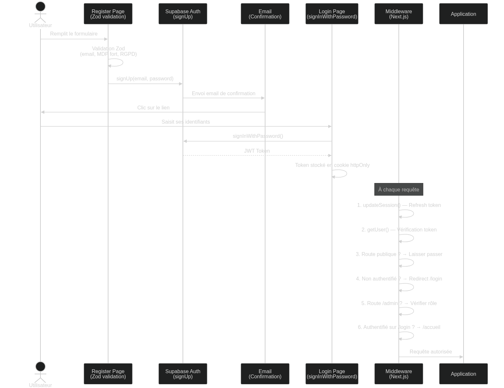

Figure F.6 : flux d'authentification du projet. Le schéma montre où sont contrôlés les mots de passe, les cookies, les JWT et les accès aux routes privées.

Les règles retenues pour les sessions sont :

| Règle            | Application                                                            |
| ---------------- | ---------------------------------------------------------------------- |
| Durée de session | 7 jours maximum sauf configuration Supabase différente                 |
| Mot de passe     | 8 caractères minimum, majuscule, minuscule, chiffre, caractère spécial |
| Rôle             | Contrôle via `profiles.role`                                           |
| Déconnexion      | Suppression de la session côté Supabase                                |
| Secrets          | Jamais de `SUPABASE_SERVICE_ROLE_KEY` côté navigateur                  |

La clé `NEXT_PUBLIC_SUPABASE_ANON_KEY` peut être visible côté client, ce qui est normal avec Supabase. La sécurité ne repose donc pas sur le secret de cette clé, mais sur les politiques RLS et les contrôles de rôle. La clé `SUPABASE_SERVICE_ROLE_KEY`, elle, doit rester uniquement côté serveur et dans les variables Vercel. Une fuite de cette clé serait classée critique.

#### Injections SQL et protection de la base

Le projet ne construit pas de requêtes SQL à partir de chaînes concaténées dans l'application. Les accès passent par le client Supabase avec des méthodes comme `.from()`, `.select()`, `.eq()`, `.insert()` et `.update()`. Cette approche limite fortement le risque d'injection SQL classique.

La protection doit quand même être complétée par des règles RLS en base. Supabase rappelle que la Row Level Security permet de définir des règles SQL adaptées au besoin métier et de protéger les données même quand elles sont accédées depuis le navigateur. Pour Le Rameau, les règles minimales attendues sont :

| Table ou ressource   | Règle attendue                                                              |
| -------------------- | --------------------------------------------------------------------------- |
| `profiles`           | Un résident lit et modifie uniquement son profil, un admin gère les membres |
| `consultation_votes` | Un résident vote pour son appartement, lecture selon besoin métier          |
| `consultations`      | Lecture résident, écriture admin ou conseil syndical                        |
| `actualites`         | Lecture résident, écriture admin ou conseil syndical                        |
| `assemblee_generale` | Lecture utilisateur connecté, écriture admin                                |
| `conseil_syndical`   | Lecture selon confidentialité, écriture admin                               |
| `user_logs`          | Lecture admin uniquement                                                    |

Un point d'attention existe dans les scripts de storage : certains buckets sont publics, notamment pour les fichiers AG et conseil syndical. Si ces documents sont considérés comme internes à la copropriété, les buckets doivent passer en privé avec URLs signées ou politiques `SELECT` limitées aux utilisateurs authentifiés. DevSphere prévoit 0,5 jour pour revoir les politiques Supabase Storage avant livraison.

#### Contrôle d'accès aux API

La sécurité API repose sur deux niveaux : le middleware Next.js et les contrôles dans chaque route sensible. Le middleware filtre l'accès global, mais une route API destructive doit aussi se protéger elle-même. C'est une règle importante, parce qu'une route peut être appelée directement sans passer par l'interface.

| API                           | Contrôle attendu                            | Statut cible |
| ----------------------------- | ------------------------------------------- | ------------ |
| `/api/cron/check-expirations` | `Authorization: Bearer CRON_SECRET`         | En place     |
| `/api/user/delete`            | Session + rôle admin + service role serveur | A renforcer  |
| `/api/board/member/delete`    | Session + rôle admin + service role serveur | A renforcer  |
| Routes Supabase directes      | RLS + rôle utilisateur                      | A vérifier   |

Pour la livraison, DevSphere fixe une règle simple : toute route qui utilise `SUPABASE_SERVICE_ROLE_KEY` doit contenir une vérification serveur du demandeur et un test fonctionnel associé. Il y a 2 routes de suppression concernées dans le dépôt, donc le contrôle est limité mais obligatoire.

#### Journalisation et surveillance

Le projet contient déjà une fonction `logAction` et une fonction `sanitizeData`. C'est utile pour garder une trace des connexions, créations, modifications, suppressions et expirations. La fonction `sanitizeData` évite de stocker des champs trop longs comme des fichiers base64 dans les logs.

Les journaux doivent rester proportionnés. Pour la V1, DevSphere recommande de conserver les logs applicatifs 6 mois, puis de supprimer ou anonymiser les anciens logs. Les actions à journaliser en priorité sont :

| Action                  | Pourquoi                                 |
| ----------------------- | ---------------------------------------- |
| Connexion admin         | Détecter une utilisation inhabituelle    |
| Suppression utilisateur | Action sensible et difficile à annuler   |
| Création consultation   | Impact direct sur les résidents          |
| Vote refusé             | Détecter tentative de double vote        |
| Upload document         | Suivre les changements de pièces jointes |
| Cron expiration         | Vérifier les traitements automatiques    |

#### Captures de code à insérer dans le cahier

Pour la version finale PDF, DevSphere recommande d'ajouter 5 captures de code dans cette partie. Elles peuvent venir du livret candidat existant si elles sont déjà prêtes.

| Capture | Fichier                                   | Ce qu'elle montre                          |
| ------- | ----------------------------------------- | ------------------------------------------ |
| SEC-01  | `middleware.ts`                           | Redirection des utilisateurs non connectés |
| SEC-02  | `middleware.ts`                           | Liste explicite des routes API publiques   |
| SEC-03  | `app/api/cron/check-expirations/route.ts` | Vérification `CRON_SECRET`                 |
| SEC-04  | `lib/validations.ts`                      | Règles de mot de passe et RGPD             |
| SEC-05  | `lib/logger.ts`                           | Nettoyage des données longues avant logs   |

#### Plan de correction avant livraison

| Action                                             | Priorité | Charge estimée |
| -------------------------------------------------- | -------- | -------------: |
| Ajouter headers sécurité dans `next.config.mjs`    | Haute    |       0,5 jour |
| Sanitizer les contenus riches des actualités       | Critique |       0,5 jour |
| Ajouter contrôle serveur sur routes de suppression | Critique |       0,5 jour |
| Revoir politiques Storage AG et conseil syndical   | Haute    |       0,5 jour |
| Tester CSRF sur routes POST sensibles              | Haute    |      0,25 jour |
| Vérifier absence de clé service role dans le front | Critique |      0,25 jour |
| Documenter la procédure de rotation des secrets    | Moyenne  |      0,25 jour |

Le budget total de correction sécurité avant livraison est donc d'environ 2,75 jours. C'est réaliste pour le projet, car les bases sont déjà présentes, mais certains points doivent être verrouillés avant de laisser le conseil syndical utiliser l'application en autonomie.

Sources utilisées pour cette partie :

| Source                                                                                                                                             | Utilisation                                               |
| -------------------------------------------------------------------------------------------------------------------------------------------------- | --------------------------------------------------------- |
| OWASP Cross Site Scripting Prevention Cheat Sheet, https://cheatsheetseries.owasp.org/cheatsheets/Cross_Site_Scripting_Prevention_Cheat_Sheet.html | Risque lié à `dangerouslySetInnerHTML`, sanitization HTML |
| OWASP CSRF Prevention Cheat Sheet, https://cheatsheetseries.owasp.org/cheatsheets/Cross-Site_Request_Forgery_Prevention_Cheat_Sheet.html           | SameSite, Origin, tokens et headers de protection         |
| Supabase Row Level Security, https://supabase.com/docs/guides/database/postgres/row-level-security                                                 | RLS, service keys et défense en profondeur                |
| Next.js Headers, https://nextjs.org/docs/app/api-reference/config/next-config-js/headers                                                           | Ajout de headers HTTP personnalisés                       |

#### English version

Security procedures are a priority for the Le Rameau project because the application contains resident data: identity, email, building, apartment, residence documents, consultations and action logs. The expected security level is not the same as a bank, but it must be serious, especially to prevent a simple resident from accessing administration or an internal document from being public by mistake.

DevSphere relies on three protection levels: Next.js for route filtering and headers, Supabase for authentication and database access rules, then GitHub/Vercel for secrets protection. This approach fits the project because it avoids building custom security that would be hard to maintain.

#### Planned protection summary

| Risk                | Planned protection                                       | Current state                    | Action before delivery                   |
| ------------------- | -------------------------------------------------------- | -------------------------------- | ---------------------------------------- |
| Unauthorized access | Next.js middleware + Supabase roles                      | Partly in place                  | Recheck sensitive API routes             |
| XSS                 | React escaping + HTML sanitization                       | To strengthen                    | Sanitize rich news content               |
| CSRF                | SameSite cookies + Origin check on sensitive POST routes | Partial                          | Add Origin check on 2 critical routes    |
| Cookies             | Supabase cookies with session options                    | In place through `@supabase/ssr` | Check `Secure`, `SameSite` in production |
| JWT                 | Supabase session and `auth.getUser()`                    | In place                         | Never trust front-end only               |
| SQL injection       | Supabase client with parameterized queries               | In place                         | Forbid raw SQL in application code       |
| Files               | Supabase buckets + MIME limits                           | Partial                          | Restrict private document buckets        |
| Secrets             | Vercel environment variables and ignored `.env.local`    | In place                         | Secrets audit before delivery            |

The final security check is estimated at 1.5 days. It includes 0.5 day of code review, 0.5 day of priority fixes and 0.5 day of security acceptance on critical journeys.

#### HTTPS and security headers

The website will be deployed on Vercel. In production, Vercel provides HTTPS on the configured domain. For the client, the goal is simple: no private page must be accessible through unencrypted HTTP. The final domain must automatically redirect to HTTPS.

The `next.config.mjs` file is currently minimal. DevSphere recommends adding security headers through Next.js configuration. The official Next.js documentation allows setting custom HTTP headers by path. For V1, the selected headers are:

| Header                      | Planned value                              | Role                                            |
| --------------------------- | ------------------------------------------ | ----------------------------------------------- |
| `Strict-Transport-Security` | `max-age=31536000; includeSubDomains`      | Force HTTPS for 1 year                          |
| `X-Content-Type-Options`    | `nosniff`                                  | Reduce MIME sniffing risk                       |
| `Referrer-Policy`           | `strict-origin-when-cross-origin`          | Limit information sent to external sites        |
| `Permissions-Policy`        | `camera=(), microphone=(), geolocation=()` | Block unused browser APIs                       |
| `X-Frame-Options`           | `DENY`                                     | Reduce clickjacking risk                        |
| `Content-Security-Policy`   | Progressive version                        | Control scripts, images, frames and connections |

The CSP must be deployed carefully because the project uses Supabase, Vercel and Spline. A too strict CSP can break the 3D scene or media loading. DevSphere therefore plans a first controlled version, tested on the 7 functional journeys defined in F.4, then a stricter version before final delivery. The planned time is 0.5 day.

#### XSS protection

React already protects most classic text rendering through automatic escaping. The sensitive point is on the news detail page: the code uses `dangerouslySetInnerHTML` to display content created with the rich text editor. OWASP warns that this React usage is risky if HTML is not cleaned before rendering.

DevSphere recommends adding DOMPurify or an equivalent solution on news content before display. Allowed tags must stay limited: headings, paragraphs, links, lists, bold, italic and validated images. `script` tags, `onClick`, `onError` attributes and `javascript:` URLs must be forbidden.

| Area              | Risk                           | Measure                                       |
| ----------------- | ------------------------------ | --------------------------------------------- |
| Rich news content | Script injection in an article | HTML sanitization before rendering            |
| External links    | Redirect to unsafe URL         | Allow only `https://` and `mailto:` if needed |
| News images       | Unexpected file type           | MIME types limited to JPEG, PNG, WebP, GIF    |
| Logs              | Too long data or base64        | Existing `sanitizeData` function              |

The related security test is simple: create a news item containing `<script>alert(1)</script>` and check that the script never runs. This test must be done during internal acceptance and can be added to automated tests. Estimated workload: 0.5 day to install the sanitizer, adapt rendering and test.

#### CSRF and sensitive requests

CSRF risk mainly concerns actions that modify data: user deletion, news creation, document update, vote. The application uses Supabase and JavaScript calls, which reduces part of the risk compared with simple HTML forms, but it is not enough for critical routes.

OWASP recommends protections such as CSRF tokens, `SameSite` cookies, custom headers and origin verification. For Le Rameau, the selected solution is pragmatic: check `Origin` or `Referer` on sensitive API routes, reject unknown origins, and keep Supabase cookies with `SameSite` and `Secure` in production.

| Route or action               | Expected measure                     | Priority         |
| ----------------------------- | ------------------------------------ | ---------------- |
| `/api/user/delete`            | Check session, admin role and origin | Critical         |
| `/api/board/member/delete`    | Check session, admin role and origin | Critical         |
| `/api/cron/check-expirations` | Mandatory `CRON_SECRET` token        | Already in place |
| Consultation vote             | Check logged-in user and apartment   | Critical         |
| Document upload               | Check role before upload             | High             |

Deletion routes currently use the `SUPABASE_SERVICE_ROLE_KEY`, which is normal to delete a Supabase Auth user. However, the route must never rely only on a header provided by the front-end. Before delivery, DevSphere must add a server-side check with `auth.getUser()` and a role check in `profiles`. Target: 0 destructive route accessible without full server-side control.

#### Cookies, JWT and sessions

Supabase handles the user session and JWTs. The project uses `@supabase/ssr` with a browser client, a server client and a middleware that refreshes the session. This is a good choice because private pages can check the user on the server side or in middleware.

The current middleware protects non-public routes and redirects a non-connected user to `/login`. It also contains an explicit list of public API routes, which avoids exposing the whole API by mistake. This is a positive point in the project.

The authentication flow diagram shown in the French version also applies here. It shows where data validation, Supabase Auth, email confirmation, JWT handling, cookies and middleware checks happen.

The selected session rules are:

| Rule             | Application                                                           |
| ---------------- | --------------------------------------------------------------------- |
| Session duration | 7 days maximum unless Supabase is configured differently              |
| Password         | 8 characters minimum, uppercase, lowercase, number, special character |
| Role             | Check through `profiles.role`                                         |
| Logout           | Supabase session removal                                              |
| Secrets          | Never expose `SUPABASE_SERVICE_ROLE_KEY` in the browser               |

The `NEXT_PUBLIC_SUPABASE_ANON_KEY` can be visible on the client side, which is normal with Supabase. Security therefore does not rely on this key being secret, but on RLS policies and role checks. The `SUPABASE_SERVICE_ROLE_KEY` must remain only server-side and in Vercel variables. A leak of this key would be classified as critical.

#### SQL injections and database protection

The project does not build SQL queries through string concatenation in the application. Access goes through the Supabase client with methods such as `.from()`, `.select()`, `.eq()`, `.insert()` and `.update()`. This strongly limits classic SQL injection risk.

Protection still needs RLS rules in the database. Supabase explains that Row Level Security makes it possible to write SQL rules matching business needs and to protect data even when it is accessed from the browser. For Le Rameau, the minimum expected rules are:

| Table or resource    | Expected rule                                                              |
| -------------------- | -------------------------------------------------------------------------- |
| `profiles`           | A resident reads and updates only their profile, an admin manages members  |
| `consultation_votes` | A resident votes for their apartment, read access depends on business need |
| `consultations`      | Resident read access, admin or council write access                        |
| `actualites`         | Resident read access, admin or council write access                        |
| `assemblee_generale` | Logged-in user read access, admin write access                             |
| `conseil_syndical`   | Read access according to confidentiality, admin write access               |
| `user_logs`          | Admin read access only                                                     |

One attention point exists in storage scripts: some buckets are public, especially AG and council files. If these documents are considered internal to the residence, buckets must become private with signed URLs or `SELECT` policies limited to authenticated users. DevSphere plans 0.5 day to review Supabase Storage policies before delivery.

#### API access control

API security relies on two levels: Next.js middleware and checks inside each sensitive route. The middleware filters global access, but a destructive API route must also protect itself. This is important because a route can be called directly without using the interface.

| API                           | Expected control                           | Target status |
| ----------------------------- | ------------------------------------------ | ------------- |
| `/api/cron/check-expirations` | `Authorization: Bearer CRON_SECRET`        | In place      |
| `/api/user/delete`            | Session + admin role + server service role | To strengthen |
| `/api/board/member/delete`    | Session + admin role + server service role | To strengthen |
| Direct Supabase routes        | RLS + user role                            | To check      |

For delivery, DevSphere sets a simple rule: every route using `SUPABASE_SERVICE_ROLE_KEY` must contain a server-side requester check and an associated functional test. There are 2 deletion routes concerned in the repository, so the control is limited but mandatory.

#### Logging and monitoring

The project already contains a `logAction` function and a `sanitizeData` function. This is useful to keep track of logins, creations, updates, deletions and expirations. The `sanitizeData` function avoids storing too long fields such as base64 files in logs.

Logs must remain proportionate. For V1, DevSphere recommends keeping application logs for 6 months, then deleting or anonymizing older logs. Priority actions to log are:

| Action                | Why                               |
| --------------------- | --------------------------------- |
| Admin login           | Detect unusual usage              |
| User deletion         | Sensitive action and hard to undo |
| Consultation creation | Direct impact on residents        |
| Refused vote          | Detect double vote attempt        |
| Document upload       | Follow attachment changes         |
| Expiration cron       | Check automatic treatments        |

#### Code screenshots to include in the specification

For the final PDF version, DevSphere recommends adding 5 code screenshots in this part. They can come from the existing candidate booklet if they are already ready.

| Screenshot | File                                      | What it shows                      |
| ---------- | ----------------------------------------- | ---------------------------------- |
| SEC-01     | `middleware.ts`                           | Redirection of non-connected users |
| SEC-02     | `middleware.ts`                           | Explicit list of public API routes |
| SEC-03     | `app/api/cron/check-expirations/route.ts` | `CRON_SECRET` verification         |
| SEC-04     | `lib/validations.ts`                      | Password and GDPR rules            |
| SEC-05     | `lib/logger.ts`                           | Long data cleaning before logs     |

#### Correction plan before delivery

| Action                                         | Priority | Estimated workload |
| ---------------------------------------------- | -------- | -----------------: |
| Add security headers in `next.config.mjs`      | High     |            0.5 day |
| Sanitize rich news content                     | Critical |            0.5 day |
| Add server-side control on deletion routes     | Critical |            0.5 day |
| Review AG and council Storage policies         | High     |            0.5 day |
| Test CSRF on sensitive POST routes             | High     |           0.25 day |
| Check absence of service role key in front-end | Critical |           0.25 day |
| Document secret rotation procedure             | Medium   |           0.25 day |

The total security correction budget before delivery is around 2.75 days. This is realistic for the project because the foundations are already present, but some points must be locked before the council uses the application autonomously.

Sources used for this section:

| Source                                                                                                                                             | Usage                                                       |
| -------------------------------------------------------------------------------------------------------------------------------------------------- | ----------------------------------------------------------- |
| OWASP Cross Site Scripting Prevention Cheat Sheet, https://cheatsheetseries.owasp.org/cheatsheets/Cross_Site_Scripting_Prevention_Cheat_Sheet.html | Risk linked to `dangerouslySetInnerHTML`, HTML sanitization |
| OWASP CSRF Prevention Cheat Sheet, https://cheatsheetseries.owasp.org/cheatsheets/Cross-Site_Request_Forgery_Prevention_Cheat_Sheet.html           | SameSite, Origin, tokens and protective headers             |
| Supabase Row Level Security, https://supabase.com/docs/guides/database/postgres/row-level-security                                                 | RLS, service keys and defense in depth                      |
| Next.js Headers, https://nextjs.org/docs/app/api-reference/config/next-config-js/headers                                                           | Custom HTTP headers                                         |

### F.10 Maintenance

#### Version française

La maintenance sert à garder le site Le Rameau utilisable après sa mise en ligne. Pour le conseil syndical, le besoin est assez concret : les résidents doivent pouvoir se connecter, lire les actualités, télécharger les documents et voter sans que l'équipe bénévole ait à gérer des problèmes techniques. Même si le site est stable au moment de la livraison, les dépendances, les navigateurs, Supabase et Vercel évoluent. Sans maintenance, un petit bug peut devenir bloquant plusieurs mois plus tard.

DevSphere propose donc une maintenance légère, adaptée à une copropriété de 80 à 100 lots. L'objectif n'est pas de vendre un forfait trop cher au client. Le bon équilibre est de prévoir un suivi régulier, des délais d'intervention clairs et un budget que le conseil syndical peut présenter facilement en réunion.

#### Garantie après livraison

Une garantie corrective de 30 jours est incluse après la mise en production. Elle couvre les anomalies directement liées au périmètre livré. Par exemple, si le vote unique ne fonctionne pas alors qu'il était prévu dans le cahier des charges, la correction entre dans la garantie. En revanche, une nouvelle fonctionnalité demandée après validation, comme un module de réservation de salle commune, est considérée comme une évolution.

| Période                   |                   Durée | Inclus                                            | Non inclus                                                |
| ------------------------- | ----------------------: | ------------------------------------------------- | --------------------------------------------------------- |
| Garantie de mise en ligne |                30 jours | Bugs bloquants ou majeurs liés au livrable validé | Nouvelles demandes, changement de design, ajout de module |
| Suivi post-livraison      |              2 semaines | Point de contrôle avec le client                  | Développement hors périmètre                              |
| Bilan de fin de garantie  | 1 réunion de 45 minutes | Liste des corrections et recommandations          | Formation complète des administrateurs                    |

Cette garantie permet de sécuriser le démarrage du projet sans obliger le client à signer tout de suite un contrat annuel. Elle rassure aussi le conseil syndical, car les premières semaines sont souvent celles où les vrais utilisateurs remontent le plus de petits problèmes.

#### Types de maintenance

| Type de maintenance | Définition dans le projet                  | Exemple Le Rameau                                             | Fréquence       |
| ------------------- | ------------------------------------------ | ------------------------------------------------------------- | --------------- |
| Corrective          | Corriger une anomalie                      | Un document ne s'ouvre plus ou une actualité ne se publie pas | Selon incident  |
| Evolutive           | Ajouter ou modifier une fonctionnalité     | Ajouter un historique des anciennes consultations             | Sur devis       |
| Préventive          | Eviter les problèmes avant qu'ils arrivent | Mettre à jour les dépendances et vérifier les logs            | 1 fois par mois |
| Adaptative          | Adapter le site à un changement externe    | Changement API Supabase, nouvelle contrainte navigateur       | Selon besoin    |

Pour la V1, DevSphere conseille de privilégier la maintenance corrective et préventive. Les évolutions doivent rester séparées dans des devis optionnels, car sinon le forfait mensuel devient vite flou. Le conseil syndical doit savoir ce qu'il paie chaque mois.

#### Niveaux de support

Les incidents sont classés en 4 niveaux. Cette classification évite de traiter une faute de frappe avec la même urgence qu'une panne de connexion.

| Niveau   | Exemple                                                         | Délai de prise en compte |       Délai cible de correction |
| -------- | --------------------------------------------------------------- | -----------------------: | ------------------------------: |
| Critique | Plus aucun résident ne peut se connecter                        |         4 heures ouvrées |                    1 jour ouvré |
| Majeur   | Les votes ou documents sont indisponibles                       |             1 jour ouvré |                  2 jours ouvrés |
| Moyen    | Un formulaire admin fonctionne mal mais un contournement existe |           2 jours ouvrés |                  5 jours ouvrés |
| Mineur   | Texte, alignement ou détail graphique                           |           5 jours ouvrés | Prochaine mise à jour mensuelle |

Le support est assuré du lundi au vendredi, de 9h00 à 18h00, hors jours fériés. Pour une petite copropriété, une astreinte 24h/24 serait trop coûteuse et pas vraiment justifiée. En cas de besoin exceptionnel, par exemple avant une assemblée générale, une intervention prioritaire peut être prévue sur devis.

#### Forfait de maintenance recommandé

DevSphere recommande un forfait mensuel simple à 120 euros HT par mois. Pour une résidence de 80 à 100 lots, cela représente environ 1,20 à 1,50 euro HT par lot et par mois. Ce montant est cohérent avec un petit projet associant suivi technique, mises à jour et assistance limitée.

| Élément inclus              |       Quantité mensuelle | Détail                                                       |
| --------------------------- | -----------------------: | ------------------------------------------------------------ |
| Surveillance technique      |   1 contrôle par semaine | Vérification disponibilité, erreurs Vercel, alertes Supabase |
| Mises à jour mineures       |       1 passage par mois | Dépendances compatibles, correctifs non risqués              |
| Support utilisateur admin   |                  1 heure | Aide au conseil syndical sur l'administration                |
| Corrections mineures        |        Jusqu'à 2 tickets | Hors nouvelle fonctionnalité                                 |
| Sauvegardes et restauration | 1 vérification mensuelle | Vérifier que les backups Supabase sont disponibles           |
| Rapport mensuel             |               1 synthèse | Incidents, actions réalisées, recommandations                |

Les heures non consommées ne sont pas reportées le mois suivant. Ce choix garde le forfait simple à gérer. Si le client préfère un fonctionnement plus souple, DevSphere peut proposer un carnet de 10 heures à utiliser sur 6 mois, mais cela sera présenté en option dans le devis.

#### Prestations hors forfait

Certaines demandes ne doivent pas entrer dans la maintenance courante, sinon le forfait devient impossible à tenir. Les prestations hors forfait sont facturées au taux journalier moyen de l'agence, ou au taux horaire si l'intervention est courte.

| Prestation                         | Exemple                                                       | Mode de facturation   |
| ---------------------------------- | ------------------------------------------------------------- | --------------------- |
| Nouvelle fonctionnalité            | Réservation de local vélo, module incident, export PDF avancé | Devis séparé          |
| Refonte graphique                  | Changer entièrement la page d'accueil                         | Devis séparé          |
| Migration technique majeure        | Passage vers une autre base ou autre hébergeur                | Devis séparé          |
| Formation longue                   | Session de 2 heures avec plusieurs administrateurs            | 90 euros HT par heure |
| Intervention urgente hors horaires | Correction soir ou week-end                                   | Majoration de 50 %    |

Le taux horaire de maintenance hors forfait est fixé à 90 euros HT. Ce montant correspond à une intervention courte par un développeur ou chef de projet technique. Pour les tâches plus longues, DevSphere privilégie un devis détaillé afin d'éviter une facture difficile à anticiper pour le conseil syndical.

#### Responsabilités

| Sujet                          | Responsable DevSphere    | Responsable client                               |
| ------------------------------ | ------------------------ | ------------------------------------------------ |
| Correction technique           | Développeur principal    | Signaler le bug avec capture si possible         |
| Priorisation                   | Chef de projet           | Valider le niveau d'urgence                      |
| Contenus publiés               | Non responsable du fond  | Conseil syndical                                 |
| Données résidents              | Support technique        | Conseil syndical en tant que représentant client |
| Mots de passe administrateurs  | Support si besoin        | Administrateurs désignés                         |
| Paiement des services externes | Assistance configuration | Client ou syndic selon décision                  |

Le responsable maintenance côté DevSphere est Antoine Garnier, chef de projet technique. Il centralise les demandes, les classe et assigne les corrections. Matthieu Luiggi intervient comme développeur principal sur les corrections liées à Next.js, Supabase et l'interface d'administration.

#### Indicateurs de suivi

Le suivi de maintenance ne doit pas se limiter à dire que tout fonctionne. DevSphere prévoit une synthèse mensuelle envoyée au conseil syndical, avec des indicateurs simples :

| Indicateur                     |                     Objectif mensuel |
| ------------------------------ | -----------------------------------: |
| Disponibilité du site          |                         99 % minimum |
| Nombre d'incidents critiques   |                                    0 |
| Temps moyen de prise en compte |                Moins de 1 jour ouvré |
| Tickets corrigés               | 90 % des tickets prévus dans le mois |
| Alertes sécurité traitées      |          100 % des alertes critiques |
| Sauvegardes vérifiées          |                  1 contrôle par mois |

Ces indicateurs sont suffisants pour un projet de cette taille. Un reporting trop détaillé ferait perdre du temps et augmenterait le coût, sans apporter beaucoup plus au client.

#### Devis optionnel associé

La maintenance sera présentée comme un devis optionnel, séparé du devis principal de création du site. La durée initiale recommandée est de 12 mois, avec résiliation possible après 3 mois. Cela évite d'engager trop fortement le conseil syndical dès le départ.

| Offre                     |            Prix HT |           Engagement | Contenu                                                      |
| ------------------------- | -----------------: | -------------------: | ------------------------------------------------------------ |
| Maintenance essentielle   | 120 euros par mois |       3 mois minimum | Suivi, mises à jour mineures, 1 h support, 2 tickets mineurs |
| Carnet d'heures optionnel |          850 euros | 10 h valables 6 mois | Evolutions ou corrections hors forfait                       |
| Formation administrateurs |          180 euros |                  2 h | Formation conseil syndical sur l'espace admin                |

Pour la résidence Le Rameau, DevSphere recommande l'offre maintenance essentielle. Elle couvre le besoin réel sans dépasser le budget attendu d'une petite copropriété. Les options ne sont activées que si le conseil syndical veut faire évoluer le site après la V1.

#### English version

Maintenance keeps the Le Rameau website usable after go-live. For the council, the need is very concrete: residents must be able to log in, read news, download documents and vote without the volunteer team having to manage technical problems. Even if the website is stable at delivery, dependencies, browsers, Supabase and Vercel evolve. Without maintenance, a small bug can become blocking several months later.

DevSphere therefore proposes a light maintenance plan, adapted to a residence of 80 to 100 units. The goal is not to sell an overpriced plan to the client. The right balance is regular follow-up, clear intervention times and a budget that the council can easily present during a meeting.

#### Warranty after delivery

A 30-day corrective warranty is included after production launch. It covers defects directly linked to the delivered scope. For example, if unique voting does not work although it was planned in the specification, the fix is included in the warranty. However, a new feature requested after validation, such as a shared room booking module, is considered an evolution.

| Period                  |                Duration | Included                                                | Not included                                  |
| ----------------------- | ----------------------: | ------------------------------------------------------- | --------------------------------------------- |
| Go-live warranty        |                 30 days | Blocking or major bugs linked to the validated delivery | New requests, design changes, module addition |
| Post-delivery follow-up |                 2 weeks | Checkpoint with the client                              | Out-of-scope development                      |
| End-of-warranty review  | 1 meeting of 45 minutes | List of fixes and recommendations                       | Full administrator training                   |

This warranty secures the project start without forcing the client to sign a yearly contract immediately. It also reassures the council because the first weeks are often when real users report the most small issues.

#### Maintenance types

| Maintenance type | Definition in the project            | Le Rameau example                                          | Frequency             |
| ---------------- | ------------------------------------ | ---------------------------------------------------------- | --------------------- |
| Corrective       | Fix a defect                         | A document no longer opens or a news item does not publish | Depending on incident |
| Evolutionary     | Add or modify a feature              | Add a history of closed consultations                      | Quotation only        |
| Preventive       | Avoid issues before they happen      | Update dependencies and check logs                         | Once a month          |
| Adaptive         | Adapt the site to an external change | Supabase API change, new browser constraint                | Depending on need     |

For V1, DevSphere recommends focusing on corrective and preventive maintenance. Evolutions must remain separated in optional quotes, otherwise the monthly plan becomes unclear. The council must know what it pays for every month.

#### Support levels

Incidents are classified into 4 levels. This classification avoids treating a typo with the same urgency as a login outage.

| Level    | Example                                        | Acknowledgement time | Target correction time |
| -------- | ---------------------------------------------- | -------------------: | ---------------------: |
| Critical | No resident can log in anymore                 |      4 working hours |          1 working day |
| Major    | Votes or documents are unavailable             |        1 working day |         2 working days |
| Medium   | An admin form works badly but has a workaround |       2 working days |         5 working days |
| Minor    | Text, alignment or visual detail               |       5 working days |    Next monthly update |

Support is provided from Monday to Friday, 9:00 to 18:00, excluding public holidays. For a small residence, 24/7 on-call support would be too expensive and not really justified. If there is an exceptional need, for example before a general meeting, a priority intervention can be planned with a separate quote.

#### Recommended maintenance plan

DevSphere recommends a simple monthly plan at 120 euros excluding VAT per month. For a residence of 80 to 100 units, this represents around 1.20 to 1.50 euros excluding VAT per unit per month. This amount is consistent with a small project combining technical monitoring, updates and limited assistance.

| Included item             | Monthly quantity | Detail                                        |
| ------------------------- | ---------------: | --------------------------------------------- |
| Technical monitoring      | 1 check per week | Availability, Vercel errors, Supabase alerts  |
| Minor updates             | 1 pass per month | Compatible dependencies, low-risk fixes       |
| Admin user support        |           1 hour | Help for the council on administration        |
| Minor fixes               |  Up to 2 tickets | Excluding new feature                         |
| Backups and restore check |  1 monthly check | Verify that Supabase backups are available    |
| Monthly report            |        1 summary | Incidents, actions completed, recommendations |

Unused hours are not carried over to the next month. This choice keeps the plan simple to manage. If the client prefers a more flexible system, DevSphere can offer a 10-hour package to use over 6 months, but it will be presented as an option in the quotation.

#### Out-of-plan services

Some requests must not be included in regular maintenance, otherwise the plan becomes impossible to manage. Out-of-plan services are billed using the agency day rate, or the hourly rate if the intervention is short.

| Service                           | Example                                                 | Billing method                  |
| --------------------------------- | ------------------------------------------------------- | ------------------------------- |
| New feature                       | Bike room booking, incident module, advanced PDF export | Separate quote                  |
| Graphic redesign                  | Fully changing the homepage                             | Separate quote                  |
| Major technical migration         | Moving to another database or host                      | Separate quote                  |
| Long training                     | 2-hour session with several administrators              | 90 euros excluding VAT per hour |
| Urgent intervention outside hours | Evening or weekend fix                                  | 50% extra                       |

The hourly maintenance rate outside the plan is 90 euros excluding VAT. This amount matches a short intervention by a developer or technical project manager. For longer tasks, DevSphere prefers a detailed quote to avoid a bill that is hard for the council to anticipate.

#### Responsibilities

| Subject                  | DevSphere owner                     | Client owner                               |
| ------------------------ | ----------------------------------- | ------------------------------------------ |
| Technical correction     | Main developer                      | Report the bug with screenshot if possible |
| Prioritization           | Project manager                     | Validate urgency level                     |
| Published content        | Not responsible for content meaning | Council                                    |
| Resident data            | Technical support                   | Council as client representative           |
| Administrator passwords  | Support if needed                   | Designated administrators                  |
| External service payment | Configuration assistance            | Client or syndic depending on decision     |

The maintenance owner on DevSphere side is Antoine Garnier, technical project manager. He centralizes requests, classifies them and assigns corrections. Matthieu Luiggi works as main developer on fixes linked to Next.js, Supabase and the administration interface.

#### Monitoring indicators

Maintenance follow-up should not only say that everything works. DevSphere plans a monthly summary sent to the council, with simple indicators:

| Indicator                    |                      Monthly target |
| ---------------------------- | ----------------------------------: |
| Website availability         |                         99% minimum |
| Number of critical incidents |                                   0 |
| Average acknowledgement time |             Less than 1 working day |
| Fixed tickets                | 90% of tickets planned in the month |
| Security alerts handled      |             100% of critical alerts |
| Backups checked              |                   1 check per month |

These indicators are enough for a project of this size. A more detailed report would take more time and increase cost, without bringing much more value to the client.

#### Associated optional quote

Maintenance will be presented as an optional quote, separated from the main website creation quote. The recommended initial duration is 12 months, with cancellation possible after 3 months. This avoids locking the council too strongly at the beginning.

| Offer                  | Price excluding VAT |              Commitment | Content                                                 |
| ---------------------- | ------------------: | ----------------------: | ------------------------------------------------------- |
| Essential maintenance  | 120 euros per month |        3 months minimum | Monitoring, minor updates, 1 h support, 2 minor tickets |
| Optional hour package  |           850 euros | 10 h valid for 6 months | Evolutions or fixes outside plan                        |
| Administrator training |           180 euros |                     2 h | Council training on admin area                          |

For the Le Rameau residence, DevSphere recommends the essential maintenance offer. It covers the real need without exceeding the expected budget of a small residence. Options are activated only if the council wants to improve the website after V1.

### F.11 Mise en ligne

#### Version française

La mise en ligne du projet Le Rameau doit rester simple à maintenir. Le conseil syndical n'a pas besoin d'un serveur dédié ou d'une infrastructure complexe. Le site est une application Next.js avec Supabase pour l'authentification, la base PostgreSQL et le stockage de fichiers. Le bon choix est donc une solution Cloud managée, avec déploiement automatique depuis GitHub.

DevSphere distingue bien l'environnement de développement de l'environnement client. Le cahier des charges ne doit pas recommander au client de garder un hébergement de test gratuit juste parce qu'il a servi pendant le développement. Pour la V1, la recommandation client est Vercel pour le front et les routes Next.js, Supabase pour les données, et OVHcloud ou Ionos pour le nom de domaine en `.fr`.

#### Comparaison des types d'hébergement

| Type de serveur         | Avantages                                          | Limites                                                     | Avis DevSphere pour Le Rameau |
| ----------------------- | -------------------------------------------------- | ----------------------------------------------------------- | ----------------------------- |
| Mutualisé               | Peu cher, simple pour un site vitrine              | Pas adapté à Next.js server-side et Supabase                | Ecarté                        |
| VPS                     | Contrôle complet, coût raisonnable                 | Demande maintenance système, sécurité, mises à jour serveur | Trop lourd pour le client     |
| Serveur dédié           | Performances et contrôle élevés                    | Coût et administration disproportionnés                     | Ecarté                        |
| Cloud managé            | Déploiement rapide, SSL, logs, scaling automatique | Dépendance au fournisseur                                   | Retenu                        |
| PaaS spécialisé Next.js | Très adapté au framework, CI/CD intégré            | Coût par siège ou usage                                     | Retenu avec Vercel            |

Le cloud managé est le plus cohérent pour ce projet. La copropriété n'a pas d'équipe informatique interne. Il vaut mieux payer un petit abonnement maîtrisé que devoir gérer un serveur Linux, des certificats, des mises à jour de sécurité et des sauvegardes manuelles.

#### Prestataires étudiés

| Prestataire  | Usage possible                                   |                            Coût observé ou prévu | Décision                           |
| ------------ | ------------------------------------------------ | -----------------------------------------------: | ---------------------------------- |
| Vercel       | Hébergement Next.js, SSL, CI/CD, cron            |     Pro à 20 dollars par mois et par développeur | Retenu pour la V1                  |
| Supabase     | Auth, PostgreSQL, Storage, RLS                   |       Free à 0 dollar, Pro à 25 dollars par mois | Retenu, Free V1 puis Pro si besoin |
| OVHcloud     | Nom de domaine `.fr`, DNS, hébergement classique |    Prévoir 10 à 15 euros HT par an pour un `.fr` | Retenu pour le domaine             |
| Ionos        | Nom de domaine et hébergement classique          |              Prix proche du marché pour un `.fr` | Alternative                        |
| AWS          | Infrastructure complète, scalabilité élevée      |                     Trop complexe pour ce besoin | Ecarté                             |
| VPS OVHcloud | Serveur applicatif manuel                        | Quelques euros par mois mais maintenance serveur | Ecarté pour la V1                  |

Le choix recommandé est volontairement sobre : Vercel Pro pour la mise en production applicative, Supabase Free au démarrage si les quotas suffisent, puis Supabase Pro si les sauvegardes automatiques et les limites deviennent nécessaires. Cette approche garde le budget initial autour de 20 dollars par mois plus le domaine, avec une option plus confortable autour de 45 dollars par mois si Supabase Pro est activé.

Pour une copropriété de 80 à 100 lots, commencer directement avec une grosse infrastructure n'a pas de sens. Les tests de charge de F.8 servent justement à vérifier si le niveau gratuit ou standard suffit. Si les documents deviennent lourds ou si le stockage augmente vite, le passage à Supabase Pro sera présenté au conseil syndical avec des chiffres.

#### Nom de domaine préconisé

Le nom de domaine doit être clair, facile à retenir et lié à la résidence. DevSphere recommande d'acheter un domaine en `.fr`, car le client est une copropriété locale en France.

| Domaine                  | Avis                                    | Justification                                |
| ------------------------ | --------------------------------------- | -------------------------------------------- |
| `le-rameau.fr`           | Choix idéal si disponible               | Court et directement lié au nom de résidence |
| `residence-le-rameau.fr` | Choix recommandé si le premier est pris | Plus explicite pour les résidents            |
| `app-le-rameau.fr`       | Possible mais moins naturel             | Fait plus technique                          |
| `le-rameau-copro.fr`     | Possible                                | Précise l'usage copropriété                  |

Le domaine recommandé est `residence-le-rameau.fr`. Il est plus clair à l'oral qu'un domaine commençant par `app`, et il évite la confusion avec un éventuel site public portant seulement le nom `le-rameau.fr`. Le coût annuel estimé reste faible, environ 10 à 15 euros HT par an selon le registrar et les options.

#### Budget mensuel de mise en ligne

| Poste                      | Formule V1 recommandée        |                      Coût estimé |
| -------------------------- | ----------------------------- | -------------------------------: |
| Hébergement front Next.js  | Vercel Pro, 1 siège DevSphere |              20 dollars par mois |
| Base de données et auth    | Supabase Free au démarrage    |                0 dollar par mois |
| Domaine `.fr`              | OVHcloud ou Ionos             |          10 à 15 euros HT par an |
| SSL                        | Inclus Vercel                 |                           0 euro |
| Cron expiration actualités | Vercel Cron                   |              Inclus selon quotas |
| Emails transactionnels     | Non prévu en V1               |                           0 euro |
| Maintenance applicative    | Devis optionnel F.10          | 120 euros HT par mois si accepté |

Budget technique V1 hors maintenance : environ 20 dollars par mois plus le domaine annuel. Budget technique avec Supabase Pro : environ 45 dollars par mois plus le domaine annuel. DevSphere recommande d'inscrire la formule Supabase Pro comme option de sécurisation, pas comme obligation de départ.

#### Architecture de mise en production


Figure F.7 : architecture de production. Le domaine pointe vers Vercel, tandis que Supabase prend en charge l'authentification, la base, le stockage et les traitements cron.

Le domaine pointe vers Vercel. Vercel sert les pages publiques, les pages privées et les routes API Next.js. Supabase gère l'authentification, les données et les fichiers. Le cron Vercel appelle une route protégée par `CRON_SECRET` pour traiter les expirations d'actualités chaque nuit à 3h00.

#### Prérequis de déploiement

| Prérequis                 | Détail                                                               |
| ------------------------- | -------------------------------------------------------------------- |
| Compte GitHub             | Dépôt privé `le-rameau`                                              |
| Compte Vercel             | Projet relié au dépôt GitHub                                         |
| Compte Supabase           | Projet de production séparé de la préproduction                      |
| Nom de domaine            | `residence-le-rameau.fr` ou équivalent                               |
| Variables d'environnement | Supabase URL, anon key, service role key, app URL, cron secret       |
| Scripts SQL               | Tables, RLS, buckets Storage, politiques                             |
| Tests préalables          | `npm run lint`, `npm run typecheck`, `npm run test`, `npm run build` |

Le projet contient déjà un fichier `.env.local.example`, ce qui est utile pour ne pas oublier les variables. Les valeurs réelles ne doivent jamais être envoyées sur GitHub. Elles sont renseignées dans Vercel et Supabase uniquement.

Variables nécessaires en production :

| Variable                        | Usage                       | Sensibilité                    |
| ------------------------------- | --------------------------- | ------------------------------ |
| `NEXT_PUBLIC_SUPABASE_URL`      | URL du projet Supabase      | Publique                       |
| `NEXT_PUBLIC_SUPABASE_ANON_KEY` | Clé publique Supabase       | Publique mais encadrée par RLS |
| `SUPABASE_SERVICE_ROLE_KEY`     | Actions serveur sensibles   | Très sensible                  |
| `NEXT_PUBLIC_APP_URL`           | URL publique du site        | Publique                       |
| `NEXT_PUBLIC_APP_NAME`          | Nom affiché                 | Publique                       |
| `CRON_SECRET`                   | Protection de la route cron | Très sensible                  |

#### Manuel de déploiement en ligne

1. Créer le projet Supabase de production.
2. Exécuter les scripts SQL présents dans le dossier `supabase`.
3. Vérifier que les tables, RLS et buckets Storage sont créés.
4. Créer ou vérifier les rôles nécessaires dans la table `profiles`.
5. Créer le projet Vercel depuis le dépôt GitHub privé.
6. Renseigner les variables d'environnement dans Vercel.
7. Vérifier que la branche de production est `main`.
8. Lancer un premier déploiement Vercel.
9. Contrôler les logs de build.
10. Ajouter le domaine `residence-le-rameau.fr` dans Vercel.
11. Configurer les DNS chez le registrar.
12. Attendre la propagation DNS, généralement entre 15 minutes et 24 heures.
13. Vérifier que le certificat SSL est actif.
14. Tester les parcours critiques.
15. Valider la mise en production avec le conseil syndical.

Les commandes locales à lancer avant le déploiement final sont :

```text
npm install
npm run lint
npm run typecheck
npm run test
npm run build
```

Dans l'environnement actuel, les dépendances ne sont pas installées, donc ces commandes devront être lancées sur le poste de livraison ou dans la CI GitHub avant validation finale.

#### Configuration DNS et SSL

La configuration DNS dépend du registrar choisi. Si le domaine est acheté chez OVHcloud, les enregistrements DNS seront modifiés dans le manager OVHcloud. Vercel indiquera les valeurs exactes à créer.

| Enregistrement | Exemple                                   | Rôle                            |
| -------------- | ----------------------------------------- | ------------------------------- |
| A              | IP fournie par Vercel                     | Pointer le domaine racine       |
| CNAME          | `cname.vercel-dns.com`                    | Pointer `www` vers Vercel       |
| TXT            | Valeur de vérification Vercel si demandée | Prouver la propriété du domaine |

Le SSL est géré par Vercel. Après propagation DNS, le certificat est généré automatiquement. La recette doit vérifier que l'URL `https://residence-le-rameau.fr` fonctionne et que `http://` redirige vers `https://`.

#### Sécurisation de la production

| Point        | Action                                                         |
| ------------ | -------------------------------------------------------------- |
| HTTPS        | Certificat Vercel actif avant ouverture aux résidents          |
| Secrets      | Variables sensibles uniquement dans Vercel                     |
| Service role | Jamais exposée côté client                                     |
| RLS          | Politiques Supabase vérifiées avant import des vrais résidents |
| Storage      | Buckets privés ou accès limité selon confidentialité           |
| Cron         | `CRON_SECRET` long et différent des autres mots de passe       |
| Domaine      | Renouvellement automatique activé                              |
| Accès admin  | 2 à 3 comptes maximum au lancement                             |

DevSphere recommande aussi d'activer la double authentification sur les comptes GitHub, Vercel, Supabase et registrar. Il y a peu de comptes concernés, donc cette mesure est peu coûteuse et réduit fortement le risque de prise de contrôle.

#### Tests post-déploiement

| Test            | Résultat attendu                                         |
| --------------- | -------------------------------------------------------- |
| Page d'accueil  | Chargement en moins de 3 secondes sur connexion correcte |
| Inscription     | Formulaire fonctionnel avec validation RGPD              |
| Connexion       | Accès à l'espace privé                                   |
| Actualités      | Liste et détail accessibles                              |
| Documents AG    | Document visible et téléchargeable                       |
| Consultation    | Vote possible une seule fois par appartement             |
| Dashboard admin | Accès réservé aux comptes autorisés                      |
| Cron            | Route protégée et traitement opérationnel                |
| Mobile          | Parcours principal utilisable sur 390 x 844              |

La mise en production n'est validée que si les parcours critiques fonctionnent. Un problème mineur visuel peut être reporté en maintenance, mais pas un problème de connexion, de vote ou de document.

#### Sauvegardes et restauration

Supabase gère une partie de la sauvegarde selon la formule choisie. Pour la V1 avec budget réduit, DevSphere prévoit aussi un export manuel mensuel de la base avant les changements importants. Si le client active Supabase Pro, la stratégie de sauvegarde devient plus confortable et moins manuelle.

| Donnée                    | Sauvegarde prévue                                        | Fréquence               |
| ------------------------- | -------------------------------------------------------- | ----------------------- |
| Base PostgreSQL           | Export Supabase ou sauvegarde intégrée selon formule     | 1 fois par mois minimum |
| Documents Storage         | Vérification des buckets et copie si besoin              | 1 fois par mois         |
| Code source               | GitHub privé                                             | À chaque commit         |
| Variables d'environnement | Inventaire sécurisé, sans valeur en clair dans le cahier | À chaque changement     |
| Domaine                   | Renouvellement automatique                               | Annuel                  |

La procédure de restauration doit être testée au moins une fois avant la livraison finale. Le test consiste à restaurer un export sur un projet Supabase de préproduction, puis à vérifier la connexion, les actualités, les documents et les consultations. Charge estimée : 0,5 jour.

#### Procédure de retour arrière

En cas de problème après mise en production, Vercel permet de revenir à un déploiement précédent. La règle DevSphere est la suivante : si un bug critique apparaît dans les 30 minutes suivant une mise en production, on annule le déploiement et on analyse ensuite. On ne tente pas une correction rapide directement en production sauf si le retour arrière est impossible.

| Situation                    | Action                                                           |
| ---------------------------- | ---------------------------------------------------------------- |
| Build cassé                  | Le déploiement est refusé, aucune mise en prod                   |
| Bug critique après livraison | Rollback Vercel immédiat                                         |
| Erreur de données            | Restaurer depuis sauvegarde ou corriger en base après validation |
| Secret exposé                | Rotation immédiate de la clé concernée                           |
| Domaine mal configuré        | Retour temporaire sur URL Vercel + correction DNS                |

#### Sources utilisées pour cette partie

| Source                                                              | Utilisation                                          |
| ------------------------------------------------------------------- | ---------------------------------------------------- |
| Vercel Pricing, https://vercel.com/pricing                          | Prix Pro, SSL, CDN, CI/CD, usage inclus              |
| Supabase Pricing, https://supabase.com/pricing                      | Comparaison Free et Pro pour la base et l'auth       |
| OVHcloud domaine `.fr`, https://www.ovhcloud.com/fr/domains/tld/fr/ | Domaine `.fr`, registrar et DNS                      |
| Documentation projet `README.md`                                    | Processus existant de déploiement Vercel et Supabase |

#### English version

The Le Rameau deployment must stay easy to maintain. The council does not need a dedicated server or a complex infrastructure. The website is a Next.js application with Supabase for authentication, PostgreSQL database and file storage. The right choice is therefore a managed Cloud solution, with automatic deployment from GitHub.

DevSphere clearly separates the development environment from the client environment. The specification must not recommend that the client keeps a free test hosting only because it was used during development. For V1, the client recommendation is Vercel for the front-end and Next.js routes, Supabase for data, and OVHcloud or Ionos for the `.fr` domain name.

#### Hosting type comparison

| Server type              | Advantages                                      | Limits                                          | DevSphere opinion for Le Rameau |
| ------------------------ | ----------------------------------------------- | ----------------------------------------------- | ------------------------------- |
| Shared hosting           | Cheap, simple for a showcase website            | Not adapted to server-side Next.js and Supabase | Rejected                        |
| VPS                      | Full control, reasonable cost                   | Requires server maintenance, security, updates  | Too heavy for the client        |
| Dedicated server         | High performance and control                    | Cost and administration are disproportionate    | Rejected                        |
| Managed Cloud            | Fast deployment, SSL, logs, automatic scaling   | Provider dependency                             | Selected                        |
| Next.js specialized PaaS | Very adapted to the framework, integrated CI/CD | Cost per seat or usage                          | Selected with Vercel            |

Managed Cloud is the most coherent option for this project. The residence has no internal IT team. It is better to pay a small controlled subscription than to manage a Linux server, certificates, security updates and manual backups.

#### Providers studied

| Provider     | Possible usage                          |                               Observed or planned cost | Decision                             |
| ------------ | --------------------------------------- | -----------------------------------------------------: | ------------------------------------ |
| Vercel       | Next.js hosting, SSL, CI/CD, cron       |              Pro at 20 dollars per month per developer | Selected for V1                      |
| Supabase     | Auth, PostgreSQL, Storage, RLS          |          Free at 0 dollar, Pro at 25 dollars per month | Selected, Free V1 then Pro if needed |
| OVHcloud     | `.fr` domain name, DNS, classic hosting | Plan 10 to 15 euros excluding VAT per year for a `.fr` | Selected for domain                  |
| Ionos        | Domain name and classic hosting         |                        Price close to market for `.fr` | Alternative                          |
| AWS          | Full infrastructure, high scalability   |                              Too complex for this need | Rejected                             |
| OVHcloud VPS | Manual application server               |           A few euros per month but server maintenance | Rejected for V1                      |

The recommended choice is intentionally simple: Vercel Pro for application production, Supabase Free at launch if quotas are enough, then Supabase Pro if automatic backups and limits become necessary. This approach keeps the initial budget around 20 dollars per month plus the domain, with a more comfortable option around 45 dollars per month if Supabase Pro is activated.

For a residence of 80 to 100 units, starting directly with a large infrastructure does not make sense. The load tests in F.8 are used to check if the free or standard level is enough. If documents become heavy or storage grows fast, the move to Supabase Pro will be presented to the council with numbers.

#### Recommended domain name

The domain name must be clear, easy to remember and linked to the residence. DevSphere recommends buying a `.fr` domain because the client is a local French residence.

| Domain                   | Opinion                                      | Reason                                          |
| ------------------------ | -------------------------------------------- | ----------------------------------------------- |
| `le-rameau.fr`           | Ideal choice if available                    | Short and directly linked to the residence name |
| `residence-le-rameau.fr` | Recommended choice if the first one is taken | More explicit for residents                     |
| `app-le-rameau.fr`       | Possible but less natural                    | Sounds more technical                           |
| `le-rameau-copro.fr`     | Possible                                     | Clarifies the residence usage                   |

The recommended domain is `residence-le-rameau.fr`. It is clearer when spoken than a domain beginning with `app`, and it avoids confusion with a possible public website using only `le-rameau.fr`. The estimated annual cost stays low, around 10 to 15 euros excluding VAT per year depending on the registrar and options.

#### Monthly deployment budget

| Item                    | Recommended V1 plan          |                                Estimated cost |
| ----------------------- | ---------------------------- | --------------------------------------------: |
| Next.js front hosting   | Vercel Pro, 1 DevSphere seat |                          20 dollars per month |
| Database and auth       | Supabase Free at launch      |                            0 dollar per month |
| `.fr` domain            | OVHcloud or Ionos            |         10 to 15 euros excluding VAT per year |
| SSL                     | Included with Vercel         |                                        0 euro |
| News expiration cron    | Vercel Cron                  |                  Included depending on quotas |
| Transactional emails    | Not planned in V1            |                                        0 euro |
| Application maintenance | Optional quote F.10          | 120 euros excluding VAT per month if accepted |

V1 technical budget excluding maintenance: around 20 dollars per month plus the annual domain. Technical budget with Supabase Pro: around 45 dollars per month plus the annual domain. DevSphere recommends listing Supabase Pro as a security option, not as a launch obligation.

#### Production architecture


Figure F.8: production architecture. The domain points to Vercel, while Supabase handles authentication, database, file storage and cron-related processing.

The domain points to Vercel. Vercel serves public pages, private pages and Next.js API routes. Supabase manages authentication, data and files. Vercel Cron calls a route protected by `CRON_SECRET` to process news expirations every night at 03:00.

#### Deployment prerequisites

| Prerequisite          | Detail                                                               |
| --------------------- | -------------------------------------------------------------------- |
| GitHub account        | Private repository `le-rameau`                                       |
| Vercel account        | Project linked to GitHub repository                                  |
| Supabase account      | Production project separated from preproduction                      |
| Domain name           | `residence-le-rameau.fr` or equivalent                               |
| Environment variables | Supabase URL, anon key, service role key, app URL, cron secret       |
| SQL scripts           | Tables, RLS, Storage buckets, policies                               |
| Previous tests        | `npm run lint`, `npm run typecheck`, `npm run test`, `npm run build` |

The project already contains a `.env.local.example` file, which helps avoid forgetting variables. Real values must never be pushed to GitHub. They are set only in Vercel and Supabase.

Required production variables:

| Variable                        | Usage                    | Sensitivity                 |
| ------------------------------- | ------------------------ | --------------------------- |
| `NEXT_PUBLIC_SUPABASE_URL`      | Supabase project URL     | Public                      |
| `NEXT_PUBLIC_SUPABASE_ANON_KEY` | Supabase public key      | Public but protected by RLS |
| `SUPABASE_SERVICE_ROLE_KEY`     | Sensitive server actions | Very sensitive              |
| `NEXT_PUBLIC_APP_URL`           | Public website URL       | Public                      |
| `NEXT_PUBLIC_APP_NAME`          | Displayed app name       | Public                      |
| `CRON_SECRET`                   | Cron route protection    | Very sensitive              |

#### Online deployment manual

1. Create the production Supabase project.
2. Run the SQL scripts located in the `supabase` folder.
3. Check that tables, RLS and Storage buckets are created.
4. Create or check required roles in the `profiles` table.
5. Create the Vercel project from the private GitHub repository.
6. Fill environment variables in Vercel.
7. Check that the production branch is `main`.
8. Start a first Vercel deployment.
9. Check build logs.
10. Add the `residence-le-rameau.fr` domain in Vercel.
11. Configure DNS at the registrar.
12. Wait for DNS propagation, usually between 15 minutes and 24 hours.
13. Check that the SSL certificate is active.
14. Test critical journeys.
15. Validate production launch with the council.

Local commands to run before final deployment are:

```text
npm install
npm run lint
npm run typecheck
npm run test
npm run build
```

In the current environment, dependencies are not installed, so these commands must be run on the delivery workstation or in GitHub CI before final validation.

#### DNS and SSL configuration

DNS configuration depends on the selected registrar. If the domain is bought on OVHcloud, DNS records will be edited in the OVHcloud manager. Vercel will provide the exact values to create.

| Record | Example                                | Role                   |
| ------ | -------------------------------------- | ---------------------- |
| A      | IP provided by Vercel                  | Point root domain      |
| CNAME  | `cname.vercel-dns.com`                 | Point `www` to Vercel  |
| TXT    | Vercel verification value if requested | Prove domain ownership |

SSL is managed by Vercel. After DNS propagation, the certificate is generated automatically. Acceptance must check that `https://residence-le-rameau.fr` works and that `http://` redirects to `https://`.

#### Production security

| Point        | Action                                                         |
| ------------ | -------------------------------------------------------------- |
| HTTPS        | Active Vercel certificate before opening to residents          |
| Secrets      | Sensitive variables only in Vercel                             |
| Service role | Never exposed client-side                                      |
| RLS          | Supabase policies checked before importing real residents      |
| Storage      | Private buckets or limited access depending on confidentiality |
| Cron         | Long `CRON_SECRET` different from other passwords              |
| Domain       | Automatic renewal enabled                                      |
| Admin access | 2 to 3 accounts maximum at launch                              |

DevSphere also recommends enabling two-factor authentication on GitHub, Vercel, Supabase and registrar accounts. There are only a few accounts involved, so this measure is low cost and strongly reduces account takeover risk.

#### Post-deployment tests

| Test            | Expected result                                       |
| --------------- | ----------------------------------------------------- |
| Homepage        | Loading in less than 3 seconds on a normal connection |
| Registration    | Functional form with GDPR validation                  |
| Login           | Access to private area                                |
| News            | List and detail accessible                            |
| AG documents    | Document visible and downloadable                     |
| Consultation    | Vote possible only once per apartment                 |
| Admin dashboard | Access limited to authorized accounts                 |
| Cron            | Protected route and operational treatment             |
| Mobile          | Main journey usable on 390 x 844                      |

Production launch is validated only if critical journeys work. A minor visual issue can be moved to maintenance, but not a login, vote or document issue.

#### Backups and restoration

Supabase handles part of the backup depending on the selected plan. For V1 with reduced budget, DevSphere also plans a monthly manual database export before important changes. If the client activates Supabase Pro, the backup strategy becomes more comfortable and less manual.

| Data                  | Planned backup                                              | Frequency             |
| --------------------- | ----------------------------------------------------------- | --------------------- |
| PostgreSQL database   | Supabase export or integrated backup depending on plan      | At least once a month |
| Storage documents     | Bucket check and copy if needed                             | Once a month          |
| Source code           | Private GitHub repository                                   | On each commit        |
| Environment variables | Secure inventory, without clear values in the specification | On each change        |
| Domain                | Automatic renewal                                           | Yearly                |

The restoration procedure must be tested at least once before final delivery. The test consists of restoring an export on a preproduction Supabase project, then checking login, news, documents and consultations. Estimated workload: 0.5 day.

#### Rollback procedure

If a problem occurs after production launch, Vercel can roll back to a previous deployment. DevSphere rule is: if a critical bug appears within 30 minutes after a production deployment, rollback first and analyze after. The team does not try a quick correction directly in production unless rollback is impossible.

| Situation                   | Action                                                   |
| --------------------------- | -------------------------------------------------------- |
| Broken build                | Deployment is refused, no production update              |
| Critical bug after delivery | Immediate Vercel rollback                                |
| Data error                  | Restore from backup or correct database after validation |
| Exposed secret              | Immediate rotation of the concerned key                  |
| Wrong domain configuration  | Temporary fallback to Vercel URL + DNS correction        |

#### Sources used for this section

| Source                                                             | Usage                                           |
| ------------------------------------------------------------------ | ----------------------------------------------- |
| Vercel Pricing, https://vercel.com/pricing                         | Pro price, SSL, CDN, CI/CD, included usage      |
| Supabase Pricing, https://supabase.com/pricing                     | Free and Pro comparison for database and auth   |
| OVHcloud `.fr` domain, https://www.ovhcloud.com/fr/domains/tld/fr/ | `.fr` domain, registrar and DNS                 |
| Project documentation `README.md`                                  | Existing Vercel and Supabase deployment process |

### F.12 Software et outils

#### Version française

Les outils retenus pour Le Rameau doivent rester cohérents avec la taille du projet. DevSphere travaille comme une petite agence, pas comme une grande ESN avec dix logiciels de suivi. L'idée est d'avoir assez d'outils pour piloter, produire, tester et livrer proprement, sans créer une charge administrative inutile.

Le projet étant déjà développé avec Next.js, React, TypeScript et Supabase, les outils choisis sont principalement orientés développement web moderne, collaboration et recette. Les outils gratuits ou déjà inclus sont privilégiés. Les outils payants sont proposés seulement quand ils apportent un vrai gain, par exemple Vercel Pro pour le déploiement client ou Figma si les maquettes doivent être retravaillées avec plusieurs intervenants.

#### Outils de gestion de projet

| Outil                    | Usage dans le projet                                          |               Coût estimé | Justification                        |
| ------------------------ | ------------------------------------------------------------- | ------------------------: | ------------------------------------ |
| Notion                   | Suivi client, comptes rendus, décisions, checklist de recette |    0 euro en usage simple | Lisible pour le conseil syndical     |
| GitHub Issues            | Tickets techniques, bugs, améliorations                       |        Inclus avec GitHub | Relié au dépôt et aux pull requests  |
| GanttProject             | Planning projet et ressources                                 |                   Gratuit | Conforme au besoin F2i pour le Gantt |
| Google Drive ou OneDrive | Partage des livrables PDF et captures                         | 0 euro si compte existant | Simple pour le client                |
| Markdown                 | Rédaction du cahier propre dans `livret f2i.md`               |                    0 euro | Facile à versionner avec Git         |

Notion et GitHub Issues ont des rôles différents. Notion sert à parler au client dans un langage simple. GitHub Issues sert à suivre les corrections techniques. Cette séparation évite d'exposer au conseil syndical des discussions trop techniques, tout en gardant une vraie traçabilité côté agence.

#### Outils de conception graphique et UX

| Outil        | Usage                                                   |                            Coût estimé | Livrable concerné     |
| ------------ | ------------------------------------------------------- | -------------------------------------: | --------------------- |
| Figma        | Zoning, wireframes, maquettes desktop, tablette, mobile | 0 euro à 15 euros par mois selon usage | Partie G              |
| Coolors      | Recherche de palette accessible                         |                                 0 euro | Identité visuelle     |
| Google Fonts | Choix typographique web                                 |                                 0 euro | UI et maquettes       |
| Lighthouse   | Contrôle performance et accessibilité                   |                                 0 euro | Recette front         |
| WAVE         | Vérification accessibilité visuelle                     |                                 0 euro | Partie D.2 et recette |

Figma est retenu pour les maquettes parce qu'il permet de montrer rapidement les écrans au client. Pour Le Rameau, il faut prévoir au minimum 3 formats : desktop, tablette et mobile. Les écrans prioritaires sont l'accueil, la connexion, l'espace résident, les actualités, les consultations et l'administration.

#### Outils de développement

| Outil                     | Version ou usage                   | Rôle                                |
| ------------------------- | ---------------------------------- | ----------------------------------- |
| Visual Studio Code        | Editeur principal                  | Développement Next.js et TypeScript |
| Node.js                   | Version 18 minimum, 20 recommandée | Exécution et build du projet        |
| npm                       | Gestion des dépendances            | Installation, scripts, audit        |
| Next.js                   | 14.2.15                            | Framework applicatif                |
| React                     | 18.3.1                             | Interface utilisateur               |
| TypeScript                | 5.9.3                              | Typage et réduction des erreurs     |
| Tailwind CSS              | 3.4.19                             | Styles et responsive                |
| Supabase CLI ou Dashboard | Configuration base, RLS et Storage | Back-end managé                     |
| Git                       | Versionning local                  | Historique et branches              |
| GitHub                    | Dépôt distant et pull requests     | Collaboration et CI                 |

VS Code est suffisant pour ce projet. Un IDE plus lourd n'apporterait pas grand-chose, car la stack est déjà bien supportée par les extensions TypeScript, Tailwind CSS et ESLint. DevSphere recommande d'utiliser les extensions suivantes : ESLint, Tailwind CSS IntelliSense, Prettier, GitLens et Supabase si besoin.

#### Outils de test, sécurité et recette

| Outil              | Usage                                 | Moment d'utilisation                        |
| ------------------ | ------------------------------------- | ------------------------------------------- |
| Vitest             | Tests unitaires                       | Pendant le développement et avant livraison |
| Vitest Coverage v8 | Rapport de couverture                 | Avant recette technique                     |
| ESLint             | Qualité du code                       | Avant pull request                          |
| TypeScript `tsc`   | Vérification de types                 | Avant pull request                          |
| Chrome DevTools    | Debug front, responsive, réseau       | Pendant intégration                         |
| Lighthouse         | Performance, SEO, accessibilité       | Avant recette                               |
| WAVE               | Contrôle accessibilité complémentaire | Avant livraison                             |
| JMeter             | Tests de montée en charge             | Partie F.8                                  |
| Dependabot         | Alertes dépendances                   | Maintenance                                 |

Le temps prévu pour la recette outillée est de 2 jours, comme indiqué dans F.7. Cela comprend les tests unitaires, la couverture, les tests fonctionnels et les contrôles navigateur. Les tests de charge JMeter sont traités à part, car ils demandent un environnement de préproduction et des données anonymisées.

#### Outils de déploiement et exploitation

| Outil                             | Usage                                 |                                                 Coût estimé |
| --------------------------------- | ------------------------------------- | ----------------------------------------------------------: |
| Vercel                            | Hébergement Next.js, SSL, CI/CD, cron |                                  20 dollars par mois en Pro |
| Supabase                          | Auth, PostgreSQL, Storage, RLS        | 0 dollar au lancement, 25 dollars par mois en Pro si besoin |
| OVHcloud ou Ionos                 | Domaine `.fr` et DNS                  |                                     10 à 15 euros HT par an |
| GitHub Actions                    | Lint, typecheck, tests, build         |                                          Inclus selon usage |
| Vercel Analytics ou logs intégrés | Suivi technique léger                 |                              Inclus ou option selon formule |

Le choix Vercel + Supabase est cohérent avec le code existant. Le dépôt contient déjà `vercel.json` avec un cron programmé à 3h00 pour les expirations. Cela évite de mettre en place un serveur cron séparé. Le client paie donc une infrastructure simple et adaptée, pas une architecture surdimensionnée.

#### Outils IA utilisés

L'IA est utilisée comme aide de travail, pas comme outil qui décide à la place de l'équipe. DevSphere garde une règle simple : aucune donnée réelle de résident, aucun secret, aucune clé API et aucun document confidentiel ne doit être envoyé dans un outil IA. Les exemples peuvent être anonymisés ou fictifs.

| Outil IA                             | Usage autorisé                                           | Exemple concret dans Le Rameau                     | Limite                               |
| ------------------------------------ | -------------------------------------------------------- | -------------------------------------------------- | ------------------------------------ |
| ChatGPT                              | Aide à la reformulation, veille, clarification technique | Reformuler une section du cahier en style étudiant | Ne pas envoyer de données réelles    |
| Codex                                | Aide au code, analyse de fichiers, rédaction technique   | Relire le middleware, proposer une section F2i     | Vérification humaine obligatoire     |
| GitHub Copilot                       | Suggestions de code ponctuelles                          | Compléter un composant ou un test simple           | Ne pas accepter sans relecture       |
| Perplexity ou moteur de recherche IA | Pré-recherche de sources                                 | Identifier une documentation officielle            | Toujours vérifier la source primaire |
| DeepL ou équivalent                  | Aide traduction FR/EN                                    | Première traduction de la partie F                 | Relecture technique obligatoire      |

Pour le cahier F2i, l'IA est surtout utile pour organiser les idées, reformuler des passages et vérifier que les sections restent cohérentes. Elle ne remplace pas la validation. Par exemple, une recommandation de sécurité proposée par IA doit être comparée avec le code réel, la documentation Supabase ou OWASP, puis adaptée au budget de la copropriété.

#### Règles d'usage de l'IA

| Règle                        | Application                                                      |
| ---------------------------- | ---------------------------------------------------------------- |
| Pas de données personnelles  | Utiliser des noms fictifs ou des données anonymisées             |
| Pas de secrets               | Ne jamais copier `.env.local`, clés Supabase, tokens Vercel      |
| Source primaire obligatoire  | Vérifier prix, sécurité et documentation sur les sites officiels |
| Relecture humaine            | Le développeur garde la responsabilité du code                   |
| Journalisation des décisions | Les choix importants sont notés dans Notion ou le cahier         |
| Style étudiant               | Reformuler pour éviter un texte trop lisse ou trop générique     |

Cette règle est importante pour la compétence C3 du référentiel. L'usage d'outils IA doit rester éthique, sécurisé et maîtrisé. Pour Le Rameau, les données manipulées concernent des résidents et une copropriété réelle. Même si le projet utilise parfois des noms fictifs dans le cahier, la règle de prudence doit rester la même.

#### Budget logiciel récapitulatif

| Poste         |                                     Coût V1 | Commentaire                                        |
| ------------- | ------------------------------------------: | -------------------------------------------------- |
| Notion        |                                      0 euro | Usage simple suffisant                             |
| GitHub        |   0 euro à 4 euros par utilisateur par mois | Dépôt privé possible selon formule                 |
| Figma         |                                      0 euro | Version gratuite suffisante au départ              |
| VS Code       |                                      0 euro | Editeur gratuit                                    |
| GanttProject  |                                      0 euro | Outil retenu pour le Gantt                         |
| Vercel        |                         20 dollars par mois | Recommandé pour production                         |
| Supabase      | 0 dollar puis 25 dollars par mois si besoin | Free au lancement, Pro en option                   |
| Domaine `.fr` |                     10 à 15 euros HT par an | Chez OVHcloud ou Ionos                             |
| Outils IA     |      0 à 25 euros par mois selon abonnement | A charge agence, pas forcément refacturé au client |

Le budget logiciel directement imputable au client reste donc limité. En dehors de la maintenance, il faut prévoir environ 20 dollars par mois et 10 à 15 euros HT par an pour le domaine dans la configuration minimale. Si le client choisit Supabase Pro, le budget technique passe autour de 45 dollars par mois.

#### Outils écartés

| Outil                            | Raison de l'écart                                                 |
| -------------------------------- | ----------------------------------------------------------------- |
| Jira                             | Trop lourd pour une petite équipe et un conseil syndical bénévole |
| MS Project                       | Payant, GanttProject suffit pour le besoin F2i                    |
| AWS complet                      | Trop complexe pour une V1 de copropriété                          |
| Serveur VPS administré à la main | Maintenance système inutile pour le client                        |
| Suite Adobe complète             | Coût trop élevé, Figma suffit pour les maquettes                  |
| Wamp                             | Peu utile sur une stack Next.js + Supabase                        |

Cette sélection garde un ensemble d'outils raisonnable. Le projet reste défendable techniquement, mais aussi économiquement. C'est important, parce que le client n'est pas une entreprise avec un gros budget digital, mais un conseil syndical qui doit justifier ses dépenses auprès des copropriétaires.

#### English version

The tools selected for Le Rameau must stay consistent with the project size. DevSphere works like a small agency, not like a large IT consulting company with ten tracking tools. The idea is to have enough tools to manage, produce, test and deliver properly, without creating useless administrative work.

As the project is already developed with Next.js, React, TypeScript and Supabase, the selected tools mainly focus on modern web development, collaboration and acceptance testing. Free or already included tools are preferred. Paid tools are proposed only when they bring a real benefit, for example Vercel Pro for client deployment or Figma if mockups need to be edited by several people.

#### Project management tools

| Tool                     | Usage in the project                                             |           Estimated cost | Reason                                    |
| ------------------------ | ---------------------------------------------------------------- | -----------------------: | ----------------------------------------- |
| Notion                   | Client follow-up, meeting notes, decisions, acceptance checklist |  0 euro for simple usage | Readable for the council                  |
| GitHub Issues            | Technical tickets, bugs, improvements                            |     Included with GitHub | Connected to repository and pull requests |
| GanttProject             | Project and resource planning                                    |                     Free | Matches the F2i Gantt need                |
| Google Drive or OneDrive | Sharing PDF deliverables and screenshots                         | 0 euro if account exists | Simple for the client                     |
| Markdown                 | Clean specification writing in `livret f2i.md`                   |                   0 euro | Easy to version with Git                  |

Notion and GitHub Issues have different roles. Notion is used to speak to the client in simple language. GitHub Issues is used to track technical corrections. This separation avoids exposing very technical discussions to the council, while keeping real traceability on the agency side.

#### Graphic and UX tools

| Tool         | Usage                                                  |                                  Estimated cost | Related deliverable     |
| ------------ | ------------------------------------------------------ | ----------------------------------------------: | ----------------------- |
| Figma        | Zoning, wireframes, desktop, tablet and mobile mockups | 0 euro to 15 euros per month depending on usage | Part G                  |
| Coolors      | Accessible palette research                            |                                          0 euro | Visual identity         |
| Google Fonts | Web typography choice                                  |                                          0 euro | UI and mockups          |
| Lighthouse   | Performance and accessibility control                  |                                          0 euro | Front-end acceptance    |
| WAVE         | Visual accessibility check                             |                                          0 euro | Part D.2 and acceptance |

Figma is selected for mockups because it makes it easy to show screens to the client. For Le Rameau, at least 3 formats must be prepared: desktop, tablet and mobile. Priority screens are home, login, resident area, news, consultations and administration.

#### Development tools

| Tool                      | Version or usage                        | Role                               |
| ------------------------- | --------------------------------------- | ---------------------------------- |
| Visual Studio Code        | Main editor                             | Next.js and TypeScript development |
| Node.js                   | Version 18 minimum, 20 recommended      | Project execution and build        |
| npm                       | Dependency management                   | Install, scripts, audit            |
| Next.js                   | 14.2.15                                 | Application framework              |
| React                     | 18.3.1                                  | User interface                     |
| TypeScript                | 5.9.3                                   | Typing and error reduction         |
| Tailwind CSS              | 3.4.19                                  | Styles and responsive design       |
| Supabase CLI or Dashboard | Database, RLS and Storage configuration | Managed back-end                   |
| Git                       | Local versioning                        | History and branches               |
| GitHub                    | Remote repository and pull requests     | Collaboration and CI               |

VS Code is enough for this project. A heavier IDE would not bring much because the stack is already well supported by TypeScript, Tailwind CSS and ESLint extensions. DevSphere recommends using the following extensions: ESLint, Tailwind CSS IntelliSense, Prettier, GitLens and Supabase if needed.

#### Testing, security and acceptance tools

| Tool               | Usage                             | Moment of use                          |
| ------------------ | --------------------------------- | -------------------------------------- |
| Vitest             | Unit tests                        | During development and before delivery |
| Vitest Coverage v8 | Coverage report                   | Before technical acceptance            |
| ESLint             | Code quality                      | Before pull request                    |
| TypeScript `tsc`   | Type checking                     | Before pull request                    |
| Chrome DevTools    | Front debug, responsive, network  | During integration                     |
| Lighthouse         | Performance, SEO, accessibility   | Before acceptance                      |
| WAVE               | Complementary accessibility check | Before delivery                        |
| JMeter             | Load testing                      | Part F.8                               |
| Dependabot         | Dependency alerts                 | Maintenance                            |

The planned time for tool-based acceptance is 2 days, as stated in F.7. It includes unit tests, coverage, functional tests and browser checks. JMeter load tests are handled separately because they require a preproduction environment and anonymized data.

#### Deployment and operations tools

| Tool                                | Usage                             |                                            Estimated cost |
| ----------------------------------- | --------------------------------- | --------------------------------------------------------: |
| Vercel                              | Next.js hosting, SSL, CI/CD, cron |                               20 dollars per month in Pro |
| Supabase                            | Auth, PostgreSQL, Storage, RLS    | 0 dollar at launch, 25 dollars per month in Pro if needed |
| OVHcloud or Ionos                   | `.fr` domain and DNS              |                     10 to 15 euros excluding VAT per year |
| GitHub Actions                      | Lint, typecheck, tests, build     |                               Included depending on usage |
| Vercel Analytics or integrated logs | Light technical monitoring        |                    Included or optional depending on plan |

The Vercel + Supabase choice matches the existing code. The repository already contains `vercel.json` with a cron scheduled at 03:00 for expirations. This avoids setting up a separate cron server. The client therefore pays for a simple and adapted infrastructure, not an oversized architecture.

#### AI tools used

AI is used as work assistance, not as a tool that decides instead of the team. DevSphere keeps a simple rule: no real resident data, no secret, no API key and no confidential document must be sent to an AI tool. Examples can be anonymized or fictitious.

| AI tool                        | Authorized usage                                      | Concrete example in Le Rameau                     | Limit                           |
| ------------------------------ | ----------------------------------------------------- | ------------------------------------------------- | ------------------------------- |
| ChatGPT                        | Reformulation, research help, technical clarification | Rephrase a specification section in student style | Do not send real data           |
| Codex                          | Code help, file analysis, technical writing           | Review middleware, propose a F2i section          | Human verification required     |
| GitHub Copilot                 | Occasional code suggestions                           | Complete a component or simple test               | Do not accept without review    |
| Perplexity or AI search engine | Pre-research of sources                               | Identify official documentation                   | Always check the primary source |
| DeepL or equivalent            | FR/EN translation help                                | First translation of part F                       | Technical proofreading required |

For the F2i specification, AI is mostly useful to organize ideas, rephrase passages and check that sections remain coherent. It does not replace validation. For example, a security recommendation suggested by AI must be compared with the real code, Supabase or OWASP documentation, then adapted to the residence budget.

#### AI usage rules

| Rule                    | Application                                                   |
| ----------------------- | ------------------------------------------------------------- |
| No personal data        | Use fictitious names or anonymized data                       |
| No secrets              | Never copy `.env.local`, Supabase keys, Vercel tokens         |
| Primary source required | Check prices, security and documentation on official websites |
| Human review            | The developer remains responsible for code                    |
| Decision logging        | Important choices are written in Notion or the specification  |
| Student style           | Rephrase to avoid text that is too smooth or generic          |

This rule is important for skill C3 of the RNCP reference. AI tool usage must remain ethical, secure and controlled. For Le Rameau, processed data concerns residents and a real residence. Even if the specification sometimes uses fictitious names, the prudence rule must stay the same.

#### Software budget summary

| Item         |                                           V1 cost | Comment                                       |
| ------------ | ------------------------------------------------: | --------------------------------------------- |
| Notion       |                                            0 euro | Simple usage is enough                        |
| GitHub       |              0 euro to 4 euros per user per month | Private repository possible depending on plan |
| Figma        |                                            0 euro | Free version enough at start                  |
| VS Code      |                                            0 euro | Free editor                                   |
| GanttProject |                                            0 euro | Tool selected for Gantt                       |
| Vercel       |                              20 dollars per month | Recommended for production                    |
| Supabase     |      0 dollar then 25 dollars per month if needed | Free at launch, Pro as option                 |
| `.fr` domain |             10 to 15 euros excluding VAT per year | With OVHcloud or Ionos                        |
| AI tools     | 0 to 25 euros per month depending on subscription | Agency cost, not necessarily billed to client |

The software budget directly charged to the client therefore stays limited. Excluding maintenance, around 20 dollars per month and 10 to 15 euros excluding VAT per year for the domain should be planned in the minimal setup. If the client chooses Supabase Pro, the technical budget moves to around 45 dollars per month.

#### Rejected tools

| Tool                 | Reason for rejection                               |
| -------------------- | -------------------------------------------------- |
| Jira                 | Too heavy for a small team and a volunteer council |
| MS Project           | Paid, GanttProject is enough for the F2i need      |
| Full AWS setup       | Too complex for a residence V1                     |
| Manually managed VPS | Unnecessary system maintenance for the client      |
| Full Adobe suite     | Too expensive, Figma is enough for mockups         |
| Wamp                 | Not very useful on a Next.js + Supabase stack      |

This tool selection keeps a reasonable working setup. The project remains technically defendable, but also economically realistic. This matters because the client is not a company with a large digital budget, but a council that must justify expenses to co-owners.

## G. Identité visuelle

La partie identité visuelle sert à donner une apparence cohérente au projet avant de passer aux maquettes définitives. Le site n'a pas vocation à devenir une marque commerciale très visible comme une application bancaire ou un gros portail immobilier. Il doit surtout inspirer confiance aux copropriétaires, rester lisible pour des personnes qui n'ont pas toutes le même niveau avec le numérique, et donner une impression de sérieux dès l'écran d'accueil.

Pour cette raison, les recherches graphiques sont volontairement sobres. Le projet concerne une résidence existante, avec un public local et un usage assez administratif. Le logo doit donc éviter les effets trop startup ou trop luxueux. L'objectif est plutôt d'avoir un repère simple, réutilisable sur le site, sur une convocation PDF, sur une affiche dans le hall ou dans un mail envoyé par le conseil syndical.

### G.1 Recherches de logo

#### Concept 1 : le rameau comme symbole principal

Le premier concept part directement du nom de la résidence. L'idée est d'utiliser un petit rameau stylisé, avec 3 à 5 feuilles, pour créer un symbole facile à retenir. Ce choix a l'avantage d'être naturel et assez doux visuellement, ce qui correspond bien à une copropriété où l'on cherche à améliorer la communication sans donner une impression trop institutionnelle.

La première déclinaison de ce concept serait un pictogramme seul, composé d'une tige fine et de feuilles arrondies. Il pourrait être utilisé en favicon, sur les boutons importants ou comme repère visuel dans le menu. La taille minimale conseillée serait de 24 px de haut, pour éviter que les feuilles deviennent illisibles sur mobile.

La deuxième déclinaison reprendrait le rameau à gauche du texte "Le Rameau". Cette version serait utilisée en haut du site, dans l'en-tête, avec une largeur cible d'environ 180 px sur desktop et 140 px sur mobile. Le texte resterait en typographie sans-serif, assez proche de Inter, pour garder une continuité avec la stack front-end déjà prévue.

La troisième déclinaison serait une version monochrome du rameau, sans texte. Elle servirait pour les documents imprimés, les annexes du cahier ou les zones où la couleur n'est pas garantie. Le coût d'impression reste donc faible, car le logo peut fonctionner en noir sur blanc sans perdre son sens.

#### Concept 2 : l'immeuble et la vie collective

Le deuxième concept met en avant la résidence plutôt que le nom. Le symbole serait une façade simplifiée avec quelques fenêtres, sans chercher à représenter exactement le bâtiment réel. Ce choix insiste sur l'idée de copropriété et rend immédiatement compréhensible le sujet du site pour un nouvel arrivant ou un prestataire extérieur.

La première déclinaison serait une icône d'immeuble très géométrique, avec 4 ou 5 niveaux et une entrée visible. Cette version serait pratique pour les espaces fonctionnels du site, par exemple les pages de documents, d'actualités ou de consultations. Elle resterait lisible en petit format si les traits sont assez épais, au minimum 2 px.

La deuxième déclinaison ajouterait le nom "Résidence Le Rameau" sous l'icône. Elle donnerait une version plus officielle, adaptée à la page d'accueil et aux supports envoyés au syndic ou aux membres du conseil syndical. La composition serait verticale, ce qui permettrait de l'utiliser dans une couverture de document A4 sans prendre trop de largeur.

La troisième déclinaison reprendrait seulement deux fenêtres et une feuille intégrée dans l'une d'elles. Cette piste est un peu plus personnelle, parce qu'elle mélange le bâtiment et le nom de la résidence. Elle peut être intéressante pour donner une identité moins froide, mais elle demande plus de tests de lisibilité car le détail de la feuille peut vite disparaître en dessous de 32 px.

#### Concept 3 : le portail numérique de la copropriété

Le troisième concept assume davantage le côté outil numérique. Le symbole serait basé sur une forme de porte, de portail ou de tableau d'affichage simplifié. L'idée est de faire comprendre que le site donne accès aux informations utiles de la résidence, sans avoir besoin de passer par des mails dispersés ou des affiches dans le hall.

La première déclinaison serait un pictogramme de porte ouverte, avec une petite ligne horizontale pour rappeler une interface web. Ce logo serait assez parlant pour la notion d'accès aux informations. Il pourrait être utilisé dans les écrans de connexion ou d'inscription, avec une taille autour de 48 px pour accompagner le formulaire sans le surcharger.

La deuxième déclinaison utiliserait un carré arrondi avec une feuille au centre. Cette version ferait le lien entre le portail numérique et le nom "Le Rameau". Elle aurait aussi l'avantage d'être compatible avec les usages modernes comme l'icône d'application, même si le projet n'est pas une application mobile native.

La troisième déclinaison serait une version horizontale avec le symbole à gauche, le nom du site au centre et une baseline courte : "Espace copropriétaires". Cette version serait la plus explicite pour les visiteurs qui arrivent sur le site pour la première fois. Elle est un peu plus longue, donc elle serait réservée au desktop ou aux documents, pas au header mobile.

#### Choix recommandé à ce stade

Après comparaison des trois pistes, le concept 1 semble le plus adapté pour la V1 du projet. Il reprend le nom de la résidence, reste simple à expliquer en soutenance et fonctionne sur plusieurs supports sans demander un gros travail graphique. Le concept 2 est pertinent mais un peu plus générique, car beaucoup de sites de copropriété utilisent déjà des icônes d'immeuble. Le concept 3 est intéressant pour l'aspect plateforme, mais il risque de donner une image trop applicative alors que le client attend surtout un outil clair et rassurant.

Le choix provisoire est donc de poursuivre avec le rameau stylisé, en gardant une palette composée d'un bleu principal proche de `#2E75B6`, déjà présent dans le projet, et d'un vert doux autour de `#4F8A5B` pour rappeler le côté végétal. Les contrastes devront être vérifiés dans les maquettes, avec un objectif minimum WCAG AA pour les textes. Pour un logo, le contraste n'est pas soumis exactement aux mêmes règles qu'un paragraphe, mais il reste préférable de conserver une version très lisible sur fond blanc.

### G.2 Logo

Le logo définitif retenu pour la résidence Le Rameau reprend le premier concept présenté dans les recherches. Il se compose d'un rameau stylisé placé à gauche du nom "Le Rameau", avec une mention secondaire "Espace copropriétaires" lorsque le support offre assez de place. Le symbole n'essaie pas de représenter une vraie plante de manière réaliste. Il sert surtout de repère visuel simple, en lien direct avec le nom de la résidence.

Le choix de ce logo est assez logique pour le projet. La copropriété a besoin d'un outil utile au quotidien, pas d'une identité très publicitaire. Le rameau donne un côté calme et local, tandis que la typographie sans-serif garde une lecture facile sur écran. Sur la page d'accueil, le logo doit capter l'attention rapidement, puis laisser la place aux informations importantes : connexion, actualités, documents et consultations.

#### Composition du logo

La version principale du logo est horizontale. Le pictogramme du rameau est placé à gauche, puis le texte "Le Rameau" est aligné verticalement au centre du symbole. La mention "Espace copropriétaires" peut être ajoutée sous le nom dans les supports où la largeur disponible dépasse 240 px. En dessous de cette largeur, la baseline est supprimée pour éviter un rendu trop tassé.

Le pictogramme doit rester simple : une tige légèrement courbée, 4 feuilles maximum, pas d'ombre portée et pas de dégradé. Cette contrainte évite les problèmes de lisibilité sur mobile et facilite la réutilisation dans les documents PDF. La taille minimale recommandée est de 120 px de largeur pour la version complète et de 28 px de hauteur pour le pictogramme seul.

#### Couleurs retenues

| Usage              |           Couleur |      Code | Justification                                                                         |
| ------------------ | ----------------: | --------: | ------------------------------------------------------------------------------------- |
| Bleu principal     |    Bleu Le Rameau | `#2E75B6` | Couleur déjà présente dans le projet, sérieuse et lisible pour les boutons principaux |
| Vert du rameau     |      Vert végétal | `#4F8A5B` | Rappel direct au nom de la résidence, plus doux qu'un vert trop saturé                |
| Texte principal    | Gris presque noir | `#1F2937` | Meilleure lisibilité que du noir pur sur fond clair                                   |
| Fond clair         |       Blanc cassé | `#F8FAFC` | Fond discret pour les zones de header ou de carte                                     |
| Version monochrome |              Noir | `#111827` | Utilisable pour impression ou document sans couleur                                   |

La version couleur doit être utilisée en priorité sur fond blanc ou très clair. Pour les supports imprimés, une version monochrome noire est prévue afin de garder un rendu propre même sur une imprimante standard. Sur le site, le bleu `#2E75B6` reste réservé aux actions principales, ce qui évite de mélanger le logo avec trop d'éléments décoratifs.

#### Typographies

La typographie principale retenue est **Inter**, déjà cohérente avec le projet front-end. Le nom "Le Rameau" est prévu en Inter SemiBold, avec une graisse autour de 600. La baseline "Espace copropriétaires" est prévue en Inter Regular, avec une taille environ 35 % plus petite que le nom principal.

Ce choix limite le nombre de polices chargées par le site. C'est meilleur pour la performance, mais aussi plus simple à maintenir. Une seule famille typographique suffit pour le logo, les titres et les textes courants. Pour les documents PDF, Arial peut servir de police de secours si Inter n'est pas disponible sur le poste utilisé.

#### Versions prévues

| Version                 | Usage                                     |  Dimensions conseillées |
| ----------------------- | ----------------------------------------- | ----------------------: |
| Logo complet horizontal | Header desktop, documents, page d'accueil |   180 à 240 px de large |
| Logo sans baseline      | Header mobile, zone de connexion          |   120 à 160 px de large |
| Pictogramme seul        | Favicon, avatar, bouton retour accueil    |      28 à 48 px de haut |
| Logo monochrome         | Impression, annexes, documents internes   | Largeur minimale 120 px |

La version complète sera utilisée sur desktop, car elle donne une lecture immédiate du nom du projet. Sur smartphone, la version sans baseline est plus adaptée. Le header mobile doit garder de la place pour le bouton de menu et éventuellement le bouton de connexion, donc le logo ne doit pas dépasser 160 px de largeur.

#### Zone de protection

Une zone vide doit être conservée autour du logo pour éviter qu'il soit collé à un bouton ou à un bord d'écran. Cette marge correspond à la hauteur d'une feuille du pictogramme, soit environ 12 px dans la version web courante. Sur document A4, la marge recommandée autour du logo est de 8 mm minimum.

Cette règle est surtout utile dans le header du site. Si le logo est trop proche du menu, l'utilisateur peut avoir l'impression d'une interface brouillonne. Pour une cible composée de copropriétaires de plusieurs âges, il vaut mieux garder un affichage aéré, même si cela prend quelques pixels de plus.

#### Interdits d'usage

| Interdit                                           | Raison                                                          |
| -------------------------------------------------- | --------------------------------------------------------------- |
| Déformer le logo en largeur ou en hauteur          | Le rameau devient vite illisible et le texte perd son équilibre |
| Utiliser le logo couleur sur un fond bleu foncé    | Le bleu principal ne ressort plus assez                         |
| Ajouter une ombre, un contour ou un effet 3D       | Le rendu ferait moins sérieux pour un espace de copropriété     |
| Modifier les couleurs sans validation              | La cohérence avec les boutons et les maquettes serait perdue    |
| Utiliser la baseline en dessous de 160 px de large | Le texte devient trop petit sur mobile                          |
| Placer le logo dans une image chargée              | La lecture du nom "Le Rameau" devient moins fiable              |

Pour la V1, le logo devra donc rester très stable. Une évolution graphique pourra être envisagée plus tard si la résidence souhaite communiquer davantage à l'extérieur, par exemple avec une newsletter ou un affichage régulier dans les parties communes. Ce n'est pas prioritaire pour le lancement. Le besoin principal reste d'avoir un signe reconnaissable et propre, compatible avec le site, les PDF et les mails envoyés aux copropriétaires.

### G.3 Zoning

Le zoning permet de poser la structure générale des pages avant de passer aux wireframes. À ce stade, le but n'est pas encore de dessiner précisément les composants, mais de décider où seront placées les grandes zones : navigation, contenu principal, actions, informations secondaires et pied de page. Pour le site Le Rameau, cette étape est importante parce que le public n'est pas composé uniquement d'utilisateurs très à l'aise avec le web.

Le plan F2i demande au minimum une page accueil, une page catégorie, une page produit et une page contact. Comme le projet n'est pas un site e-commerce, ces pages sont adaptées au contexte de la copropriété. La page catégorie correspond à une rubrique de contenus, par exemple les documents ou les actualités. La page produit devient une page détail, par exemple le détail d'une actualité, d'un document ou d'une consultation. Cette adaptation reste cohérente avec la logique demandée : une page d'entrée, une page de liste, une page de détail et une page de prise de contact.

#### Principes communs

Toutes les pages gardent un header fixe visuellement identifiable, sans forcément être sticky au scroll sur desktop. Le logo reste à gauche, la navigation principale au centre ou à droite, puis l'accès au compte utilisateur. Sur mobile, cette navigation est remplacée par un bouton de menu. La hauteur du header doit rester autour de 72 px sur desktop et 64 px sur mobile, pour ne pas prendre trop de place sur les petits écrans.

Le contenu principal utilise une largeur maximale d'environ 1120 px sur desktop. Ce choix évite les lignes de texte trop longues et garde une lecture confortable. Sur tablette, la largeur s'adapte entre 720 et 900 px. Sur smartphone, les blocs passent en une seule colonne avec une marge latérale de 16 px minimum.

Les actions importantes doivent être visibles rapidement. Sur l'accueil, l'utilisateur doit comprendre en moins de 10 secondes où se connecter, où lire les dernières actualités et où retrouver les documents. Cette logique reprend la méthode AIDA : attirer avec un message clair, donner envie par les informations utiles, puis pousser vers l'action avec la connexion ou la consultation des contenus.

#### Page accueil

La page accueil sert de point d'entrée principal. Elle doit rassurer l'utilisateur et lui donner accès aux informations récentes sans le noyer. Le zoning prévoit une zone haute avec le logo, le menu, un titre court et un bouton d'accès à l'espace copropriétaire. En dessous, trois blocs donnent accès aux actualités, aux documents et aux consultations en cours.

| Format   | Organisation prévue                                                                                       |
| -------- | --------------------------------------------------------------------------------------------------------- |
| Desktop  | Header 72 px, zone d'introduction sur 2 colonnes, accès rapides en 3 cartes, dernières actualités, footer |
| Tablette | Header simplifié, introduction sur 1 colonne, accès rapides en grille 2 colonnes, actualités en liste     |
| Mobile   | Logo et menu, titre court, bouton connexion, accès rapides empilés, actualités limitées à 3 éléments      |

Zoning desktop de l'accueil :

```text
+------------------------------------------------------+
| Logo Le Rameau        Menu principal        Connexion |
+------------------------------------------------------+
| Titre + message d'accueil | Bloc accès rapide compte |
+------------------------------------------------------+
| Documents        | Actualités        | Consultations  |
+------------------------------------------------------+
| Dernières informations de la résidence                |
+------------------------------------------------------+
| Footer : contact, mentions légales, confidentialité   |
+------------------------------------------------------+
```

Zoning mobile de l'accueil :

```text
+--------------------------+
| Logo              Menu   |
+--------------------------+
| Titre court              |
| Bouton connexion         |
+--------------------------+
| Carte Documents          |
| Carte Actualités         |
| Carte Consultations      |
+--------------------------+
| 3 dernières informations |
+--------------------------+
| Footer                   |
+--------------------------+
```

#### Page catégorie

La page catégorie correspond à une rubrique de contenus. Pour le cahier, l'exemple retenu est la page "Documents", car c'est une des fonctionnalités les plus utiles pour une copropriété. Elle regroupe les procès-verbaux, les convocations, les règlements, les diagnostics ou les informations pratiques. Le zoning doit permettre de filtrer rapidement sans rendre la page trop technique.

| Format   | Organisation prévue                                                                                          |
| -------- | ------------------------------------------------------------------------------------------------------------ |
| Desktop  | Titre de rubrique, filtres à gauche sur 260 px, liste de documents à droite, pagination ou chargement limité |
| Tablette | Titre, filtres sur une ligne repliable, liste en cartes larges                                               |
| Mobile   | Titre, bouton "Filtrer", documents en cartes empilées, action de téléchargement visible                      |

Zoning desktop de la page catégorie :

```text
+------------------------------------------------------+
| Header                                               |
+------------------------------------------------------+
| Titre Documents + texte court                         |
+-------------------+----------------------------------+
| Filtres           | Liste des documents               |
| Type              | Carte document                    |
| Année             | Carte document                    |
| Recherche         | Carte document                    |
+-------------------+----------------------------------+
| Footer                                               |
+------------------------------------------------------+
```

Zoning mobile de la page catégorie :

```text
+--------------------------+
| Header mobile            |
+--------------------------+
| Titre Documents          |
| Bouton Filtrer           |
+--------------------------+
| Carte document           |
| Carte document           |
| Carte document           |
+--------------------------+
| Footer                   |
+--------------------------+
```

La limite recommandée est d'afficher 10 à 12 documents par page sur desktop et 6 à 8 sur mobile. Au-delà, la page devient trop longue, surtout pour les copropriétaires qui consultent depuis un téléphone. La recherche par mot-clé reste donc prioritaire par rapport à une liste complète affichée d'un seul coup.

#### Page détail

La page détail remplace la page produit demandée dans le plan. Elle peut correspondre au détail d'une actualité, d'un document ou d'une consultation. Pour le zoning, l'exemple retenu est une consultation en cours, parce que c'est une fonctionnalité importante du projet et qu'elle demande une structure plus précise qu'une simple actualité.

| Format   | Organisation prévue                                                                     |
| -------- | --------------------------------------------------------------------------------------- |
| Desktop  | Contenu principal à gauche sur environ 65 %, panneau d'action à droite sur environ 35 % |
| Tablette | Contenu principal puis panneau d'action en dessous                                      |
| Mobile   | Titre, statut, contenu, choix de vote, bouton d'action, rappel des dates                |

Zoning desktop de la page détail :

```text
+------------------------------------------------------+
| Header                                               |
+------------------------------------------------------+
| Fil d'Ariane : Accueil > Consultations > Détail       |
+--------------------------------+---------------------+
| Titre de la consultation        | Statut              |
| Description                     | Date limite         |
| Documents liés                  | Choix de vote       |
| Historique ou contexte          | Bouton Valider      |
+--------------------------------+---------------------+
| Message RGPD ou rappel confidentialité                |
+------------------------------------------------------+
| Footer                                               |
+------------------------------------------------------+
```

Zoning mobile de la page détail :

```text
+--------------------------+
| Header mobile            |
+--------------------------+
| Fil d'Ariane court       |
| Titre                    |
| Statut + date limite     |
+--------------------------+
| Description              |
| Documents liés           |
+--------------------------+
| Choix de vote            |
| Bouton Valider           |
+--------------------------+
| Footer                   |
+--------------------------+
```

Le bouton de validation doit rester proche du choix de vote, mais il ne doit pas être placé avant la description. L'utilisateur doit lire le contexte avant de voter. Sur mobile, il est conseillé de limiter la largeur du bouton à 100 % du conteneur et de garder une hauteur d'au moins 44 px, car c'est plus simple à utiliser au doigt.

#### Page contact

La page contact est prévue pour les demandes liées à la résidence, pas pour remplacer complètement le syndic. Elle doit donc orienter correctement l'utilisateur : problème technique sur le site, question au conseil syndical, demande générale, accès au compte. Le zoning prévoit un formulaire simple et un bloc d'informations pratiques.

| Format   | Organisation prévue                                                                 |
| -------- | ----------------------------------------------------------------------------------- |
| Desktop  | Formulaire à gauche, informations de contact à droite, rappel des délais de réponse |
| Tablette | Formulaire puis bloc contact en dessous                                             |
| Mobile   | Formulaire en pleine largeur, champs empilés, message d'aide court                  |

Zoning desktop de la page contact :

```text
+------------------------------------------------------+
| Header                                               |
+------------------------------------------------------+
| Titre Contact + phrase d'orientation                  |
+--------------------------------+---------------------+
| Formulaire                      | Infos pratiques     |
| Nom, email, lot                 | Conseil syndical    |
| Sujet, message                  | Délais de réponse   |
| Consentement RGPD               | Adresse résidence   |
| Bouton Envoyer                  |                     |
+--------------------------------+---------------------+
| Footer                                               |
+------------------------------------------------------+
```

Zoning mobile de la page contact :

```text
+--------------------------+
| Header mobile            |
+--------------------------+
| Titre Contact            |
| Phrase courte            |
+--------------------------+
| Champ nom                |
| Champ email              |
| Champ lot                |
| Champ sujet              |
| Champ message            |
| Consentement RGPD        |
| Bouton Envoyer           |
+--------------------------+
| Infos pratiques          |
+--------------------------+
| Footer                   |
+--------------------------+
```

Le formulaire ne doit pas demander trop d'informations. Pour la V1, 5 champs suffisent : nom, email, numéro de lot, sujet et message. Le numéro de lot aide le conseil syndical à identifier la demande, mais il doit rester optionnel pour ne pas bloquer un copropriétaire qui ne l'a pas sous la main. Une case de consentement RGPD est ajoutée avant l'envoi, avec un lien vers la politique de confidentialité.

#### Synthèse des choix de zoning

| Page                | Objectif principal                | Action prioritaire               | Point d'attention responsive                       |
| ------------------- | --------------------------------- | -------------------------------- | -------------------------------------------------- |
| Accueil             | Orienter rapidement l'utilisateur | Connexion ou accès aux rubriques | Ne pas surcharger le premier écran mobile          |
| Catégorie Documents | Trouver un document précis        | Télécharger ou consulter         | Filtres repliables sur mobile                      |
| Détail Consultation | Lire et participer                | Valider un choix                 | Bouton proche du formulaire, pas avant le contexte |
| Contact             | Envoyer une demande claire        | Envoyer le formulaire            | Champs empilés, hauteur tactile 44 px minimum      |

Ce zoning reste volontairement simple. Pour un public de copropriété, une interface trop originale serait plutôt un risque qu'un avantage. Le choix retenu privilégie des repères classiques, une lecture directe et des zones d'action faciles à identifier. Les wireframes pourront ensuite préciser les espacements, les tailles de textes et les composants exacts.

### G.4 Wireframes

Les wireframes reprennent les pages définies dans le zoning, mais avec un niveau de précision plus proche de l'écran réel. Ils servent à valider l'organisation avant de choisir les couleurs, les images et les détails graphiques. Pour Le Rameau, le choix est de garder une interface assez classique, parce que l'objectif n'est pas de surprendre l'utilisateur. L'objectif est qu'un copropriétaire trouve rapidement son document, son actualité ou sa consultation.

Les formats de référence utilisés pour cette étape sont les suivants : desktop en 1440 px de large, tablette en 768 px et mobile en 375 px. Ces largeurs correspondent à des cas courants et permettent de vérifier les ruptures principales de mise en page. Les boutons importants gardent une hauteur minimale de 44 px sur mobile pour être plus faciles à utiliser au doigt.

#### Wireframe accueil

Sur desktop, la page d'accueil est pensée comme un tableau d'entrée. La première zone donne le nom de la résidence et l'accès au compte. Ensuite, trois cartes orientent vers les usages principaux. Cette organisation limite le nombre de choix visibles au premier écran, ce qui évite de perdre les utilisateurs moins habitués aux interfaces web.

```text
Desktop 1440 px

+--------------------------------------------------------------------------------+
| [Logo Le Rameau]        Accueil  Documents  Actualités  Consultations  [Compte] |
+--------------------------------------------------------------------------------+
|                                                                                |
|  Bienvenue sur l'espace copropriétaires Le Rameau        [Se connecter]         |
|  Retrouvez les informations utiles de la résidence       [Créer un accès]       |
|                                                                                |
+--------------------------------------------------------------------------------+
|  [Documents]                 [Actualités]                 [Consultations]       |
|  Derniers PV et fichiers     Infos de la résidence        Votes et avis          |
|  [Consulter]                 [Voir les infos]             [Participer]           |
+--------------------------------------------------------------------------------+
|  Dernières informations                                                     >   |
|  [Info 1] Date courte  Résumé sur 2 lignes                                      |
|  [Info 2] Date courte  Résumé sur 2 lignes                                      |
|  [Info 3] Date courte  Résumé sur 2 lignes                                      |
+--------------------------------------------------------------------------------+
| Footer : contact | mentions légales | confidentialité                           |
+--------------------------------------------------------------------------------+
```

Sur tablette, les cartes passent en 2 colonnes pour éviter des blocs trop serrés. La troisième carte occupe ensuite toute la largeur disponible, ce qui garde un rythme lisible. Sur mobile, tout est empilé et les résumés sont limités à 2 lignes.

```text
Mobile 375 px

+--------------------------------+
| [Logo]                    Menu |
+--------------------------------+
| Bienvenue sur Le Rameau        |
| Espace copropriétaires         |
| [Se connecter]                 |
+--------------------------------+
| [Documents]                    |
| PV, convocations, fichiers     |
| [Consulter]                    |
+--------------------------------+
| [Actualités]                   |
| Infos récentes                 |
| [Voir]                         |
+--------------------------------+
| [Consultations]                |
| Votes et avis                  |
| [Participer]                   |
+--------------------------------+
| Dernières informations         |
| Info 1                         |
| Info 2                         |
| Info 3                         |
+--------------------------------+
| Footer                         |
+--------------------------------+
```

#### Wireframe page catégorie Documents

La page Documents doit permettre de retrouver un fichier sans parcourir toute une liste. Sur desktop, les filtres restent visibles à gauche. Sur mobile, ils sont placés dans un panneau repliable, car garder les filtres affichés en haut prendrait trop de place avant les documents.

```text
Desktop 1440 px

+--------------------------------------------------------------------------------+
| [Logo]        Accueil  Documents  Actualités  Consultations            [Compte] |
+--------------------------------------------------------------------------------+
| Documents de la résidence                                                       |
| Procès-verbaux, convocations et documents utiles                                |
+------------------------+-------------------------------------------------------+
| Rechercher             | [Document] Procès-verbal AG 2026                      |
| [Champ recherche]      | Type : PV | Date : 15/06/2026          [Télécharger]  |
|                        |-------------------------------------------------------|
| Type                   | [Document] Convocation AG 2026                        |
| [Tous]                 | Type : Convocation | Date : 20/05/2026 [Télécharger]  |
| [PV]                   |-------------------------------------------------------|
| [Convocations]         | [Document] Règlement de copropriété                   |
| [Règlements]           | Type : Règlement | Date : 03/02/2025  [Télécharger]  |
|                        |                                                       |
| Année                  | [Voir plus]                                           |
| [2026] [2025] [2024]   |                                                       |
+------------------------+-------------------------------------------------------+
| Footer                                                                         |
+--------------------------------------------------------------------------------+
```

```text
Mobile 375 px

+--------------------------------+
| [Logo]                    Menu |
+--------------------------------+
| Documents                      |
| PV, convocations et fichiers   |
| [Rechercher un document]       |
| [Filtrer]                      |
+--------------------------------+
| Procès-verbal AG 2026          |
| PV | 15/06/2026                |
| [Télécharger]                  |
+--------------------------------+
| Convocation AG 2026            |
| Convocation | 20/05/2026       |
| [Télécharger]                  |
+--------------------------------+
| Règlement de copropriété       |
| Règlement | 03/02/2025         |
| [Télécharger]                  |
+--------------------------------+
| [Voir plus]                    |
+--------------------------------+
| Footer                         |
+--------------------------------+
```

Le bouton de téléchargement doit rester clairement visible sur chaque carte. Pour éviter les erreurs, le nom du document est placé avant le type et la date. Les documents sensibles ne doivent apparaître qu'aux utilisateurs connectés, ce qui sera rappelé dans la maquette par un état "accès réservé" si besoin.

#### Wireframe page détail Consultation

La page détail Consultation demande plus d'attention, parce qu'elle peut conduire à une action engageante. L'utilisateur doit d'abord lire le contexte, puis voir les pièces jointes, puis choisir sa réponse. Sur desktop, le choix de vote est dans un panneau latéral. Sur mobile, il passe après la description.

```text
Desktop 1440 px

+--------------------------------------------------------------------------------+
| [Logo]        Accueil  Documents  Actualités  Consultations            [Compte] |
+--------------------------------------------------------------------------------+
| Accueil > Consultations > Travaux hall                                          |
+------------------------------------------------------+-------------------------+
| Consultation : travaux du hall d'entrée              | Statut : en cours       |
| Ouverte jusqu'au 30/07/2026                           | Date limite : 30/07     |
|                                                      |                         |
| Présentation de la demande                           | Votre choix             |
| Texte explicatif sur 2 à 4 paragraphes maximum.      | ( ) Pour                |
| Le conseil syndical explique le contexte, le coût    | ( ) Contre              |
| estimé et la raison de la consultation.              | ( ) Abstention          |
|                                                      |                         |
| Documents liés                                       | [Valider mon choix]     |
| [Devis entreprise PDF] [Compte rendu réunion PDF]    | Message de confirmation |
|                                                      |                         |
+------------------------------------------------------+-------------------------+
| Rappel confidentialité : consultation réservée aux copropriétaires connectés     |
+--------------------------------------------------------------------------------+
| Footer                                                                         |
+--------------------------------------------------------------------------------+
```

```text
Mobile 375 px

+--------------------------------+
| [Logo]                    Menu |
+--------------------------------+
| Consultations > Détail         |
+--------------------------------+
| Travaux du hall d'entrée       |
| Statut : en cours              |
| Date limite : 30/07/2026       |
+--------------------------------+
| Présentation de la demande     |
| Texte explicatif court         |
| sur plusieurs paragraphes.     |
+--------------------------------+
| Documents liés                 |
| [Devis PDF]                    |
| [Compte rendu PDF]             |
+--------------------------------+
| Votre choix                    |
| ( ) Pour                       |
| ( ) Contre                     |
| ( ) Abstention                 |
| [Valider mon choix]            |
+--------------------------------+
| Rappel confidentialité         |
+--------------------------------+
| Footer                         |
+--------------------------------+
```

Le wireframe prévoit 3 choix maximum pour la V1 : pour, contre, abstention. Cela suffit pour une consultation simple et évite de transformer l'outil en système de vote complexe. En cas de besoin juridique plus strict, le conseil syndical devra repasser par les procédures officielles d'assemblée générale.

#### Wireframe page contact

La page contact doit rester courte. Le formulaire ne doit pas ressembler à un ticket support compliqué, sinon les copropriétaires risquent de reprendre leurs anciens réflexes et d'envoyer directement un mail au hasard. Le formulaire est donc structuré avec 5 champs principaux et une case RGPD.

```text
Desktop 1440 px

+--------------------------------------------------------------------------------+
| [Logo]        Accueil  Documents  Actualités  Consultations            [Compte] |
+--------------------------------------------------------------------------------+
| Contact                                                                        |
| Envoyer une demande au conseil syndical ou signaler un problème d'accès         |
+------------------------------------------------------+-------------------------+
| Nom et prénom                                        | Infos pratiques         |
| [Champ texte]                                        | Réponse sous 3 à 5 j    |
|                                                      | ouvrés selon urgence    |
| Email                                                |                         |
| [Champ email]                                        | Adresse résidence       |
|                                                      | 5 rue André Malraux     |
| Numéro de lot, optionnel                             | 21000 Dijon             |
| [Champ texte]                                        |                         |
|                                                      | Pour urgence technique  |
| Sujet                                                | liée au site : contact  |
| [Liste déroulante]                                   | via ce formulaire       |
|                                                      |                         |
| Message                                              |                         |
| [Zone texte]                                         |                         |
| [ ] J'accepte le traitement de ma demande             |                         |
| [Envoyer]                                            |                         |
+------------------------------------------------------+-------------------------+
| Footer                                                                         |
+--------------------------------------------------------------------------------+
```

```text
Mobile 375 px

+--------------------------------+
| [Logo]                    Menu |
+--------------------------------+
| Contact                        |
| Envoyer une demande            |
+--------------------------------+
| Nom et prénom                  |
| [Champ]                        |
| Email                          |
| [Champ]                        |
| Numéro de lot, optionnel       |
| [Champ]                        |
| Sujet                          |
| [Choix]                        |
| Message                        |
| [Zone texte]                   |
| [ ] Consentement RGPD          |
| [Envoyer]                      |
+--------------------------------+
| Infos pratiques                |
| Réponse sous 3 à 5 jours       |
| Adresse résidence              |
+--------------------------------+
| Footer                         |
+--------------------------------+
```

#### Règles ergonomiques retenues pour les wireframes

| Règle                                      | Application prévue                                     | Justification                                        |
| ------------------------------------------ | ------------------------------------------------------ | ---------------------------------------------------- |
| Un écran mobile en une seule colonne       | Accueil, documents, consultation, contact              | Plus lisible pour les copropriétaires sur smartphone |
| Boutons de 44 px minimum                   | Connexion, téléchargement, vote, envoi                 | Taille confortable au doigt                          |
| Actions principales visibles sans chercher | CTA dans le haut de page ou proche du contenu concerné | Réduit les hésitations                               |
| Filtres repliables sur mobile              | Page Documents                                         | Évite de repousser la liste trop bas                 |
| Texte limité dans les cartes               | Résumés d'actualités et documents                      | Lecture plus rapide                                  |
| Mention RGPD proche du formulaire          | Contact et consultation                                | Cohérent avec la partie D.3                          |

Ces wireframes pourront être repris dans Figma ou directement dans les maquettes du cahier. Pour ce projet, il n'est pas utile de multiplier les variantes. Une version claire par format suffit, car le besoin client est déjà bien cadré et le site doit rester léger. Le travail graphique final portera surtout sur les espacements, la couleur des boutons, la hiérarchie des titres et les états utilisateur connecté ou non connecté.

### G.5 Maquettes

Les maquettes reprennent les wireframes précédents en ajoutant l'identité visuelle du projet : couleurs, typographies, espacements, états de boutons et hiérarchie des contenus. Elles doivent rester proches de ce qui pourra être développé dans l'application Next.js. Le but n'est pas de créer une maquette très décorative, mais une interface crédible pour une résidence de 80 à 100 lots.

Le style choisi est volontairement clair. Le fond principal reste blanc ou très légèrement bleuté, les boutons importants utilisent le bleu `#2E75B6`, et le vert `#4F8A5B` sert surtout d'accent pour le rameau, les états positifs ou certains pictogrammes. Cette répartition évite d'avoir une page trop colorée, ce qui ne correspondrait pas vraiment au contexte d'un espace copropriétaires.

#### Charte d'interface appliquée

| Élément             | Choix de maquette             | Justification                                        |
| ------------------- | ----------------------------- | ---------------------------------------------------- |
| Fond général        | `#F8FAFC`                     | Fond doux, moins agressif qu'un blanc pur            |
| Contenus principaux | Cartes blanches `#FFFFFF`     | Meilleure séparation entre les zones utiles          |
| Texte principal     | `#1F2937`                     | Lisibilité correcte sur fond clair                   |
| Texte secondaire    | `#64748B`                     | Pour dates, aides et informations moins prioritaires |
| Bouton principal    | Fond `#2E75B6`, texte blanc   | Cohérent avec la couleur déjà prévue dans le projet  |
| Bouton secondaire   | Bordure `#2E75B6`, texte bleu | Permet d'éviter trop de boutons pleins               |
| Accent validé       | `#4F8A5B`                     | Pour les confirmations et éléments liés au rameau    |
| Erreur formulaire   | `#B42318`                     | Rouge visible pour les champs invalides              |

La typographie utilisée dans les maquettes est Inter. Les titres principaux sont prévus entre 28 et 32 px sur desktop, 24 px sur tablette et 22 px sur mobile. Les textes courants restent entre 15 et 16 px, car descendre plus bas serait gênant pour certains copropriétaires. Les libellés de formulaire sont en 14 px minimum.

Les composants gardent des rayons de bordure de 8 px maximum. Ce choix donne une interface actuelle sans tomber dans un style trop arrondi. Les cartes ont une bordure légère en `#E2E8F0` et une ombre très discrète uniquement sur desktop. Sur mobile, l'ombre est supprimée ou presque invisible pour garder un rendu plus net.

#### Maquette accueil

Sur desktop, l'accueil utilise un header blanc avec une fine bordure basse. Le logo complet apparaît à gauche, le menu est aligné à droite avec un bouton "Connexion" plus visible. Le bloc d'introduction occupe toute la largeur utile, avec un texte court à gauche et un encart de connexion à droite. Les 3 cartes principales reprennent les rubriques clés : documents, actualités et consultations.

```text
Maquette desktop accueil

Fond page : #F8FAFC
Header : blanc, hauteur 72 px, bordure basse #E2E8F0
Logo : rameau vert + texte Le Rameau
Menu : texte #1F2937, état actif en bleu #2E75B6

[Bloc hero blanc]
Titre : Bienvenue sur l'espace copropriétaires Le Rameau
Texte : Retrouvez les informations utiles de la résidence.
Bouton principal : Se connecter
Bouton secondaire : Créer un accès

[Carte Documents] [Carte Actualités] [Carte Consultations]
Icônes fines, titre 18 px, texte 14 px, bouton bleu ou lien texte.
```

Sur tablette, la maquette garde le même contenu mais avec une colonne principale. Les cartes sont affichées en 2 colonnes, puis la troisième passe en pleine largeur. Sur mobile, le header affiche seulement le logo court et un bouton menu. Le bouton "Se connecter" est placé très haut, car c'est l'action la plus fréquente.

| Format   | Rendu prévu                                                               |
| -------- | ------------------------------------------------------------------------- |
| Desktop  | Header complet, hero en 2 colonnes, cartes en 3 colonnes                  |
| Tablette | Header simplifié, hero en 1 colonne, cartes en 2 puis 1 colonne           |
| Mobile   | Logo court, bouton menu, bouton connexion pleine largeur, cartes empilées |

La maquette mobile doit tenir le titre, le bouton connexion et au moins le début des cartes dans les premiers 700 px de hauteur. C'est une contrainte volontaire pour que l'utilisateur ne doive pas chercher l'accès principal.

#### Maquette page Documents

La page Documents utilise un affichage plus dense que l'accueil. C'est normal, car l'utilisateur vient ici pour trouver quelque chose. Les filtres sont dessinés dans un panneau blanc avec titres courts. La liste de documents utilise des cartes horizontales sur desktop, avec un bouton de téléchargement aligné à droite.

```text
Maquette desktop documents

Titre : Documents de la résidence
Texte aide : Procès-verbaux, convocations et fichiers utiles.

Panneau filtres :
Fond blanc, largeur 260 px, bordure #E2E8F0
Champ recherche avec icône loupe
Groupes Type et Année en boutons sobres

Liste :
Carte document blanche, hauteur environ 96 px
Titre document en 16 px semi-bold
Type et date en gris secondaire
Bouton Télécharger en bleu
```

Sur tablette, les filtres deviennent une barre horizontale repliable. Sur mobile, un bouton "Filtrer" ouvre la zone de filtres. Les cartes documents passent en pleine largeur avec le bouton de téléchargement en bas, ce qui évite les boutons trop petits à droite du texte.

| Format   | Rendu prévu                                                          |
| -------- | -------------------------------------------------------------------- |
| Desktop  | Filtres fixes à gauche, documents à droite                           |
| Tablette | Filtres repliables au-dessus de la liste                             |
| Mobile   | Bouton filtre, cartes empilées, bouton téléchargement pleine largeur |

Pour l'accessibilité, la couleur ne doit pas être le seul indicateur du type de document. Le libellé "PV", "Convocation" ou "Règlement" reste affiché en toutes lettres. C'est plus lisible qu'une pastille uniquement colorée.

#### Maquette page Consultation

La page Consultation est la plus sensible de la partie maquette, car elle contient une action utilisateur. L'interface doit donner une impression de sérieux. Le titre est clair, le statut de la consultation est visible, et le formulaire de choix n'arrive pas avant le contexte. Le panneau de vote est blanc, avec une bordure plus marquée que les autres cartes pour bien le repérer.

```text
Maquette desktop consultation

Fil d'Ariane discret en haut, texte 13 px
Titre consultation en 30 px
Badge "En cours" en vert doux, texte #1F2937

Colonne principale :
Carte blanche avec description
Sous-titre "Présentation de la demande"
Documents liés en boutons secondaires

Panneau de vote :
Fond blanc, bordure #CBD5E1
Choix radio espacés de 12 px
Bouton "Valider mon choix" en bleu plein
Texte de confidentialité en 13 px
```

Sur tablette et mobile, le panneau de vote descend sous la description. La maquette mobile garde un bouton de validation large, mais pas sticky, afin d'éviter que l'utilisateur valide sans avoir lu. Les documents liés sont présentés en petits boutons secondaires avec une icône de fichier.

| Format   | Rendu prévu                                                         |
| -------- | ------------------------------------------------------------------- |
| Desktop  | Description à gauche, vote à droite                                 |
| Tablette | Description, documents, puis vote en bloc séparé                    |
| Mobile   | Titre compact, statut visible, description puis vote pleine largeur |

Un état de confirmation est prévu après validation. Il affiche un encart vert clair avec le message "Votre choix a bien été enregistré". Le vert reste modéré pour ne pas donner un effet trop commercial. En cas d'erreur, le message apparaît en rouge au-dessus du bouton, avec une phrase courte.

#### Maquette page Contact

La page Contact doit être calme et directe. La maquette utilise une grande carte formulaire et un bloc d'informations pratiques. Les champs ont des labels visibles, pas seulement des placeholders, parce que les placeholders disparaissent quand l'utilisateur commence à écrire. C'est plus fiable pour l'accessibilité.

```text
Maquette desktop contact

Titre : Contact
Texte d'aide : Envoyer une demande au conseil syndical ou signaler un problème d'accès.

Carte formulaire :
Labels visibles en 14 px
Champs hauteur 44 px
Zone message hauteur 140 px
Case RGPD avant le bouton
Bouton Envoyer en bleu

Bloc infos :
Réponse sous 3 à 5 jours ouvrés
Adresse résidence
Rappel : les urgences techniques bâtiment restent à traiter avec le syndic
```

Sur mobile, le formulaire occupe toute la largeur. Les champs ont une marge verticale de 12 à 16 px pour éviter les clics involontaires. Le bloc d'informations passe sous le formulaire. L'ordre est volontaire : l'utilisateur vient d'abord pour écrire, puis il peut lire les informations complémentaires.

| Format   | Rendu prévu                                                     |
| -------- | --------------------------------------------------------------- |
| Desktop  | Formulaire à gauche, infos pratiques à droite                   |
| Tablette | Formulaire en haut, infos en dessous sur 2 colonnes             |
| Mobile   | Champs empilés, bouton pleine largeur, infos sous le formulaire |

Le sujet du message est une liste déroulante avec 4 choix : problème de connexion, document manquant, question au conseil syndical, autre demande. Cela simplifie le tri côté administrateur sans demander trop d'effort à l'utilisateur.

#### États graphiques prévus

| État           | Rendu prévu                      | Exemple d'utilisation              |
| -------------- | -------------------------------- | ---------------------------------- |
| Normal         | Fond blanc, bordure légère       | Carte document ou champ vide       |
| Survol desktop | Bordure bleue ou fond `#EFF6FF`  | Carte cliquable, bouton secondaire |
| Focus clavier  | Contour bleu visible de 2 px     | Champ formulaire, lien, bouton     |
| Succès         | Fond `#ECFDF3`, texte vert foncé | Vote enregistré, message envoyé    |
| Erreur         | Fond `#FEF3F2`, texte rouge      | Champ invalide ou échec d'envoi    |
| Désactivé      | Fond gris clair, texte `#94A3B8` | Bouton indisponible                |

Ces états sont nécessaires pour que la maquette ne montre pas seulement les écrans parfaits. En soutenance, c'est aussi utile pour expliquer comment l'interface réagit aux actions utilisateur. Les états focus sont particulièrement importants pour les personnes qui naviguent au clavier.

#### Préconisations finales pour les maquettes

Les maquettes doivent rester proches des contraintes réelles du développement. Les espacements seront basés sur une grille de 8 px, avec des marges principales de 24 à 32 px sur desktop, 24 px sur tablette et 16 px sur mobile. Les images décoratives sont limitées, car le site doit surtout charger vite et rester lisible.

Les contrastes des boutons et des textes devront être vérifiés avec Lighthouse ou WAVE avant validation finale. L'objectif est d'atteindre au minimum le niveau WCAG AA sur les textes et les composants interactifs. Ce point est cohérent avec la partie D.2 du cahier et avec le public visé, qui peut inclure des copropriétaires avec une vue moins confortable ou une faible habitude des outils numériques.

La partie identité visuelle se termine donc sur un choix assez sobre : logo végétal, palette bleu et vert, composants simples, pages lisibles sur mobile. Ce n'est pas le style le plus original possible, mais c'est celui qui correspond le mieux au besoin du Rameau. Le site doit donner confiance, faire gagner du temps et éviter les échanges dispersés entre copropriétaires, conseil syndical et syndic.

## H. Gantt

Cette partie prépare le planning projet. Avant de présenter le diagramme de Gantt, il faut poser les méthodes de priorisation et les responsabilités. Le projet Le Rameau reste un projet de taille raisonnable, mais il touche à des informations sensibles : comptes utilisateurs, documents de copropriété, consultations et échanges avec le conseil syndical. Un minimum de cadrage est donc nécessaire pour éviter un planning trop optimiste.

Le pilotage est organisé sur 21 semaines, du 19 janvier au 12 juin 2026. Il comprend 10 sprints de deux semaines, du 19 janvier au 5 juin, puis une semaine de clôture du 8 au 12 juin. Cette période couvre le cadrage, la conception, le développement, les tests et la livraison de la V1. Le calendrier est reconstitué pour présenter l'organisation du projet. Il ne remplace pas les dates réelles de création et de clôture des tickets, des réunions ou des rapports de tests.

### H.1 Méthodes et matrices

#### Méthode MoSCoW

La méthode MoSCoW sert à classer les fonctionnalités selon leur importance réelle pour la V1. Pour Le Rameau, le piège serait de vouloir faire une plateforme trop complète dès le départ. La résidence a surtout besoin d'un espace clair pour centraliser les informations, sécuriser les accès et simplifier les échanges. Les fonctionnalités secondaires peuvent donc être gardées pour une V2.

| Niveau        | Fonctionnalités retenues                                                                                                         | Justification                                                                                              |
| ------------- | -------------------------------------------------------------------------------------------------------------------------------- | ---------------------------------------------------------------------------------------------------------- |
| Must have     | Authentification, rôles administrateur et copropriétaire, actualités, documents, consultations, contact, RGPD, sécurité Supabase | Sans ces éléments, le site ne répond pas au besoin principal de la copropriété                             |
| Should have   | Tableau de bord administrateur, filtres documents, statut des consultations, emails de notification simples, responsive complet  | Ces éléments améliorent vraiment l'usage quotidien, mais certains peuvent être livrés juste après le socle |
| Could have    | Statistiques de consultation, historique avancé, recherche globale, personnalisation du profil, exports PDF propres              | Utiles pour le confort, mais pas bloquants pour le lancement                                               |
| Won't have V1 | Paiement des charges, messagerie privée entre copropriétaires, vote légal d'assemblée générale, application mobile native        | Trop sensible ou trop coûteux pour une première version                                                    |

Le périmètre V1 conseillé regroupe donc les éléments Must have et une partie des Should have. Le paiement des charges et le vote légal sont volontairement exclus. Ces sujets demanderaient des garanties juridiques et techniques plus fortes, donc un budget beaucoup plus élevé que celui d'une petite copropriété.

#### Matrice d'Eisenhower

La matrice d'Eisenhower permet de distinguer ce qui doit être traité tout de suite de ce qui peut être planifié plus tard. Elle est utile ici car le conseil syndical peut avoir beaucoup d'idées au fil du projet. Sans tri, le planning risque de glisser.

| Urgence / importance        | Tâches projet                                                                                                           | Décision de pilotage                                      |
| --------------------------- | ----------------------------------------------------------------------------------------------------------------------- | --------------------------------------------------------- |
| Important et urgent         | Valider le périmètre V1, créer les rôles, sécuriser les accès, préparer les documents RGPD, corriger les bugs bloquants | À traiter dans les premiers sprints ou avant livraison    |
| Important mais non urgent   | Améliorer les maquettes, optimiser le SEO local, enrichir les tests, préparer la maintenance, documenter les procédures | À planifier dans le Gantt sans bloquer le démarrage       |
| Urgent mais moins important | Ajuster un texte, changer un libellé, corriger une couleur, répondre à une demande ponctuelle du conseil syndical       | À traiter si moins de 2 heures, sinon à mettre en backlog |
| Ni urgent ni important      | Ajouter une application mobile native, créer une messagerie interne complète, personnaliser fortement les profils       | À refuser pour la V1 ou à garder en idée V2               |

Cette matrice sera utilisée pendant les points projet hebdomadaires. Si une demande nouvelle arrive, elle est classée dans une des 4 cases avant d'être ajoutée au planning. Cela évite de modifier le Gantt à chaque nouvelle idée.

#### Matrice RASCI

Pour le projet, la matrice RASCI est plus intéressante qu'une simple matrice RACI, car elle ajoute le rôle de support. Dans un petit projet web, certaines personnes ne décident pas directement, mais aident à fournir les informations. C'est le cas du conseil syndical pour les contenus et du développeur pour les choix techniques.

Rappel des rôles utilisés :

| Lettre | Signification | Rôle dans le projet                         |
| ------ | ------------- | ------------------------------------------- |
| R      | Responsible   | Réalise la tâche                            |
| A      | Accountable   | Valide et porte la responsabilité finale    |
| S      | Support       | Aide à produire ou fournit les informations |
| C      | Consulted     | Donne un avis avant décision                |
| I      | Informed      | Est informé de l'avancement                 |

| Tâche                              | Chef de projet DevSphere | Développeur full-stack | Graphiste UX | Claire Martin | Julien Moreau | Sophie Bernard |
| ---------------------------------- | ------------------------ | ---------------------- | ------------ | ------------- | ------------- | -------------- |
| Cadrage du besoin                  | A/R                      | C                      | C            | A/C           | S             | S              |
| Validation du périmètre V1         | R                        | C                      | C            | A             | C             | C              |
| Benchmark et veille                | A/R                      | S                      | C            | C             | I             | I              |
| Zoning, wireframes et maquettes    | A                        | C                      | R            | C             | C             | I              |
| Modèle de données et architecture  | A                        | R                      | I            | C             | I             | I              |
| Développement front-end            | A                        | R                      | S            | I             | I             | I              |
| Développement back-end et Supabase | A                        | R                      | I            | I             | C             | I              |
| Rédaction des contenus client      | R                        | I                      | S            | A             | S             | S              |
| Tests fonctionnels                 | A                        | R                      | C            | S             | S             | S              |
| Validation recette client          | R                        | S                      | C            | A             | C             | C              |
| Mise en ligne                      | A                        | R                      | I            | C             | I             | I              |
| Maintenance après livraison        | A/R                      | S                      | I            | C             | I             | I              |

Claire Martin garde le rôle de validation côté client, car elle représente le conseil syndical dans les décisions principales. Julien Moreau intervient surtout sur les aspects pratiques, par exemple les documents et les consultations. Sophie Bernard apporte un regard utilisateur, notamment sur la lisibilité et la compréhension des contenus.

#### Matrice des risques

La matrice des risques identifie les problèmes qui peuvent impacter le coût, le délai ou la qualité du projet. L'échelle utilisée est volontairement simple : probabilité de 1 à 3, impact de 1 à 3, criticité calculée par multiplication. Une criticité de 6 ou 9 demande une action préventive claire.

| Risque                                                             | Probabilité | Impact | Criticité | Prévention                                                              | Action si le risque arrive                                                |
| ------------------------------------------------------------------ | ----------: | -----: | --------: | ----------------------------------------------------------------------- | ------------------------------------------------------------------------- |
| Retard de validation par le conseil syndical                       |           2 |      3 |         6 | Prévoir un délai de 3 jours ouvrés pour chaque validation               | Décaler les tâches non bloquantes et relancer avec un compte rendu court  |
| Contenus ou documents fournis trop tard                            |           2 |      2 |         4 | Demander les contenus dès le sprint 1                                   | Utiliser des contenus temporaires clairement signalés                     |
| Périmètre V1 qui s'élargit trop                                    |           3 |      3 |         9 | Appliquer MoSCoW à chaque nouvelle demande                              | Reporter en V2 ou chiffrer un avenant                                     |
| Problème de sécurité sur les rôles                                 |           2 |      3 |         6 | Tester les accès admin et copropriétaire avant livraison                | Bloquer la mise en ligne jusqu'à correction                               |
| Mauvaise compréhension de l'interface par certains copropriétaires |           2 |      2 |         4 | Prévoir des libellés simples et une maquette mobile lisible             | Ajouter une aide courte ou reformuler les textes                          |
| Dépendance à Supabase ou Vercel                                    |           1 |      3 |         3 | Documenter les variables d'environnement et la procédure de déploiement | Suivre la procédure de restauration ou migration prévue en F.11           |
| Non-conformité RGPD                                                |           1 |      3 |         3 | Limiter les données collectées et afficher les mentions légales         | Corriger les formulaires et mettre à jour la politique de confidentialité |
| Tests insuffisants avant recette                                   |           2 |      3 |         6 | Prévoir une semaine de recette et des scénarios écrits                  | Prioriser les corrections bloquantes avant les demandes visuelles         |
| Budget de maintenance refusé                                       |           2 |      2 |         4 | Présenter un devis optionnel clair                                      | Limiter la maintenance à la garantie de 30 jours                          |

Les risques les plus forts sont le périmètre qui s'élargit et les retards de validation. C'est assez classique sur un projet avec un conseil syndical, car les décisions peuvent demander plusieurs échanges. Pour réduire ce risque, chaque réunion doit se terminer par un compte rendu court avec 3 éléments : décisions prises, points bloquants et actions avant la prochaine réunion.

#### Synthèse de pilotage

| Méthode             | Utilisation dans le projet                                | Moment d'utilisation          |
| ------------------- | --------------------------------------------------------- | ----------------------------- |
| MoSCoW              | Fixer le périmètre V1 et refuser les demandes trop larges | Cadrage puis chaque arbitrage |
| Eisenhower          | Trier les tâches selon urgence et importance              | Points projet hebdomadaires   |
| RASCI               | Clarifier qui fait quoi et qui valide                     | Début de projet puis recette  |
| Matrice des risques | Anticiper les retards, bugs ou problèmes RGPD             | Début de projet puis suivi    |

Ces matrices donnent une base propre pour construire le diagramme de Gantt. Elles permettent aussi de justifier les choix à l'oral. Si le jury demande pourquoi certaines fonctionnalités sont absentes de la V1, la réponse est directement liée au MoSCoW, au budget et au risque juridique.

### H.2 Diagramme de Gantt

Le planning est conservé au format GanttProject dans `docs/gantt/le-rameau-sprints-2026.gan`. Le script `scripts/generate-gantt-sprints.ps1` permet de reconstruire ce fichier et le tableau des tâches `docs/gantt/le-rameau-sprints-2026-taches.csv`. Les tâches sont regroupées en 7 lots et rattachées aux sprints concernés. Les identifiants Azure DevOps figurent dans les notes des tâches de développement.

La date de départ retenue est le **19 janvier 2026**, avec une livraison V1 prévue le **12 juin 2026**. Les 21 semaines correspondent au délai de réalisation, pas à une mobilisation de toute l'équipe à temps plein. La charge agence reste de 452 heures, réparties selon les besoins du projet. Le calendrier de base utilise des semaines du lundi au vendredi et une référence de 8 heures par jour. Les jours fériés et les congés ne sont pas intégrés dans cette version et devront être paramétrés avant une utilisation opérationnelle.

#### Ressources et taux horaires utilisés

Les taux horaires ci-dessous sont des taux agence hors taxes. Ils intègrent le salaire chargé, les frais de structure et une marge commerciale. Le détail du calcul est placé en annexe, comme demandé dans le plan F2i.

| Ressource | Rôle                     | Taux horaire HT | Utilisation principale                     |
| --------- | ------------------------ | --------------: | ------------------------------------------ |
| CP        | Chef de projet DevSphere |        75 euros | Cadrage, suivi client, planning, recette   |
| DEV       | Développeur full-stack   |        65 euros | Front-end, back-end, Supabase, déploiement |
| UX        | Graphiste UX             |        55 euros | Logo, zoning, wireframes, maquettes        |
| QA        | Testeur fonctionnel      |        50 euros | Scénarios de test, recette, non-régression |
| CLIENT    | Conseil syndical         |  0 euro facturé | Validations, contenus, retours métier      |

Le temps client n'est pas facturé dans le devis agence, mais il est quand même indiqué dans le planning. Sans validations du conseil syndical, le projet peut rester bloqué même si l'équipe technique est disponible.

#### Lots de travail

| Lot   | Période                    | Objectif                                        | Livrable principal             |
| ----- | -------------------------- | ----------------------------------------------- | ------------------------------ |
| Lot 1 | Du 19 au 30 janvier        | Cadrer le besoin et confirmer le périmètre V1     | Compte rendu de cadrage         |
| Lot 2 | Du 22 au 29 janvier        | Réaliser veille, benchmark et stratégie          | Synthèse marché et priorités    |
| Lot 3 | Du 23 janvier au 11 février | Concevoir UX, identité visuelle et maquettes     | Maquettes validées              |
| Lot 4 | Du 23 janvier au 11 février | Préparer architecture, MERISE et base de données | MCD, MLD, structure Supabase    |
| Lot 5 | Du 12 février au 8 mai     | Développer la V1 et vérifier les interfaces      | Application fonctionnelle       |
| Lot 6 | Du 11 mai au 5 juin       | Tester, corriger et sécuriser                   | Rapport de recette              |
| Lot 7 | Du 8 au 12 juin           | Déployer, former et livrer                      | Site en ligne et documentation  |

#### Tableau détaillé du Gantt

| ID  | Tâche                                         |      Début |        Fin | Durée | Prédécesseur  | Ressources | Avancement |
| --- | --------------------------------------------- | ---------: | ---------: | ----: | ------------- | ---------- | ---------: |
| 1.1 | Réunion de lancement avec le conseil syndical | 19/01/2026 | 19/01/2026 | 1 j | Aucun | CP, CLIENT | 100 % |
| 1.2 | Reformulation du besoin et périmètre V1 | 20/01/2026 | 21/01/2026 | 2 j | 1.1 | CP | 100 % |
| 1.3 | Validation du cadrage par le client | 30/01/2026 | 30/01/2026 | 1 j | 2.3 | CP, CLIENT | 100 % |
| 2.1 | Plan de veille et collecte des sources | 22/01/2026 | 23/01/2026 | 2 j | 1.2 | CP | 100 % |
| 2.2 | Benchmark concurrents et analyse PESTEL | 26/01/2026 | 28/01/2026 | 3 j | 2.1 | CP | 100 % |
| 2.3 | Synthèse stratégie, cibles et personas | 29/01/2026 | 29/01/2026 | 1 j | 2.2 | CP, CLIENT | 100 % |
| 3.1 | Recherches de logo | 23/01/2026 | 27/01/2026 | 3 j | 1.2 | CP, UX | 100 % |
| 3.2 | Zoning desktop, tablette et mobile | 28/01/2026 | 29/01/2026 | 2 j | 3.1 | CP, UX | 100 % |
| 3.3 | Wireframes des pages principales | 30/01/2026 | 03/02/2026 | 3 j | 3.2 | CP, UX | 100 % |
| 3.4 | Maquettes graphiques finales | 04/02/2026 | 10/02/2026 | 5 j | 3.3 | CP, UX | 100 % |
| 3.5 | Validation des maquettes | 11/02/2026 | 11/02/2026 | 1 j | 3.4, 1.3 | CP, UX, CLIENT | 100 % |
| 4.1 | Modélisation MERISE | 23/01/2026 | 29/01/2026 | 5 j | 1.2 | CP, DEV | 100 % |
| 4.2 | Choix architecture et clauses techniques | 30/01/2026 | 04/02/2026 | 4 j | 4.1 | CP, DEV | 100 % |
| 4.3 | Préparation Supabase et règles d'accès | 05/02/2026 | 11/02/2026 | 5 j | 4.2 | CP, DEV | 100 % |
| 5.1 | Projet Next.js, page publique et navigation | 12/02/2026 | 13/02/2026 | 2 j | 3.5, 4.3 | DEV | 100 % |
| 5.2 | Authentification, profils et accès administrateur | 16/02/2026 | 27/02/2026 | 10 j | 5.1 | CP, DEV | 100 % |
| 5.9 | Espace résident et informations pratiques | 02/03/2026 | 06/03/2026 | 5 j | 5.2 | CP, DEV, CLIENT | 100 % |
| 5.7a | Administration des informations et message d'accueil | 09/03/2026 | 13/03/2026 | 5 j | 5.9 | CP, DEV | 100 % |
| 5.3 | Module actualités et notifications | 16/03/2026 | 20/03/2026 | 5 j | 5.7a | CP, DEV, CLIENT | 100 % |
| 5.7b | Administration des actualités | 23/03/2026 | 27/03/2026 | 5 j | 5.3 | CP, DEV | 100 % |
| 5.4 | Consultation des documents officiels | 30/03/2026 | 03/04/2026 | 5 j | 5.7b | CP, DEV, CLIENT | 100 % |
| 5.7c | Administration des documents | 06/04/2026 | 10/04/2026 | 5 j | 5.4 | CP, DEV | 100 % |
| 5.5 | Consultations et vote unique par logement | 13/04/2026 | 17/04/2026 | 5 j | 5.7c | CP, DEV, CLIENT | 100 % |
| 5.7d | Administration et clôture des consultations | 20/04/2026 | 24/04/2026 | 5 j | 5.5 | CP, DEV | 100 % |
| 5.6 | Page contact et contenus légaux | 27/04/2026 | 01/05/2026 | 5 j | 5.7d | CP, DEV | 100 % |
| 5.8 | Responsive, accessibilité et ajustements UX | 04/05/2026 | 08/05/2026 | 5 j | 5.6 | CP, DEV, UX | 100 % |
| 6.1 | Tests unitaires et validation technique | 11/05/2026 | 15/05/2026 | 5 j | 5.8 | CP, DEV, QA | 85 % |
| 6.4 | Contrôle sécurité, RGPD et préproduction | 18/05/2026 | 22/05/2026 | 5 j | 6.1 | CP, DEV, QA | 70 % |
| 6.2 | Recette fonctionnelle et contrôles de performance | 25/05/2026 | 29/05/2026 | 5 j | 6.4 | CP, DEV, QA, CLIENT | 80 % |
| 6.3 | Corrections de recette et non-régression | 01/06/2026 | 05/06/2026 | 5 j | 6.2 | CP, DEV, QA | 75 % |
| 7.1 | Préparation de l'environnement de production | 08/06/2026 | 08/06/2026 | 1 j | 6.3 | CP, DEV | 70 % |
| 7.2 | Mise en ligne Vercel et Supabase | 09/06/2026 | 09/06/2026 | 1 j | 7.1 | CP, DEV, QA | 70 % |
| 7.3 | Formation courte du conseil syndical | 10/06/2026 | 10/06/2026 | 1 j | 7.2 | CP, CLIENT | 0 % |
| 7.5 | Marge de livraison et retours client | 11/06/2026 | 11/06/2026 | 1 j | 7.3 | Aucune charge réservée | 0 % |
| 7.4 | Livraison finale et PV de recette | 12/06/2026 | 12/06/2026 | 1 j | 7.5 | CP, CLIENT | 0 % |

La durée indiquée correspond au nombre de jours ouvrés de la fenêtre d'exécution. Elle ne représente pas autant de journées à temps plein pour chaque intervenant. Les charges horaires sont portées par les affectations de ressources. La tâche 5.7 est répartie en quatre sous-tâches pour livrer l'administration en même temps que chaque module. La journée 7.5 constitue une marge calendaire sans charge facturée supplémentaire. Les pourcentages d'avancement de l'ancien planning sont conservés comme valeurs déclaratives à actualiser ; ils ne prouvent pas une validation client à ces dates.

#### Diagramme GanttProject

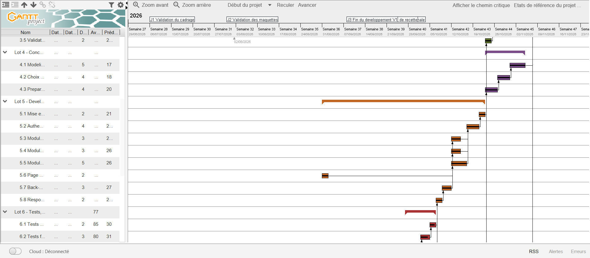

Figure H.1 : capture du diagramme de Gantt réalisé dans GanttProject. Le planning couvre le projet du cadrage à la livraison, avec les lots, les tâches, les dépendances, les jalons et les pourcentages d'avancement.

#### Jalons du projet

| Jalon                       |       Date | Condition de validation                    |
| --------------------------- | ---------: | ------------------------------------------ |
| J1 Validation du cadrage    | 30/01/2026 | Le conseil syndical valide le périmètre V1 |
| J2 Validation des maquettes | 11/02/2026 | Les écrans principaux sont acceptés        |
| J3 Fin du développement V1  | 08/05/2026 | Les modules principaux sont fonctionnels   |
| J4 Fin de recette           | 05/06/2026 | Les bugs bloquants sont corrigés           |
| J5 Mise en ligne            | 09/06/2026 | Le site est accessible en production       |
| J6 Livraison finale         | 12/06/2026 | Le procès-verbal de recette est validé     |

#### Diagramme des ressources

Le diagramme des ressources permet de vérifier la répartition de la charge. Le développeur intervient sur l'architecture dès janvier, puis sur les modules de février à avril. La graphiste travaille surtout sur la conception, avec un retour pendant le sprint 8 pour les ajustements d'interface. Le chef de projet intervient sur le cadrage, les validations et la livraison. Cette répartition correspond au chiffrage agence, pas à une équipe supplémentaire réellement mobilisée sur mon développement individuel.

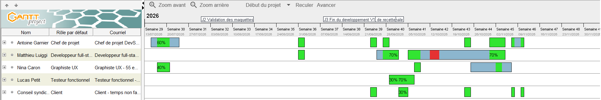

Figure H.2 : capture du diagramme des ressources dans GanttProject. Elle montre la répartition du travail entre le chef de projet, le développeur full-stack, la graphiste UX, le testeur fonctionnel et le conseil syndical.

| Période | Dates          | CP | DEV | UX | QA | CLIENT | Commentaire |
| ------- | -------------- | --: | --: | --: | --: | --: | ----------- |
| Sprint 1 | 19/01 au 30/01 | 43,17 h | 19 h | 24 h | 0 h | 5 h | Cadrage, veille et début de conception |
| Sprint 2 | 02/02 au 13/02 | 10,83 h | 41 h | 40 h | 0 h | 4 h | Maquettes, architecture et interface publique |
| Sprint 3 | 16/02 au 27/02 | 2 h | 32 h | 0 h | 0 h | 0 h | Comptes, profils et droits |
| Sprint 4 | 02/03 au 13/03 | 3 h | 28 h | 0 h | 0 h | 1 h | Espace résident et informations pratiques |
| Sprint 5 | 16/03 au 27/03 | 3 h | 28 h | 0 h | 0 h | 1 h | Actualités et notifications |
| Sprint 6 | 30/03 au 10/04 | 3 h | 24 h | 0 h | 0 h | 1 h | Documents |
| Sprint 7 | 13/04 au 24/04 | 3 h | 32 h | 0 h | 0 h | 1 h | Consultations et votes |
| Sprint 8 | 27/04 au 08/05 | 4 h | 16 h | 12 h | 0 h | 0 h | Accessibilité et conformité |
| Sprint 9 | 11/05 au 22/05 | 4 h | 16 h | 0 h | 10 h | 0 h | Tests techniques et sécurité |
| Sprint 10 | 25/05 au 05/06 | 6 h | 8 h | 0 h | 18 h | 4 h | Recette et corrections |
| Clôture | 08/06 au 12/06 | 12 h | 8 h | 0 h | 2 h | 6 h | Mise en ligne, formation et livraison |

Charge totale estimée :

| Ressource              | Total heures | Taux horaire HT | Montant estimé HT |
| ---------------------- | -----------: | --------------: | ----------------: |
| Chef de projet         |         94 h |        75 euros |       7 050 euros |
| Développeur full-stack |        252 h |        65 euros |      16 380 euros |
| Graphiste UX           |         76 h |        55 euros |       4 180 euros |
| Testeur fonctionnel    |         30 h |        50 euros |       1 500 euros |
| Total agence           |        452 h |        Variable |   29 110 euros HT |

Ce total servira de base au devis principal. Il reste cohérent avec un projet web complet, mais il devra être présenté au client avec un périmètre très clair. Pour une copropriété, le montant peut sembler important. C'est pour cela que les options comme la maintenance, la formation avancée ou les évolutions V2 seront séparées dans les devis optionnels.

#### Dépendances importantes

| Dépendance                                               | Explication                                                                       | Risque si non respectée                    |
| -------------------------------------------------------- | --------------------------------------------------------------------------------- | ------------------------------------------ |
| Le développement commence après validation des maquettes | Le développeur a besoin d'écrans stables pour éviter les retours inutiles         | Perte de 2 à 4 jours sur l'intégration     |
| Supabase est préparé avant les modules métier            | Les tables et rôles conditionnent documents, actualités et consultations          | Risque de refaire une partie du code       |
| Les tests commencent avant la fin complète du projet     | Les modules déjà prêts peuvent être testés pendant les derniers développements    | Trop de bugs découverts en fin de planning |
| La mise en ligne attend le contrôle sécurité             | Les données de copropriété ne doivent pas être exposées avec des accès mal réglés | Blocage de livraison                       |
| La livraison finale dépend de la validation client       | Le PV de recette confirme que le client accepte la V1                             | Litige possible sur le périmètre livré     |

La charge est répartie sur la période plutôt que concentrée à temps plein. Le sprint 10 et la semaine de clôture réservent du temps à la recette et aux retours client. Si de nouvelles demandes dépassent la charge disponible, les tâches "Could have" définies dans MoSCoW sont reportées après la livraison V1.

## I. Devis

Le devis reprend les charges calculées dans le Gantt. Il présente le coût d'un projet réalisé par l'agence DevSphere, du premier rendez-vous client jusqu'à la livraison finale. Les montants sont indiqués en hors taxes, avec une TVA à 20 %. Les frais externes d'hébergement, de nom de domaine et d'abonnements techniques sont séparés, car ils sont payés au prestataire concerné et peuvent évoluer selon les choix du client.

Pour une copropriété de 80 à 100 lots, le montant d'un développement sur mesure peut paraître élevé. C'est pour cela que le périmètre V1 reste limité aux fonctionnalités indispensables : authentification, actualités, documents, consultations, contact, administration et mise en ligne. Les options sont mises à part pour que le conseil syndical puisse arbitrer sans mélanger le socle du projet et les améliorations futures.

### I.1 Devis principal

#### Informations du devis

| Champ                            | Information                                    |
| -------------------------------- | ---------------------------------------------- |
| Type de document                 | Devis principal                                |
| Numéro de devis                  | DEV-2026-001                                   |
| Date d'émission prévisionnelle    | 19/01/2026                                     |
| Validité du devis                | 30 jours                                       |
| Date de début prévisionnelle     | 19/01/2026                                     |
| Date de livraison prévisionnelle | 12/06/2026                                     |
| Projet                           | Création de l'espace copropriétaires Le Rameau |
| Modalité                         | Projet au forfait, basé sur le Gantt validé    |

#### Emetteur du devis

| Champ                  | Information                        |
| ---------------------- | ---------------------------------- |
| Société                | DevSphere SAS                      |
| Siège social           | 18 rue de la Liberté, 21000 Dijon  |
| SIREN                  | 918 472 640                        |
| SIRET                  | 918 472 640 00024                  |
| RCS                    | Dijon B 918 472 640                |
| Code APE               | 6201Z - Programmation informatique |
| Capital social         | 12 000 euros                       |
| TVA intracommunautaire | FR 42 918472640                    |
| Mail                   | contact@devsphere-agency.fr        |
| Téléphone              | 03 80 42 16 58                     |

#### Destinataire du devis

| Champ                  | Information                                              |
| ---------------------- | -------------------------------------------------------- |
| Client                 | Syndicat des copropriétaires résidence Le Rameau         |
| Adresse                | 5 rue André Malraux, 21000 Dijon                         |
| SIREN                  | 824 619 735                                              |
| SIRET                  | 824 619 735 00017                                        |
| Code APE               | 8110Z - Activités combinées de soutien lié aux bâtiments |
| Représentante projet   | Claire Martin, présidente du conseil syndical            |
| TVA intracommunautaire | Non applicable                                           |

#### Prestations incluses

| Poste                  | Contenu couvert                                                                    |         Quantité | Prix unitaire HT |         Total HT |
| ---------------------- | ---------------------------------------------------------------------------------- | ---------------: | ---------------: | ---------------: |
| Chef de projet         | Cadrage, réunions, veille, planning, suivi client, recette et livraison            |             94 h |         75 euros |      7 050 euros |
| Développeur full-stack | Architecture, base de données, front-end, back-end, sécurité et déploiement        |            252 h |         65 euros |     16 380 euros |
| Graphiste UX           | Logo, identité visuelle, zoning, wireframes, maquettes et ajustements responsive   |             76 h |         55 euros |      4 180 euros |
| Testeur fonctionnel    | Scénarios de recette, tests fonctionnels, non-régression et rapport de corrections |             30 h |         50 euros |      1 500 euros |
|                        | **Total hors taxes**                                                               | **452 h agence** |                  | **29 110 euros** |

Le découpage reprend directement les ressources du Gantt. Les lots projet restent ceux présentés en H.2, mais le devis facture surtout du temps d'équipe par profil. Les heures client ne sont pas facturées, mais elles restent nécessaires pour les validations et les retours de recette.

#### Total du devis principal

| Total     |      Montant |
| --------- | -----------: |
| Total HT  | 29 110 euros |
| TVA 20 %  |  5 822 euros |
| Total TTC | 34 932 euros |

#### Echelonnement de paiement

| Échéance               | Moment                                   | Pourcentage |   Montant HT |     Montant TTC |
| ---------------------- | ---------------------------------------- | ----------: | -----------: | --------------: |
| Acompte                | Signature du devis                       |        30 % |  8 733 euros | 10 479,60 euros |
| Paiement intermédiaire | Validation des maquettes et architecture |        40 % | 11 644 euros | 13 972,80 euros |
| Solde                  | Livraison finale et PV de recette        |        30 % |  8 733 euros | 10 479,60 euros |

Ce paiement en 3 temps évite de demander toute la somme au lancement. Il protège aussi l'agence, car une partie importante du travail est réalisée avant la mise en ligne. Pour le client, le deuxième paiement intervient seulement après validation d'un livrable concret : les maquettes et l'architecture.

#### Prestations non incluses dans le devis principal

| Élément non inclus    |              Estimation | Commentaire                                                           |
| --------------------- | ----------------------: | --------------------------------------------------------------------- |
| Nom de domaine `.fr`  | 10 à 15 euros HT par an | A régler auprès d'OVHcloud, Ionos ou autre registrar                  |
| Vercel Pro            |     20 dollars par mois | Recommandé pour la production client                                  |
| Supabase Free         |       0 dollar par mois | Suffisant au lancement si le volume reste faible                      |
| Supabase Pro          |     25 dollars par mois | Option possible si le client veut plus de confort sur les sauvegardes |
| Maintenance mensuelle |    Voir devis optionnel | Non incluse après la garantie de 30 jours                             |
| Évolutions V2         |    Voir devis optionnel | Hors périmètre V1                                                     |

Ces frais sont séparés pour éviter une confusion entre le coût de fabrication du site et le coût d'exploitation. La copropriété pourra donc voir clairement ce qui est payé une seule fois et ce qui revient chaque mois.

#### Conditions du devis principal

Le devis comprend une garantie corrective de 30 jours après la livraison. Cette garantie couvre les bugs liés aux fonctionnalités livrées dans le périmètre V1. Elle ne couvre pas les nouvelles fonctionnalités, les changements de design demandés après validation des maquettes ou les problèmes causés par une modification externe des comptes Vercel, Supabase ou du nom de domaine.

Toute demande supplémentaire devra être validée par écrit. Si elle prend moins de 2 heures et ne modifie pas le périmètre, elle peut être intégrée pendant la phase de recette. Au-delà, DevSphere proposera un chiffrage séparé ou un report en V2.

### I.2 Devis optionnel maintenance

La maintenance n'est pas obligatoire pour lancer le site, mais elle est recommandée. Le conseil syndical n'a pas vocation à gérer seul les mises à jour techniques, les petits bugs ou les contrôles de sécurité. L'option proposée reste volontairement légère, car le budget d'une copropriété doit rester maîtrisé.

| Champ            | Information                                       |
| ---------------- | ------------------------------------------------- |
| Type de document | Devis optionnel maintenance                       |
| Numéro de devis  | DEV-2026-002                                      |
| Validité         | 30 jours                                          |
| Démarrage        | Après la période de garantie de 30 jours          |
| Engagement       | 12 mois, résiliation possible à date anniversaire |

| Prestation                                      | Fréquence                             |            Montant HT |
| ----------------------------------------------- | ------------------------------------- | --------------------: |
| Surveillance technique légère                   | Mensuelle                             |                Inclus |
| Correction de bugs mineurs                      | Jusqu'à 2 h par mois                  |                Inclus |
| Vérification dépendances et sécurité            | Mensuelle                             |                Inclus |
| Export manuel de sauvegarde si formule gratuite | Mensuelle                             |                Inclus |
| Petit support conseil syndical                  | Par mail, réponse sous 3 jours ouvrés |                Inclus |
| Maintenance mensuelle                           | 12 mois                               | 120 euros HT par mois |

| Total             |     Montant |
| ----------------- | ----------: |
| Total HT mensuel  |   120 euros |
| TVA 20 %          |    24 euros |
| Total TTC mensuel |   144 euros |
| Total HT annuel   | 1 440 euros |
| Total TTC annuel  | 1 728 euros |

Ce devis optionnel correspond à la section F.10 du cahier. Il donne au client une solution de suivi sans imposer une grosse dépense. Si le client refuse cette option, seule la garantie corrective de 30 jours s'applique.

### I.3 Devis optionnel formation avancée

Le devis principal inclut une formation courte à la livraison, suffisante pour montrer les écrans principaux. Une formation plus complète peut être utile si plusieurs membres du conseil syndical doivent gérer les actualités, les documents et les consultations.

| Champ            | Information                           |
| ---------------- | ------------------------------------- |
| Type de document | Devis optionnel formation             |
| Numéro de devis  | DEV-2026-003                          |
| Durée            | 3 h                                   |
| Format           | Présentiel à Dijon ou visioconférence |
| Participants     | Jusqu'à 5 membres du conseil syndical |

| Prestation                          | Quantité | Prix unitaire HT |      Total HT |
| ----------------------------------- | -------: | ---------------: | ------------: |
| Préparation du support de formation |   2 h CP |         75 euros |     150 euros |
| Session de formation                |   3 h CP |         75 euros |     225 euros |
| Support PDF utilisateur             |   1 h CP |         75 euros |      75 euros |
| **Total HT**                        |      6 h |                  | **450 euros** |

| Total     |   Montant |
| --------- | --------: |
| Total HT  | 450 euros |
| TVA 20 %  |  90 euros |
| Total TTC | 540 euros |

Cette formation peut être intéressante si le conseil syndical change de membres ou si plusieurs personnes doivent administrer le site. Elle n'est pas indispensable au lancement, donc elle reste bien séparée du devis principal.

### I.4 Devis optionnel évolutions V2

Les évolutions V2 regroupent les fonctionnalités jugées utiles mais non prioritaires dans la méthode MoSCoW. Elles peuvent être lancées 2 à 3 mois après la mise en production, une fois que les premiers retours des copropriétaires sont connus.

| Information     | Détail                       |
| --------------- | ---------------------------- |
| Numéro de devis | DEV-2026-004                 |
| Objet           | Évolutions V2 post-lancement |
| Date du devis   | 01/07/2026                   |
| Validité        | 30 jours                     |

| Prestation V2                                       | Quantité | Prix unitaire HT |        Total HT |
| --------------------------------------------------- | -------: | ---------------: | --------------: |
| Recherche globale sur documents et actualités       | 20 h DEV |         65 euros |     1 300 euros |
| Statistiques d'utilisation pour le conseil syndical | 16 h DEV |         65 euros |     1 040 euros |
| Export PDF propre des consultations                 | 18 h DEV |         65 euros |     1 170 euros |
| Ajustements UX après retours utilisateurs           |   8 h UX |         55 euros |       440 euros |
| Pilotage et recette V2                              |   8 h CP |         75 euros |       600 euros |
| **Total HT**                                        |     70 h |                  | **4 550 euros** |

| Total     |     Montant |
| --------- | ----------: |
| Total HT  | 4 550 euros |
| TVA 20 %  |   910 euros |
| Total TTC | 5 460 euros |

Cette option n'est pas à lancer avant d'avoir observé les usages réels. Si peu de copropriétaires utilisent le site au départ, il vaut mieux investir d'abord dans l'accompagnement et la communication interne plutôt que dans de nouvelles fonctionnalités.

### I.5 Synthèse des devis

| Devis        | Objet                      |     Total HT |    Total TTC | Statut recommandé                            |
| ------------ | -------------------------- | -----------: | -----------: | -------------------------------------------- |
| DEV-2026-001 | Création complète de la V1 | 29 110 euros | 34 932 euros | A valider si le budget copropriété le permet |
| DEV-2026-002 | Maintenance annuelle       |  1 440 euros |  1 728 euros | Recommandé                                   |
| DEV-2026-003 | Formation avancée          |    450 euros |    540 euros | Optionnel                                    |
| DEV-2026-004 | Évolutions V2              |  4 550 euros |  5 460 euros | À reporter après lancement                   |

Le devis principal est le plus important à discuter avec le client, car il représente un vrai investissement pour une copropriété. Pour rester réaliste, DevSphere peut aussi proposer un arbitrage : garder le socle technique complet, mais reporter certaines finitions non bloquantes comme les statistiques, les exports avancés ou la personnalisation fine des profils.

### I.6 Mentions d'acceptation

Le devis devient contractuel après signature par le représentant autorisé du syndicat des copropriétaires. La signature vaut acceptation du périmètre, du planning, du prix, des conditions de paiement et des limites indiquées dans le cahier des charges.

| Mention                | Contenu                                                                    |
| ---------------------- | -------------------------------------------------------------------------- |
| Bon pour accord        | Nom, date, signature du représentant client                                |
| Cachet client          | Si disponible                                                              |
| Signature agence       | DevSphere SAS, représentée par Antoine Garnier                             |
| Conditions de paiement | 30 % à la signature, 40 % à validation intermédiaire, 30 % à livraison     |
| Pénalités de retard    | Taux légal en vigueur et indemnité forfaitaire de recouvrement de 40 euros |
| Réserve de propriété   | Les livrables restent la propriété de DevSphere jusqu'au paiement complet  |

Ces mentions donnent au devis un cadre professionnel. Elles évitent aussi une ambiguïté fréquente dans les projets étudiants : le cahier des charges décrit un projet, mais le devis montre comment une agence le vendrait réellement au client.

## Annexes

Les annexes regroupent les éléments qui appuient le cahier des charges sans forcément entrer dans le corps principal du document. Elles permettent aussi de montrer la méthode utilisée pour cadrer le besoin, estimer les coûts et préparer la soutenance. Pour Le Rameau, les deux annexes minimum attendues sont le QQOQCCPP et le calcul du TJM des ressources.

### Annexe 1 : QQOQCCPP

Le QQOQCCPP a été utilisé au début du projet pour clarifier la demande du conseil syndical. L'objectif était de ne pas partir directement sur une solution technique, mais de comprendre le problème réel : des informations dispersées, des documents difficiles à retrouver et des échanges parfois peu clairs entre copropriétaires.

| Question    | Réponse appliquée au projet Le Rameau                                                                                                                                                                                                                                                                                                                                           |
| ----------- | ------------------------------------------------------------------------------------------------------------------------------------------------------------------------------------------------------------------------------------------------------------------------------------------------------------------------------------------------------------------------------- |
| Qui ?       | Le projet est porté par le conseil syndical de la résidence Le Rameau. Les interlocuteurs principaux sont Claire Martin, Julien Moreau et Sophie Bernard. Les utilisateurs finaux sont les copropriétaires, les résidents ayant un accès autorisé et les administrateurs du conseil syndical.                                                                                   |
| Quoi ?      | Créer un espace web privé pour centraliser les actualités, les documents importants, les consultations et les demandes de contact. Le site doit aussi donner au conseil syndical un back-office simple pour publier les contenus sans passer par un développeur à chaque modification.                                                                                          |
| Où ?        | Le projet concerne la résidence Le Rameau, située au 5 rue André Malraux à Dijon. L'outil est accessible en ligne depuis un navigateur desktop, tablette ou mobile. Il n'est pas limité physiquement à la résidence, car certains copropriétaires bailleurs peuvent consulter les informations à distance.                                                                      |
| Quand ?     | Le calendrier reconstitué du projet s'étend du 19 janvier au 12 juin 2026, soit 21 semaines. Il comprend 10 sprints de deux semaines jusqu'au 5 juin, puis une semaine de clôture du 8 au 12 juin. La mise en ligne de référence est prévue le 9 juin, après la recette et les contrôles de sécurité. |
| Comment ?   | DevSphere réalise une application web avec Next.js, React, TypeScript et Supabase. Le projet est découpé en phases : cadrage, benchmark, identité visuelle, MERISE, développement, tests, recette et mise en ligne. Le suivi se fait avec des cycles courts de 2 semaines et des validations régulières côté client.                                                            |
| Combien ?   | Le devis principal est estimé à 29 110 euros HT, soit 34 932 euros TTC. Les frais techniques récurrents restent séparés : environ 20 dollars par mois pour Vercel Pro, 0 dollar au lancement avec Supabase Free, puis 25 dollars par mois si Supabase Pro est activé. Le nom de domaine `.fr` représente environ 10 à 15 euros HT par an.                                       |
| Pourquoi ?  | Le conseil syndical veut réduire les informations dispersées entre mails, affichage papier et échanges informels. Le site doit aider les copropriétaires à retrouver rapidement les documents, suivre les actualités de la résidence et participer aux consultations simples. Le but n'est pas de remplacer le syndic, mais de rendre la communication quotidienne plus claire. |
| Pour quoi ? | Le projet doit aboutir à une V1 exploitable par une copropriété de 80 à 100 lots. Les objectifs principaux sont la centralisation des informations, la sécurisation des accès, la simplification de la gestion documentaire et un gain de temps pour le conseil syndical.                                                                                                       |

#### Synthèse du besoin

Le besoin principal n'est pas seulement de créer un site web. Le Rameau a besoin d'un point d'accès unique, compréhensible par des utilisateurs de niveaux différents. Certains copropriétaires vont consulter le site depuis un ordinateur, d'autres depuis un téléphone, et une partie d'entre eux ne se connectera que quelques fois par an. L'interface doit donc rester directe.

Le projet doit aussi respecter une contrainte de confiance. Les documents de copropriété ne sont pas publics, les consultations doivent être réservées aux personnes autorisées et le conseil syndical doit pouvoir gérer le contenu sans prendre de risque sur les accès. C'est pour cela que l'authentification, les rôles et les règles Supabase sont classés en Must have dans la méthode MoSCoW.

#### Problèmes identifiés avant projet

| Problème                                               | Conséquence                                                                  | Réponse prévue dans le projet                                      |
| ------------------------------------------------------ | ---------------------------------------------------------------------------- | ------------------------------------------------------------------ |
| Documents envoyés par plusieurs canaux                 | Les copropriétaires ne savent pas toujours quelle version retrouver          | Espace documents centralisé, filtrable par type et année           |
| Actualités dispersées                                  | Certaines informations sur les travaux ou la vie de l'immeuble sont manquées | Rubrique actualités avec publication par le conseil syndical       |
| Consultations informelles                              | Les retours peuvent être difficiles à suivre                                 | Module consultations avec statut, date limite et choix enregistrés |
| Manque de visibilité pour les nouveaux copropriétaires | Les informations pratiques ne sont pas toujours accessibles                  | Accueil clair, contact et documents de référence                   |
| Gestion manuelle trop lourde                           | Le conseil syndical perd du temps sur des tâches répétitives                 | Back-office simple pour créer, modifier et archiver les contenus   |

#### Contraintes à respecter

| Contrainte                        | Niveau | Impact sur le projet                                          |
| --------------------------------- | ------ | ------------------------------------------------------------- |
| Budget de copropriété             | Fort   | Limiter la V1 aux fonctionnalités vraiment utiles             |
| Données personnelles              | Fort   | Prévoir RGPD, authentification et contrôle d'accès            |
| Public varié                      | Fort   | Interface lisible, responsive et accessible                   |
| Disponibilité du conseil syndical | Moyen  | Prévoir des validations espacées et des comptes rendus courts |
| Maintenance future                | Moyen  | Choisir une stack connue et documentée                        |
| Délais du projet F2i              | Fort   | Avancer section par section et garder un périmètre défendable |

#### Conclusion du QQOQCCPP

Le QQOQCCPP confirme que la solution attendue est une application web de copropriété, mais limitée à un périmètre réaliste. Le projet ne doit pas devenir un logiciel de syndic complet. Il doit d'abord répondre à un besoin local et concret : mieux informer, mieux centraliser et donner au conseil syndical un outil simple à administrer.

Cette analyse justifie les choix faits dans le cahier. Le périmètre V1 reste volontairement raisonnable, le budget est séparé entre développement et frais techniques, et les fonctionnalités trop sensibles comme le paiement des charges ou le vote légal d'assemblée générale sont exclues pour le lancement.

### Annexe 2 : calcul du TJM des ressources

Cette annexe explique comment les taux horaires utilisés dans le Gantt et dans le devis ont été calculés. L'objectif n'est pas de faire une comptabilité complète, mais de montrer une logique d'agence crédible. Un tarif ne correspond pas seulement au salaire du collaborateur. Il doit aussi couvrir les charges, les frais de structure, les jours non facturables et la marge de l'agence.

#### Hypothèses de calcul

| Hypothèse                    |      Valeur retenue | Justification                                                         |
| ---------------------------- | ------------------: | --------------------------------------------------------------------- |
| Jours ouvrés théoriques      |    251 jours par an | Base approximative hors week-ends                                     |
| Congés et RTT                |     33 jours par an | 25 jours de congés + environ 8 jours RTT                              |
| Jours travaillés disponibles |    218 jours par an | 251 jours moins congés et RTT                                         |
| Taux de jours facturables    |                75 % | Le reste couvre réunions internes, veille, administratif, avant-vente |
| Jours facturables estimés    |    164 jours par an | 218 jours x 75 %                                                      |
| Durée d'une journée          |                 7 h | Base classique pour transformer TJM en taux horaire                   |
| Charges patronales           |        45 % du brut | Hypothèse réaliste pour une agence française                          |
| Frais de structure           | 20 % du coût chargé | Locaux, logiciels, matériel, comptabilité, assurance                  |
| Marge agence                 |         25 % à 30 % | Nécessaire pour absorber les risques et dégager du bénéfice           |

Avec ces hypothèses, un collaborateur ne peut pas être vendu simplement au coût de son salaire. Même un profil junior doit intégrer du temps non facturable, des outils, de la gestion de projet et une marge. C'est ce qui explique l'écart entre un salaire mensuel et un taux horaire client.

#### Formule utilisée

La formule retenue est la suivante :

```text
Salaire annuel brut = salaire brut mensuel x 12
Coût chargé = salaire annuel brut x 1,45
Coût avec structure = coût chargé x 1,20
Prix annuel cible = coût avec structure x marge agence
TJM = prix annuel cible / jours facturables
Taux horaire = TJM / 7
```

La marge agence est appliquée avec un coefficient compris entre 1,25 et 1,30 selon le profil. Le chef de projet est vendu plus cher car il porte une partie du risque client, du planning et des arbitrages. Le développeur est aussi fortement valorisé, car il intervient sur les choix techniques, la sécurité et la mise en ligne.

#### Calcul par profil

| Ressource              | Salaire brut mensuel estimé |  Brut annuel | Coût chargé 45 % | Coût avec structure 20 % | Coefficient marge | Prix annuel cible | TJM arrondi | Taux horaire arrondi |
| ---------------------- | --------------------------: | -----------: | ---------------: | -----------------------: | ----------------: | ----------------: | ----------: | -------------------: |
| Chef de projet         |                 3 200 euros | 38 400 euros |     55 680 euros |             66 816 euros |              1,30 |      86 861 euros |   530 euros |             75 euros |
| Développeur full-stack |                 2 800 euros | 33 600 euros |     48 720 euros |             58 464 euros |              1,28 |      74 834 euros |   456 euros |             65 euros |
| Graphiste UX           |                 2 400 euros | 28 800 euros |     41 760 euros |             50 112 euros |              1,25 |      62 640 euros |   382 euros |             55 euros |
| Testeur fonctionnel    |                 2 200 euros | 26 400 euros |     38 280 euros |             45 936 euros |              1,25 |      57 420 euros |   350 euros |             50 euros |

Les taux horaires ont été arrondis pour simplifier le devis. Par exemple, le développeur arrive à environ 65 euros par heure, ce qui correspond à 455 euros par jour sur une base de 7 h. Ce tarif reste cohérent pour une petite agence qui vend un profil full-stack sans se positionner comme une grande ESN.

#### Taux retenus dans le projet

| Ressource              | TJM retenu HT | Taux horaire HT | Utilisation dans le devis                 |
| ---------------------- | ------------: | --------------: | ----------------------------------------- |
| Chef de projet         |     525 euros |        75 euros | Cadrage, suivi client, recette, livraison |
| Développeur full-stack |     455 euros |        65 euros | Développement Next.js, Supabase, sécurité |
| Graphiste UX           |     385 euros |        55 euros | Logo, zoning, wireframes, maquettes       |
| Testeur fonctionnel    |     350 euros |        50 euros | Tests fonctionnels et non-régression      |

Ces tarifs sont utilisés dans le devis principal. Ils permettent de justifier le total de 29 110 euros HT sur 452 h agence. Les profils ne sont pas facturés au même prix, car ils n'ont pas le même niveau de responsabilité ni le même coût interne.

#### Application au projet Le Rameau

| Ressource              | Heures prévues | Taux horaire HT |          Montant HT |
| ---------------------- | -------------: | --------------: | ------------------: |
| Chef de projet         |           94 h |        75 euros |         7 050 euros |
| Développeur full-stack |          252 h |        65 euros |        16 380 euros |
| Graphiste UX           |           76 h |        55 euros |         4 180 euros |
| Testeur fonctionnel    |           30 h |        50 euros |         1 500 euros |
| **Total**              |      **452 h** |                 | **29 110 euros HT** |

Ce tableau reprend exactement les heures du Gantt et du devis. Il sert donc de passerelle entre le planning et le chiffrage. Si le jury demande comment le devis a été obtenu, la réponse est simple : les tâches du Gantt donnent les heures, les taux horaires viennent du calcul TJM, puis le devis additionne les profils mobilisés.

#### Vérification rapide du coût journalier

| Ressource              | Taux horaire | Journée de 7 h | Arrondi TJM utilisé |
| ---------------------- | -----------: | -------------: | ------------------: |
| Chef de projet         |     75 euros |      525 euros |           525 euros |
| Développeur full-stack |     65 euros |      455 euros |           455 euros |
| Graphiste UX           |     55 euros |      385 euros |           385 euros |
| Testeur fonctionnel    |     50 euros |      350 euros |           350 euros |

Le calcul reste volontairement lisible. Dans une vraie agence, le modèle pourrait être plus précis avec le coût réel de chaque salarié, les charges exactes, le taux d'occupation commercial, les frais logiciels et les frais de direction. Pour le cahier F2i, ce niveau de détail suffit à montrer que le devis n'a pas été inventé au hasard.

#### Conclusion sur le TJM

Le TJM retenu donne un devis assez élevé pour une copropriété, mais cohérent avec un projet sur mesure. La solution n'est pas un abonnement logiciel standard. Elle comprend du cadrage, de la conception, du développement, des tests, de la sécurité et une mise en ligne. Pour rendre le projet plus acceptable côté client, les fonctionnalités non indispensables sont donc séparées en options et la maintenance reste proposée à part.

Cette annexe permet aussi de défendre le choix du forfait. DevSphere ne vend pas seulement des heures isolées, mais un résultat livré : une V1 fonctionnelle, testée et documentée. Les heures servent à construire le prix, mais le client achète surtout un livrable complet.

## Pour rattrapage

### R.1 À partir du besoin du client et de l'étude de marché, redéfinir les cibles

Le ciblage repart du besoin client : Le Rameau veut centraliser les informations utiles d'une copropriété dans un espace privé, simple et consultable par les résidents. Le projet ne vise donc pas un marché national avec une vente d'abonnement. Il vise une résidence précise, d'environ 80 à 100 lots, avec un volume réaliste de 110 à 140 comptes si chaque logement dispose de 1 à 2 accès.

#### Étude de marché locale et viabilité du projet

Le périmètre étudié est la commune de Dijon, car la résidence se situe dans ce bassin de vie. Les chiffres de l'Insee montrent que le contexte local est favorable à un service de copropriété : Dijon compte 161 830 habitants en 2023, 101 972 logements et surtout 86 944 appartements, soit 85,3 % du parc de logements. Le besoin n'est donc pas isolé. Il s'inscrit dans une ville où l'habitat collectif est très présent.

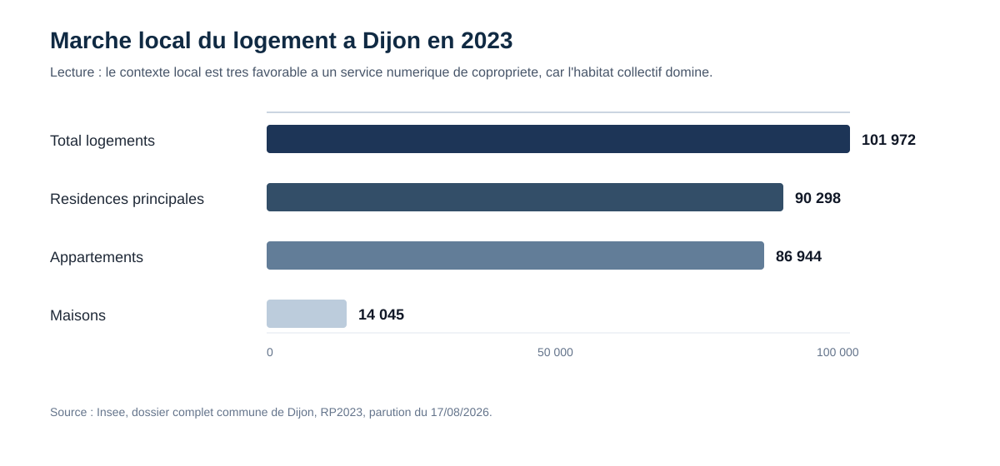

Graphique R.1 : marché local du logement à Dijon en 2023. Source : Insee, dossier complet commune de Dijon, RP2023.

L'autre point important est l'usage numérique. Le projet peut fonctionner seulement si les habitants ont l'habitude d'utiliser Internet pour consulter des informations. En 2024, l'Insee indique que 88,7 % des personnes de 15 ans ou plus vivant en France ont utilisé Internet au cours des trois derniers mois. Les moins de 60 ans sont presque tous internautes, et les 60-74 ans restent aussi très connectés avec 86 %. La limite se situe davantage chez les 75 ans et plus, où 48 % sont internautes. Cela confirme qu'il faut une interface simple, lisible et accessible, mais cela ne remet pas en cause la viabilité du service.

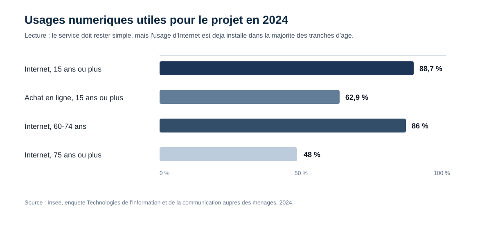

Graphique R.2 : usages numériques utiles pour le projet en 2024. Source : Insee, enquête Technologies de l'information et de la communication auprès des ménages.

Le secteur de la copropriété est aussi un secteur suivi par les pouvoirs publics. Le Registre national d'immatriculation des copropriétés, géré par l'Anah, recense les copropriétés à usage d'habitat et permet de publier des informations sur leur nombre de lots, leur syndic et leur situation. Le jeu de données CoproFF, coproduit par l'Anah et le Cerema, propose aussi des indicateurs agrégés sur les copropriétés à l'échelle des communes. Cela montre que la gestion des copropriétés est un vrai sujet de données, de suivi et d'organisation.

| Donnée de marché                      | Valeur retenue                                         | Lecture pour Le Rameau                                                      |
| ------------------------------------- | ------------------------------------------------------ | --------------------------------------------------------------------------- |
| Population de Dijon                   | 161 830 habitants en 2023                              | Bassin local suffisant, avec des profils d'âge variés                       |
| Parc de logements dijonnais           | 101 972 logements en 2023                              | Marché local important autour de l'habitat                                  |
| Part d'appartements                   | 85,3 % des logements                                   | Contexte très favorable à un projet lié à la vie collective                 |
| Résidences principales                | 90 298 logements                                       | Usage d'habitation réel, pas seulement touristique                          |
| Usage d'Internet en France            | 88,7 % des 15 ans ou plus en 2024                      | Service numérique viable si l'interface reste simple                        |
| Usage d'Internet chez les 60-74 ans   | 86 % en 2024                                           | Les profils plus âgés peuvent être inclus avec une interface claire         |
| Usage d'Internet chez les 75 ans et + | 48 % en 2024                                           | Nécessité de prévoir des libellés simples et des actions très visibles      |
| Périmètre réel du projet              | 80 à 100 lots, 110 à 140 comptes potentiels            | Projet suffisamment petit pour être administré par le conseil syndical      |

Pour vérifier la viabilité, j'ai retenu une lecture en trois niveaux. Le marché local large correspond aux logements collectifs dijonnais, car ils prouvent que le besoin d'organisation en habitat collectif existe sur la zone. Le marché accessible correspond aux copropriétés de taille moyenne, où les échanges par mail, papier ou groupe informel deviennent vite difficiles à suivre. Le marché réellement visé est volontairement réduit : la résidence Le Rameau, avec un objectif d'adoption de 60 % des logements dans les 3 premiers mois, soit environ 48 à 60 logements actifs.

Cette analyse confirme que le projet est viable à l'échelle de la résidence. Il ne cherche pas à remplacer un extranet complet de syndic ni à concurrencer les grandes plateformes nationales. Sa valeur vient plutôt de sa proximité : regrouper les documents, les actualités, les contacts et les consultations dans une interface pensée pour une copropriété locale.

Les sources utilisées pour cette étude sont les suivantes :

| Source | Donnée utilisée |
| ------ | --------------- |
| [Insee - dossier complet commune de Dijon](https://www.insee.fr/fr/statistiques/2011101?geo=COM-21231) | population, logements, types de logements, sexe, âge et CSP |
| [Insee - usages des technologies de l'information et de la communication 2024](https://www.insee.fr/fr/statistiques/8278698) | taux d'utilisation d'Internet selon l'âge |
| [Data.gouv - Registre national d'immatriculation des copropriétés](https://www.data.gouv.fr/datasets/registre-national-dimmatriculation-des-coproprietes) | rôle du registre national des copropriétés |
| [Data.gouv - données agrégées CoproFF](https://www.data.gouv.fr/datasets/donnees-agregees-du-referentiel-national-des-coproprietes-coproff) | indicateurs publics sur les copropriétés par territoire |

#### Définition des cibles

Pour clarifier le ciblage, je distingue trois niveaux : la cible principale, le cœur de cible et la cible secondaire. Le conseil syndical reste aussi un prescripteur important, mais il ne remplace pas ces trois cibles. Il pilote le projet côté client, alors que les cibles décrivent les personnes qui utiliseront vraiment le service.

La population dijonnaise est légèrement plus féminine que masculine en 2023, avec 76 664 hommes et 85 166 femmes selon l'Insee. Pour Le Rameau, le service ne cible pas un sexe en particulier : les fonctionnalités répondent à un besoin de résidence. En revanche, cette donnée permet de compléter les profils et de prévoir une communication inclusive, sans orienter l'interface vers un public masculin ou féminin.

#### Cible principale

La cible principale regroupe les habitants et copropriétaires liés à la résidence, avec une tranche prioritaire de 30 à 70 ans. Cette tranche est assez large, mais elle correspond bien au projet : elle couvre les actifs qui consultent surtout depuis leur téléphone, les familles propriétaires de leur logement et les copropriétaires plus âgés qui préfèrent retrouver les documents depuis un ordinateur.

| Critère               | Définition retenue                                                                                  |
| --------------------- | --------------------------------------------------------------------------------------------------- |
| Age prioritaire       | 30 à 70 ans                                                                                         |
| Sexe                  | Femmes et hommes, sans restriction, avec une communication neutre et inclusive                       |
| Situation             | Résidents, copropriétaires occupants, locataires et propriétaires bailleurs                          |
| Volume estimé         | 110 à 140 comptes potentiels pour environ 80 à 100 lots                                             |
| CSP probable          | Employés, professions intermédiaires, cadres, indépendants, retraités actifs                        |
| Appareils utilisés    | Smartphone pour les actualités courtes, ordinateur ou tablette pour les PDF et consultations        |
| Motivation principale | Retrouver les informations de copropriété sans chercher dans les mails, papiers ou groupes informels |
| Frein principal       | Peur d'un outil compliqué, oubli du mot de passe, doute sur la confidentialité des documents         |
| Réponse prévue        | Accès privé, navigation courte, documents classés, actualités visibles dès l'accueil                |

Cette cible n'utilise pas le site par curiosité. Elle vient chercher une information précise. Le service doit donc être utile en moins de 2 minutes pour les actions simples : lire une actualité, ouvrir un document, vérifier un contact ou participer à une consultation. La motivation d'utilisation est surtout pratique. Le site doit éviter de donner l'impression d'un outil de gestion lourd.

#### Coeur de cible

Le cœur de cible correspond aux copropriétaires occupants de 35 à 45 ans. C'est la tranche la plus intéressante pour l'adoption du service, car elle combine souvent trois éléments : un usage numérique régulier, un intérêt direct pour la valeur du logement et un manque de temps pour chercher des informations dans plusieurs canaux. Ces personnes peuvent aussi entraîner d'autres résidents, parce qu'elles sont à l'aise avec les démarches en ligne.

| Critère                | Définition retenue                                                                      |
| ---------------------- | --------------------------------------------------------------------------------------- |
| Age prioritaire        | 35 à 45 ans                                                                             |
| Sexe                   | Femmes et hommes, cible mixte                                                           |
| Situation              | Copropriétaires occupants, souvent actifs professionnellement et attentifs aux travaux  |
| CSP probable           | Professions intermédiaires, cadres, indépendants, employés qualifiés                    |
| Usage numérique        | Habitude des applications bancaires, administratives, scolaires ou de réservation       |
| Besoin prioritaire     | Accéder aux PV, convocations, règlements, décisions et consultations                    |
| Motivation d'usage     | Gagner du temps, suivre les décisions et éviter de redemander les mêmes documents       |
| Indicateur de réussite | 60 % des logements avec un compte actif dans les 3 premiers mois                        |
| Réponse prévue         | Tableau de bord clair, documents récents visibles, vote par appartement, accès sécurisé |

Ce groupe est le plus important pour la réussite du projet. Si le cœur de cible adopte l'outil, le conseil syndical aura moins de demandes répétitives et pourra centraliser les informations. Si ce groupe ne l'utilise pas, le site restera une vitrine technique sans vraie utilité pour la copropriété. C'est pour cette raison que la page d'accueil doit donner accès tout de suite aux actions utiles, sans discours trop long.

#### Cible secondaire

La cible secondaire regroupe les personnes moins impliquées dans la vie de la copropriété, mais qui ont quand même besoin d'un accès simple. Elle comprend les locataires et nouveaux arrivants entre 20 et 35 ans, les propriétaires bailleurs qui ne vivent pas toujours sur place et les copropriétaires plus âgés de 70 ans et plus. Leur usage sera plus ponctuel. Ils ne liront pas forcément tous les documents d'assemblée générale, mais ils peuvent avoir besoin d'informations pratiques : badge Vigik, contacts utiles, règlement intérieur, actualité sur une intervention ou accès à un document précis.

| Critère            | Définition retenue                                                                |
| ------------------ | --------------------------------------------------------------------------------- |
| Age estimé         | 20 à 35 ans, puis 70 ans et plus pour une partie des copropriétaires              |
| Sexe               | Femmes et hommes, sans différenciation fonctionnelle                              |
| Situation          | Locataires, bailleurs hors résidence, nouveaux occupants, résidents peu connectés |
| CSP probable       | Etudiants, employés, jeunes actifs, retraités, propriétaires bailleurs            |
| Besoin prioritaire | Trouver vite une information pratique sans contacter le conseil syndical          |
| Motivation d'usage | Autonomie, gain de temps, suivi à distance pour les bailleurs                     |
| Frein principal    | Faible intérêt pour la copropriété ou difficulté avec certains usages numériques  |
| Réponse prévue     | Actualités courtes, contacts visibles, page Vigik, documents nommés simplement    |

Pour cette cible, le site doit éviter le vocabulaire trop technique. Un locataire doit comprendre rapidement où cliquer. Un propriétaire bailleur doit pouvoir consulter à distance sans demander un envoi par mail. Les nouveaux arrivants doivent trouver les règles de base sans connaître déjà l'organisation de la résidence. Pour les profils moins à l'aise avec le numérique, l'interface doit garder des libellés simples et des boutons assez grands.

#### Cible prescriptrice côté client

La cible prescriptrice est plus petite, mais elle décide du projet. Elle correspond aux 3 membres du conseil syndical qui pilotent avec DevSphere. Leur motivation est moins centrée sur la lecture des documents que sur le temps gagné dans la gestion quotidienne.

| Critère               | Définition retenue                                                                        |
| --------------------- | ----------------------------------------------------------------------------------------- |
| Taille                | 3 membres pilotes côté client                                                             |
| Age estimé            | 35 à 65 ans                                                                               |
| Sexe                  | Groupe mixte possible, la fonction dans le conseil syndical prime sur le sexe             |
| Rôle                  | Valider le périmètre, prioriser les contenus, tester l'administration                     |
| Motivation principale | Réduire les demandes répétitives et mieux organiser les informations                      |
| Contrainte            | Ne pas passer plus de 1 h par semaine à administrer le site en rythme normal              |
| Réponse prévue        | Back-office limité, création rapide d'actualité, documents classés, consultations simples |

Cette cible explique plusieurs choix du projet. L'administration reste volontairement courte. Une actualité doit pouvoir être publiée en moins de 5 minutes. Une consultation simple doit pouvoir être créée sans formation technique. C'est aussi pour cette raison que le projet ne cherche pas à remplacer un syndic complet.

### R.2 Établir un zoning, un wireframe et une maquette de la page d'accueil

La page d'accueil est la première page que voit un résident lorsqu'il arrive sur l'application. Elle doit être simple, rassurante et utile rapidement. Le but n'est pas de faire une page commerciale avec beaucoup de texte, mais une entrée claire vers les services de la résidence : actualités, documents, consultations, contacts et accès au compte.

Pour éviter de mélanger les étapes de conception, j'ai séparé trois niveaux : le zoning, le wireframe et la maquette. Le zoning sert uniquement à placer les grandes zones. Le wireframe précise les éléments fonctionnels attendus dans chaque bloc. La maquette applique ensuite l'identité visuelle réelle de l'application.

| Niveau de conception | Rôle dans le projet                                             | Niveau de détail attendu                                  |
| -------------------- | --------------------------------------------------------------- | --------------------------------------------------------- |
| Zoning               | Organiser les grandes zones de la page                          | Blocs génériques en nuances de gris, sans design final    |
| Wireframe            | Détailler les contenus et interactions de chaque zone           | Titres, boutons, menu, cartes, textes et bloc information |
| Maquette             | Montrer le rendu final de l'interface                           | Couleurs, typographie, espacements et identité visuelle   |

La page doit répondre à trois objectifs mesurables :

| Objectif                         | Critère retenu                                                                     | Pourquoi ce critère est important                                 |
| -------------------------------- | ---------------------------------------------------------------------------------- | ----------------------------------------------------------------- |
| Comprendre le service rapidement | Le nom Le Rameau et l'accès à l'espace résident sont visibles dès le premier écran | L'utilisateur doit savoir qu'il est sur le bon site sans chercher |
| Réduire les clics inutiles       | Les rubriques principales sont accessibles en 1 clic après connexion               | Les résidents viennent surtout chercher une information précise   |
| Rester utilisable sur mobile     | Les zones importantes sont lisibles sur un écran de 390 px de large                | Une partie des résidents utilisera surtout un smartphone          |

#### Zoning de la page d'accueil

Le zoning a été réalisé dans Figma à partir de l'accueil connecté, car c'est l'écran que le résident utilise vraiment après connexion. Il ne reprend pas les couleurs de l'application. Les zones sont volontairement représentées en nuances de gris afin de rester au niveau de l'organisation générale de la page.

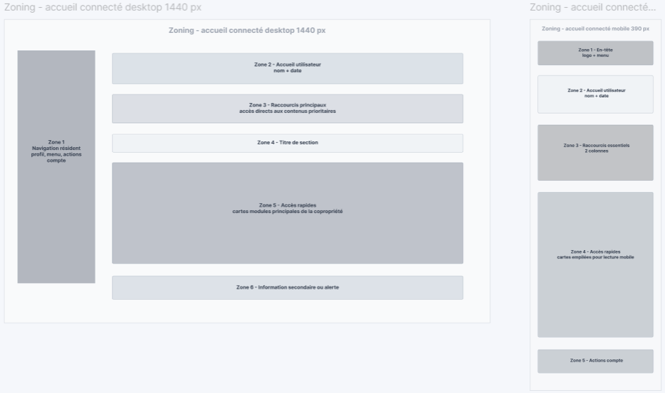

Figure R.3 : zoning de l'accueil connecté en version ordinateur 1440 px et mobile 390 px. Il représente les grandes zones : navigation, accueil utilisateur, raccourcis principaux, accès rapides, information secondaire et actions de compte.

Sur ordinateur, la navigation latérale est placée à gauche pour garder les rubriques visibles en permanence. Le contenu principal est organisé verticalement : accueil utilisateur, raccourcis, titre de section, cartes principales puis information secondaire. Sur mobile, la navigation devient un en-tête compact avec menu, puis les zones sont empilées pour respecter la largeur de 390 px. Ce zoning permet de valider la hiérarchie générale avant de parler de graphisme.

#### Wireframe basse fidélité

Le wireframe reprend la structure du zoning, mais il va plus loin dans le détail fonctionnel. Il précise les éléments présents dans chaque zone : logo, menu, profil résident, libellés de navigation, titre d'accueil, date, boutons de raccourci, cartes métiers et bloc d'information. Les couleurs restent neutres afin de ne pas confondre le wireframe avec la maquette graphique.

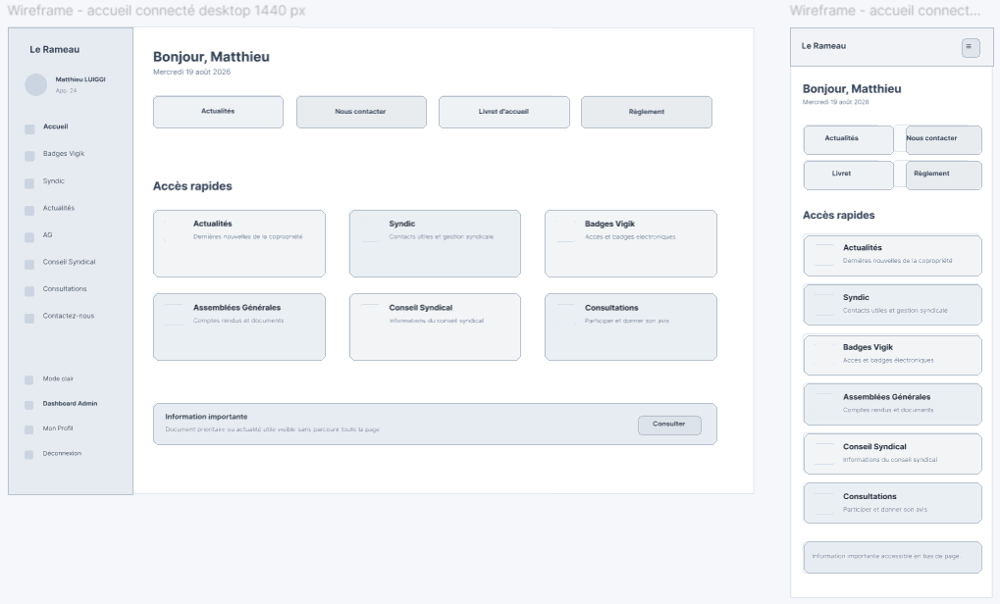

Figure R.4 : wireframe basse fidélité de l'accueil connecté en version ordinateur et mobile. Les contenus sont indiqués de manière fonctionnelle pour vérifier les parcours, les priorités et la lisibilité.

Sur ordinateur, les cartes sont organisées en grille de 3 colonnes pour limiter la hauteur de la page. Chaque carte prévoit un emplacement d'icône, un titre et une description courte. Les quatre raccourcis principaux restent au-dessus des cartes, car ils correspondent aux contenus les plus consultés : actualités, contact, livret d'accueil et règlement. Sur mobile, les raccourcis passent sur 2 colonnes, puis les cartes sont empilées pour garder des zones tactiles lisibles.

#### Maquette de la page d'accueil

La maquette a été réalisée dans Figma en reprenant l'identité visuelle de l'application développée. Contrairement au zoning et au wireframe, elle montre le rendu final : thème sombre, couleurs métiers, typographie et espacements proches de l'interface réelle.

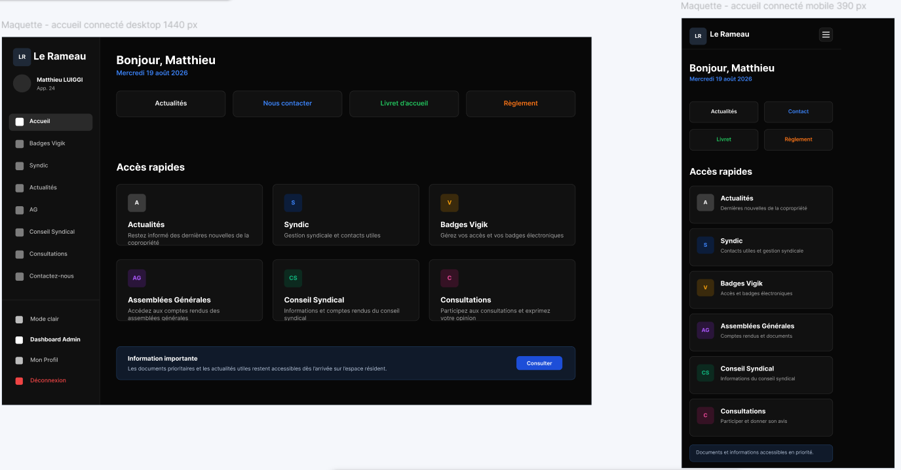

Figure R.5 : maquette de l'accueil connecté en version ordinateur 1440 px et mobile 390 px. Elle montre l'interface finale attendue pour un résident connecté, avec les raccourcis principaux et les cartes métiers.

La maquette évite les acronymes visibles côté utilisateur. Les libellés restent simples : actualités, syndic, badges Vigik, assemblées générales, conseil syndical et consultations. Les titres sont courts, les textes descriptifs ne dépassent pas une ligne ou deux, et les contrastes sont pensés pour rester lisibles sur fond sombre. Le bouton d'action du bloc d'information est placé à droite sur ordinateur, puis transformé en bloc simple sur mobile pour éviter une zone trop chargée.

#### Ergonomie prévue

L'ergonomie est construite autour d'un usage réel : un résident veut retrouver une information sans perdre de temps. Les choix suivants permettent de limiter les frictions.

| Choix ergonomique           | Application concrète                                                          |
| --------------------------- | ----------------------------------------------------------------------------- |
| Navigation claire           | Menu latéral sur ordinateur, menu compact sur mobile                          |
| Boutons suffisamment grands | Hauteur minimale de 44 px pour un usage tactile                               |
| Texte lisible               | Taille de base autour de 16 px, titres courts, paragraphes limités            |
| Parcours rapides            | Rubriques importantes accessibles en 1 clic depuis l'accueil connecté         |
| Feedback visuel             | Survol, focus clavier et état actif visibles sur les boutons                  |
| Mobile prioritaire          | Les contenus sont empilés et les cartes gardent une largeur lisible           |

L'objectif est qu'une action simple prenne moins de 2 minutes : se connecter, lire une actualité, ouvrir un document ou vérifier une consultation. Cet objectif reste réaliste pour une résidence de 80 à 100 lots, car l'application ne contient pas un grand volume de rubriques.

#### Optimisation SEO

Même si l'application est surtout privée, la page d'accueil publique doit rester correctement référencée. Le SEO ne vise pas une acquisition nationale, mais une identification claire du site par les résidents et les personnes qui cherchent la résidence.

| Elément SEO          | Choix prévu                                                                                                               |
| -------------------- | ------------------------------------------------------------------------------------------------------------------------- |
| Balise title         | `Le Rameau - Espace résident de la copropriété`                                                                           |
| Meta description     | `Accédez aux actualités, documents et consultations de la résidence Le Rameau depuis un espace privé simple et sécurisé.` |
| Titre H1             | Un seul H1 : `Le Rameau`                                                                                                  |
| Structure des titres | H2 pour les grandes zones, H3 pour les blocs d'accès                                                                      |
| URLs                 | Adresses courtes et lisibles : `/actualites`, `/documents`, `/consultations`, `/contact`                                  |
| Images               | Poids compressé, nom de fichier explicite, texte alternatif si l'image apporte une information                            |
| Indexation           | Les pages publiques peuvent être indexées, les pages privées restent protégées                                            |

Les mots-clés principaux sont volontairement locaux : `Le Rameau`, `résidence Le Rameau`, `copropriété Le Rameau`, `espace résident` et `Dijon` si le contexte géographique est affiché. Le but est d'être trouvable proprement, pas de concurrencer les grands syndics sur Google.

#### Accessibilité prévue

L'accessibilité est prise en compte dès la conception de la page, car la cible contient des profils d'âges différents. Certains utilisateurs peuvent avoir une vision moins confortable, utiliser un clavier ou naviguer sur un téléphone avec une luminosité réduite.

| Point contrôlé        | Application prévue                                                              |
| --------------------- | ------------------------------------------------------------------------------- |
| Langue de la page     | Attribut `lang="fr"`                                                            |
| Contraste             | Contrastes vérifiés sur fond clair public et fond sombre connecté, avec Lighthouse et WAVE |
| Hiérarchie des titres | Un H1 unique, puis H2 et H3 dans l'ordre                                        |
| Navigation clavier    | Focus visible sur liens, boutons et champs                                      |
| Noms accessibles      | Boutons et liens compréhensibles hors contexte                                  |
| Documents PDF         | Liens indiquant clairement qu'il s'agit d'un PDF                                |
| Images utiles         | Texte alternatif descriptif si l'image transmet une information                 |
| Formulaires           | Labels visibles ou noms accessibles pour les champs                             |

La capture WAVE réalisée sur l'application montre 0 erreur et 0 erreur de contraste. Ce résultat ne remplace pas une recette humaine complète, mais il donne une première preuve que les bases techniques sont correctes : structure de titres, contraste, textes alternatifs et langue de page. Les alertes restantes doivent être lues manuellement, car WAVE signale parfois des points à vérifier qui ne sont pas forcément des erreurs.

#### Critères de validation de la page d'accueil

| Critère                                    | Validation attendue                                                                               |
| ------------------------------------------ | ------------------------------------------------------------------------------------------------- |
| L'utilisateur comprend le service          | Le nom Le Rameau, le rôle de la page et le bouton de connexion sont visibles dès le premier écran |
| Le parcours principal est court            | Accès à une rubrique importante en 1 clic depuis l'accueil                                        |
| La page est lisible sur mobile             | Aucun texte ne sort de son bloc sur une largeur de 390 px                                         |
| La page respecte les bases SEO             | Title, meta description, H1 unique et URLs lisibles                                               |
| La page respecte les bases d'accessibilité | Navigation clavier, contraste correct, labels et ordre des titres                                 |
| La page reste légère                       | Images compressées et pas d'animation bloquante                                                   |

Cette conception donne une page d'accueil cohérente avec le projet. Elle reste assez sobre pour une copropriété, tout en mettant en avant les usages qui justifient l'application : informer, centraliser et consulter.

### R.3 Établir un mapping concurrentiel en expliquant le choix des concurrents directs

Le mapping concurrentiel complète le benchmark en montrant plus clairement la place du Rameau face aux solutions existantes. Les quatre acteurs gardés sont ceux déjà analysés dans le benchmark, car ils couvrent bien le marché observé autour du projet.

MyFoncia est retenu comme référence institutionnelle. C'est le portail privé connu chez beaucoup de copropriétaires passés par un grand syndic. Cotoit et Homeland sont retenus comme concurrents directs, car ils proposent des services de syndic en ligne et des espaces numériques pour copropriétés. ChouetteCopro est retenu comme concurrent indirect, parce qu'il ne remplace pas un syndic mais propose un outil complémentaire pour améliorer la circulation d'informations et la gestion d'incidents. Le Rameau se place volontairement à part : ce n'est pas une offre nationale, c'est un outil local adapté à une résidence précise.

Le mapping repose sur deux axes. Le premier oppose les plateformes nationales et standardisées aux solutions locales adaptées à une résidence précise. Le deuxième oppose les portails surtout documentaires aux solutions plus complètes, avec gestion avancée, accompagnement et services de syndic.

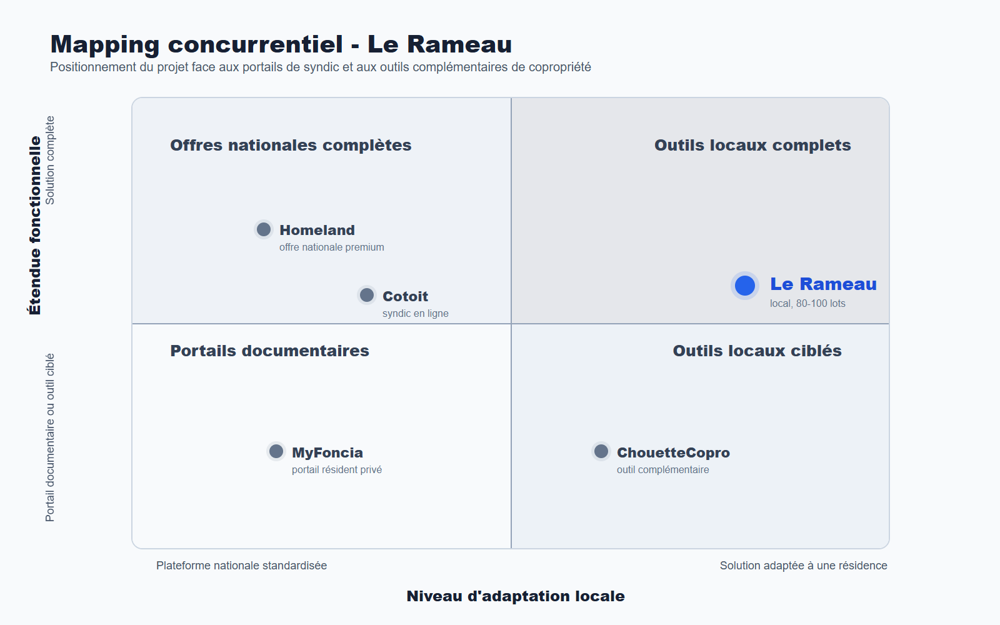

Figure R.3.1 : mapping concurrentiel du projet Le Rameau. Il compare les concurrents selon leur niveau d'adaptation locale et leur étendue fonctionnelle.

La lecture du mapping confirme les écarts entre les solutions étudiées. Homeland se positionne comme une offre nationale complète, rassurante grâce à ses chiffres et à son accompagnement, mais trop large pour une copropriété de 80 à 100 lots. Cotoit reste proche de cette logique, avec un syndic en ligne plus pédagogique, mais son modèle commercial dépasse le besoin d'un outil interne de résidence. MyFoncia sert surtout de référence pour l'espace client privé : la solution est connue et sécurisante, mais elle reste institutionnelle et peu personnalisée à l'échelle d'un seul immeuble.

ChouetteCopro occupe une place différente. Ce n'est pas un syndic complet, mais un outil complémentaire ciblé, intéressant pour fluidifier certains échanges et traiter des incidents. Le Rameau se place donc volontairement dans la partie droite du mapping : il ne cherche pas à couvrir tout le métier du syndic, mais à proposer un service local, simple et directement utile pour une résidence précise.

Sur ce mapping, Le Rameau est placé à droite de la carte, car il est conçu pour une résidence précise, et plutôt dans la partie intermédiaire haute. Il couvre plus qu'un simple portail documentaire grâce aux actualités, aux documents, aux profils, aux rôles et aux consultations. Par contre, il reste en dessous de Cotoit ou Homeland sur l'étendue fonctionnelle, car il ne gère pas le syndic complet, les charges, les devis ou les incidents complexes.

Le positionnement retenu est volontairement modeste. Le Rameau ne cherche pas à battre Homeland ou Cotoit sur le nombre de services. Ces plateformes peuvent proposer une gestion de syndic complète, des devis, de l'assistance et des outils commerciaux. Le projet Le Rameau répond à un besoin plus court : centraliser les informations d'une résidence, donner accès aux documents et permettre des consultations internes simples.

Ce positionnement a deux avantages. D'abord, il rend le budget réaliste pour une copropriété de 80 à 100 lots. Le coût d'exploitation cible reste inférieur à 25 euros par mois, alors qu'une solution nationale peut vite devenir trop lourde ou trop chère pour un seul immeuble. Ensuite, il réduit la complexité d'usage. Les résidents n'ont pas besoin d'un logiciel métier complet. Ils ont besoin d'un espace identifiable, avec peu de rubriques et des actions directes.

La proposition de valeur peut donc se résumer ainsi : pour les résidents et copropriétaires du Rameau qui perdent du temps à chercher les informations de copropriété, Le Rameau est une application web locale qui centralise actualités, documents et consultations dans un espace privé simple. Contrairement aux plateformes nationales de syndic, le service reste limité au besoin réel de la résidence, avec un coût maîtrisé et une administration adaptée au conseil syndical.

### R.4 Établir un use case, un diagramme d'activité et un diagramme de séquence

Les diagrammes fonctionnels ci-dessous se concentrent sur un flux central du projet : la participation à une consultation avec un vote unique par logement. Ce choix est volontaire, car cette règle touche directement à la logique métier de la copropriété. Dans une résidence, une consultation ne doit pas représenter chaque compte utilisateur séparément, mais chaque appartement concerné.

Le vote est donc contrôlé avec le couple `id_consultation` + `appartement`. Cette règle évite qu'un logement vote deux fois si deux personnes du même appartement ont un compte. Elle reste aussi plus juste qu'une contrainte uniquement posée sur l'utilisateur, car un copropriétaire peut changer de compte ou partager le logement avec un autre résident.

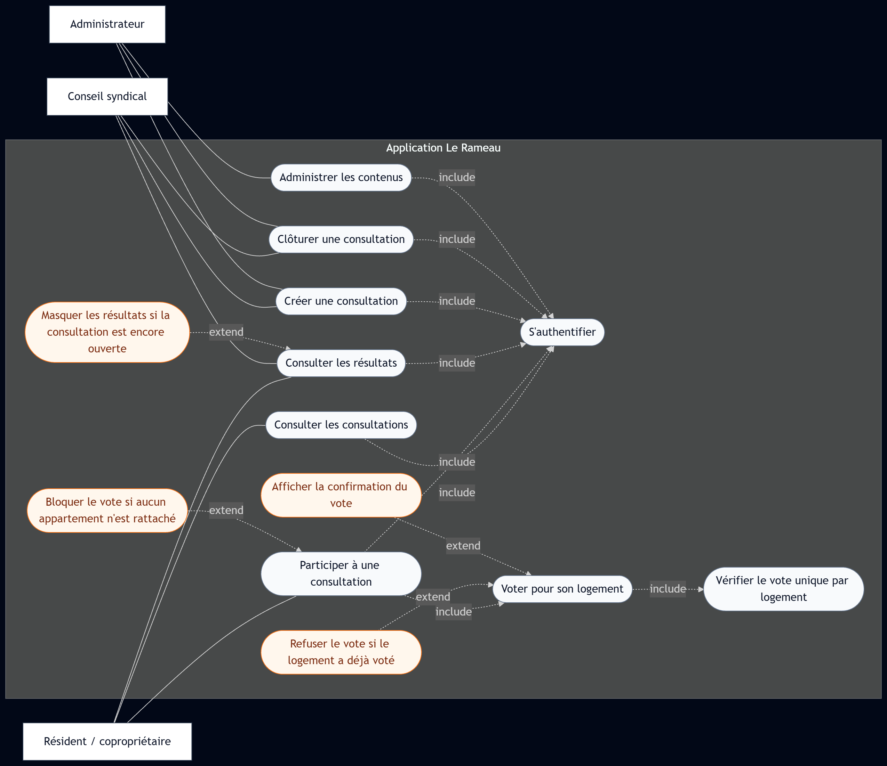

Figure R.4.1 : diagramme de cas d'utilisation du module de consultation. Il montre les rôles principaux : le résident ou copropriétaire participe, le conseil syndical pilote les consultations, et l'administrateur garde la possibilité d'administrer les contenus.

Le diagramme de cas d'utilisation permet de séparer les responsabilités. Le résident ne crée pas la consultation, il la consulte et y participe. Le conseil syndical peut créer, clôturer et lire les résultats. L'administrateur intervient surtout sur la gestion des contenus et la cohérence globale de l'application. Le cas `Vérifier le vote unique par logement` est inclus dans le vote, car il n'est pas optionnel : sans cette vérification, la consultation ne respecte pas la règle métier principale.

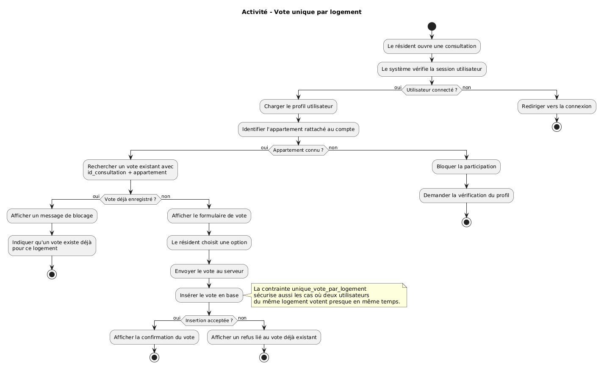

Figure R.4.2 : diagramme d'activité du vote unique par logement. Il détaille les vérifications faites avant l'enregistrement du vote : session utilisateur, appartement rattaché au profil, puis recherche d'un vote déjà existant.

Le diagramme d'activité montre les cas de blocage avant l'insertion en base. Si l'utilisateur n'est pas connecté, il est redirigé vers la connexion. Si son profil n'est pas relié à un appartement, le vote est bloqué, car le système ne peut pas garantir l'unicité par logement. Si un vote existe déjà pour le couple `id_consultation` + `appartement`, l'utilisateur reçoit un message de refus. Dans le cas normal, le formulaire est affiché, le vote est envoyé, puis la base accepte ou refuse l'insertion.

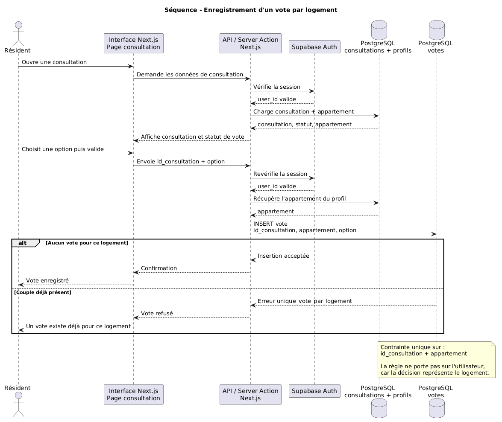

Figure R.4.3 : diagramme de séquence de l'enregistrement d'un vote. Il montre les échanges entre l'interface Next.js, l'API, Supabase Auth et PostgreSQL jusqu'à l'insertion du vote.

Le diagramme de séquence complète l'explication métier avec une lecture plus technique. La session est vérifiée une première fois pour afficher la consultation, puis une seconde fois au moment de l'envoi du vote. Cette double vérification évite de s'appuyer seulement sur l'état affiché côté navigateur. La base PostgreSQL reste le dernier niveau de sécurité grâce à la contrainte `unique_vote_par_logement`. Même si deux utilisateurs du même appartement votent presque en même temps, l'un des deux enregistrements sera refusé.

Ces trois diagrammes se complètent. Le premier explique qui fait quoi, le deuxième explique les décisions du parcours, et le troisième montre comment l'application sécurise techniquement l'enregistrement. Ils donnent donc une preuve plus claire de la maîtrise du flux de consultation, qui est l'une des parties les plus sensibles du projet.

### R.5 Expliquer et justifier l'architecture globale de développement

Pour l'architecture, je suis parti du besoin réel du projet. Le Rameau concerne une copropriété locale d'environ 80 à 100 lots. L'application doit surtout permettre aux résidents de consulter des actualités, retrouver des documents, contacter les bons interlocuteurs et participer à des consultations. Je n'avais donc pas besoin d'une infrastructure prévue pour plusieurs milliers d'utilisateurs dès la V1. Le plus important était d'avoir une base propre, des accès sécurisés et un projet que je pouvais maintenir seul.

Sur mon projet, l'application est hébergée sur Vercel avec l'offre gratuite. Supabase est aussi utilisé avec l'offre gratuite pour l'authentification, PostgreSQL et le stockage des fichiers. Pour le moment, c'est suffisant, car le site n'est pas encore ouvert à tous les résidents en usage réel. Il sert principalement à développer, tester et montrer une version fonctionnelle. Je préfère donc partir sur une solution gratuite mais sérieuse, puis réévaluer les limites si la résidence décide de l'utiliser au quotidien.


Figure R.5.1 : architecture globale en 3 tiers. Le schéma précise les protocoles et les ports utilisés entre le navigateur, Vercel et les services Supabase.


Figure R.5.2 : architecture back-end détaillée. Elle montre la séparation entre l'interface, les routes applicatives, l'authentification, la base relationnelle et le stockage des fichiers, avec les communications réseau associées.

Les communications accessibles depuis Internet passent par HTTPS avec TLS sur le port TCP 443. C'est le cas entre le navigateur et Vercel, mais aussi entre l'application et les API Supabase pour l'authentification, les données et les fichiers. Le temps réel utilise une connexion WebSocket sécurisée sur le même port 443. PostgreSQL utilise le port TCP 5432 uniquement à l'intérieur de l'infrastructure Supabase. Ce port n'est pas exposé directement au navigateur. Les appels entre les composants, les services et le middleware Next.js restent internes à l'application et n'ouvrent donc pas de port public supplémentaire.

#### Comparaison des architectures possibles

Une architecture de type MERN ou MEAN aurait pu fonctionner techniquement. Elle aurait demandé un front React ou Angular, un serveur Node.js séparé et une base MongoDB. Pour Le Rameau, ce découpage aurait surtout ajouté un serveur API complet à maintenir. Sur une V1 portée seul, je pense que cela aurait représenté 2 à 4 jours de configuration et de tests en plus, sans apporter beaucoup plus de valeur au conseil syndical.

Une approche plus classique avec PHP, Symfony ou Laravel et une base MySQL aurait aussi été possible. Elle reste solide pour une application métier. Dans mon cas, elle aurait demandé plus de travail sur l'hébergement, l'authentification et le stockage sécurisé des documents. Comme le projet devait avancer vite sur les écrans utiles aux résidents, j'ai préféré utiliser une stack qui me permettait de mettre en place ces briques plus directement.

WordPress aurait pu sembler plus rapide pour publier des contenus. Je ne l'ai pas retenu, car Le Rameau dépasse un simple site de pages. Il y a des comptes, des rôles, des documents privés et une règle métier importante sur le vote unique par logement. Avec plusieurs extensions, j'aurais gagné du temps au début, mais la maintenance aurait été moins claire dès que les règles de consultation ou les droits d'accès deviennent spécifiques.

Une architecture microservices serait trop importante pour ce contexte. Elle peut être intéressante quand plusieurs équipes travaillent sur des modules séparés ou quand l'application supporte beaucoup de trafic. Pour une copropriété seule, cela aurait créé plus de complexité que de bénéfices.

Le choix retenu est donc une architecture Next.js avec des services managés. Next.js gère l'interface, les routes et une partie de la logique serveur. Supabase gère l'authentification, la base PostgreSQL et les fichiers. Vercel automatise le déploiement depuis GitHub. Ce choix correspond bien à mon projet, parce qu'il réduit la maintenance technique tout en gardant une vraie séparation entre l'interface, les règles applicatives et les données.

#### Limites et évolution possible

La limite principale vient des offres gratuites. Elles conviennent pour le développement, la préproduction et les tests actuels, mais elles ne doivent pas être considérées comme définitives sans contrôle. Si le site est ouvert à tous les résidents, il faudra surveiller le nombre de connexions, le stockage des documents et les temps de réponse. Les tests de montée en charge sur la préproduction servent justement à vérifier si la configuration actuelle tient correctement.

Pour le périmètre actuel, je garde donc Vercel gratuit et Supabase gratuit. C'est cohérent avec l'usage réel du projet aujourd'hui et cela évite de payer une infrastructure avant d'avoir de vrais utilisateurs. Si Le Rameau devient plus tard une solution utilisée chaque jour par toute la résidence, ou si l'idée évolue vers plusieurs résidences, il faudra revoir le budget et peut-être passer sur des offres supérieures. Ce sera une décision basée sur les mesures, pas un choix fait à l'avance.

### R.6 Justifier les technologies front-end utilisées

#### Structure de stack retenue

Le Rameau n'utilise pas une stack MERN ou MEAN au sens strict. MERN associe MongoDB, Express, React et Node.js. MEAN reprend la même base mais remplace React par Angular. Mon projet utilise bien React et s'exécute dans un environnement Node.js grâce à Next.js, mais il n'utilise ni MongoDB ni un serveur Express séparé.

La structure retenue correspond à l'association MSSR + PSAA présentée dans le cahier des charges. La partie MSSR repose sur une seule application Next.js qui regroupe les pages, le rendu côté serveur, le middleware et les routes API. La partie PSAA correspond aux services managés utilisés autour de cette application : Vercel pour le déploiement et Supabase pour l'authentification, l'API PostgREST, le stockage et PostgreSQL.

Cette structure est avantageuse pour Le Rameau pour quatre raisons concrètes. Je garde TypeScript sur l'interface et sur la logique serveur, ce qui évite de changer de langage dans un projet développé seul. Le front-end et les routes API restent dans le même dépôt, sans serveur Express supplémentaire à configurer et à déployer. PostgreSQL correspond mieux que MongoDB aux relations entre les résidents, les logements, les consultations et les votes. Enfin, Vercel et Supabase prennent en charge une partie de l'exploitation technique, et leurs offres gratuites sont suffisantes pour le développement et les tests actuels du projet.

Face à MERN, ce choix évite une base documentaire moins pratique pour faire respecter la contrainte de vote unique par logement. Face à MEAN, il évite aussi d'ajouter Angular et Express alors que Next.js couvre déjà le routage, le rendu et les routes serveur dont j'ai besoin. Pour une copropriété de 80 à 100 lots, cette stack est plus simple à maintenir tout en gardant une vraie séparation entre l'interface, les traitements et les données.

#### Technologies retenues

Les versions utilisées dans le projet sont les suivantes :

- Next.js 14.2.35 pour la structure de l'application, les pages, les routes protégées et le rendu côté serveur.
- React 18.3.1 pour les composants d'interface.
- TypeScript 5.9.3 avec le mode strict activé pour limiter les erreurs de typage.
- Tailwind CSS 3.4.19 pour une interface responsive et cohérente.
- Supabase JS 2.97.0 et `@supabase/ssr` 0.8.0 pour l'authentification, les sessions et l'accès à la base.
- Zod 4.3.6 pour valider les données reçues dans les formulaires.
- Vitest 4.1.8 pour les tests unitaires.

Pour la partie front-end, Angular aurait donné une structure très complète, mais avec davantage de configuration pour une application que je développe seul. Vue avec Nuxt aurait aussi été cohérent, mais le projet et mes compétences étaient déjà orientés React. Un React seul avec Vite aurait été plus léger, mais il aurait fallu ajouter séparément le routage, la protection des pages, une stratégie de rendu et les routes API. Next.js reste donc le choix le plus cohérent pour centraliser ces besoins sans multiplier les outils.

Le choix de Tailwind CSS répond au même raisonnement. Bootstrap aurait permis d'aller vite, mais avec un rendu plus générique et moins adapté à l'identité sobre du Rameau. Des fichiers CSS classiques auraient fonctionné, mais ils auraient demandé plus de conventions manuelles pour garder une interface homogène sur desktop et mobile. Tailwind permet de garder les espacements, les états et le responsive au même endroit que les composants. Pour une V1 portée seul, c'est plus facile à maintenir.

Le choix de TypeScript strict est important dans ce projet, car plusieurs règles dépendent du rôle de l'utilisateur et de son appartement. Une erreur sur un type de profil, un identifiant de consultation ou une valeur de formulaire peut créer un bug métier. Le typage ne remplace pas les tests, mais il bloque déjà une partie des erreurs pendant le développement.

Zod complète TypeScript, car TypeScript ne vérifie pas les données à l'exécution. Un formulaire peut recevoir une valeur vide, mal formatée ou modifiée depuis le navigateur. Zod permet donc de valider les données au moment où elles entrent dans l'application. C'est particulièrement utile pour les formulaires d'inscription, les consultations et les contenus administrables.

Supabase a été retenu parce que le projet repose sur des données relationnelles. Les documents, actualités, profils, rôles, consultations et votes sont liés entre eux. PostgreSQL est donc plus adapté qu'une base NoSQL pour représenter les relations et les contraintes, comme le vote unique par logement. La contrainte `unique_vote_par_logement` montre bien ce besoin de règle côté base, pas seulement côté interface.

#### Organisation front-end

L'organisation du projet suit une logique par responsabilités. Les pages de l'application sont placées dans `app`, les composants réutilisables dans `components`, les fonctions liées aux services dans `lib`, et les types partagés dans `types`. Cette séparation aide à retrouver rapidement le code, surtout sur un projet solo où il faut pouvoir reprendre une fonctionnalité plusieurs semaines après l'avoir écrite.

Le front-end n'est pas pensé comme une simple couche graphique. Il vérifie les formulaires, affiche les droits selon le rôle, protège les routes sensibles et garde une navigation claire entre les rubriques. Les contrôles importants restent quand même côté serveur ou côté base de données. Par exemple, le bouton de vote peut être masqué dans l'interface, mais la base doit quand même refuser une tentative de double vote.

### R.7 Finaliser le site internet sur les aspects légaux, l'accessibilité web et le SEO

Le site Le Rameau utilise déjà des cookies de session via Supabase Auth. Ces cookies sont nécessaires pour garder l'utilisateur connecté, protéger les accès privés et éviter de redemander l'authentification à chaque page. Ils ne servent pas à faire du suivi marketing.

Pour rendre ce point plus clair côté utilisateur, un bandeau de gestion des cookies a été ajouté sur le site. Il apparaît lors de la première visite et propose trois choix au même niveau : `Tout refuser`, `Paramétrer` et `Tout accepter`. Ce fonctionnement suit la recommandation de la CNIL : refuser doit être aussi simple qu'accepter. Le refus n'empêche pas l'utilisation du site, car les cookies strictement nécessaires restent actifs.

Le panneau de paramétrage sépare les finalités en trois catégories. Les cookies strictement nécessaires sont toujours actifs, car ils sont liés à la sécurité et à la session. Les cookies de mesure d'audience et de confort sont facultatifs. Dans la version actuelle, aucun outil publicitaire n'est branché sur le site, ce qui limite le risque de suivi inutile pour les résidents.

Le choix est mémorisé dans le navigateur avec la clé `le-rameau-cookie-consent-v1`. La durée retenue est de 183 jours, soit environ 6 mois. Après cette durée, le choix est redemandé. Un lien `Gérer les cookies` est aussi présent dans le pied de page pour permettre à l'utilisateur de modifier son choix plus tard, sans devoir supprimer manuellement les données de son navigateur.

La correction est visible dans le code avec quatre fichiers principaux : `components/legal/CookieConsentBanner.tsx`, `app/layout.tsx`, `components/landing/Footer.tsx` et `app/confidentialite/page.tsx`. La politique de confidentialité contient maintenant une partie dédiée aux cookies et traceurs. Elle explique les cookies nécessaires, les cookies facultatifs et la durée de conservation du choix utilisateur.

Cette évolution reste volontairement simple. Pour une copropriété de 80 à 100 lots, il n'est pas utile d'ajouter une solution complexe de gestion publicitaire. Le besoin est surtout d'être transparent avec les résidents et de montrer que le site ne dépose pas de traceurs non nécessaires sans action claire de leur part.

Source utilisée pour cette note : CNIL, Questions-réponses sur les cookies et autres traceurs : https://www.cnil.fr/fr/cookies-et-autres-traceurs/regles/cookies/FAQ

### R.8 Établir une note client sur la conformité W3C et la compatibilité navigateur

Cette note est destinée au conseil syndical de la Résidence Le Rameau. Son objectif est d'expliquer simplement comment la qualité technique du site est contrôlée avant la livraison, notamment sur la structure HTML, l'accessibilité et la compatibilité avec les navigateurs utilisés par les résidents.

Le W3C correspond à l'organisme qui publie des standards pour le Web. Dans le projet, cela se traduit par des règles concrètes : une page HTML correctement structurée, une langue déclarée en français, des titres hiérarchisés, des liens compréhensibles, des images avec un texte alternatif quand elles portent une information et des formulaires lisibles par les navigateurs comme par les technologies d'assistance. Ce n'est pas une certification commerciale. C'est plutôt une vérification de base pour éviter un site fragile, difficile à maintenir ou mal interprété par certains outils.

Sur Le Rameau, plusieurs points sont déjà intégrés dans le code. La balise principale de la page déclare `lang="fr"`, ce qui aide les lecteurs d'écran et les navigateurs à choisir la bonne langue. La page d'accueil possède un titre et une description dans les métadonnées Next.js : `Le Rameau - Votre copropriété en ligne` et `Plateforme de gestion et communication pour les résidents de la copropriété Le Rameau`. Les pages légales sont aussi accessibles depuis le pied de page : mentions légales, confidentialité et conditions générales. Pour un site de copropriété, c'est important car l'utilisateur doit pouvoir comprendre qui édite le service et comment ses données sont utilisées.

L'accessibilité est contrôlée avec WCAG 2.2 et le RGAA 4.1.2 comme références. L'objectif retenu est un niveau proche AA sur les parcours principaux : créer un compte, se connecter, consulter une actualité, ouvrir un document, participer à une consultation et accéder à son profil. Ce niveau est cohérent avec le public du Rameau, car la résidence peut regrouper des jeunes actifs, des familles, des copropriétaires plus âgés et des utilisateurs moins habitués aux outils numériques.

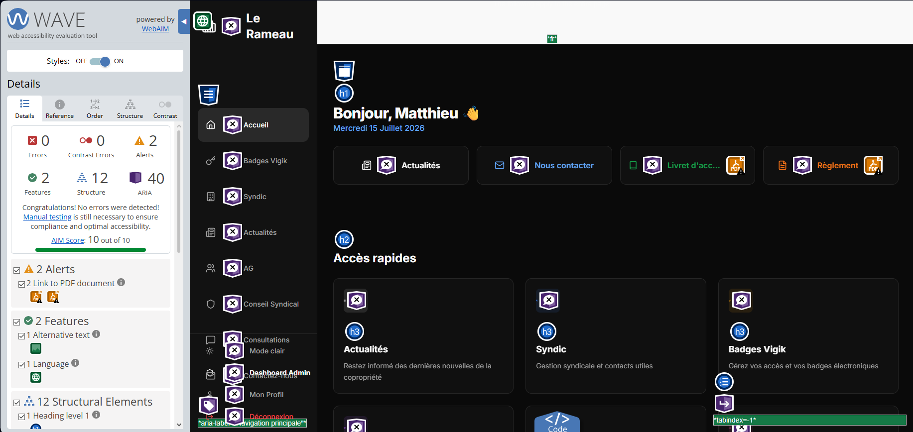

Figure R.11 : contrôle WAVE réalisé sur l'application. La capture montre 0 erreur, 0 erreur de contraste et 2 alertes liées aux liens PDF.

Le résultat WAVE est positif, mais il doit être lu correctement. Les 0 erreur et 0 erreur de contraste montrent que la base de la page auditée est saine. Les 2 alertes ne sont pas des erreurs bloquantes. Elles signalent surtout que les liens vers les PDF doivent être vérifiés manuellement, parce qu'un outil automatique ne peut pas savoir si un PDF est vraiment lisible, bien nommé et accessible dans son contenu. La règle retenue pour le client est donc la suivante : chaque PDF mis en ligne doit avoir un titre compréhensible, une date ou une catégorie claire, une taille raisonnable et, si possible, ne pas être un scan illisible.

Côté compatibilité navigateur, le site est basé sur Next.js 14.2.35. La documentation officielle de Next.js indique une prise en charge des navigateurs modernes avec Chrome 111+, Edge 111+, Firefox 111+ et Safari 16.4+. Pour la livraison du Rameau, la cible retenue est un peu plus récente, afin de rester réaliste en 2026 : Chrome 120 et plus, Edge 120 et plus, Firefox 121 et plus, Safari 17 et plus, Chrome Android récent et Safari iOS 17 et plus. Internet Explorer et Opera Mini ne sont pas supportés, car ils ne correspondent plus aux usages attendus pour une interface connectée avec authentification, formulaires et documents privés.

La recette navigateur se fait sur 6 environnements : Chrome desktop, Edge desktop, Firefox desktop, Safari macOS, Chrome Android et Safari iOS. Sur chaque environnement, les mêmes parcours sont rejoués : inscription, connexion, consultation d'une actualité, ouverture d'un document, vote à une consultation, accès au profil et déconnexion. Cela représente 42 vérifications fonctionnelles. En comptant environ 5 minutes par vérification, une demi-journée de recette est réservée, car il faut aussi garder du temps pour corriger les écarts d'affichage.

La validation W3C du HTML doit être faite sur l'URL publique de livraison, ou sur le code HTML généré si l'environnement est protégé. La préproduction Vercel peut bloquer certains outils externes si elle reste protégée. Le contrôle final consiste donc à lancer le validateur W3C sur la page d'accueil publique, puis à vérifier Lighthouse et WAVE sur les pages les plus importantes. Les pages privées ne doivent pas être indexées par les moteurs de recherche. Le sitemap public doit rester limité aux pages réellement publiques : accueil, mentions légales, confidentialité et conditions générales.

Les corrections à prévoir avant la livraison sont assez ciblées. Les boutons d'affichage du mot de passe doivent avoir un libellé accessible, comme `Afficher le mot de passe` ou `Masquer le mot de passe`. Les messages de succès ou d'erreur doivent être annoncés correctement aux technologies d'assistance. Les documents PDF doivent être vérifiés un par un avant publication. Enfin, le fichier `robots.txt` et le `sitemap.xml` doivent être générés avec le bon domaine de production pour éviter d'indexer des pages privées.

Sources utilisées pour cette note :

- W3C, Web Content Accessibility Guidelines 2.2 : https://www.w3.org/TR/WCAG22/
- W3C, Markup Validation Service : https://validator.w3.org/
- RGAA 4.1.2, référentiel français d'accessibilité : https://accessibilite.numerique.gouv.fr/
- Next.js, Supported Browsers : https://nextjs.org/docs/architecture/supported-browsers

### R.9 Retravailler le compte Git avec les branches dev, preprod et prod

Le projet est organisé avec 3 branches principales pour séparer le développement, les tests et la version validée. Cette séparation évite de tester directement sur la production et donne un parcours plus clair avant mise en ligne.

| Branche   | Rôle dans le projet                               | Usage prévu                                                                 |
| --------- | ------------------------------------------------- | --------------------------------------------------------------------------- |
| `dev`     | Branche de développement                          | Intégrer les corrections et les nouvelles fonctionnalités                   |
| `preprod` | Branche de préproduction                          | Tester une version stable sur Vercel avant validation                       |
| `prod`    | Branche de production suivie par Vercel           | Déployer uniquement une version validée                                     |
| `main`    | Branche historique conservée dans le dépôt GitHub | Gardée pour l'historique du projet, mais non utilisée comme étape de test   |

Au moment de la mise en place, les branches `main`, `dev`, `preprod` et `prod` pointaient sur le même commit. C'est normal, car elles ont été créées après coup pour structurer le workflow. Leur intérêt apparaîtra ensuite à chaque évolution : le travail démarre sur `dev`, passe sur `preprod` pour les tests, puis arrive sur `prod` après validation.

Sur Vercel, la branche de production a été configurée sur `prod`. Un push sur cette branche déclenche donc un déploiement de production. La branche `preprod`, elle, déclenche un déploiement Preview. L'URL stable de préproduction est :

`https://le-rameau-git-preprod-matthieuluiggis-projects.vercel.app`

Cette URL suit automatiquement la branche `preprod`. Si une nouvelle version est poussée sur cette branche, le lien reste le même et pointe vers la dernière préproduction. C'est cette URL qui a été utilisée pour les tests de montée en charge.

Les variables d'environnement Vercel sont configurées pour tous les environnements. Les variables Supabase et le secret du cron sont donc disponibles sur Production et Preview. Pour cette phase de test, la base Supabase actuelle sert de base de préproduction, car l'application n'est pas encore ouverte à de vrais utilisateurs. Dans une exploitation client complète, il serait plus prudent de prévoir une base séparée pour éviter de mélanger données de test et données réelles.

### R.10 Établir un diagramme de Gantt avec GanttProject

Le planning du projet est conservé au format GanttProject dans `docs/gantt/le-rameau-sprints-2026.gan`. Le script `scripts/generate-gantt-sprints.ps1` reconstruit le fichier source et le tableau des tâches `docs/gantt/le-rameau-sprints-2026-taches.csv`. L'ancien fichier est gardé séparément pour conserver la version précédente du planning.

Le calendrier retenu s'étend du 19 janvier au 12 juin 2026. Il est organisé en 10 sprints de deux semaines, du 19 janvier au 5 juin, puis une semaine de clôture du 8 au 12 juin. Les 7 lots couvrent le cadrage, la veille, l'identité visuelle, la conception technique, le développement, la recette et la livraison. Les 35 tâches reprennent les identifiants du tableau H.2. L'administration est découpée par module pour suivre les mêmes livraisons que les sprints. Ce planning est reconstitué : il ne présente pas les réunions ou les validations comme un historique déjà attesté.

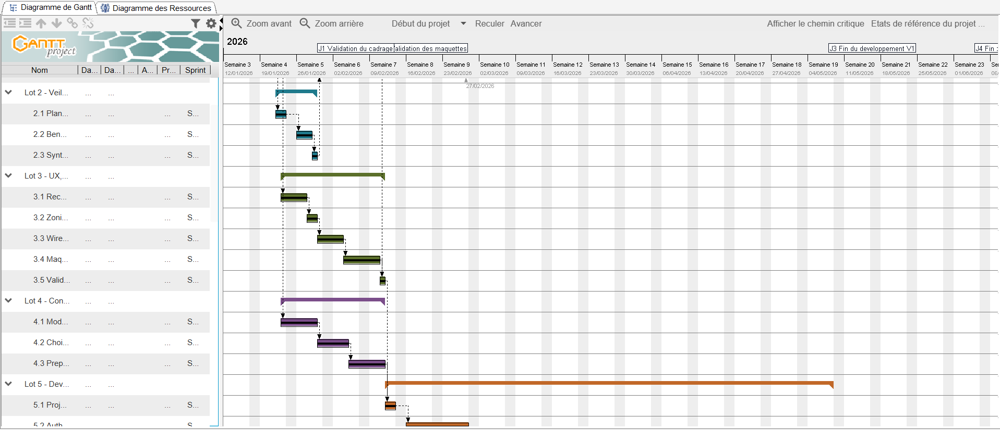

Figure R.9 : capture du diagramme de Gantt dans GanttProject. Elle montre les lots, les tâches, les dépendances, les jalons et les pourcentages d'avancement.

Le planning utilise 5 ressources : chef de projet, développeur full-stack, graphiste UX, testeur fonctionnel et conseil syndical. Les 4 ressources agence sont facturées avec les taux déjà justifiés dans l'annexe TJM : 75 euros HT/h pour le chef de projet, 65 euros HT/h pour le développeur, 55 euros HT/h pour la graphiste UX et 50 euros HT/h pour le testeur. Le temps du conseil syndical reste indiqué dans le planning, mais il n'est pas facturé dans le devis agence.

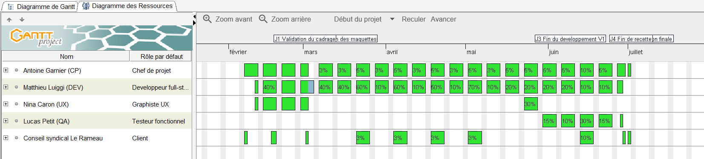

Figure R.10 : capture du diagramme des ressources dans GanttProject. Elle sert à visualiser la charge de travail par profil sur la période projet.

Les jalons de référence sont la validation du cadrage le 30 janvier 2026, la validation des maquettes le 11 février, la fin du développement V1 le 8 mai, la fin de recette le 5 juin, la mise en ligne le 9 juin et la livraison finale le 12 juin. La charge reste de 94 heures de chef de projet, 252 heures de développement, 76 heures d'UX et 30 heures de tests. Le devis agence reste donc de 29 110 euros HT. Les 23 heures client ne sont pas facturées.

### R.11 Mettre en place un outil de pilotage de projet

J'utilise Azure DevOps pour organiser le backlog du Rameau. L'arborescence comprend les Epics, les Features, les User Stories et les Tasks. Les éléments sont assignés à mon compte, car j'ai réalisé le développement. Le découpage suivant est retenu pour configurer les itérations ; il ne correspond pas à des sprints déjà suivis à ces dates.

| Sprint | Période 2026 | Objectif | User Stories existantes |
| ------ | ------------ | -------- | ----------------------- |
| 1 | 19/01 au 30/01 | Cadrage, étude de marché et début de conception | Tickets de pilotage à compléter |
| 2 | 02/02 au 13/02 | Interface publique et navigation | 121, 186 |
| 3 | 16/02 au 27/02 | Inscription, connexion, profils et accès administrateur | 123, 124, 109, 133 |
| 4 | 02/03 au 13/03 | Espace résident et informations pratiques | 126, 129, 130, 244, 135 |
| 5 | 16/03 au 27/03 | Actualités et notifications | 127, 134, 128 |
| 6 | 30/03 au 10/04 | Consultation et administration des documents | 131, 231 |
| 7 | 13/04 au 24/04 | Consultations, vote unique et administration | 132, 237 |
| 8 | 27/04 au 08/05 | Accessibilité et conformité | 122 et tickets complémentaires |
| 9 | 11/05 au 22/05 | Tests applicatifs, sécurité et préproduction | Tickets de qualification à compléter |
| 10 | 25/05 au 05/06 | Recette et préparation de la livraison | Tickets de recette à compléter |

La semaine du 8 au 12 juin est réservée à la clôture. La story 135 correspond au message de l'ancien robot 3D et reste dans l'historique de la V1. Les évolutions réalisées ensuite doivent conserver leur propre date. En particulier, les rapports k6 présentés en R.12 restent datés du 12 novembre 2026.

La configuration des sprints et le suivi des comptes rendus restent à compléter dans Azure DevOps. Chaque tâche devra permettre de retrouver le responsable, le sprint, l'échéance et l'état d'avancement. Les réunions réellement tenues seront documentées avec leur date, les participants, les décisions et les actions associées. Le calendrier reconstitué ne sert pas à créer des comptes rendus de réunions qui n'ont pas eu lieu.

### R.12 Mettre en place les tests de montée en charge avec les rapports de tests

#### Objectif et environnement testé

J'ai réalisé cette campagne le 12 novembre 2026 avec k6 2.2.0. L'objectif est de vérifier le comportement du Rameau lorsque plusieurs clients consultent les rubriques de l'espace résident en même temps. Le scénario porte sur des lectures authentifiées, avec un téléchargement de pièce jointe à chaque parcours.

k6 s'exécute depuis mon poste Windows et envoie ses requêtes vers le déploiement Vercel de la branche `preprod`, à l'adresse suivante :

https://le-rameau-git-preprod-matthieuluiggis-projects.vercel.app

L'application ciblée est donc hébergée en préproduction, pas sur mon serveur local. Supabase conserve actuellement une base commune aux déploiements du projet. Les requêtes de données et de fichiers sollicitent ce service partagé : l'environnement de test n'est pas entièrement isolé de l'autre déploiement.

Pour cette résidence de 80 à 100 lots, j'ai retenu trois niveaux de charge. Les 5 clients représentent une utilisation courante supposée, les 15 clients une période plus active et les 30 clients une pointe après une annonce ou l'ouverture d'une consultation. Ce sont des hypothèses de test, pas des chiffres de fréquentation déjà observés chez les résidents.

#### Parcours et contrôles effectués

Le script principal est `tests/load/preprod.k6.js`. Chaque client virtuel suit ce parcours :

1. Ouvrir `/accueil`, récupérer son profil et les dernières notifications.
2. Ouvrir `/actualites`, charger les actualités non expirées puis lire un article de la liste.
3. Ouvrir `/ag`, récupérer la liste des documents puis télécharger une pièce jointe depuis Supabase Storage.
4. Ouvrir `/consultations`, récupérer les consultations actives et les votes existants pour l'appartement du compte.

Des pauses aléatoires de 2 à 5 secondes séparent les rubriques pour représenter un temps de lecture. Les appels reprennent les tables et les filtres utilisés par l'application. k6 vérifie les pages protégées et reproduit explicitement les requêtes Supabase que les composants React exécutent dans le navigateur. Il n'exécute pas lui-même le JavaScript de l'interface.

Un statut HTTP `200` ne suffit pas à valider une étape. Le script contrôle aussi la structure des données, le profil attendu, la présence d'une actualité et d'une consultation active. Pour les pièces jointes, il vérifie la signature binaire et le type MIME du fichier reçu. Les fichiers présents lors de cette campagne sont des PNG, acceptés par le formulaire AG. Les PDF et plusieurs formats d'image sont également pris en charge par le contrôle. Une réponse HTML reçue à la place d'un fichier est refusée, même avec un statut `200`.

Le compte est authentifié pendant la préparation du test. Le script installe ensuite les cookies au format utilisé par `@supabase/ssr` et transmet le jeton utilisateur aux API Supabase. Les contrôles d'accès restent appliqués. Le secret `Protection Bypass for Automation` autorise uniquement l'accès automatisé au déploiement Vercel protégé ; il ne remplace pas la session résident.

Cette campagne utilise un seul compte de test avec `allowSharedAccounts` activé. Les 30 clients virtuels partagent donc ce compte et sa session. Le test mesure des requêtes concurrentes sur des droits identiques, pas 30 résidents distincts ou 30 connexions simultanées. Aucun vote, document ou profil n'est créé ou modifié. L'authentification peut toutefois créer une session et alimenter les journaux Supabase.

#### Protocole et seuils fixés avant mesure

Le mode `load` comporte sept étapes. La charge monte de 0 à 5 clients en 30 secondes, reste à 5 pendant 45 secondes, monte à 15 en 30 secondes puis reste à 15 pendant 60 secondes. Elle monte ensuite à 30 en 30 secondes, reste à 30 pendant 60 secondes et redescend à 0 en 30 secondes. La charge programmée dure 4 min 45 s. Le temps total observé au terminal est de 5 min 02,4 s, avec la préparation et la fin des parcours en cours.

Les objectifs sont définis avant l'exécution :

- Moins de 1 % d'erreurs HTTP pendant la mesure.
- Un p90 HTTP inférieur à 800 ms et un p95 inférieur à 1 200 ms.
- Un p95 inférieur à 1 200 ms pour chaque opération et chaque palier stable.
- Au moins 99 % de parcours réussis, avec toutes les étapes exécutées, une pièce jointe valide et le nombre cible de clients atteint.

Le p95 correspond au temps sous lequel se situent environ 95 % des réponses de l'échantillon. Il ne signifie pas que toutes les requêtes respectent ce délai. Les pauses de lecture et la préparation des connexions sont exclues des temps HTTP présentés ci-dessous. Ces durées ne mesurent pas l'affichage visuel complet d'une page.

Le lancement se fait depuis la racine du projet :

```powershell
.\tests\load\run-preprod.ps1 -Profile smoke
.\tests\load\run-preprod.ps1 -Profile demo
.\tests\load\run-preprod.ps1 -Profile load
```

Le mode `smoke` exécute un seul parcours, le mode `demo` monte à 5 clients sur 75 secondes et le mode `load` réalise la campagne complète. La configuration et les identifiants sont placés dans `tests/load/config.local.json`, exclu de Git. Ils ne sont pas recopiés dans les rapports. Le guide de lancement est disponible dans `tests/load/README.md`.

#### Résultats et rapports conservés

La démonstration à 5 clients a terminé 20 parcours avec 100 % de réussite et 0 % d'erreurs HTTP. Son p95 global est de 690,65 ms. Le test complet a ensuite atteint les 30 clients prévus, sans parcours interrompu.

| Indicateur du test complet | Résultat observé |
| --- | --- |
| Clients virtuels au maximum | 30, avec un compte partagé |
| Parcours terminés | 270 |
| Parcours réussis | 100 % |
| Requêtes pendant la charge | 3 510 |
| Requêtes avec la préparation | 3 517 |
| Erreurs HTTP pendant la charge | 0 % |
| Pièces jointes Storage téléchargées et vérifiées | 270 |
| p90 HTTP pendant la charge | 575,49 ms |
| p95 HTTP pendant la charge | 644,82 ms |
| Temps HTTP maximal pendant la charge | 1 832,80 ms |

Tous les seuils de la campagne complète sont atteints. Les mesures des fenêtres de palier donnent le détail suivant, hors transitions entre niveaux :

| Palier | Requêtes mesurées sur la fenêtre | p95 HTTP |
| --- | ---: | ---: |
| 5 clients | 158 | 858,09 ms |
| 15 clients | 664 | 695,79 ms |
| 30 clients | 1 392 | 582,79 ms |

Ces fenêtres ne couvrent pas toutes les requêtes du test : les rampes et la fin des parcours sont aussi incluses dans le résultat global. La baisse du p95 au fil des paliers ne prouve pas que l'application devient plus rapide grâce à la charge. Les fenêtres se succèdent et leur contexte n'est pas identique ; il faudrait répéter la campagne pour expliquer cette différence.

Le p95 le plus élevé parmi les opérations du test complet concerne la page d'un article, à 917,88 ms. La page des documents atteint 765,65 ms. Les données d'une actualité sont récupérées avec un p95 de 111,36 ms et le téléchargement d'une pièce jointe avec un p95 de 224,02 ms. Sur cet essai, les réponses des pages Next.js prennent donc davantage de temps que ces appels de données et de fichiers.

Les preuves sont conservées avec leur date, leur profil et leurs seuils :

- Démonstration à 5 clients : [rapport HTML](tests/load/results/preprod-demo-20261112-131219.html) et [mesures JSON](tests/load/results/preprod-demo-20261112-131219.json).
- Campagne à 30 clients : [rapport HTML](tests/load/results/preprod-load-20261112-131951.html) et [mesures JSON](tests/load/results/preprod-load-20261112-131951.json).
- Contrôle préliminaire d'un parcours : [rapport HTML](tests/load/results/preprod-smoke-2026-11-12T12-09-18-242Z.html) et [mesures JSON](tests/load/results/preprod-smoke-2026-11-12T12-09-18-242Z.json).

Les rapports tracent aussi la version de k6 et la référence Git locale `f162d49` pour les modes `demo` et `load`. Cette référence locale ne constitue pas à elle seule une preuve du commit déployé dans Vercel. L'ancienne capture du scénario limité aux pages publiques n'est pas utilisée pour justifier les résultats de cette campagne authentifiée.

#### Analyse et suites prévues

Le contrôle préliminaire à un client terminait le parcours sans erreur fonctionnelle, mais son p95 de 1 362,27 ms dépassait l'objectif de 1 200 ms. Ce résultat est conservé. Les corrections documentées portent sur le protocole, avec le chargement de la configuration, l'accès automatisé à Vercel et la prise en compte des pièces jointes réellement stockées. Les seuils n'ont pas été relevés. Les rapports ne démontrent pas qu'une optimisation de l'application explique les écarts entre ces essais ; je ne les présente donc pas comme un gain obtenu par une correction de performance.

La campagne complète montre que ce parcours de lecture respecte les objectifs fixés jusqu'à 30 clients partageant un compte, dans les conditions de l'essai. Certaines requêtes dépassent malgré tout 1 200 ms, comme le montre le maximum de 1 832,80 ms. Le respect du p95 reste compatible avec ces dépassements ponctuels. Je garde donc la page d'article et les réponses Next.js comme points à suivre lors des prochaines mesures.

Pour consolider ce résultat, je prévois trois campagnes comparables, avec plusieurs comptes et appartements distincts, en relevant le déploiement Vercel exact et les conditions réseau. Les essais sont à rapprocher des indicateurs Vercel et Supabase sur la même période. Le rapport k6 ne fournit pas directement leur utilisation CPU ou mémoire et ne démontre pas le déclenchement d'un mécanisme d'autoscaling.

Le test ne couvre pas l'enregistrement des votes, les créations de contenus, les abonnements temps réel ou le rendu de l'interface dans un navigateur. La limite de capacité et le seuil de rupture n'ont pas été recherchés au-delà de 30 clients. Des tests d'écriture nécessiteraient des comptes et des données dédiés avec une procédure de nettoyage. Une base de préproduction séparée sera également nécessaire pour isoler ces essais si le service est ouvert aux résidents en usage réel.
